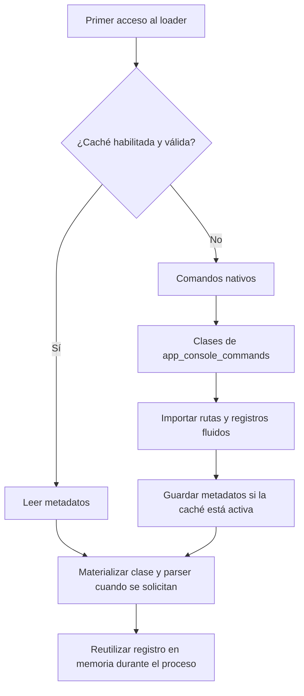

La caché del CLI conserva **metadatos de comandos**, no resultados de ejecución, instancias del contenedor ni tareas programadas. Su almacenamiento es un archivo local de `FileBasedCache`; no selecciona el driver de la fachada Cache ni los drivers de Queues o del scheduler.

<a id="compiled-configuration"></a>

## Activar y configurar la compilación

La aplicación distribuida llama a `app.compile()` en `bootstrap/app.py`, antes de su configuración y de `app.create()`:

```python
app.compile(
    path="storage/framework/bootstrap",
    invalidation_paths=[
        "app", "bootstrap", "config", "database", "resources", "routes", ".env",
    ],
)
```

Su firma es `compile(path: str | None = None, invalidation_paths: list[str] | None = None) -> None`. Sin un `path` propio, la aplicación usa `storage/framework/cache`; la plantilla anterior lo cambia explícitamente a `storage/framework/bootstrap`. Las rutas se resuelven respecto a la raíz de aplicación y se validan. Los archivos/directorios de invalidación deben existir para clasificarse y monitorizarse.

El loader solo crea persistencia si `app.compiled` está activo. Sin `compile()`, descubre los comandos en memoria en cada proceso. No existe una variable `COMMAND_CACHE_DRIVER` ni un driver Redis de metadatos CLI en esta implementación.

<a id="command-persistence"></a>

## Qué se guarda y dónde

El archivo se llama **`commands`**, sin extensión, dentro de `app.compiledPath`. Con la plantilla anterior es `storage/framework/bootstrap/commands`. Guarda el módulo, clase y método de cada comando, su firma, descripción, timestamps y las definiciones de `Argument`.

La envoltura de `FileBasedCache` añade versión de formato y hash de fuentes. Los valores se serializan como JSON mediante el serializador de caché; el parser `argparse` se reconstruye al cargar cada comando, no se persiste como objeto Python ejecutable. La escritura del serializador utiliza un archivo temporal y reemplazo del destino.

Para los conversores `type_`, el loader guarda `__module__` y `__qualname__` y los resuelve por importación. Define los conversores en módulos importables, con nombres estables; una lambda o una función local no es una definición transportable para ese proceso. Esta conversión de metadatos se realiza también cuando la persistencia está desactivada.

No uses el texto reservado `"__MISSING__"` como default o const de negocio: el loader lo utiliza para reconstruir el sentinel `MISSING`. Los defaults y choices también deben ser serializables por el mecanismo de caché si activas la compilación.

## Descubrimiento e invalidación



Se monitorizan las rutas de invalidación de la aplicación y, adicionalmente, `orionis/console/core/commands.py`, para detectar cambios en el catálogo nativo. `FileBasedCache` compara un hash; reutiliza durante medio segundo su hash calculado para evitar recalcularlo en cada consulta de ese objeto.

Una caché inexistente, de formato inválido o con hash diferente provoca reconstrucción. No es un TTL de resultados. Una vez que un loader cargó metadatos, mantiene sus indicadores y objetos en memoria: cambiar archivos en disco no recarga automáticamente ese servicio ya iniciado.

`Reactor.info()` añade otra caché en memoria de la lista ordenada de metadatos y devuelve esa misma lista. No la modifiques como mecanismo de registro. Declara rutas y builders antes de cargar comandos.

<a id="invalidate-command-cache"></a>

## Limpiar y regenerar

Después de cambiar firmas, opciones o rutas, puedes limpiar los artefactos de optimización desde una terminal nueva:

```shell
orionis optimize:clear
```

```shell
python -B reactor optimize:clear
```

Este comando limpia la optimización de la aplicación, no solamente una entrada de comandos. Para validar las fuentes Python de la aplicación en memoria:

```shell
orionis optimize
python -B reactor optimize
```

El comando `optimize` valida las fuentes sin escribir bytecode ni precargar los comandos; los metadatos se reconstruyen al necesitarse. Consulta [mantenimiento](/es/console/built-in-application) para sus operaciones y resultados exactos. Ejecuta después la operación en un proceso nuevo; borrar archivos no elimina los diccionarios de un loader que ya vive en memoria.

Los comandos `bootstrap:*` activan un contexto transitorio de recuperación que evita leer y escribir estas cachés mientras se repara la aplicación. Un contexto de reparación no debe terminar persistido como configuración normal.

<a id="loader-api"></a>

## API pública del loader

La implementación `orionis.console.core.loader.Loader` utiliza `IApplication`. Para el trabajo habitual usa [Reactor](/es/console/reactor-and-injection); estas operaciones sirven para inspección e integración del registro.

| Método | Resultado y comportamiento |
| --- | --- |
| `Loader(app: IApplication)` | Construye el registro vacío; configura el archivo de caché si corresponde. Puede crear su directorio. |
| `async get(signature: str) -> Command \| None` | Carga metadatos y materializa solo el comando solicitado; devuelve `None` si no existe. |
| `async all() -> dict[str, Command]` | Materializa todos los comandos y devuelve el diccionario interno, sin copiarlo. |
| `async load() -> None` | Materializa el registro completo; no ejecuta handlers. |
| `addFluentCommand(signature: str, handler: list[type[Any], str \| None]) -> ICommand` | Añade el builder de clase/método. No invalida un registro ya materializado. |

`ILoader` declara esos cuatro métodos. La lista del handler debe tener al menos una referencia callable con `__name__`; si omites el método, selecciona `__call__`. La construcción del builder valida la existencia del método. Los errores de importación, definición o persistencia pueden propagarse desde el loader; Reactor los trata dentro de su flujo normal de error.

```python
from orionis.console.core.loader import Loader


class CommandInspector:
    async def inspect(self, loader: Loader) -> list[str]:
        await loader.load()
        commands = await loader.all()
        return sorted(commands)
```

El proveedor de Reactor resuelve la clase concreta `Loader`; no registra por sí mismo un binding `ILoader -> Loader`. Para inyectar ese contrato en tu propio componente, declara el binding en un provider, o recibe `Loader` directamente. La [referencia](/es/console/api-reference) detalla los servicios nativos y sus contratos.
