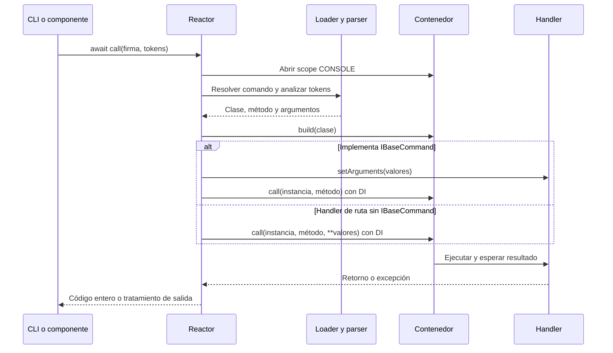

Reactor es el servicio que localiza, analiza y ejecuta comandos. El CLI, los comandos programados y las llamadas desde otros componentes pasan por este mismo servicio. La fachada pública se importa así:

```python
from orionis.support.facades import Reactor
```

La escritura, las preguntas y las barras de progreso pertenecen a [Console y sus auxiliares](/es/console/console-output). Reactor no devuelve una captura de stdout ni un resultado estructurado del handler: devuelve un código de salida.

<a id="reactor-construction"></a>

## Servicio, proveedor y dependencias

La implementación es `orionis.console.core.reactor.Reactor`, con este constructor técnico:

```text
Reactor(
    app: IApplication,
    loader: Loader,
    executer: Executor,
    logger: ILogger,
    catch: ICatch,
    performance_counter: PerformanceCounter,
) -> None
```

El proveedor nativo registra `IReactor` como singleton con el alias `x-orionis-IReactor` y fija la fachada en el arranque. El contenedor construye el loader, el ejecutor y los demás servicios. No necesitas crear un proveedor adicional ni construir Reactor manualmente para el uso habitual.

La fachada y `IReactor` acceden al mismo administrador; importa el contrato desde `orionis.console.core.contracts.reactor`. Todas las operaciones siguientes presuponen una aplicación arrancada.

<a id="reactor-call"></a>

## call: ejecutar un comando

```text
async call(signature: str, args: list[str] | None = None) -> int
```

`signature` es el nombre registrado, sin incluir el ejecutable. `args` es la lista de tokens después de la firma; `None` equivale a no proporcionar argumentos.

```python
from orionis.support.facades import Reactor


class GreetingRunner:
    async def run(self) -> int:
        return await Reactor.call("app:greet", ["Ada", "--times", "2"])
```

Este ejemplo utiliza el comando de [creación de comandos](/es/console/creating-commands). Cada valor es un elemento de la lista: no pases una cadena de shell como `"Ada --times 2"` ni incluyas `python`, `reactor` u `orionis`. Para un valor con espacios utiliza un único elemento, por ejemplo `"Ada Lovelace"`; las comillas del shell no forman parte de él.

La llamada ocurre en el mismo proceso y espera el handler. No crea un proceso independiente, no pone un job en cola y no dispone de un timeout general de ejecución. El método realiza este flujo:



Un entero devuelto por el handler se conserva, incluso si es distinto de cero. Otros retornos correctos se normalizan a `0`. El ejecutor puede imprimir `DONE` y escribir un log de ejecución correcta aunque el handler devuelva un código no cero: esa devolución no es por sí misma una excepción. Comprueba el valor retornado.

<a id="reactor-hascommand"></a>

## hasCommand: comprobar una firma

```text
async hasCommand(signature: str) -> bool
```

Devuelve si el loader encuentra la firma. Puede cargar metadatos y construir su parser; no ejecuta el handler ni verifica que su operación de negocio termine correctamente.

```python
from orionis.support.facades import Reactor


class ConditionalRunner:
    async def run(self) -> int:
        if not await Reactor.hasCommand("app:greet"):
            return 1
        return await Reactor.call("app:greet", ["Ada"])
```

Los errores de importación o configuración durante esta consulta pueden propagarse. A diferencia de `call()`, `hasCommand()` no envuelve su operación en el mismo bloque de captura de excepciones.

<a id="reactor-info"></a>

## info: inspeccionar metadatos

```text
async info() -> list[dict]
```

Materializa el registro completo, omite firmas que comiencen **y** terminen con `__`, y ordena por firma. Cada diccionario contiene:

| Clave | Contenido |
| --- | --- |
| `timestamps` | Flag del ejecutor. |
| `signature` | Nombre CLI. |
| `description` | Descripción de ayuda. |
| `arguments` | Parser `argparse.ArgumentParser` construido por el loader. |
| `object` | Referencia a la clase del handler. |
| `method` | Nombre del método que se invocará. |

```python
from orionis.support.facades import Reactor


class CommandCatalog:
    async def signatures(self) -> list[str]:
        metadata = await Reactor.info()
        return [item["signature"] for item in metadata]
```

No serialices directamente toda la lista como JSON: contiene clases y parsers. El servicio conserva esa lista en memoria y la devuelve sin copiarla; úsala para lectura. No es un mecanismo para añadir o modificar comandos. Los errores de carga pueden propagarse.

<a id="reactor-command"></a>

## command: registrar una ruta CLI

```text
command(
    signature: str,
    handler: list[type[Any] | str | None] | str,
) -> ICommand
```

Es un método **síncrono** que devuelve un builder. En el uso real pasa una clase importable, una lista `[Clase, "metodo"]` o `[Clase]` para utilizar `__call__`. Las anotaciones amplias del contrato no significan que se acepten cadenas de importación ni un `None` como método: la validación del loader exige una referencia callable y un nombre de método válido.

```python
from orionis.support.facades import Reactor


class StatusHandler:
    async def __call__(self) -> int:
        return 0


Reactor.command("app:status", StatusHandler).description(
    "Check command wiring."
).timestamp(enabled=False)
```

Decláralo en un archivo configurado de rutas de consola antes de cargar el registro. El builder admite `.description()`, `.arguments()`, `.timestamp()` y `.get()`; consulta [su referencia y ejemplos con DI](/es/console/command-routing).

<a id="reactor-injection"></a>

## Inyectar IReactor por constructor o por método

Cuando un componente realiza varias operaciones CLI, puede conservar el contrato inyectado:

```python
from orionis.console.core.contracts.reactor import IReactor


class ReportWorkflow:
    def __init__(self, reactor: IReactor) -> None:
        self.reactor = reactor

    async def build(self, report_id: int) -> int:
        return await self.reactor.call("reports:build-one", [str(report_id)])
```

Para una sola acción puedes recibirlo en el método que invoca el contenedor:

```python
from orionis.console.base import BaseCommand
from orionis.console.core.contracts.reactor import IReactor


class BuildDailyCommand(BaseCommand):
    signature = "reports:daily"
    description = "Run one report command."

    async def handle(self, reactor: IReactor) -> int:
        return await reactor.call("reports:build-one", ["42"])
```

El comando `reports:build-one` se define en [el ejemplo con Storage](/es/console/creating-commands#dependency-injection). La llamada interna abre otro scope y devuelve su código al comando exterior. No crees ciclos entre comandos que se llamen mutuamente. Recibir servicios anotados en una llamada Python directa no activa DI: debe invocar el método el contenedor o Reactor.

<a id="reactor-exceptions"></a>

## Excepciones, ayuda y cancelación

Dentro del flujo normal de `call()`, una `Exception` se registra en `ILogger`, se añade el contexto `[Clase.metodo]` al mensaje cuando se conoce, y se delega a `ICatch.exception()`. Si ese tratamiento termina correctamente, Reactor devuelve `1`. Utiliza el [handler global de excepciones](/es/architecture/exception-handling) para personalizar presentación y reporte; no necesitas envolver cada comando con la misma lógica de diagnóstico.

Un comando también puede capturar un error y devolver su propio código. Reactor no puede reconocer un fallo que el handler silenció terminando con `None`; consulta las particularidades de los [comandos incluidos](/es/console/built-in-commands).

El parser utiliza `SystemExit`: la ayuda devuelve normalmente `0` y una invocación inválida, `2`. `SystemExit` no es una `Exception` y no se convierte en el retorno `1`. Si llamas a ayuda programáticamente, debes manejar esa salida explícitamente:

```python
from orionis.support.facades import Reactor


class HelpRunner:
    async def show_greeting_help(self) -> int:
        try:
            return await Reactor.call("app:greet", ["--help"])
        except SystemExit as result:
            return result.code if isinstance(result.code, int) else 1
```

La cancelación async, `KeyboardInterrupt` y otras salidas que no derivan de `Exception` tampoco pasan por ese bloque. Los errores al abrir/cerrar el scope, al inicializar la medición antes del bloque de captura, o dentro del propio logger/capturador pueden propagarse. El contrato de retorno `int` describe una ejecución que consigue completar ese flujo; no garantiza convertir todo error del proceso en un código.

<a id="command-events"></a>

## Comandos manuales frente a eventos de tareas

Una llamada manual a `Reactor.call()` no emite por sí misma eventos del scheduler. Los eventos `EXECUTED`, `ERROR`, `MISSED` y los hooks de listeners pertenecen a comandos ejecutados como tareas del scheduler. Si Reactor devuelve `1` y no lanza una excepción al scheduler, este puede emitir `EXECUTED` con `retval=1`; no necesariamente `ERROR`. Consulta [listeners y eventos](/es/console/scheduler-listeners).
