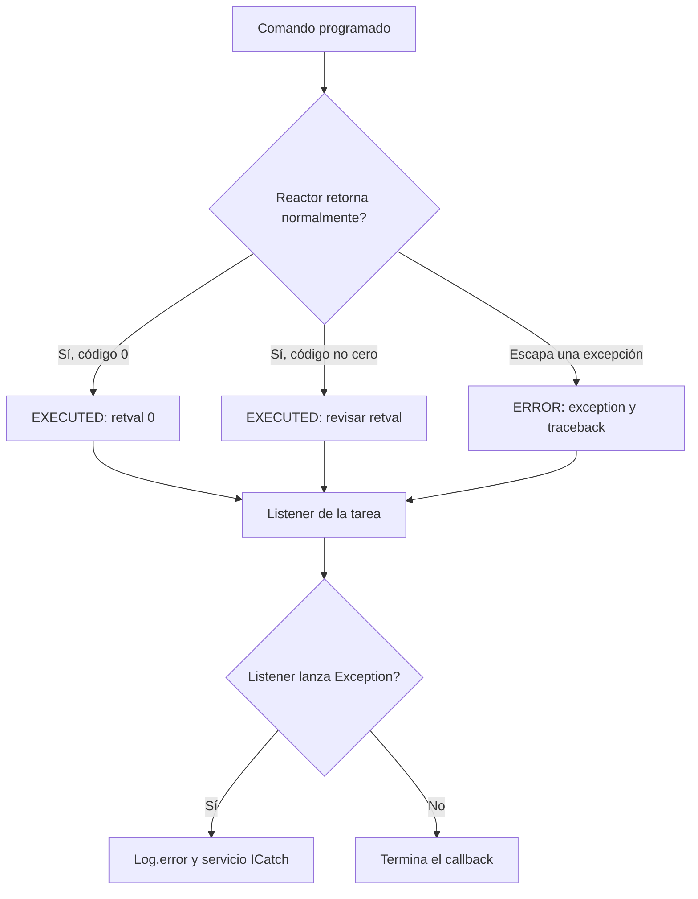

El scheduler emite eventos sobre su propio ciclo de vida y sobre cada tarea. Un listener permite registrar resultados, avisar de horarios perdidos o reaccionar a un error sin añadir esa lógica al comando. Existen dos niveles: eventos del **scheduler** y eventos de una **firma programada**.

## Crear un listener de tarea

<a id="listener-construction"></a>

```shell
orionis make:console-listener report
python -B reactor make:console-listener report
```

El único argumento propio es `name`, obligatorio y de tipo `str`; `-h`/`--help` muestra la ayuda. El generador utiliza `console_listener.stub`, agrega el sufijo `Listener` si hace falta y crea por defecto `app/console/listeners/report_listener.py`, con la clase `ReportListener(BaseTaskListener)`.

Admite subdirectorios relativos: `reports/report` crea `app/console/listeners/reports/report_listener.py`. Los componentes se normalizan a minúsculas para los archivos; las palabras separadas por `_` forman el nombre de clase. No convierte automáticamente una cadena CamelCase en snake_case: `ReportAudit` produce `reportaudit_listener.py`. Crea directorios faltantes, rechaza rutas absolutas o con `..` y no sobrescribe un archivo existente. No incluye `--force`.

La plantilla genera los siete hooks mostrados en la referencia inferior. Los cuerpos iniciales solo contienen su docstring: no hacen ninguna operación. Puedes conservar únicamente los hooks que quieras sobrescribir; `BaseTaskListener` implementa los demás como métodos async que devuelven `None`. También hereda las funciones de [salida de consola](/es/console/console-output).

Este ejemplo puede reemplazar el listener generado:

```python
from orionis.console.base import BaseTaskListener
from orionis.console.entities import TaskEvent


class ReportAudit:
    def record(self, signature: str, exit_code: object) -> None:
        print(f"Command {signature}: exit code {exit_code}")


class ReportListener(BaseTaskListener):
    def __init__(self, audit: ReportAudit) -> None:
        self.audit = audit

    async def onTaskExecuted(self, event: TaskEvent) -> None:
        self.audit.record(event.signature, event.retval)
        if event.retval != 0:
            self.warning(f"Scheduled command returned {event.retval}")

    async def onTaskError(self, event: TaskEvent) -> None:
        self.error(f"Escaped error in {event.signature}: {event.exception}")

    async def onTaskMissed(self, event: TaskEvent) -> None:
        self.warning(f"Missed schedule: {event.signature}")
```

## Registrar la instancia con inyección

En `app/console/scheduler.py`, utilizando el comando `reports:build` de [la guía inicial](/es/console/task-scheduling):

```python
from app.console.listeners.report_listener import ReportListener
from orionis.console.base import BaseScheduler
from orionis.console.contracts import ISchedule


class Scheduler(BaseScheduler):
    def tasks(
        self,
        schedule: ISchedule,
        listener: ReportListener,
    ) -> None:
        (
            schedule.command("reports:build")
            .registerListener(listener)
            .maxInstances(1)
            .dailyAt(2, 30)
        )
```

El contenedor construye `ReportListener`, inyecta `ReportAudit` en su constructor y entrega la instancia a `tasks()`. `registerListener()` exige la instancia, no la clase. En cambio, los hooks se invocan directamente con `event`: **no reciben inyección adicional por método**. Prepara sus colaboradores al construir la clase, no como parámetros nuevos de `onTaskExecuted()`.

Si prefieres inyección en el constructor del scheduler, recibe allí `listener: ReportListener`, guárdalo y utiliza `.registerListener(self.listener)` dentro de `tasks()`. La aplicación también construye esa clase mediante el contenedor.

## Referencia de hooks de `BaseTaskListener`

Todos reciben `event: orionis.console.entities.TaskEvent` y retornan `None`. Las implementaciones base son async y no realizan acciones.

<a id="listener-ontaskadded"></a>

### `async onTaskAdded(self, event: TaskEvent) -> None`

Responde a `ADDED`, cuando el job se incorpora al store. Es distinto de su envío para ejecución.

<a id="listener-ontaskremoved"></a>

### `async onTaskRemoved(self, event: TaskEvent) -> None`

Responde a `REMOVED`, por eliminación explícita o porque el trigger ya no tiene otra ejecución. Una tarea de fecha única puede retirarse del store antes de que termine el comando enviado; no uses este evento como confirmación de éxito.

<a id="listener-ontaskexecuted"></a>

### `async onTaskExecuted(self, event: TaskEvent) -> None`

Responde a `EXECUTED`: el callable programado terminó sin propagar una excepción. Examina `retval`, que para el ejecutor de Orionis contiene el código de salida de Reactor. Un código distinto de cero sigue llegando a este evento si no escapó una excepción.

<a id="listener-ontaskerror"></a>

### `async onTaskError(self, event: TaskEvent) -> None`

Responde a `ERROR`, cuando una excepción escapa del callable programado. Ofrece `exception` y `traceback`; no equivale a todo comando que retorne `1`.

<a id="listener-ontaskmissed"></a>

### `async onTaskMissed(self, event: TaskEvent) -> None`

Responde a `MISSED`: se superó la tolerancia `misfire_grace_time` de una ejecución. Es una notificación, no un reintento automático.

<a id="listener-ontasksubmitted"></a>

### `async onTaskSubmitted(self, event: TaskEvent) -> None`

Responde a `SUBMITTED`, cuando uno o varios horarios se envían al ejecutor. Todavía no confirma su finalización.

<a id="listener-ontaskmaxinstances"></a>

### `async onTaskMaxInstances(self, event: TaskEvent) -> None`

Responde a `MAX_INSTANCES`, cuando una ejecución no se puede enviar porque ya está ocupado el máximo de instancias de esa firma. No crea una cola de espera ni un reintento de negocio.

## Callbacks por evento

<a id="task-events"></a>

Puedes asociar un callback mediante `.on(TaskEvent.MIEMBRO, callback)` antes del trigger. El enum se importa desde `orionis.console.enums.events`; la **entidad** con el payload del evento se importa desde `orionis.console.entities`.

```python
from orionis.console.base import BaseScheduler
from orionis.console.contracts import ISchedule
from orionis.console.entities import TaskEvent as TaskEventData
from orionis.console.enums.events import TaskEvent
from orionis.support.facades import Log


async def record_modification(event: TaskEventData) -> None:
    Log.info(f"Schedule modified: {event.signature}")


class Scheduler(BaseScheduler):
    def tasks(self, schedule: ISchedule) -> None:
        (
            schedule.command("reports:build")
            .on(TaskEvent.MODIFIED, record_modification)
            .dailyAt(2, 30)
        )
```

| Miembro de `TaskEvent` | Valor | Información relevante |
|---|---|---|
| `ADDED` | `512` | Identidad y store del job incorporado. |
| `REMOVED` | `1024` | Identidad y store del job retirado. |
| `MODIFIED` | `2048` | Cambio de configuración; no existe hook `onTaskModified` en la clase base. |
| `EXECUTED` | `4096` | `scheduled_run_time`, `retval`. |
| `ERROR` | `8192` | `scheduled_run_time`, `exception`, `traceback`. |
| `MISSED` | `16384` | `scheduled_run_time` que no se ejecutó dentro de la tolerancia. |
| `SUBMITTED` | `32768` | `scheduled_run_times`, posiblemente varios horarios. |
| `MAX_INSTANCES` | `65536` | `scheduled_run_times` que no se pudieron enviar. |

Cada evento y firma tiene **un callback efectivo**. Si registras varios para el mismo par, el último reemplaza al anterior al arrancar y se escribe un aviso. `registerListener()` registra incluso los hooks heredados sin implementación propia: si lo colocas después de `.on()` puede reemplazar ese callback por un hook vacío. Para realizar varias acciones, compónlas dentro de un callback.

Usa miembros individuales: un OR bit a bit de los enums produce un `int`, que `on()` no acepta como miembro. Los callbacks síncronos se ejecutan inmediatamente; las funciones `async def` se ejecutan como tareas administradas. No dependen de Reactor para resolver parámetros y no se esperan unas a otras como una cadena de middleware. Evita operaciones bloqueantes en listeners sync.

## Eventos globales del scheduler

<a id="base-scheduler-events"></a>
<a id="scheduler-events"></a>

`BaseScheduler` dispone de estos hooks async con implementación vacía:

| Hook | Enum `SchedulerEvent` | Valor |
|---|---|---|
| `onStarted(self, event: SchedulerEvent) -> None` | `STARTED` | `1` |
| `onShutdown(self, event: SchedulerEvent) -> None` | `SHUTDOWN` | `2` |
| `onPaused(self, event: SchedulerEvent) -> None` | `PAUSED` | `4` |
| `onResumed(self, event: SchedulerEvent) -> None` | `RESUMED` | `8` |

`schedule:work` registra automáticamente los hooks disponibles de la clase indicada en `app.withScheduler()`. El evento es una entidad `orionis.console.entities.SchedulerEvent`; usa los enums únicamente para elegir el tipo de evento.

```python
from orionis.console.base import BaseScheduler
from orionis.console.contracts import ISchedule
from orionis.console.entities import SchedulerEvent
from orionis.support.facades import Log


class Scheduler(BaseScheduler):
    def tasks(self, schedule: ISchedule) -> None:
        schedule.command("reports:build").dailyAt(2, 30)

    async def onStarted(self, event: SchedulerEvent) -> None:
        Log.info(event.description)

    async def onShutdown(self, event: SchedulerEvent) -> None:
        Log.info(event.description)
```

Si gestionas directamente el servicio, registra los callbacks con `schedule.on(SchedulerEvent.STARTED, callback)` antes de `await schedule.boot()`. Esta operación reemplaza el callback previo del mismo evento y devuelve el servicio. Después de iniciar, `on()` produce `RuntimeError`.

<a id="task-event-entity"></a>

## Datos de eventos de tarea

La entidad `TaskEvent` es una dataclass por nombre, con estos campos públicos:

| Campo | Tipo anotado y predeterminado |
|---|---|
| `code` | `int`, obligatorio; corresponde al enum. |
| `signature` | `str`, obligatorio. |
| `description` | `str = ""`; `__post_init__()` la reemplaza por la descripción del código. |
| `jobstore` | `str = "memory"`; el despachador utiliza el store del evento o el seleccionado. |
| `scheduled_run_times` | `Any \| None = None`; lista de fechas en eventos de envío/límite. |
| `scheduled_run_time` | `Any \| None = None`; fecha concreta en ejecución/error/misfire. |
| `retval` | `Any \| None = None`; retorno del callable, normalmente código de salida entero. |
| `exception` | `Any \| None = None`; excepción escapada. |
| `traceback` | `Any \| None = None`; traceback del error escapado. |

Los campos no presentes en un evento permanecen en `None`. La descripción se calcula con mensajes como `"Task Executed."`, `"Task Error."` o `"Task Reached Max Instances."`; un código desconocido produce `"Unknown Task Event."`.

<a id="scheduler-event-entity"></a>

## Datos de eventos del scheduler

La entidad `SchedulerEvent` contiene `code: int` obligatorio, `description: str = ""` y `jobstore: str = "memory"`. `__post_init__()` calcula la descripción: `"Scheduler started."`, `"Scheduler shutdown."`, `"Scheduler paused."` o `"Scheduler resumed."`; un código desconocido produce `"Unknown Task Event."`.

El despachador toma `jobstore` del atributo `alias` del evento subyacente. Los eventos de ciclo de vida normalmente no identifican un store y pueden entregar `None` aunque la anotación pública sea `str`; no lo uses como conexión obligatoria.

<a id="schedule-states"></a>

`ScheduleStates` define `STOPPED = "STOPPED"`, `RUNNING = "RUNNING"` y `PAUSED = "PAUSED"`. El método `state()` devuelve el texto. El wrapper establece el estado al iniciar, pausar y reanudar; actualmente el apagado no lo restablece a `STOPPED`. Utiliza `await wait()` para sincronizar una parada, no un bucle que espere ese estado.

## Excepciones y códigos de salida

Estos eventos pertenecen a ejecuciones **programadas**. Ejecutar `orionis reports:build` directamente o llamar a Reactor fuera del scheduler no emite los eventos de tarea anteriores; el comando conserva su salida, logs y manejo de excepciones de Reactor. No existe un enum independiente `CommandEvent` en este componente.



Reactor captura las excepciones ordinarias del comando, las envía al [manejador global](/es/exceptions) y normalmente retorna `1`. El scheduler de Orionis observa ese retorno como **ejecución del callable sin excepción**, por lo que emite `EXECUTED` con `retval=1`. Para observar fallos de comando revisa el código en `onTaskExecuted()` además de implementar `onTaskError()`.

Si un listener lanza `Exception`, Orionis registra el fallo y llama a `ICatch.exception()` de forma asíncrona. Si ese manejador también falla, registra ese segundo error. Esto no repite el comando ni revierte sus efectos. Los listeners async se mantienen en un conjunto de tareas y el apagado espera a los ya pendientes antes de solicitar el cierre del scheduler; no almacena ni reproduce sus callbacks después de reiniciar.

`MISSED`, `MAX_INSTANCES`, `ERROR` y un retorno no cero no crean reintentos de negocio. Para trabajo con políticas de reintento persistentes, despacha [jobs de Queues](/es/queues/failures-and-retries) desde el comando y observa ambos componentes por separado.
