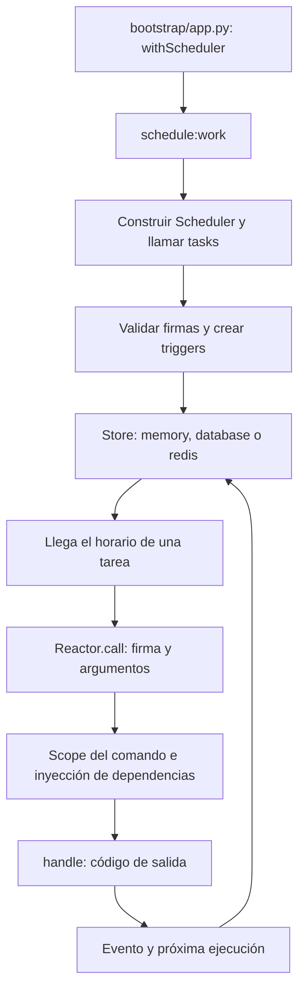

Una tarea programada indica **cuándo ejecutar un comando registrado en Reactor**. Por ejemplo, generar un informe a las 02:30, limpiar registros cada hora o sincronizar un catálogo de lunes a viernes. El scheduler calcula las próximas ejecuciones y despacha la firma del comando cuando llega su turno.

La agenda se define en `app/console/scheduler.py`. La configuración de horarios y persistencia está en `config/scheduler.py`; `config/queue.py` configura el sistema independiente de [colas y jobs](/es/queues). Una tarea programada también puede ejecutar un comando que envíe jobs a una cola, pero programar ese comando no inicia un worker de colas.



## 1. Crear el comando que se ejecutará

Genera un comando con cualquiera de estas alternativas:

```shell
orionis make:console-command scheduled_report --signature reports:build
python -B reactor make:console-command scheduled_report --signature reports:build
```

El archivo predeterminado es `app/console/commands/scheduled_report_command.py`. Sustituye su contenido por este ejemplo mínimo; en una aplicación real el servicio puede consultar la base de datos y almacenar el resultado mediante [Storage](/es/storage):

```python
from orionis.console.base import BaseCommand


class ReportService:
    async def build(self) -> int:
        # Reemplaza esta operación por la generación real del informe.
        return 1


class ScheduledReportCommand(BaseCommand):
    signature = "reports:build"
    description = "Build the daily report."

    async def handle(self, reports: ReportService) -> int:
        generated = await reports.build()
        self.success(f"Reports generated: {generated}")
        return 0
```

Comprueba primero el comando de forma independiente:

```shell
orionis reports:build
python -B reactor reports:build
```

Reactor descubre la clase del comando y resuelve `ReportService` al ejecutar `handle()`. Consulta [creación de comandos](/es/console/creating-commands) para sus convenciones, argumentos y opciones.

<a id="2-declarar-la-agenda"></a>

## 2. Programar con Schedule.command()

<a id="scheduler-registration"></a>

La clase de la aplicación hereda `BaseScheduler`, implementación de `IBaseScheduler`. Su método `tasks(schedule: ISchedule)` registra las tareas. La clase base declara `async def tasks(self, schedule: ISchedule) -> None` y lanza `NotImplementedError` si no lo implementas; tu implementación puede ser síncrona o asíncrona porque la aplicación la invoca mediante el contenedor.

El registro se realiza con **`Schedule.command()`** desde la fachada, o con **`schedule.command()`** desde el servicio inyectado. [Consulta su firma, parámetros y ejemplo con argumentos CLI](/es/console/scheduler-execution#schedule-command).

En `app/console/scheduler.py`:

```python
from orionis.console.base import BaseScheduler
from orionis.console.contracts import ISchedule


class Scheduler(BaseScheduler):
    def tasks(self, schedule: ISchedule) -> None:
        (
            schedule.command("reports:build", purpose="Build the daily report")
            .coalesce()
            .misfireGraceTime(60)
            .maxInstances(1)
            .dailyAt(2, 30)
        )
```

Esto ejecuta `reports:build` cada día a las 02:30 en la zona horaria de la aplicación (`app.timezone`, normalmente `APP_TIMEZONE`, predeterminada `UTC`). La firma debe existir en Reactor: no basta con nombrar un archivo o una clase.

Los métodos que seleccionan frecuencia, como `dailyAt()`, son terminales y devuelven `True`; los configuradores anteriores devuelven la misma tarea. Configura fechas, listeners y políticas **antes** de seleccionar la frecuencia. La [referencia de frecuencias](/es/console/scheduler-frequencies) incluye todos los métodos y ejemplos.

En `bootstrap/app.py`, conserva el registro del esqueleto o importa tu clase y regístrala antes de `app.create()`:

```python
from app.console.scheduler import Scheduler

# app es la instancia de Application que configura este archivo.
app.withScheduler(Scheduler)
```

`Application.withScheduler(scheduler: type[IBaseScheduler]) -> Self` guarda la clase, no una instancia. Exige una subclase de `IBaseScheduler` y configuración todavía mutable; una nueva declaración sustituye la anterior. Si el bootstrap ya está compilado, la configuración compilada prevalece. Después del arranque, `await app.getScheduler()` construye una instancia mediante el contenedor; antes del arranque produce `RuntimeError`. Este registro **no inicia el proceso del scheduler**.

## 3. Revisar y ejecutar la agenda

```shell
orionis schedule:list
python -B reactor schedule:list
```

`schedule:list` construye el scheduler de la aplicación, llama a `tasks()` y muestra firma, argumentos, propósito, políticas, fechas y descripción del horario. Valida las firmas y los triggers sin iniciar el reloj ni procesar las tareas del store.

Para mantener el proceso activo:

```shell
orionis schedule:work
python -B reactor schedule:work
```

`schedule:work` carga la agenda, conecta los listeners, inicia el servicio y espera la parada. Debe permanecer ejecutándose para que los horarios se cumplan. `Ctrl+C` solicita su apagado. Ambos comandos incluyen `-h`/`--help` y no declaran argumentos ni opciones específicas adicionales. Orionis no incluye un comando `schedule:run`.

## Inyección en la agenda y en cada ejecución

Este módulo puede reemplazar `app/console/scheduler.py` manteniendo el comando anterior:

```python
from orionis.console.base import BaseScheduler
from orionis.console.contracts import ISchedule


class ReportSchedulePolicy:
    def hour(self) -> int:
        return 2


class ReportScheduleLabel:
    def purpose(self) -> str:
        return "Daily reports"


class Scheduler(BaseScheduler):
    def __init__(self, policy: ReportSchedulePolicy) -> None:
        self.policy = policy

    async def tasks(
        self,
        schedule: ISchedule,
        labels: ReportScheduleLabel,
    ) -> None:
        (
            schedule.command("reports:build", purpose=labels.purpose())
            .maxInstances(1)
            .dailyAt(self.policy.hour(), 30)
        )
```

El contenedor construye `ReportSchedulePolicy` para el constructor y `ReportScheduleLabel` para `tasks()`. Estas clases concretas no requieren un binding adicional. `schedule:list` y `schedule:work` proporcionan `schedule` explícitamente; las demás dependencias se resuelven por anotación de tipo.

`tasks()` se ejecuta al cargar la agenda. Cuando vence el horario, Reactor crea el scope de **cada ejecución del comando**, construye su clase e invoca `handle()` con sus propias dependencias. Los listeners reciben el evento mediante una llamada directa; usa dependencias preparadas en su constructor, como muestra [Listeners y eventos](/es/console/scheduler-listeners).

## Cómo continuar

- [Configuración y persistencia](/es/console/scheduler-configuration): stores, variables de entorno y reinicios.
- [Frecuencias y calendario](/es/console/scheduler-frequencies): todos los intervalos, horarios, fechas y políticas de tarea.
- [Listeners y eventos](/es/console/scheduler-listeners): callbacks, clases de listener y códigos de salida.
- [Ejecución y API](/es/console/scheduler-execution): fachada `Schedule`, servicio `ISchedule`, control y apagado.

El scheduler no añade por sí mismo reintentos de negocio ni historial de ejecuciones fallidas. Para ese comportamiento, el comando puede despachar un [job persistente](/es/queues/jobs-and-dispatch) a un backend de colas y dejar su procesamiento al worker correspondiente.
