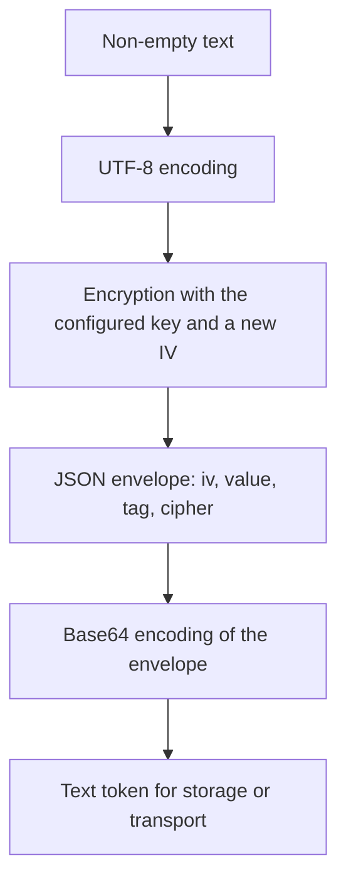

El servicio de cifrado permite guardar un valor y recuperar después su texto original con la misma clave. Usa [hashing](/es/cryptography/hashing) para contraseñas que solo deban verificarse; utiliza cifrado cuando tu aplicación necesite volver a leer el contenido.

## Configurar la clave y el cifrado

Los ajustes pertenecen a `config/app.py`. `config/hashing.py` configura los hashes de contraseñas y no interviene en este servicio.

| Ajuste | Variable de entorno | Comportamiento |
| --- | --- | --- |
| `app.cipher` | `APP_CIPHER` | Identificador del cifrado. Predeterminado: `AES-256-CBC`. |
| `app.key` | `APP_KEY` | Clave compartida por los procesos que deban descifrar los mismos valores. |

Los identificadores se escriben exactamente así:

| Cifrado | Clave | IV por operación | Autenticación del contenido |
| --- | --- | --- | --- |
| `AES-128-CBC` | 16 bytes | 16 bytes | No agrega MAC ni tag; utiliza padding PKCS7. |
| `AES-256-CBC` | 32 bytes | 16 bytes | No agrega MAC ni tag; utiliza padding PKCS7. |
| `AES-128-GCM` | 16 bytes | 12 bytes | Genera y verifica un tag de 16 bytes. |
| `AES-256-GCM` | 32 bytes | 12 bytes | Genera y verifica un tag de 16 bytes. |

Para utilizar GCM en un flujo que necesite comprobar la autenticidad del contenido, configura, por ejemplo:

```dotenv
APP_CIPHER=AES-256-GCM
```

La configuración admite una clave `bytes`, texto sin prefijo convertido a UTF-8 o texto con prefijo `base64:` que se decodifica antes de usarlo. La longitud exigida se aplica a los **bytes de la clave**, no a los caracteres de su representación Base64. Un cifrado no admitido, una clave Base64 inválida o una longitud incompatible impiden validar la configuración.

Si `app.key` es `None`, la configuración genera una clave aleatoria del tamaño correspondiente e intenta guardarla mediante `Env.set("APP_KEY", ...)`. Conserva ese valor para los siguientes arranques y despliegues.

### Generar una clave desde el CLI

Desde la raíz del proyecto, las dos alternativas equivalentes son:

```bash
orionis key:generate
```

```bash
python -B reactor key:generate
```

El comando lee `app.cipher`, genera bytes aleatorios, los representa como `base64:...` y guarda `APP_KEY` en el entorno del proyecto. Si ya existe una clave no vacía, la conserva y termina correctamente.

| Opción | Predeterminado | Efecto |
| --- | --- | --- |
| `--force` | `False` | Sustituye la clave existente. |
| `-h`, `--help` | — | Muestra la ayuda del comando. |

La sustitución explícita se ejecuta así:

```bash
orionis key:generate --force
```

```bash
python -B reactor key:generate --force
```

**Reemplazar la clave no vuelve a cifrar los datos existentes.** Conserva la clave anterior si necesitas recuperarlos. Reinicia los procesos de la aplicación después de un cambio de clave o cifrado: el servicio resuelto conserva la configuración con la que se construyó.

## API disponible

El contrato público `IEncrypter` declara dos métodos **síncronos**:

| Método | Entrada | Resultado |
| --- | --- | --- |
| `encrypt(plaintext: str) -> str` | Texto no vacío y codificable en UTF-8. | Token cifrado completo como `str`. |
| `decrypt(payload: str) -> str` | Token completo generado por `encrypt()`. | Texto original como `str`. |

No añadas `await` a estas llamadas, aunque se utilicen dentro de un controlador `async`. La API no recibe directamente `bytes`, diccionarios, modelos o archivos; más adelante se muestra cómo representar otros datos como texto.

## Usar inyección de dependencias en controladores

Solicita `IEncrypter` desde `orionis.encrypter.contracts`. Orionis registra el servicio como singleton; el contenedor puede inyectarlo tanto en el constructor como en una acción.

Crea `app/http/controllers/encryption_controller.py`:

```python
from orionis.encrypter.contracts import IEncrypter
from orionis.http import JSONResponse
from orionis.http.base import BaseController
from orionis.schemas import Schema


class PlaintextPayload(Schema):
    value: str


class EncryptedPayload(Schema):
    token: str


class EncryptionController(BaseController):

    def __init__(self, crypt: IEncrypter) -> None:
        self._crypt = crypt

    async def encrypt(self, payload: PlaintextPayload) -> JSONResponse:
        if not payload.value:
            return JSONResponse(
                {"message": "The value must not be empty."},
                status_code=422,
            )

        token = self._crypt.encrypt(payload.value)
        return JSONResponse({"token": token})

    async def decrypt(
        self,
        payload: EncryptedPayload,
        crypt: IEncrypter,
    ) -> JSONResponse:
        try:
            plaintext = crypt.decrypt(payload.token)
        except (ValueError, RuntimeError):
            return JSONResponse(
                {"message": "The encrypted value is invalid."},
                status_code=422,
            )

        return JSONResponse({"value": plaintext})
```

La acción `encrypt` usa la dependencia recibida en `__init__`; `decrypt` muestra la alternativa de recibirla directamente como argumento de la acción. Ambas resuelven el mismo servicio configurado. Los [esquemas](/es/validation) reciben y validan el cuerpo JSON antes de ejecutar la acción.

En `routes/api.py` registra las acciones con la [fachada de rutas](/es/http/routing):

```python
from app.http.controllers.encryption_controller import EncryptionController
from orionis.support.facades import Route


Route.post("/secrets/encrypt", [EncryptionController, "encrypt"])
Route.post("/secrets/decrypt", [EncryptionController, "decrypt"])
```

Envía un cuerpo JSON `{"value": "private note"}` a la primera ruta y utiliza el `token` devuelto como `{"token": "..."}` en la segunda. El ejemplo muestra el intercambio de datos; en un flujo de aplicación puedes persistir ese token y descifrarlo al recuperar el registro. Aplica la [autenticación y autorización](/es/authentication) que corresponda antes de permitir acceso al contenido.

## Usar la fachada Crypt

La fachada utiliza el mismo servicio del contenedor y está disponible después del arranque de la aplicación. Impórtala desde el módulo público:

```python
from orionis.http import JSONResponse
from orionis.http.base import BaseController
from orionis.support.facades import Crypt


class EncryptionPreviewController(BaseController):

    async def __call__(self) -> JSONResponse:
        token = Crypt.encrypt("private note")
        restored = Crypt.decrypt(token)

        return JSONResponse({
            "token": token,
            "restored": restored,
        })
```

También puedes utilizar `Crypt` o inyectar `IEncrypter` en servicios, comandos y otros componentes que resuelva el contenedor. No necesitas registrar un proveedor adicional para el servicio nativo.

## Cifrar datos estructurados

Serializa un objeto compatible con JSON antes de cifrarlo y decodifica el texto recuperado después. `decrypt()` devuelve texto; no reconstruye objetos automáticamente.

```python
import json

from orionis.encrypter.contracts import IEncrypter
from orionis.http import JSONResponse
from orionis.http.base import BaseController


class PreferencesPreviewController(BaseController):

    async def __call__(self, crypt: IEncrypter) -> JSONResponse:
        preferences = {
            "language": "es",
            "notifications": True,
        }

        token = crypt.encrypt(json.dumps(preferences, ensure_ascii=False))
        restored = json.loads(crypt.decrypt(token))

        return JSONResponse({
            "token": token,
            "preferences": restored,
        })
```

Para representar bytes, realiza explícitamente una conversión de ida y vuelta. Aquí Base64 representa los bytes originales como texto **antes** del cifrado; no reemplaza la operación criptográfica.

```python
import base64

from orionis.encrypter.contracts import IEncrypter
from orionis.http import JSONResponse
from orionis.http.base import BaseController


class BinaryPreviewController(BaseController):

    async def __call__(self, crypt: IEncrypter) -> JSONResponse:
        original = b"\x00\xff\x10"
        text = base64.b64encode(original).decode("ascii")

        token = crypt.encrypt(text)
        restored = base64.b64decode(crypt.decrypt(token), validate=True)

        return JSONResponse({"matches": restored == original})
```

El servicio procesa el contenido completo en memoria; no proporciona cifrado de archivos en streaming.

## Qué contiene el token

Cada llamada genera un IV aleatorio nuevo. Cifrar dos veces el mismo valor produce tokens diferentes que recuperan el mismo texto.



Los campos binarios `iv`, `value` y `tag` se representan también en Base64. En CBC, `tag` es `None`; en GCM contiene el tag de autenticación. Guarda el **token completo**: el texto cifrado aislado no contiene toda la información necesaria para descifrarlo.

El token ocupa más espacio que el texto original por el IV, el tag cuando corresponde, JSON y Base64. No contiene la clave, un identificador de clave, una fecha de caducidad ni una lista de claves anteriores. El campo `cipher` debe coincidir con el de la instancia que lo descifra; no cambia automáticamente su configuración.

GCM comprueba su tag durante el descifrado y rechaza un contenido alterado. CBC verifica el padding, pero esta implementación no agrega un MAC: un descifrado exitoso de CBC no demuestra integridad.

## Errores de entrada y descifrado

| Situación | Excepción pública |
| --- | --- |
| Entrada que no sea `str`. | `TypeError`. |
| Texto o token vacío; texto que no se pueda codificar en UTF-8. | `ValueError`. |
| Sobre Base64/JSON inválido, campos incompatibles, cifrado distinto o tamaño de IV incorrecto. | `ValueError`. |
| Fallo durante el cifrado. | `RuntimeError`. |
| Tag GCM ausente o de longitud incorrecta, fallo de autenticación, padding CBC inválido o fallo al recuperar UTF-8. | `RuntimeError`, con la causa original encadenada. |

La acción `decrypt` del ejemplo transforma los errores esperados del token en una respuesta HTTP sin devolver el detalle interno de la excepción. El resto de fallos sigue el [flujo de excepciones HTTP](/es/http/exceptions). No se necesita capturar `TypeError` allí porque el esquema ya exige un `str`.

## Conservar y cambiar claves

Todos los procesos que lean los mismos tokens necesitan la misma clave y el mismo cifrado. Conserva `APP_KEY` fuera del código publicado y mantén su valor estable entre reinicios y despliegues.

El servicio no ofrece un anillo de claves ni un parámetro para intentar claves anteriores. Para cambiar la clave o el cifrado de datos existentes:

1. Conserva acceso a su configuración original.
2. Recupera cada valor con esa configuración.
3. Cífralo con la configuración nueva.
4. Sustituye el token solo cuando ambas operaciones hayan terminado correctamente.
5. Cambia la configuración de lectura cuando los registros correspondientes ya se hayan migrado.

La aplicación debe identificar qué configuración corresponde a cada registro mientras dure la migración. `key:generate --force` solo sustituye `APP_KEY`; no ejecuta estos pasos.

---

[Índice de cifrado](/es/cryptography/encryption) · [Hashing de contraseñas](/es/cryptography/hashing) · [Controladores](/es/deployment/health-and-default-responses)
