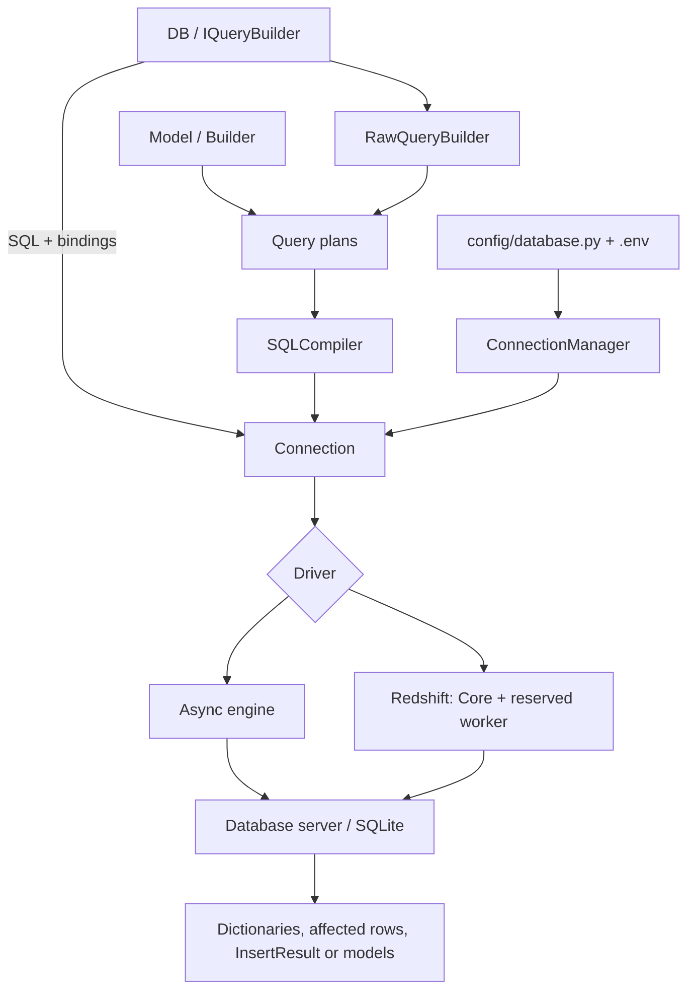

Database administra conexiones SQL con nombre y proporciona la infraestructura de consultas, transacciones, esquemas, migraciones y seeders. Puedes ejecutar SQL, utilizar el constructor de consultas o trabajar con modelos del [ORM](/es/orm). Las tres alternativas comparten el gestor y las transacciones.

Las operaciones de E/S se esperan con `await`. Elegir una conexión, construir una consulta o definir una tabla son operaciones síncronas; una operación terminal como `get()` o `insert()` sí ejecuta SQL.

## Arquitectura



| Componente | Responsabilidad |
|---|---|
| `BootstrapDatabase` | Lee el entorno y valida la configuración tipada. |
| `ConnectionManager` / `IConnectionManager` | Resuelve y reutiliza conexiones por nombre. |
| `DB` / `IQueryBuilder` | Selecciona tabla, ejecuta SQL y controla transacciones sin modelos. |
| `RawQueryBuilder` | Construye planes de consulta sobre tablas. |
| `Model` / `Builder` | Añaden atributos, persistencia y relaciones. |
| `SQLCompiler` | Traduce planes y definiciones al dialecto elegido. |
| `Connection` / `IConnection` | Adquiere recursos, ejecuta, materializa resultados y administra transacciones. |
| `Schema`, migrador y seeders | Definen estructuras, aplican cambios y cargan datos. |

## Primera consulta desde un controlador

Configura una conexión y crea tus tablas mediante [migraciones](/es/database/migrations). Este ejemplo supone una tabla `notes` con columnas `id` y `body`. Registra el controlador mediante [rutas HTTP](/es/http/routing):

```python
from orionis.http import JSONResponse
from orionis.support.facades import DB


class NoteController:
    async def index(self) -> JSONResponse:
        notes = await (
            DB.table("notes")
            .select("id", "body")
            .orderBy("id")
            .limit(20)
            .get()
        )
        return JSONResponse({"notes": notes.all()})
```

Importa la fachada desde `orionis.support.facades`. La aplicación registra sus servicios durante el arranque. En servicios, comandos, jobs y componentes MCP asíncronos se utiliza la misma API; también puedes inyectar `IQueryBuilder` o `IConnectionManager`.

## Ciclo de vida

1. La configuración se carga y valida sin conectarse al servidor.
2. El gestor crea y conserva `Connection` al resolver por primera vez su nombre.
3. El engine se crea al necesitar E/S; construir el objeto no comprueba conectividad ni credenciales.
4. Sin transacción explícita, cada operación adquiere una conexión física, abre una transacción temporal, consume sus resultados y confirma o revierte antes de liberarla.
5. Dentro de una transacción explícita, las operaciones de su tarea propietaria reutilizan la misma conexión física.
6. `disconnect()` descarta el engine y conexiones inactivas; un uso posterior puede reconstruirlo. No lo llames por petición ni mientras otras tareas usan el servicio compartido.

## Guías y referencia

[Referencia de comandos de Database](/es/database/commands): sintaxis, argumentos y opciones de los 14 comandos, incluida inspección y borrado.

- [Drivers y dependencias](/es/database/drivers): motores y `reactor packages`.
- [Configuración](/es/database/configuration): propiedades y variables de entorno.
- [Gestión de conexiones](/es/database/connections): nombres, inyección y registro.
- [Fachada DB](/es/database/db-facade): sus once métodos de entrada.
- [SQL y resultados](/es/database/raw-queries): bindings, retornos y errores.
- [Constructor de consultas](/es/database/query-builder): consultas sin modelos.
- [Transacciones](/es/database/transactions): contextos, savepoints y concurrencia.
- [Esquemas](/es/database/schema), [migraciones y seeders](/es/database/migrations).
- [Dialectos y producción](/es/database/dialects-and-production).
- [API de conexiones y compilación](/es/database/runtime-api).

Utiliza `DB` para trabajar sin instancias de modelo; su builder devuelve colecciones de diccionarios y no dispara eventos de modelos. Utiliza el [ORM](/es/orm) para estado de entidad, casts, scopes, eventos, relaciones y factories.
