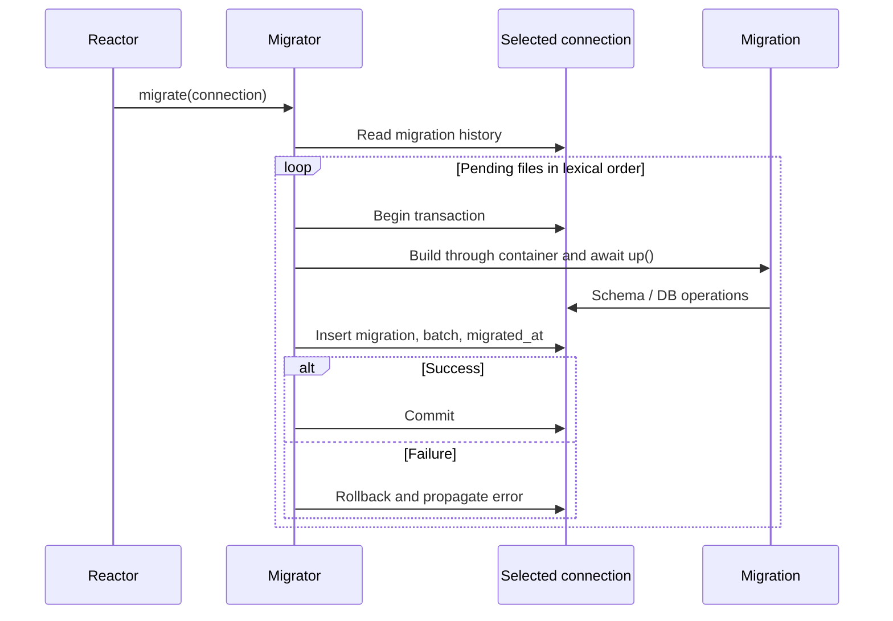

Las migraciones son clases async que describen cambios físicos ordenados. up aplica el cambio y down describe su reversión. Cada archivo aplicado queda registrado en la tabla migrations, en la misma conexión. Los [seeders](/es/database/seeders) tienen su propio historial y se ejecutan después de disponer del esquema.

## Generar una migración

```shell
orionis make:database-migration create_flags
python -B reactor make:database-migration create_flags
```

Las dos líneas son alternativas. El comando real es make:database-migration, con name: str obligatorio y solo -h/--help como opción de ayuda; no existe --create, --table ni --force. El generador usa la ruta database_migrations, normalmente database/migrations. Crea un archivo `m<YYYYmmddHHMMSS>_create_flags.py`, con la hora de la aplicación, y clase CreateFlags con up/down async vacíos. El prefijo m permite importar el archivo como módulo Python.

Elige snake_case para nombres predecibles. Se aceptan subdirectorios con / o \, por ejemplo catalog/create_flags. Los componentes se normalizan a minúsculas y deben formar módulos Python (letras, dígitos y guion bajo, comenzando por letra). El generador elimina una extensión del nombre; rechaza rutas absolutas, componentes vacíos, `.` y `..`. Los directorios necesarios se crean. Un archivo existente produce error y no se sobrescribe; dos nombres iguales creados en el mismo segundo pueden coincidir.

Completa el contenido generado:

```python
from orionis.database import Migration
from orionis.support.facades import Schema


class CreateFlags(Migration):
    async def up(self) -> None:
        async with Schema.create("flags") as table:
            table.id()
            table.string("name", 80)
            table.unique("name", name="uq_flags_name")

    async def down(self) -> None:
        await Schema.drop("flags")
```

<a id="migration-contract"></a>

## Descubrimiento y orden

El runner descubre recursivamente módulos en la ruta configurada e importa subclases locales de `Migration`. No exige inicializadores de paquete. Ignora reexportaciones y módulos de inicialización. Cada archivo debe tener una sola subclase local inequívoca: dos clases para la misma identidad producen `ValueError`. La identidad es el nombre de archivo sin extensión, no el nombre de clase ni el directorio: dos subdirectorios con el mismo stem también colisionan. Los archivos se ordenan lexicográficamente; el prefijo temporal conserva el orden de creación.

El descubrimiento se guarda en la instancia de `Migrator`. Un proceso nuevo ve archivos nuevos. No renombres, elimines ni cambies una migración ya aplicada: el historial usa esa identidad y down podría dejar de resolver. Para cambios futuros añade otro archivo y conserva los schemas versionados.

<a id="commands"></a>

## Todos los comandos y opciones

Todos se ejecutan desde la raíz mediante orionis <comando> o python -B reactor <comando>. Opciones comunes: --database NAME o -d NAME (str opcional, None usa la conexión default) y -h/--help. El nombre debe estar declarado en config/database.py.

| Comando | Opciones propias | Resultado |
|---|---|---|
| migrate | --seed, bool False por defecto | Aplica pendientes; si se indica --seed, ejecuta seeders pendientes después del éxito. También los ejecuta si no había migraciones nuevas. |
| migrate:status | Ninguna | Muestra migraciones descubiertas, estado y lote; puede crear la tabla de historial vacía. |
| migrate:rollback | --step N / -s N, int opcional, efectivo 1 | Revierte los últimos N lotes. |
| migrate:reset | Ninguna | Ejecuta down de todas las aplicadas, en orden inverso. |
| migrate:refresh | --step N / -s N, int opcional, None significa todas | Revierte los lotes seleccionados y vuelve a aplicar pendientes. |
| migrate:fresh | Ninguna | Reset, eliminación del historial migrations/seeders y nueva aplicación como lote 1. |
| seed / db:seed | Ninguna | Ejecuta seeders pendientes; ver su [guía](/es/database/seeders). |

```shell
orionis migrate:status
python -B reactor migrate:status

orionis migrate --seed
python -B reactor migrate --seed

orionis migrate --database reporting
python -B reactor migrate --database reporting

orionis migrate:rollback --step 1
python -B reactor migrate:rollback --step 1

orionis migrate:refresh --step 2
python -B reactor migrate:refresh --step 2
```

step cuenta **lotes, no archivos** y debe ser un entero positivo. Una invocación migrate comparte un lote entre sus pendientes, pero cada archivo tiene su propia transacción. rollback revierte los registros más recientes dentro de los últimos lotes. refresh no acepta --seed; ejecuta seed después si deseas poblar de nuevo. fresh tampoco acepta --seed y **no borra todas las tablas arbitrariamente**: depende de down para retirar las tablas registradas; las tablas ajenas se conservan.

## Transacciones e historial



La tabla migrations contiene id autogenerado, migration único, batch y migrated_at como segundos epoch. Dentro de cada operación se fija la conexión contextual: las llamadas no calificadas de `DB`, `Schema` y resolución ORM la respetan. Una conexión seleccionada explícitamente puede escapar de esa transacción; mantén los cambios del archivo en su conexión objetivo. Las migraciones se construyen con app.build: admiten inyección por constructor; up/down se llaman sin argumentos y no reciben inyección por método.

```python
from orionis.database import Migration
from orionis.database.contracts.schema import ISchema


class CreateAuditEntries(Migration):
    def __init__(self, schema: ISchema) -> None:
        self._schema = schema

    async def up(self) -> None:
        async with self._schema.create("audit_entries") as table:
            table.id()
            table.string("message", 255)

    async def down(self) -> None:
        await self._schema.drop("audit_entries")
```

Un error aborta el archivo actual, revierte su transacción e impide registrar su éxito. Los archivos previos del mismo lote ya pueden estar confirmados; volver a ejecutar aplica los restantes. **La reversibilidad del DDL depende del motor**: motores con commits implícitos no garantizan restaurar una tabla solo por hacer rollback. down es código explícito y debe probarse. El runner no proporciona un bloqueo de despliegue global entre varios procesos de migración; coordina un ejecutor por conexión.

Una reversión parcial conserva el historial seeders. Cuando se revierte la última migración aplicada, ese historial se elimina junto al último paso; seed puede volver a ejecutarse tras reconstruir. reset deja el historial migrations vacío; fresh elimina y recrea el historial como primer lote.

<a id="migrator-init"></a>

## API programática de `Migrator`

`Migrator`(app: `IApplication`, conn_manager: `IConnectionManager`) puede recibirse mediante inyección en comandos propios. Todas sus operaciones son async; connection=None usa default y events=None no informa progreso. No hay selección por archivo ni parámetro force.

<a id="migrator-migrate"></a>

### migrate

```text
async migrate(*, connection: str | None=None, events: MigrationEvents | None=None) -> list[str]
```

Devuelve list[str] de identidades aplicadas en orden. Sin pendientes devuelve []. Esta API no ejecuta seeders: --seed pertenece al comando CLI.

```python
from orionis.database import Migrator


async def migrate_example(migrator: Migrator) -> list[str]:
    return await migrator.migrate(connection=None, events=None)
```

<a id="migrator-rollback"></a>

### rollback

```text
async rollback(steps: int=1, *, connection: str | None=None, events: MigrationEvents | None=None) -> list[str]
```

Devuelve list[str] de revertidas en orden inverso. steps=1 por defecto; valores no enteros, bool o <1 producen `ValueError`. Una identidad aplicada sin archivo produce `MigrationNotFoundException` antes de iniciar reversiones.

```python
from orionis.database import Migrator


async def rollback_example(migrator: Migrator) -> list[str]:
    return await migrator.rollback(steps=1, connection=None, events=None)
```

<a id="migrator-reset"></a>

### reset

```text
async reset(*, connection: str | None=None, events: MigrationEvents | None=None) -> list[str]
```

Revierte todas y devuelve identidades en orden inverso; [] si no había aplicadas. Propaga errores de down y archivos faltantes.

```python
from orionis.database import Migrator


async def reset_example(migrator: Migrator) -> list[str]:
    return await migrator.reset(connection=None, events=None)
```

<a id="migrator-refresh"></a>

### refresh

```text
async refresh(steps: int | None=None, *, connection: str | None=None, events: MigrationEvents | None=None) -> list[str]
```

steps=None equivale a reset seguido de migrate; steps=N equivale a rollback(N) seguido de migrate. Devuelve las nuevas identidades aplicadas, no las revertidas.

```python
from orionis.database import Migrator


async def refresh_example(migrator: Migrator) -> list[str]:
    return await migrator.refresh(steps=None, connection=None, events=None)
```

<a id="migrator-fresh"></a>

### fresh

```text
async fresh(*, connection: str | None=None, events: MigrationEvents | None=None) -> list[str]
```

Reset, eliminación del historial migrations y seeders residual, y migrate. Devuelve las identidades reaplicadas. No reemplaza un down incorrecto ni elimina tablas no registradas.

```python
from orionis.database import Migrator


async def fresh_example(migrator: Migrator) -> list[str]:
    return await migrator.fresh(connection=None, events=None)
```

<a id="migrator-status"></a>

### status

```text
async status(*, connection: str | None=None) -> list[dict[str, Any]]
```

Devuelve list[dict] en orden descubierto con migration: str, ran: bool, batch: int | None. Solo enumera archivos descubiertos, no una lista independiente de todos los registros históricos.

```python
from orionis.database import Migrator


async def status_example(migrator: Migrator) -> list[dict[str, object]]:
    return await migrator.status(connection=None)
```

```python
from orionis.console.base.command import BaseCommand
from orionis.database import Migrator


class InspectMigrations(BaseCommand):
    signature = "database:inspect-migrations"
    description = "Show migration history for the default connection."

    async def handle(self, migrator: Migrator) -> None:
        rows = await migrator.status()
        self.table(
            ["Migration", "Ran", "Batch"],
            [[row["migration"], row["ran"], row["batch"]] for row in rows],
        )
```

```python
[
    {"migration": "m20261022090000_create_flags", "ran": True, "batch": 1},
    {"migration": "m20261022090100_create_audit_entries", "ran": False, "batch": None},
]
```

El segundo bloque ilustra el resultado, no es un archivo de migración. Las firmas del contrato `IMigrator` coinciden con esas operaciones.

<a id="migrationevents"></a>

## Progreso y errores

```python
from orionis.console.base.command import BaseCommand
from orionis.database import Migrator
from orionis.database.migrations.events import MigrationEvents


class ApplyMigrations(BaseCommand):
    signature = "database:apply-migrations"
    description = "Apply pending migrations and show progress."

    async def handle(self, migrator: Migrator) -> None:
        events = MigrationEvents(
            on_start=lambda name: self.info(f"Starting {name}"),
            on_success=lambda name, elapsed: self.info(f"Done {name}: {elapsed:.2f}s"),
            on_error=lambda name, elapsed: self.error(f"Failed {name}: {elapsed:.2f}s"),
        )
        applied = await migrator.migrate(connection=None, events=events)
        self.info(f"Applied: {len(applied)}")
```

`MigrationEvents`(*, on_start: Callable[[str], None] | None = None, on_success: Callable[[str, float], None] | None = None, on_error: Callable[[str, float], None] | None = None) es frozen/slots y acepta callbacks síncronos. started(name) llama on_start; succeeded(name, elapsed) llama on_success; failed(name, elapsed) llama on_error. Los tres métodos devuelven None; elapsed se mide en segundos. NO_EVENTS es la instancia sin callbacks.

No lances excepciones desde callbacks: started se ejecuta antes de la transacción, succeeded después del commit y failed durante la propagación del fallo; una excepción del callback también se propaga. `SeederEvents` es un alias del mismo tipo.

Un nombre de conexión inexistente produce `ConnectionNotFoundException`. Un tipo sin builder o un DDL inválido produce `QueryException`. Un módulo con errores Python falla al importar. Una migración ambigua produce `ValueError`. No hay opciones de ejecución ficticia, salto de archivos, confirmación de producción ni compatibilidad automática con DDL de otros motores. Para evolucionar tablas existentes utiliza [alteraciones verificadas](/es/database/schema-alterations).

<a id="migration-connection-context"></a>

### Contexto de conexión para integraciones

```text
current_migration_connection() -> IConnection | None
migration_connection_scope(connection: IConnection) -> Generator[None]
```

Se encuentran en orionis.database.migrations.context. La primera consulta la conexión contextual sin crearla; la segunda es un contextmanager síncrono que fija y restaura el ContextVar en finally. El migrador y los seeders lo gestionan automáticamente; utilizar el contexto por sí solo no abre una transacción, no confirma ni revierte. Si implementas otro runner, conserva la misma tarea async y combina este contexto con la transacción real de la conexión.

```text
MigrationEvents.started(name: str) -> None
MigrationEvents.succeeded(name: str, elapsed: float) -> None
MigrationEvents.failed(name: str, elapsed: float) -> None
```
