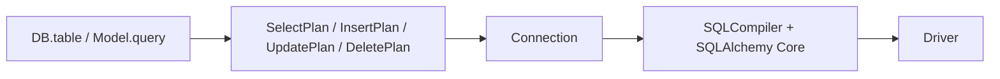

Los builders producen planes independientes del motor; `Connection` los entrega al compilador y ejecuta el SQL resultante. Normalmente utiliza el [Query Builder](/es/database/query-builder). Esta API es útil para integraciones, inspección y herramientas que ya disponen de una descripción estructurada de la consulta.



## Ejecutar un plan

El servicio siguiente recibe el manager por constructor. Requiere una aplicación inicializada y la tabla products creada. `Connection.select(plan)` devuelve una lista de diccionarios; es distinto de `RawQueryBuilder.get()`, que devuelve `Collection`.

```python
from orionis.database.contracts.connection_manager import IConnectionManager
from orionis.orm.query.expressions import OrderClause, SelectPlan, WhereClause
from orionis.orm.schema.table import TableDefinition


class ProductReport:
    def __init__(self, manager: IConnectionManager) -> None:
        self._manager = manager

    async def run(self) -> list[dict[str, object]]:
        plan = SelectPlan(
            table=TableDefinition(name="products"),
            columns=("id", "name", "price"),
            wheres=[WhereClause("price", operator=">=", value=10)],
            orders=[OrderClause("id")],
            limit_value=10,
        )
        return await self._manager.connection().select(plan)
```

Los planes son dataclasses, no validadores completos de SQL. Declara columnas, alias y tipos correctos; una tabla dinámica puede resolverse sin catálogo completo de columnas. Las anotaciones no impiden por sí solas valores inválidos. Los errores de SQL o de capacidades se convierten en excepciones de la [capa de ejecución](/es/database/runtime-api).

## Enumeraciones y constantes

<a id="constant-supported_operators"></a>

### `SUPPORTED_OPERATORS`

```python
from orionis.orm.query.expressions import SUPPORTED_OPERATORS

SUPPORTED_OPERATORS: frozenset[str] = frozenset({'=', '==', '!=', '<>', '<', '<=', '>', '>=', 'like', 'not like', 'ilike', 'not ilike'})
```

<a id="enum-wheretype"></a>

### `WhereType`

```python
from orionis.orm.query.expressions import WhereType

assert WhereType.BASIC.value == 'basic'
assert WhereType.IN.value == 'in'
assert WhereType.NOT_IN.value == 'not_in'
assert WhereType.NULL.value == 'null'
assert WhereType.NOT_NULL.value == 'not_null'
assert WhereType.BETWEEN.value == 'between'
assert WhereType.NOT_BETWEEN.value == 'not_between'
assert WhereType.LIKE.value == 'like'
assert WhereType.NOT_LIKE.value == 'not_like'
assert WhereType.ILIKE.value == 'ilike'
assert WhereType.NOT_ILIKE.value == 'not_ilike'
assert WhereType.STARTS_WITH.value == 'starts_with'
assert WhereType.ENDS_WITH.value == 'ends_with'
assert WhereType.CONTAINS.value == 'contains'
assert WhereType.REGEXP.value == 'regexp'
assert WhereType.NESTED.value == 'nested'
assert WhereType.COLUMN.value == 'column'
assert WhereType.RAW.value == 'raw'
assert WhereType.EXISTS.value == 'exists'
assert WhereType.NOT_EXISTS.value == 'not_exists'
```

<a id="constant-columnless_where_types"></a>

### `COLUMNLESS_WHERE_TYPES`

```python
from orionis.orm.query.expressions import COLUMNLESS_WHERE_TYPES, WhereType

COLUMNLESS_WHERE_TYPES: frozenset[WhereType] = frozenset({WhereType.NESTED, WhereType.RAW, WhereType.EXISTS, WhereType.NOT_EXISTS})
```

<a id="enum-lockmode"></a>

### `LockMode`

```python
from orionis.orm.query.expressions import LockMode

assert LockMode.UPDATE.value == 'update'
assert LockMode.SHARE.value == 'share'
```

<a id="enum-sortdirection"></a>

### `SortDirection`

```python
from orionis.orm.query.expressions import SortDirection

assert SortDirection.ASC.value == 'asc'
assert SortDirection.DESC.value == 'desc'
```

<a id="enum-aggregatefunction"></a>

### `AggregateFunction`

```python
from orionis.orm.query.expressions import AggregateFunction

assert AggregateFunction.COUNT.value == 'count'
assert AggregateFunction.MAX.value == 'max'
assert AggregateFunction.MIN.value == 'min'
assert AggregateFunction.AVG.value == 'avg'
assert AggregateFunction.SUM.value == 'sum'
```

<a id="enum-jointype"></a>

### `JoinType`

```python
from orionis.orm.query.expressions import JoinType

assert JoinType.INNER.value == 'inner'
assert JoinType.LEFT.value == 'left'
assert JoinType.RIGHT.value == 'right'
assert JoinType.FULL.value == 'full'
assert JoinType.CROSS.value == 'cross'
```

Las condiciones WHERE, HAVING y ON se combinan **de izquierda a derecha**: A OR B AND C se construye como `(A OR B) AND C`. Utiliza grupos explícitos para expresar otra asociación. Los enum no garantizan soporte de cada motor: RIGHT/FULL, regex y bloqueos dependen del dialecto.

## Estructuras públicas

<a id="plan-rawexpression"></a>

### `RawExpression`

Fragmento SQL de confianza con valores enlazados. Es inmutable en sus atributos, pero su diccionario de bindings sigue siendo mutable.

```python
from dataclasses import dataclass, field
from typing import Any
from orionis.orm.schema.table import TableDefinition
from orionis.orm.query.expressions import (
    AggregateClause, AggregateFunction, JoinCondition, JoinExpression,
    JoinType, LockMode, OrderClause, RawExpression, SelectPlan, SortDirection,
    SubQueryColumn, UnionClause, WhereClause, WhereType,
)

@dataclass(slots=True, frozen=True)
class RawExpression:
    sql: str
    bindings: dict[str, Any] = field(default_factory=dict)
    alias: str | None = None
```

| Campo | Significado |
| --- | --- |
| `sql` | Texto SQL con placeholders :nombre. |
| `bindings` | Diccionario de nombres y valores; se crea uno independiente por instancia. |
| `alias` | Alias de la fuente o proyección; None conserva el nombre lógico donde se permite. |

Cada `field(default_factory=list/dict)` crea un contenedor propio. Los demás valores predeterminados y los tipos están indicados en la declaración anterior.

```python
from orionis.orm.query.expressions import (
    AggregateClause, AggregateFunction, DeletePlan, InsertPlan, JoinCondition,
    JoinExpression, JoinType, OrderClause, RawExpression, SelectPlan, SortDirection,
    SubQueryColumn, UnionClause, UpdatePlan, WhereClause,
)
from orionis.orm.schema.table import TableDefinition

table = TableDefinition(name="products")
expression = RawExpression("price * :factor", {"factor": 2}, alias="double_price")
```

<a id="plan-subquerycolumn"></a>

### `SubQueryColumn`

Proyección escalar de una subconsulta: debe producir una columna y, para cada evaluación, como máximo una fila. El motor determina el error si devuelve varias.

```python
from dataclasses import dataclass, field
from typing import Any
from orionis.orm.schema.table import TableDefinition
from orionis.orm.query.expressions import (
    AggregateClause, AggregateFunction, JoinCondition, JoinExpression,
    JoinType, LockMode, OrderClause, RawExpression, SelectPlan, SortDirection,
    SubQueryColumn, UnionClause, WhereClause, WhereType,
)

@dataclass(slots=True, frozen=True)
class SubQueryColumn:
    plan: SelectPlan
    alias: str
```

| Campo | Significado |
| --- | --- |
| `plan` | SelectPlan incorporado a la consulta exterior, sin ejecutar otra conexión. |
| `alias` | Alias obligatorio de la columna escalar en la consulta exterior. |

Cada `field(default_factory=list/dict)` crea un contenedor propio. Los demás valores predeterminados y los tipos están indicados en la declaración anterior.

```python
from orionis.orm.query.expressions import (
    AggregateClause, AggregateFunction, DeletePlan, InsertPlan, JoinCondition,
    JoinExpression, JoinType, OrderClause, RawExpression, SelectPlan, SortDirection,
    SubQueryColumn, UnionClause, UpdatePlan, WhereClause,
)
from orionis.orm.schema.table import TableDefinition

table = TableDefinition(name="products")
column = SubQueryColumn(SelectPlan(table=table, aggregate=AggregateClause(AggregateFunction.MAX, "price")), "maximum_price")
```

<a id="plan-whereclause"></a>

### `WhereClause`

Condición de WHERE o HAVING. El tipo determina la interpretación de value; boolean enlaza con la condición anterior.

```python
from dataclasses import dataclass, field
from typing import Any
from orionis.orm.schema.table import TableDefinition
from orionis.orm.query.expressions import (
    AggregateClause, AggregateFunction, JoinCondition, JoinExpression,
    JoinType, LockMode, OrderClause, RawExpression, SelectPlan, SortDirection,
    SubQueryColumn, UnionClause, WhereClause, WhereType,
)

@dataclass(slots=True)
class WhereClause:
    column: str
    where_type: WhereType = WhereType.BASIC
    operator: str = '='
    value: Any = None
    boolean: str = 'and'
```

| Campo | Significado |
| --- | --- |
| `column` | Nombre de columna, eventualmente calificado; vacío en tipos sin columna. En agregados COUNT puede ser *. |
| `where_type` | Clase de condición de WhereType; BASIC de forma predeterminada. |
| `operator` | Operador de comparación; = por defecto. Usa los operadores admitidos. |
| `value` | Valor básico; iterable para IN/BETWEEN; lista WhereClause para NESTED; RawExpression para RAW; SelectPlan para EXISTS o IN con subconsulta. |
| `boolean` | and u or, combinado de izquierda a derecha con las condiciones previas. |

Cada `field(default_factory=list/dict)` crea un contenedor propio. Los demás valores predeterminados y los tipos están indicados en la declaración anterior.

```python
from orionis.orm.query.expressions import (
    AggregateClause, AggregateFunction, DeletePlan, InsertPlan, JoinCondition,
    JoinExpression, JoinType, OrderClause, RawExpression, SelectPlan, SortDirection,
    SubQueryColumn, UnionClause, UpdatePlan, WhereClause,
)
from orionis.orm.schema.table import TableDefinition

table = TableDefinition(name="products")
condition = WhereClause("price", operator=">=", value=10)
```

<a id="plan-orderclause"></a>

### `OrderClause`

Una columna de ordenación y su dirección.

```python
from dataclasses import dataclass, field
from typing import Any
from orionis.orm.schema.table import TableDefinition
from orionis.orm.query.expressions import (
    AggregateClause, AggregateFunction, JoinCondition, JoinExpression,
    JoinType, LockMode, OrderClause, RawExpression, SelectPlan, SortDirection,
    SubQueryColumn, UnionClause, WhereClause, WhereType,
)

@dataclass(slots=True)
class OrderClause:
    column: str
    direction: SortDirection = SortDirection.ASC
```

| Campo | Significado |
| --- | --- |
| `column` | Nombre de columna, eventualmente calificado; vacío en tipos sin columna. En agregados COUNT puede ser *. |
| `direction` | SortDirection.ASC o DESC. |

Cada `field(default_factory=list/dict)` crea un contenedor propio. Los demás valores predeterminados y los tipos están indicados en la declaración anterior.

```python
from orionis.orm.query.expressions import (
    AggregateClause, AggregateFunction, DeletePlan, InsertPlan, JoinCondition,
    JoinExpression, JoinType, OrderClause, RawExpression, SelectPlan, SortDirection,
    SubQueryColumn, UnionClause, UpdatePlan, WhereClause,
)
from orionis.orm.schema.table import TableDefinition

table = TableDefinition(name="products")
order = OrderClause("id", SortDirection.DESC)
```

<a id="plan-aggregateclause"></a>

### `AggregateClause`

Agregado que reemplaza la proyección del SELECT. COUNT admite *, los demás requieren una columna.

```python
from dataclasses import dataclass, field
from typing import Any
from orionis.orm.schema.table import TableDefinition
from orionis.orm.query.expressions import (
    AggregateClause, AggregateFunction, JoinCondition, JoinExpression,
    JoinType, LockMode, OrderClause, RawExpression, SelectPlan, SortDirection,
    SubQueryColumn, UnionClause, WhereClause, WhereType,
)

@dataclass(slots=True)
class AggregateClause:
    function: AggregateFunction
    column: str = '*'
```

| Campo | Significado |
| --- | --- |
| `function` | AggregateFunction: COUNT, MAX, MIN, AVG o SUM. |
| `column` | Nombre de columna, eventualmente calificado; vacío en tipos sin columna. En agregados COUNT puede ser *. |

Cada `field(default_factory=list/dict)` crea un contenedor propio. Los demás valores predeterminados y los tipos están indicados en la declaración anterior.

```python
from orionis.orm.query.expressions import (
    AggregateClause, AggregateFunction, DeletePlan, InsertPlan, JoinCondition,
    JoinExpression, JoinType, OrderClause, RawExpression, SelectPlan, SortDirection,
    SubQueryColumn, UnionClause, UpdatePlan, WhereClause,
)
from orionis.orm.schema.table import TableDefinition

table = TableDefinition(name="products")
aggregate = AggregateClause(AggregateFunction.SUM, "price")
```

<a id="plan-joincondition"></a>

### `JoinCondition`

Comparación entre dos referencias de columna en ON; second no representa un valor enlazado.

```python
from dataclasses import dataclass, field
from typing import Any
from orionis.orm.schema.table import TableDefinition
from orionis.orm.query.expressions import (
    AggregateClause, AggregateFunction, JoinCondition, JoinExpression,
    JoinType, LockMode, OrderClause, RawExpression, SelectPlan, SortDirection,
    SubQueryColumn, UnionClause, WhereClause, WhereType,
)

@dataclass(slots=True)
class JoinCondition:
    first: str
    operator: str = '='
    second: str = ''
    boolean: str = 'and'
```

| Campo | Significado |
| --- | --- |
| `first` | Referencia de columna izquierda, admite tabla.columna. |
| `operator` | Operador de comparación; = por defecto. Usa los operadores admitidos. |
| `second` | Referencia de columna derecha; no una cadena literal a comparar. |
| `boolean` | and u or, combinado de izquierda a derecha con las condiciones previas. |

Cada `field(default_factory=list/dict)` crea un contenedor propio. Los demás valores predeterminados y los tipos están indicados en la declaración anterior.

```python
from orionis.orm.query.expressions import (
    AggregateClause, AggregateFunction, DeletePlan, InsertPlan, JoinCondition,
    JoinExpression, JoinType, OrderClause, RawExpression, SelectPlan, SortDirection,
    SubQueryColumn, UnionClause, UpdatePlan, WhereClause,
)
from orionis.orm.schema.table import TableDefinition

table = TableDefinition(name="products")
condition = JoinCondition("p.category_id", "=", "c.id")
```

<a id="plan-joinexpression"></a>

### `JoinExpression`

Fuente de JOIN, alias y condiciones ON. Una subconsulta como fuente necesita alias. CROSS JOIN no requiere ON.

```python
from dataclasses import dataclass, field
from typing import Any
from orionis.orm.schema.table import TableDefinition
from orionis.orm.query.expressions import (
    AggregateClause, AggregateFunction, JoinCondition, JoinExpression,
    JoinType, LockMode, OrderClause, RawExpression, SelectPlan, SortDirection,
    SubQueryColumn, UnionClause, WhereClause, WhereType,
)

@dataclass(slots=True)
class JoinExpression:
    join_type: JoinType
    table: TableDefinition | SelectPlan
    alias: str | None = None
    conditions: list[JoinCondition] = field(default_factory=list)
```

| Campo | Significado |
| --- | --- |
| `join_type` | JoinType según la capacidad real del motor. |
| `table` | TableDefinition para la tabla; JoinExpression también admite SelectPlan como tabla derivada. |
| `alias` | Alias de la fuente o proyección; None conserva el nombre lógico donde se permite. |
| `conditions` | Lista de JoinCondition para ON. |

Cada `field(default_factory=list/dict)` crea un contenedor propio. Los demás valores predeterminados y los tipos están indicados en la declaración anterior.

```python
from orionis.orm.query.expressions import (
    AggregateClause, AggregateFunction, DeletePlan, InsertPlan, JoinCondition,
    JoinExpression, JoinType, OrderClause, RawExpression, SelectPlan, SortDirection,
    SubQueryColumn, UnionClause, UpdatePlan, WhereClause,
)
from orionis.orm.schema.table import TableDefinition

table = TableDefinition(name="products")
join = JoinExpression(JoinType.LEFT, TableDefinition(name="categories"), alias="c", conditions=[JoinCondition("p.category_id", "=", "c.id")])
```

<a id="plan-unionclause"></a>

### `UnionClause`

SELECT adicional, con eliminación de duplicados o conservándolos mediante UNION ALL.

```python
from dataclasses import dataclass, field
from typing import Any
from orionis.orm.schema.table import TableDefinition
from orionis.orm.query.expressions import (
    AggregateClause, AggregateFunction, JoinCondition, JoinExpression,
    JoinType, LockMode, OrderClause, RawExpression, SelectPlan, SortDirection,
    SubQueryColumn, UnionClause, WhereClause, WhereType,
)

@dataclass(slots=True)
class UnionClause:
    plan: SelectPlan
    all_rows: bool = False
```

| Campo | Significado |
| --- | --- |
| `plan` | SelectPlan incorporado a la consulta exterior, sin ejecutar otra conexión. |
| `all_rows` | False genera UNION; True genera UNION ALL. |

Cada `field(default_factory=list/dict)` crea un contenedor propio. Los demás valores predeterminados y los tipos están indicados en la declaración anterior.

```python
from orionis.orm.query.expressions import (
    AggregateClause, AggregateFunction, DeletePlan, InsertPlan, JoinCondition,
    JoinExpression, JoinType, OrderClause, RawExpression, SelectPlan, SortDirection,
    SubQueryColumn, UnionClause, UpdatePlan, WhereClause,
)
from orionis.orm.schema.table import TableDefinition

table = TableDefinition(name="products")
union = UnionClause(SelectPlan(table=table, columns=("id",)), all_rows=True)
```

<a id="plan-selectplan"></a>

### `SelectPlan`

Representación completa de una lectura. Sus atributos se pueden inspeccionar y modificar; no abre una conexión ni ejecuta SQL al construirlo.

```python
from dataclasses import dataclass, field
from typing import Any
from orionis.orm.schema.table import TableDefinition
from orionis.orm.query.expressions import (
    AggregateClause, AggregateFunction, JoinCondition, JoinExpression,
    JoinType, LockMode, OrderClause, RawExpression, SelectPlan, SortDirection,
    SubQueryColumn, UnionClause, WhereClause, WhereType,
)

@dataclass(slots=True)
class SelectPlan:
    table: TableDefinition
    alias: str | None = None
    joins: list[JoinExpression] = field(default_factory=list)
    columns: tuple[str | SubQueryColumn | RawExpression, ...] = ()
    wheres: list[WhereClause] = field(default_factory=list)
    orders: list[OrderClause] = field(default_factory=list)
    groups: list[str] = field(default_factory=list)
    havings: list[WhereClause] = field(default_factory=list)
    limit_value: int | None = None
    offset_value: int | None = None
    aggregate: AggregateClause | None = None
    distinct: bool = False
    lock: LockMode | None = None
    unions: list[UnionClause] = field(default_factory=list)
```

| Campo | Significado |
| --- | --- |
| `table` | TableDefinition para la tabla; JoinExpression también admite SelectPlan como tabla derivada. |
| `alias` | Alias de la fuente o proyección; None conserva el nombre lógico donde se permite. |
| `joins` | Lista de fuentes JoinExpression. |
| `columns` | Tupla de str, SubQueryColumn o RawExpression; vacía selecciona todas las columnas. |
| `wheres` | Lista de WhereClause que delimita las filas. Vacía no agrega WHERE. |
| `orders` | Lista de OrderClause aplicada a la lectura. |
| `groups` | Lista de nombres de columnas GROUP BY. |
| `havings` | Lista de condiciones WhereClause posteriores a la agrupación. |
| `limit_value` | Máximo de filas; None no agrega límite. |
| `offset_value` | Filas a omitir; None no agrega offset. |
| `aggregate` | AggregateClause o None para conservar la proyección de columns. |
| `distinct` | False por defecto; True solicita SELECT DISTINCT. |
| `lock` | LockMode o None. SQLite omite el row lock; Redshift lo rechaza. |
| `unions` | Lista de UnionClause anexadas al SELECT. |

Cada `field(default_factory=list/dict)` crea un contenedor propio. Los demás valores predeterminados y los tipos están indicados en la declaración anterior.

```python
from orionis.orm.query.expressions import (
    AggregateClause, AggregateFunction, DeletePlan, InsertPlan, JoinCondition,
    JoinExpression, JoinType, OrderClause, RawExpression, SelectPlan, SortDirection,
    SubQueryColumn, UnionClause, UpdatePlan, WhereClause,
)
from orionis.orm.schema.table import TableDefinition

table = TableDefinition(name="products")
plan = SelectPlan(table=table, columns=("id", "name"), wheres=[WhereClause("price", operator=">=", value=10)], orders=[OrderClause("id")], limit_value=10)
```

<a id="plan-insertplan"></a>

### `InsertPlan`

Tabla y lista de filas a insertar. No aplica configuración ni eventos de un modelo.

```python
from dataclasses import dataclass, field
from typing import Any
from orionis.orm.schema.table import TableDefinition
from orionis.orm.query.expressions import (
    AggregateClause, AggregateFunction, JoinCondition, JoinExpression,
    JoinType, LockMode, OrderClause, RawExpression, SelectPlan, SortDirection,
    SubQueryColumn, UnionClause, WhereClause, WhereType,
)

@dataclass(slots=True)
class InsertPlan:
    table: TableDefinition
    values: list[dict[str, Any]] = field(default_factory=list)
```

| Campo | Significado |
| --- | --- |
| `table` | TableDefinition para la tabla; JoinExpression también admite SelectPlan como tabla derivada. |
| `values` | En InsertPlan es list[dict]; en UpdatePlan es dict de columnas a valores. |

Cada `field(default_factory=list/dict)` crea un contenedor propio. Los demás valores predeterminados y los tipos están indicados en la declaración anterior.

```python
from orionis.orm.query.expressions import (
    AggregateClause, AggregateFunction, DeletePlan, InsertPlan, JoinCondition,
    JoinExpression, JoinType, OrderClause, RawExpression, SelectPlan, SortDirection,
    SubQueryColumn, UnionClause, UpdatePlan, WhereClause,
)
from orionis.orm.schema.table import TableDefinition

table = TableDefinition(name="products")
plan = InsertPlan(table=table, values=[{"name": "Book", "price": 10}])
```

<a id="plan-updateplan"></a>

### `UpdatePlan`

Tabla, valores nuevos y filtros de actualización. No tiene campos de JOIN, ordenación, límite u offset.

```python
from dataclasses import dataclass, field
from typing import Any
from orionis.orm.schema.table import TableDefinition
from orionis.orm.query.expressions import (
    AggregateClause, AggregateFunction, JoinCondition, JoinExpression,
    JoinType, LockMode, OrderClause, RawExpression, SelectPlan, SortDirection,
    SubQueryColumn, UnionClause, WhereClause, WhereType,
)

@dataclass(slots=True)
class UpdatePlan:
    table: TableDefinition
    values: dict[str, Any] = field(default_factory=dict)
    wheres: list[WhereClause] = field(default_factory=list)
```

| Campo | Significado |
| --- | --- |
| `table` | TableDefinition para la tabla; JoinExpression también admite SelectPlan como tabla derivada. |
| `values` | En InsertPlan es list[dict]; en UpdatePlan es dict de columnas a valores. |
| `wheres` | Lista de WhereClause que delimita las filas. Vacía no agrega WHERE. |

Cada `field(default_factory=list/dict)` crea un contenedor propio. Los demás valores predeterminados y los tipos están indicados en la declaración anterior.

```python
from orionis.orm.query.expressions import (
    AggregateClause, AggregateFunction, DeletePlan, InsertPlan, JoinCondition,
    JoinExpression, JoinType, OrderClause, RawExpression, SelectPlan, SortDirection,
    SubQueryColumn, UnionClause, UpdatePlan, WhereClause,
)
from orionis.orm.schema.table import TableDefinition

table = TableDefinition(name="products")
plan = UpdatePlan(table=table, values={"price": 12}, wheres=[WhereClause("id", value=1)])
```

<a id="plan-deleteplan"></a>

### `DeletePlan`

Tabla y filtros de eliminación. Una lista vacía de condiciones significa todas las filas.

```python
from dataclasses import dataclass, field
from typing import Any
from orionis.orm.schema.table import TableDefinition
from orionis.orm.query.expressions import (
    AggregateClause, AggregateFunction, JoinCondition, JoinExpression,
    JoinType, LockMode, OrderClause, RawExpression, SelectPlan, SortDirection,
    SubQueryColumn, UnionClause, WhereClause, WhereType,
)

@dataclass(slots=True)
class DeletePlan:
    table: TableDefinition
    wheres: list[WhereClause] = field(default_factory=list)
```

| Campo | Significado |
| --- | --- |
| `table` | TableDefinition para la tabla; JoinExpression también admite SelectPlan como tabla derivada. |
| `wheres` | Lista de WhereClause que delimita las filas. Vacía no agrega WHERE. |

Cada `field(default_factory=list/dict)` crea un contenedor propio. Los demás valores predeterminados y los tipos están indicados en la declaración anterior.

```python
from orionis.orm.query.expressions import (
    AggregateClause, AggregateFunction, DeletePlan, InsertPlan, JoinCondition,
    JoinExpression, JoinType, OrderClause, RawExpression, SelectPlan, SortDirection,
    SubQueryColumn, UnionClause, UpdatePlan, WhereClause,
)
from orionis.orm.schema.table import TableDefinition

table = TableDefinition(name="products")
plan = DeletePlan(table=table, wheres=[WhereClause("id", value=1)])
```

<a id="plan-selectplan-clone"></a>

## `SelectPlan.clone() -> SelectPlan`

Copia las listas de joins, wheres, orders, groups, havings y unions; conserva las referencias a los elementos y a table, columns y aggregate. Agregar una cláusula al clon no cambia la lista original, pero modificar una cláusula ya compartida sí afecta a ambos. No es una copia profunda. `QueryBuilderBase.clone()` utiliza esta misma operación.

```python
from orionis.orm.query.expressions import SelectPlan, WhereClause
from orionis.orm.schema.table import TableDefinition

original = SelectPlan(
    table=TableDefinition(name="products"),
    wheres=[WhereClause("price", operator=">=", value=10)],
)
branch = original.clone()
branch.wheres.append(WhereClause("active", value=True))
assert len(original.wheres) == 1
assert len(branch.wheres) == 2
assert branch.wheres[0] is original.wheres[0]
assert branch.table is original.table
```

<a id="builder-constructors"></a>

## Constructores de builders

```text
QueryBuilderBase(table: TableDefinition | None = None) -> None
JoinClause() -> None
```

`QueryBuilderBase` crea un SelectPlan vacío si no recibe tabla y guarda el nombre de conexión en None. Es la base compartida; no proporciona por sí sola la resolución de conexiones ni la representación de filas. Utiliza `DB.table()` o `Model.query()` para consultas ejecutables. `JoinClause()` crea una lista ON vacía; sus [métodos](/es/database/joins-and-subqueries#api-join-on) solo acumulan condiciones.

```python
from orionis.orm.query.base_builder import QueryBuilderBase
from orionis.orm.query.join_clause import JoinClause
from orionis.orm.schema.table import TableDefinition

builder = QueryBuilderBase(TableDefinition(name="products"))
assert builder.toPlan().table.name == "products"
join = JoinClause().on("products.category_id", "=", "categories.id")
assert len(join.conditions()) == 1
```
