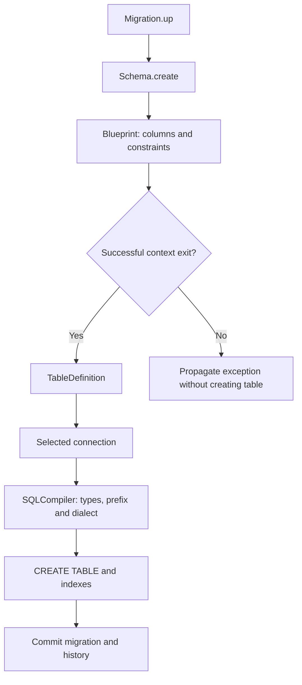

Un esquema físico describe tablas, columnas, claves e índices. **Definir un modelo no crea su tabla.** `Schema` convierte un `Blueprint` o `TableDefinition` en operaciones de la conexión; el ORM comparte esos metadatos para generar consultas. Los cambios duraderos se organizan en [migraciones](/es/database/migrations-and-seeders).

## Crear una tabla

```python
from orionis.database import Migration
from orionis.support.facades import Schema


class CreateProjects(Migration):
    async def up(self) -> None:
        async with Schema.create("projects") as table:
            table.id()
            table.string("name", 120)
            table.string("slug", 160)
            table.boolean("active").default(True)
            table.timestamps()
            table.unique("slug", name="uq_projects_slug")
            table.index("active", name="ix_projects_active")

    async def down(self) -> None:
        await Schema.drop("projects")
```

Guarda la clase en un archivo de migración y ejecuta migrate desde el proyecto. create() es síncrono y devuelve `TableCreation`: se utiliza con async with, sin await delante de `Schema.create`. Las columnas se acumulan en memoria y el SQL se ejecuta al salir sin excepción. El bloque no suprime errores. timestamps() añade created_at y updated_at anulables, sin programar por sí mismo su actualización.



<a id="schema-init"></a>

## API de `Schema`

Importa la fachada directamente desde orionis.support.facades. Para inyección utiliza `ISchema`, del módulo orionis.database.contracts.schema. El provider registra una implementación transitoria porque cada instancia conserva su selección de conexión. Las cinco operaciones públicas son:

<a id="schema-connection"></a>

### connection

```text
connection(name: str | None=None) -> Self
```

Selecciona una conexión y devuelve la misma instancia. name=None selecciona explícitamente la conexión predeterminada. Solo se permite una selección por instancia; una segunda llamada lanza `ValueError`, incluso si repite el nombre. La fachada resuelve un servicio nuevo por acceso.

```python
from orionis.support.facades import Schema


async def remove_reporting_table() -> bool:
    schema = await Schema.connection("reporting")
    return await schema.drop("old_reports")
```

<a id="schema-create"></a>

### create

```text
create(name: str) -> TableCreation
```

Devuelve `TableCreation` para construir una tabla llamada name o schema.table. Nombres vacíos, schema. o con más de un punto producen `ValueError` cuando se procesa la definición. Un nombre no válido de factoría en `Blueprint` produce `AttributeError`.

```python
from orionis.database import Migration
from orionis.support.facades import Schema


class CreateProjects(Migration):
    async def up(self) -> None:
        async with Schema.create("projects") as table:
            table.id()
            table.string("name", 120)
            table.string("slug", 160)
            table.boolean("active").default(True)
            table.timestamps()
            table.unique("slug", name="uq_projects_slug")
            table.index("active", name="ix_projects_active")

    async def down(self) -> None:
        await Schema.drop("projects")
```

<a id="schema-createfromdefinition"></a>

### createFromDefinition

```text
async createFromDefinition(definition: TableDefinition) -> bool
```

Recibe una `TableDefinition` reutilizable y devuelve bool después de await. Usa la conexión explícita, la contextual de migración o la predeterminada, en ese orden. Errores de tipos/DDL se propagan como `QueryException` o desde el compilador.

```python
from database.schemas.projects_v1_schema import ProjectsV1Schema
from orionis.database import Migration
from orionis.support.facades import Schema


class CreateProjects(Migration):
    async def up(self) -> None:
        await Schema.createFromDefinition(ProjectsV1Schema.table_definition)

    async def down(self) -> None:
        await Schema.drop("projects")
```

<a id="schema-createfrommodel"></a>

### createFromModel

```text
async createFromModel(model: type[Model]) -> bool
```

Recibe una clase concreta `Model`, nunca instancia ni la clase base abstracta; de otro modo `TypeError`. Selección de conexión: explícita > conexión declarada del modelo > conexión contextual de migración > default. Devuelve bool. Utiliza los metadatos actuales: apropiado para bootstrap y testing, no para congelar historia de migraciones.

```python
from app.models.project import Project
from orionis.support.facades import Schema


async def prepare_test_table() -> bool:
    return await Schema.createFromModel(Project)
```

<a id="schema-drop"></a>

### drop

```text
async drop(name: str) -> bool
```

Elimina una tabla y devuelve bool. Admite schema.table y separa schema del nombre antes de enviarlo a la conexión. La operación subyacente usa if_exists=True; no permite seleccionar ese flag desde la fachada `Schema`. El contenido de la tabla se elimina.

```python
from orionis.support.facades import Schema


async def remove_projects() -> bool:
    return await Schema.drop("projects")
```

<a id="schema-generator"></a>

## Definiciones versionadas compartidas

Genera el contenedor con los dos comandos alternativos siguientes. name es obligatorio; se añade el sufijo `Schema` si falta. catalog/projects_v1 crea database/schemas/catalog/projects_v1_schema.py y ProjectsV1Schema. No se genera el contenido de tabla automáticamente.

```shell
orionis make:database-schema projects_v1
python -B reactor make:database-schema projects_v1
```

```python
from orionis.database.schema.column import Column
from orionis.orm.schema import TableDefinition


class ProjectsV1Schema:
    table_definition = TableDefinition(
        name="projects",
        columns={
            "id": Column.id(),
            "name": Column.string("name", 120),
        },
        primary_key="id",
    )
```

Guarda el ejemplo en database/schemas/projects_v1_schema.py. `TableDefinition` contiene el nombre lógico, columnas y restricciones. La metaclase del modelo admite table_definition = ProjectsV1Schema.table_definition. Congela V1: para evolucionar el esquema crea V2 y otra migración, en lugar de cambiar el significado de una migración aplicada. Los subdirectorios se crean automáticamente; un archivo existente produce `FileExistsError` y no hay --force. Los nombres, rutas relativas, sufijos y rechazos siguen el [generador de migraciones](/es/database/migrations-and-seeders#generar-una-migración).

<a id="blueprint-api"></a>

## `Blueprint` y acceso directo

`Blueprint`() inicia una colección vacía. Las 40 factorías de `Column` aparecen automáticamente como métodos del blueprint y agregan su resultado; llamar `Column.string` por separado no registra esa columna en un blueprint. columns() -> tuple[`ColumnDefinition`, ...] devuelve una instantánea de columnas. definitions() -> tuple[`SchemaDefinition`, ...] devuelve primero columnas y después restricciones, conservando el orden de cada conjunto. `SchemaDefinition` es la unión de `ColumnDefinition`, `Comment`, `ForeignKey`, `Index`, `PrimaryKey` y `Unique`.

```python
from orionis.database.schema.blueprint import Blueprint


table = Blueprint()
table.id()
table.string("name", 120)
table.unique("name")
columns = table.columns()
definitions = table.definitions()
```

La creación mantiene una tabla ya existente mediante checkfirst=True y devuelve True; no compara columnas ni actualiza su estructura. Para necesitar una comprobación estricta, `IConnection.createTable`(definition, if_not_exists=False) es el nivel que expone ese flag. El prefijo de conexión se aplica a tablas y referencias estructuradas; no lo dupliques en name. Una cadena de SQL manual no recibe ese tratamiento.

El código no expone `Schema.table`, alter, rename, hasTable ni dropIfExists. Las [alteraciones](/es/database/schema-alterations) requieren SQL explícito del motor. Consulta [todos los tipos](/es/database/column-types), [modificadores y claves](/es/database/schema-modifiers) y [`TableDefinition`](/es/database/orm/schema-and-type-reference) para completar la declaración.

Si declaras una columna varias veces con el mismo nombre, `Schema` conserva la última definición; no crea dos columnas ni informa duplicado. Declara cada nombre una vez para evitar reemplazar accidentalmente opciones.


<a id="tablecreation-init"></a>

### Construcción directa del servicio y contexto

```text
Schema(conn_manager: IConnectionManager)
TableCreation(schema: Schema, name: str)
```

El contenedor construye `Schema` con `IConnectionManager`. `TableCreation` es el contexto devuelto por create: __aenter__ entrega `Blueprint` y __aexit__ crea solo al no recibir excepción, devuelve False y propaga fallos. Para seleccionar una conexión desde la fachada primero espera el servicio: schema = await `Schema.connection`("reporting"); después utiliza schema.create o await schema.drop. La selección es síncrona en una instancia `ISchema`, pero el dispatcher de la fachada se resuelve mediante await.
