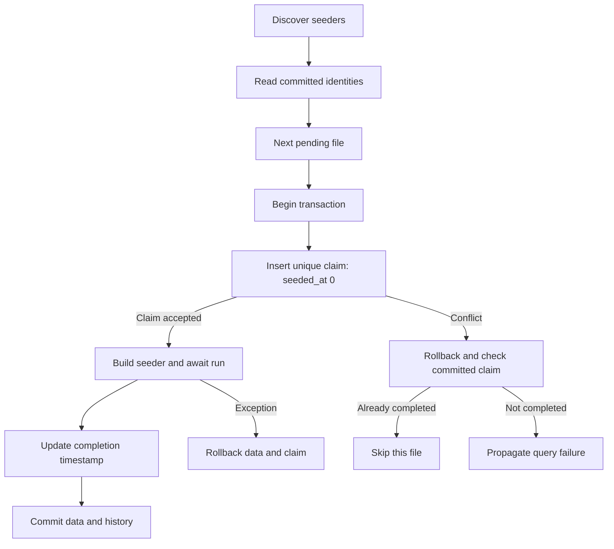

Un seeder describe datos iniciales o de desarrollo en una clase con run async. `SeederRunner` descubre los archivos pendientes y registra su ejecución en la tabla seeders. Un seeder registrado no se repite en esa conexión; una factory genera modelos cada vez que la invocas y no sustituye ese historial. Migra primero las tablas utilizadas.

## Crear un seeder

```shell
orionis make:database-seeder default_flags
python -B reactor make:database-seeder default_flags
```

name: str es obligatorio. El comando usa database_seeders, normalmente database/seeders. default_flags crea default_flags_seeder.py y DefaultFlagsSeeder; añade el sufijo `Seeder` solo si falta. El stub importa `Seeder` y genera async def run(self) -> None vacío. No hay flags de sobrescritura ni selección de modelo. Se admiten subdirectorios y se crean automáticamente; se rechazan rutas absolutas, . y .., componentes vacíos o nombres que no forman módulos. Los archivos existentes no se sobrescriben.

Completa el archivo generado. La tabla flags pertenece a la [migración de ejemplo](/es/database/migrations-and-seeders).

```python
from orionis.database import Seeder
from orionis.support.facades import DB


class DefaultFlagsSeeder(Seeder):
    async def run(self) -> None:
        await DB.table("flags").insert({"name": "enabled"})
```

<a id="seeder-contract"></a>

## Ejecutar pendientes

[Referencia de comandos de Database](/es/database/commands): sintaxis, argumentos y opciones de los 14 comandos, incluida inspección y borrado.

```shell
orionis seed
python -B reactor seed

orionis db:seed --database reporting
python -B reactor db:seed --database reporting

orionis migrate --seed
python -B reactor migrate --seed
```

Cada par de líneas es alternativo. seed y db:seed tienen el mismo comportamiento. Admiten --database NAME / -d NAME (str opcional, None usa default) y -h/--help. No hay argumento de clase, --class, --force, --count ni --seed en esos dos comandos. migrate --seed es la variante que aplica migraciones y después ejecuta seeders. El fallo de un seeder no deshace migraciones confirmadas previamente.

## Orden e identidad

Los archivos se descubren recursivamente y se ordenan por stem lexicográfico. Solo cuentan subclases de `Seeder` definidas localmente; reexportaciones no se ejecutan. Cada identidad debe corresponder a una clase inequívoca. Dos clases locales en el mismo archivo o el mismo stem en subdirectorios distintos producen `ValueError`. No se necesitan archivos __init__.py adicionales.

Para dependencias de datos utiliza nombres ordenables como s010_roles_seeder.py y s020_users_seeder.py; el generador no añade una marca temporal ni resuelve dependencias entre clases. Una tabla no se crea porque el seeder use su modelo. Si necesitas cambiar datos sembrados en producción, añade un nuevo seeder en lugar de renombrar o editar uno ejecutado. El descubrimiento queda cacheado en la instancia del runner.

## Transacción, exclusión y errores



seeders contiene id, seeder único, batch y seeded_at (segundos epoch). Cada seeder se reclama mediante su identidad única antes de ejecutar run; el dato y el registro se confirman en la misma transacción. Si otra ejecución ya confirmó la identidad, la segunda la omite. Una reclamación fallida que no corresponde a un seeder completado propaga su `QueryException`; no se transforma cualquier error de base en un salto silencioso.

Un error de run revierte sus escrituras y la reclamación: sigue pendiente para reintentar. Los seeders previos pueden estar confirmados; no hay una transacción global del conjunto. Mantén las operaciones en la conexión contextual y la misma tarea async. No envíes correos ni servicios externos suponiendo que rollback los deshará. La reclamación necesita restricciones UNIQUE efectivas: **Redshift rechaza seed antes de comenzar** porque no puede garantizarlas.

## Inyección de dependencias

`SeederRunner` usa app.build para construir la clase, por lo que el constructor puede recibir servicios. run se llama sin argumentos: no se inyectan parámetros adicionales en ese método. Este ejemplo sustituye la fachada por el contrato real de Query Builder:

```python
from orionis.database import Seeder
from orionis.orm.contracts.query_builder import IQueryBuilder


class DefaultFlagsSeeder(Seeder):
    def __init__(self, db: IQueryBuilder) -> None:
        self._db = db

    async def run(self) -> None:
        await self._db.table("flags").insert({"name": "enabled"})
```

Consulta también [`Faker`](/es/database/orm/faker) para datos simulados.

## Modelos y factories

El siguiente archivo funciona como seeder una vez creada products con id, name y price. `Factory.definition` es síncrono; create es async y persiste por el flujo normal del modelo. El runner ya proporciona la transacción que rodea las 20 inserciones.

```python
from decimal import Decimal
from typing import Any
from orionis.database import Seeder
from orionis.orm import Integer, Model, Numeric, String
from orionis.orm.factories import Factory


class Product(Model):
    table = "products"
    timestamps = False
    fillable = ("name", "price")
    id = Integer().primary().autoIncrement()
    name = String(120)
    price = Numeric(12, 2)


class ProductFactory(Factory[Product]):
    model = Product

    def definition(self) -> dict[str, Any]:
        return {"name": "Demo product", "price": Decimal("9.50")}


class DemoProductsSeeder(Seeder):
    async def run(self) -> None:
        await ProductFactory().count(20).create()
```

Los registros tienen valores repetidos deliberadamente y la tabla no declara UNIQUE(name). Para variaciones, secuencias, `Faker`, relaciones y estados utiliza la [guía de factories](/es/database/orm/factories-and-testing). No esperes que `Factory` cree tablas o asigne relaciones por sí sola.

<a id="seederrunner-seed"></a>

## API de `SeederRunner`

<a id="seederrunner-init"></a>

```text
SeederRunner(app: IApplication, conn_manager: IConnectionManager)
async seed(*, connection: str | None=None, events: SeederEvents | None=None) -> list[str]
```

seed devuelve list[str] de identidades completadas por esa llamada en orden, o [] cuando no hay pendientes o las reclamó otra ejecución. connection=None usa default; events=None desactiva progreso. `SeederEvents` es alias de `MigrationEvents` y utiliza callbacks síncronos on_start(name), on_success(name, elapsed) y on_error(name, elapsed). Las propiedades default son None. Ver [eventos de migración](/es/database/migrations-and-seeders#progreso-y-errores) para su firma y métodos started/succeeded/failed.

```python
from orionis.console.base.command import BaseCommand
from orionis.database import SeederRunner
from orionis.database.seeders.events import SeederEvents


class SeedReporting(BaseCommand):
    signature = "database:seed-reporting"
    description = "Run pending seeders on reporting."

    async def handle(self, runner: SeederRunner) -> None:
        events = SeederEvents(
            on_start=lambda name: self.info(f"Starting {name}"),
            on_success=lambda name, elapsed: self.info(f"Done {name}: {elapsed:.2f}s"),
            on_error=lambda name, elapsed: self.error(f"Failed {name}: {elapsed:.2f}s"),
        )
        names = await runner.seed(connection="reporting", events=events)
        self.info(f"Completed: {len(names)}")
```

## Ejecutar una clase de forma explícita

No hay selección individual en seed. Cuando tu aplicación necesita invocar una clase específica, puede resolverla e invocar run en un comando propio. Esta es una ejecución explícita **sin registro ni reclamación de `SeederRunner`**; se repetirá cada vez y debes decidir la idempotencia. El ejemplo solo sirve con la variante DefaultFlagsSeeder que no tiene dependencias o con sus dependencias registradas.

```python
from database.seeders.default_flags_seeder import DefaultFlagsSeeder
from orionis.console.base.command import BaseCommand
from orionis.support.facades import DB


class InsertDefaultFlags(BaseCommand):
    signature = "database:insert-default-flags"
    description = "Invoke one seeder explicitly without recorded history."

    async def handle(self, seeder: DefaultFlagsSeeder) -> None:
        async with DB.transaction():
            await seeder.run()
```

## Relación con rollback y reconstrucción

Los seeders no tienen down ni un comando independiente de rollback. Cuando migrate:rollback/reset revierte todas las migraciones aplicadas de una conexión, elimina también el historial seeders. Una reversión parcial lo conserva. migrate:fresh reconstruye ambos historiales y luego requiere seed o migrate --seed para poblar. Conserva datos que deban sobrevivir mediante migraciones cuidadosamente diseñadas, no editando el historial manualmente.
