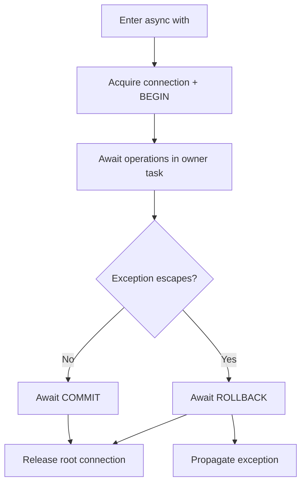

Una transacción agrupa lecturas y escrituras en una unidad confirmable. Usa el mismo nombre de conexión y la misma tarea de asyncio. `DB`, SQL crudo y modelos con esa conexión comparten el estado transaccional. No hay coordinador distribuido entre conexiones o servidores.

## Contexto asíncrono

```python
from orionis.support.facades import DB


async def transfer(source_id: int, target_id: int, amount: int) -> None:
    if source_id == target_id or amount <= 0:
        raise ValueError("Invalid transfer")
    async with DB.transaction():
        debited = await DB.execute(
            "UPDATE accounts SET balance = balance - :amount "
            "WHERE id = :id AND balance >= :amount",
            {"amount": amount, "id": source_id},
        )
        if debited != 1:
            raise ValueError("Account missing or insufficient funds")
        credited = await DB.execute(
            "UPDATE accounts SET balance = balance + :amount WHERE id = :id",
            {"amount": amount, "id": target_id},
        )
        if credited != 1:
            raise ValueError("Target account missing")
```

Requiere `accounts` con `id` único y `balance` entero. La condición de débito se evalúa en la base de datos y evita depender de una lectura anterior que podría quedar obsoleta.

Al entrar se abre una conexión dedicada y un nivel transaccional. Al salir normalmente se espera `commit()`. Si escapa cualquier `BaseException`, incluida cancelación, se espera `rollback()` y la excepción se propaga. Si ocultas una excepción **dentro** del bloque, el contexto ve una salida correcta y confirma: vuelve a lanzarla o captura por fuera.

`async with DB.transaction() as transaction` entrega el contexto, no un builder ni conexión SQL. Sigue consultando mediante `DB` o modelos; no cierres manualmente el mismo nivel administrado por el contexto.



## Control manual equivalente

```python
from orionis.support.facades import DB


async def record_event(message: str) -> None:
    await DB.beginTransaction()
    try:
        await DB.execute(
            "INSERT INTO audit_log (message) VALUES (:message)", {"message": message}
        )
    except BaseException:
        await DB.rollback()
        raise
    else:
        await DB.commit()
```

`beginTransaction(name=None)`, `commit(name=None)` y `rollback(name=None)` son async y devuelven `None`. El inicio está antes de `try`: si no pudo abrirse no hay un nivel propio que revertir. El commit está en `else`: si falla no presupongas que continúa existiendo un nivel activo que se pueda revertir.

Un cierre termina el nivel interno; sin transacción activa, `commit()`/`rollback()` producen `TransactionException`. Mantén el mismo nombre al iniciar, consultar y cerrar. Consulta [las firmas de DB](/es/database/db-facade#control-de-transacciones).

`finally` sirve para liberar recursos que tú creaste. No cierres el gestor singleton al terminar operaciones de negocio. Para una prueba o previsualización que deba revertirse siempre, utiliza `try/finally` y `rollback()` sin una rama de commit.

## Selección de conexión

```python
from orionis.support.facades import DB


async def report_event(message: str) -> None:
    reporting = DB.connection("reporting")
    async with reporting.transaction():
        await reporting.execute(
            "INSERT INTO audit_log (message) VALUES (:message)", {"message": message}
        )
```

El gateway no crea un predeterminado implícito para todo el bloque. `DB.table("...")` sin nombre sigue resolviendo el predeterminado del gestor, salvo el contexto específico de migración. Usa el gateway seleccionado o `connection="reporting"` en cada builder para participar en esa transacción.

## Savepoints y anidamiento

```python
from orionis.support.facades import DB


async def save_with_optional_event() -> None:
    async with DB.transaction():
        await DB.execute(
            "INSERT INTO notes (body) VALUES (:body)", {"body": "retained"}
        )
        try:
            async with DB.transaction():
                await DB.execute(
                    "INSERT INTO notes (body) VALUES (:body)", {"body": "discarded"}
                )
                raise ValueError("Discard only inner work")
        except ValueError:
            pass
```

El primer nivel inicia una transacción raíz; los siguientes crean savepoints en la misma conexión. La excepción se captura después de salir del contexto interior, por lo que su fila se revierte y la exterior puede confirmarse. Si escapa del bloque exterior, se revierte todo.

Redshift rechaza anidamiento con `TransactionException`. En otros drivers se solicitan savepoints, sujetos a la compatibilidad de su DDL. No son transacciones independientes ni hay parámetros de nombre de savepoint o aislamiento en `DB.transaction()`.

## Concurrencia y propiedad de tareas

Un `ContextVar` conserva la pila y la tarea propietaria. Una tarea hija hereda el contexto, pero no la propiedad: intentar usar ese estado activo produce `TransactionException`. No compartas una transacción mediante `asyncio.gather()` o `create_task()`; espera operaciones secuencialmente en su tarea.

Fuera de una transacción, tareas independientes pueden adquirir conexiones físicas distintas. Crea un builder por consulta: compartir builders mutables puede mezclar condiciones. SQLite en memoria usa un pool de una conexión con checkout exclusivo, por lo que sus operaciones se serializan al adquirirla.

`IConnection.inTransaction()` devuelve `True` sólo para la tarea propietaria con niveles activos. Una hija recibe `False`, pero eso no la autoriza a usar la transacción heredada. El estado heredado ya finalizado se limpia al resolverlo.

La paginación ORM hace recuento y lectura secuencialmente dentro de una transacción y puede hacerlos concurrentemente fuera. Sin transacción no hay garantía de instantánea común entre ambos resultados.

## Aislamiento y cancelación

El motor y su configuración determinan el aislamiento. No se añade una política universal ni reintentos de deadlocks. `lockForUpdate()`/`sharedLock()` pertenecen al builder, se aplican al ejecutar y dependen del dialecto; Redshift los rechaza y SQLite no proporciona los mismos locks de fila que un servidor relacional.

`Connection.createTable()` solicita `BEGIN IMMEDIATE` en SQLite cuando crea una transacción temporal propia. No cambia el modo de una transacción existente; una operación normal utiliza `BEGIN`.

Adquirir una conexión del pool continúa siendo cancelable. El control transaccional y la limpieza esperan al driver antes de propagar cancelación; Oracle protege también la ejecución nativa y Redshift drena el worker. Esto protege recursos, pero no garantiza detener SQL en el servidor inmediatamente.

Un `COMMIT` solicitado puede haber persistido cambios aunque el llamador reciba `CancelledError`. Cancelar no demuestra rollback. Verifica el resultado mediante una identidad estable o idempotencia antes de reintentar.

## Efectos externos y DDL

Mantén bloques breves. Correo, archivos y llamadas HTTP no se revierten con SQL. Una cola database puede participar en su conexión; Redis no comparte esa transacción. No hay API general `afterCommit` en esta capa.

DDL puede producir commits implícitos según el motor. Una migración envuelta en transacción no garantiza reversión de toda su estructura: comprueba los errores, locks y DDL contra una base de pruebas del motor elegido.

### Transaction

`Transaction(connection: IConnection)` implementa `ITransaction`. `async __aenter__() -> ITransaction` abre un nivel y devuelve `self`. `async __aexit__(exc_type: type[BaseException] | None, exc: BaseException | None, traceback: TracebackType | None) -> bool` confirma o revierte según `exc_type` y devuelve siempre `False`. No suprime excepciones. Utiliza `async with connection.transaction()` en lugar de invocar manualmente estos métodos especiales.
