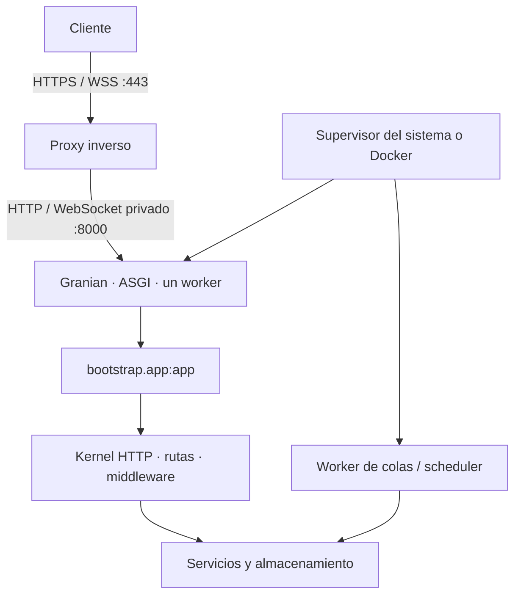

Publica el **proyecto completo de tu aplicación**: código, `bootstrap/`, `config/`, `routes/`, `resources/`, `database/`, `reactor`, `pyproject.toml` y `uv.lock`, además de los artefactos de frontend que utilice. Instalar únicamente el paquete del framework no publica tu aplicación.

Las guías parten de una aplicación instalada y probada. Sustituye el dominio de ejemplo `app.example.com`, las rutas y las credenciales por los de tu entorno.

| Escenario | Proceso de aplicación | Proxy y HTTPS |
| --- | --- | --- |
| [Windows Server](/es/deployment/windows-server) | Servicio Windows mediante WinSW | Caddy como servicio independiente |
| [Linux](/es/deployment/linux) | Servicio systemd sin privilegios | Nginx con certificado TLS |
| [Docker](/es/deployment/docker) | Contenedor sin privilegios | Caddy y red privada de Compose |

## Arquitectura de publicación



Granian ya forma parte de las dependencias de Orionis. El objeto `app` creado en `bootstrap/app.py` implementa **ASGI** y **RSGI**. Estas guías seleccionan ASGI explícitamente, con su ciclo de inicio y cierre habilitado, y un worker como punto de partida. Consulta [Aplicación y Contenedor](/es/application) para personalizar el bootstrap.

## Preparar dependencias y configuración

Los ejemplos utilizan Python **3.14**. Comprueba `requires-python`, `.python-version` y el lockfile de tu aplicación antes de elegir otra versión. Resuelve y prueba las dependencias y extras necesarios en desarrollo; distribuye el `uv.lock` resultante. Desde la raíz del proyecto en el servidor:

```shell
uv sync --locked --no-default-groups --python 3.14
```

`--locked` exige que el lockfile corresponda al proyecto; si falla, corrígelo antes de publicar. `--no-default-groups` excluye los grupos predeterminados, incluido `dev`; las dependencias de producción deben estar declaradas fuera de esos grupos. Los servicios ejecutarán después el Python de `.venv` directamente, sin resolver paquetes en cada arranque. [Referencia de uv](https://docs.astral.sh/uv/reference/cli/#uv-sync).

Proporciona el `.env` privado **antes de importar la aplicación o ejecutar Reactor**. Fija el directorio de trabajo del servicio en la raíz del proyecto: el componente de entorno toma esa ubicación para leer el archivo. Sus valores se consumen desde `config/`. Consulta [Entorno](/es/environment).

```dotenv
APP_ENV=production
APP_DEBUG=bool:false
ALLOWED_HOSTS=list:["app.example.com"]
TRUSTED_PROXIES=list:["127.0.0.1"]
SESSION_DRIVER=file
SESSION_SECURE=bool:true
```

Conserva las demás variables, especialmente **la `APP_KEY` existente** y las conexiones. Este fragmento supone un proxy en el mismo servidor y sesiones de archivo en una instancia; Docker usa otra IP de proxy. Configurar sesiones no las añade a las rutas API.

Para una instalación nueva sin clave, `python -B reactor key:generate` crea una y la guarda en `.env`; sin `--force` conserva una existente. Provisiona la clave una sola vez y reutilízala en todos los procesos de la misma aplicación. No la regeneres por despliegue: los datos previamente cifrados dependen de ella.

En Linux utiliza `.venv/bin/python`; en Windows, `.venv\Scripts\python.exe`. Los comandos abreviados con `python` suponen ese entorno activo:

```shell
python -B reactor about
python -B reactor route:list
python -B reactor serve --interface asgi --export
```

Ejecuta las comprobaciones con la identidad y el directorio del servicio. `serve --export` muestra el comando resuelto y termina sin iniciar el servidor.

## Servidor y archivos públicos

```shell
python -B reactor serve --interface asgi --port 8000 --log
```

También puedes usar `orionis serve --interface asgi --port 8000 --log`. Reactor admite `--interface` (`rsgi` por defecto o `asgi`), `--host` (desde 1.0.13), `--port` (8000), `--log` y `--export`. Para fijar la escucha al proxy local, añade `--host 127.0.0.1`. Las opciones `--workers` y `--reload` se configuran al invocar Granian directamente.

| Decisión | `serve` | Servicios de estas guías |
| --- | --- | --- |
| Dirección | `--host`; al omitirlo, loopback en desarrollo y `0.0.0.0` en producción | Loopback en Windows/Linux; red privada en Docker |
| Workers | Uno en Windows; número de CPU en Unix | Uno explícito |
| Recarga | Solo fuera de producción | Deshabilitada explícitamente |
| Archivos públicos | Lee el disco `public` | Montaje equivalente configurado en Granian |

Las guías llaman a `python -B -m granian` para fijar esas decisiones. El destino es `bootstrap.app:app`, sin `--factory`. Para RSGI puedes seleccionar `--interface rsgi` con el mismo objeto. No uses `wsgi` ni `asginl`: el primero no corresponde al contrato de Orionis y el segundo omite el lifespan ASGI. [Interfaces de Granian](https://github.com/emmett-framework/granian).

El disco público predeterminado es `storage/app/public`, publicado como `/static`. Si cambias `PUBLIC_PATH` o `PUBLIC_URL`, actualiza también los argumentos de montaje del servidor directo. Granian atiende ese montaje antes del kernel: los archivos públicos no pasan por los middleware de Orionis. Nunca publiques la raíz del proyecto ni `storage/app/private`.

## Permisos, cachés y datos persistentes

El proceso necesita leer el código y escribir en los directorios que use: bootstrap, logs, vistas compiladas, sesiones, temporales y archivos de aplicación. Las guías conceden escritura en `storage/`. SQLite necesita además escritura en el **directorio** de su archivo para crear archivos auxiliares; configura esa ruta y sus permisos. Consulta [drivers de base de datos](/es/database/drivers).

`app.compile(...)` habilita la persistencia de configuración, comandos y rutas conforme se preparan durante el arranque, habitualmente en `storage/framework/bootstrap`. La caché contiene configuración resuelta, rutas absolutas y posiblemente secretos. Protégela como el `.env`; no la copies desde desarrollo ni entre versiones con diferentes rutas de código.

La invalidación comprueba las rutas declaradas en el bootstrap. Cambiar solo variables del proceso no garantiza invalidar una caché existente. Con la versión detenida, elimina su caché de bootstrap o ejecuta `python -B reactor optimize:clear` conociendo su alcance: también limpia bytecode y directorios Python `build`/`dist`. Reinicia después todos los procesos persistentes. Consulta la [configuración de aplicación](/es/application/configuration).

Conserva fuera de releases desechables los archivos subidos, bases SQLite, sesiones y colas persistentes que necesites. Docker utiliza volúmenes. Un directorio local no se comparte automáticamente entre servidores.

## Datos y procesos auxiliares

Respalda y revisa las migraciones antes de aplicarlas. Ejecútalas una vez por despliegue, con la configuración de producción:

```shell
python -B reactor migrate:status
python -B reactor migrate
```

`migrate` admite `--database` para otra conexión; no tiene un flag `--force`. No ejecutes `migrate:fresh`, `db:wipe` ni seeders de demostración como paso habitual de publicación. Consulta [comandos de base de datos](/es/database/commands).

HTTP no inicia automáticamente workers de colas persistentes ni un scheduler CLI. Si los utilizas, crea servicios independientes con el mismo código, configuración y clave; sigue las guías de [colas](/es/queues/workers) y [consola y tareas](/es/console). Reinícialos también al actualizar código.

## Concurrencia y verificación

Un worker no hace duradero el estado de memoria. Antes de aumentar workers o réplicas, revisa [sesiones](/es/sessions/stores-and-concurrency), [grupos Realtime](/es/realtime/groups-and-deployment), [eventos MCP](/es/mcp/advanced-workflows), [caché](/es/cache) y [logs](/es/logging/rotation-and-lifecycle). Un almacén compartido no sustituye por sí solo el registro de conexiones Realtime.

Verifica el backend privado y después el dominio público. `/up`, si conservas la ruta predeterminada, devuelve 200 normalmente y 503 durante mantenimiento; no comprueba automáticamente bases de datos. Prueba una ruta real, archivos públicos, sesión segura y WebSocket/SSE si existen. [Salud y respuestas predeterminadas](/es/deployment/health-and-default-responses).

Para una interrupción programada, `python -B reactor down` escribe el marcador de mantenimiento para los procesos que comparten su almacenamiento; no interrumpe operaciones ya iniciadas. Detén los procesos, publica y verifica; `python -B reactor up` restaura disponibilidad. Investiga fallos de arranque en el supervisor y [Logs](/es/logging).

Continúa con [Windows Server](/es/deployment/windows-server), [Linux](/es/deployment/linux) o [Docker](/es/deployment/docker), y revisa [el contrato del proxy](/es/deployment/reverse-proxies).
