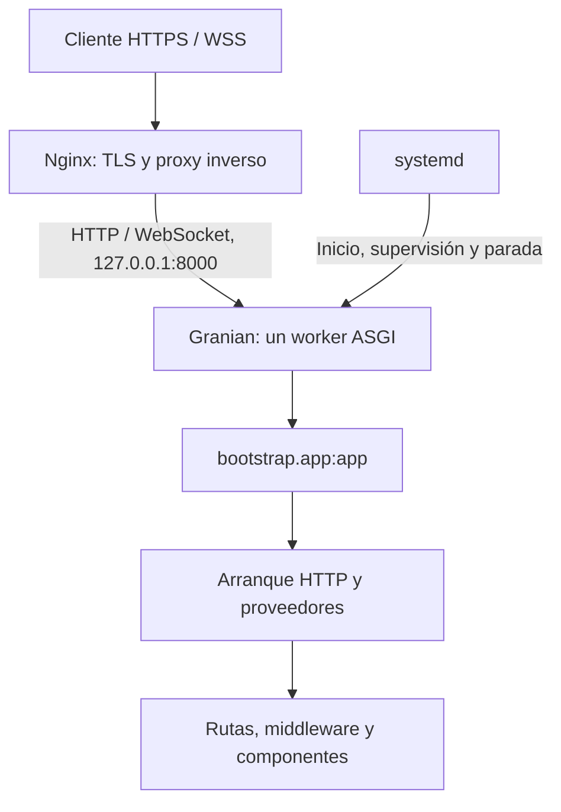

Esta guía utiliza un servidor Debian/Ubuntu con `systemd`, una aplicación en `/srv/orionis-app`, un usuario de servicio `orionis` y el dominio de ejemplo `app.example.com`. Sustituye el dominio y proporciona un certificado válido para él. La aplicación atiende exclusivamente en `127.0.0.1:8000`; Nginx recibe las conexiones públicas.



## 1. Preparar el servidor y la entrega

Necesitas acceso administrativo, DNS dirigido al servidor, los puertos públicos 80 y 443 habilitados y una entrega de tu **aplicación**, no solamente del paquete `orionis`. Esa entrega debe contener `reactor`, `bootstrap/app.py`, los directorios de la aplicación, `pyproject.toml` y su `uv.lock` revisado. Excluye `.venv`, credenciales y cachés generadas en otra máquina.

La implementación requiere Python 3.14 o posterior. En este ejemplo se selecciona Python 3.14; conserva la versión de Python con la que hayas verificado tu aplicación. Granian y su integración RSGI/ASGI ya forman parte de las dependencias de Orionis.

En un servidor nuevo, instala las herramientas del sistema y Nginx:

```bash
sudo apt update
sudo apt install --yes ca-certificates curl nginx
sudo useradd --system --user-group --create-home --home-dir /var/lib/orionis --shell /usr/sbin/nologin orionis
sudo install -d -o orionis -g orionis -m 0750 /srv/orionis-app
```

La distribución proporciona el servicio y la estructura de sitios de Nginx utilizados aquí; consulta su [instalación en Ubuntu](https://ubuntu.com/server/docs/how-to/web-services/install-nginx/) si el servidor tiene otra configuración previa.

Instala `uv` para el usuario del servicio. Su directorio personal también conservará el intérprete de Python que utiliza `.venv`:

```bash
sudo -u orionis -H sh -c 'curl -LsSf https://astral.sh/uv/install.sh | sh'
sudo -u orionis -H /var/lib/orionis/.local/bin/uv python install 3.14
```

Estos comandos corresponden al [instalador oficial de uv](https://docs.astral.sh/uv/getting-started/installation/) y a su [gestión de Python](https://docs.astral.sh/uv/guides/install-python/). El usuario no necesita una sesión interactiva ni permisos de administrador para ejecutar la aplicación.

## 2. Instalar las dependencias de la aplicación

Coloca la entrega preparada en `/tmp/orionis-release`. Los siguientes comandos comprueban sus archivos de entrada antes de copiarla:

```bash
set -eu
test -f /tmp/orionis-release/reactor
test -f /tmp/orionis-release/bootstrap/app.py
test -f /tmp/orionis-release/pyproject.toml
test -f /tmp/orionis-release/uv.lock
sudo cp -a /tmp/orionis-release/. /srv/orionis-app/
sudo chown -R orionis:orionis /srv/orionis-app
cd /srv/orionis-app
sudo -u orionis -H /var/lib/orionis/.local/bin/uv sync --locked --no-default-groups --python 3.14
```

`--locked` exige que el lockfile entregado esté actualizado respecto a `pyproject.toml`; si necesita cambios, la instalación falla en lugar de modificarlo. `--no-default-groups` excluye los grupos de desarrollo y otros grupos predeterminados. Las dependencias de producción y extras que necesite tu aplicación deben estar declarados y seleccionados en esa entrega; si tu propio proyecto define extras necesarios, añade su `--extra` correspondiente al comando. Véanse [sincronización del proyecto](https://docs.astral.sh/uv/concepts/projects/sync/) y [opciones de uv sync](https://docs.astral.sh/uv/reference/cli/#uv-sync).

## 3. Proporcionar la configuración y los permisos

Entrega el `.env` de producción por tu mecanismo de secretos. Por ejemplo, si se ha montado temporalmente como `/run/secrets/orionis-app.env`:

```bash
sudo install -o root -g orionis -m 0640 /run/secrets/orionis-app.env /srv/orionis-app/.env
sudoedit /srv/orionis-app/.env
```

Comprueba estas entradas dentro del archivo, conservando su `APP_KEY` privada y el resto de credenciales de la aplicación:

```dotenv
APP_ENV=production
APP_DEBUG=bool:false
APP_URL=https://app.example.com
ALLOWED_HOSTS=list:['app.example.com']
TRUSTED_PROXIES=list:['127.0.0.1']
SESSION_DRIVER=file
SESSION_SECURE=bool:true
```

El ejemplo utiliza sesiones de archivo para esta instancia y cookies seguras a través de HTTPS; conserva tu driver si ya utilizas otro almacén de producción. Esto no incorpora sesiones a las rutas API. `TRUSTED_PROXIES` corresponde al salto Nginx → aplicación de este escenario. Nginx sustituirá los encabezados de reenvío del cliente; Orionis solamente los utiliza cuando la conexión procede de un proxy confiable. Revisa la [configuración de proxies](/es/deployment/reverse-proxies) si existe otro balanceador delante.

El framework lee `.env` desde el directorio de trabajo y convierte los prefijos tipados al cargar los archivos de configuración. Por eso el servicio tendrá `WorkingDirectory=/srv/orionis-app`. En esta guía lo carga Orionis; no se usa `EnvironmentFile=` de systemd ni `--env-files` de Granian para evitar una segunda lectura del mismo archivo. Un `.env` presente también puede sobrescribir variables coincidentes del proceso durante su carga. Consulta [Entorno](/es/environment) para definir una única fuente coherente de configuración.

Prepara los directorios que usarán el disco público y los componentes que escriben en `storage`. Después limita la escritura de código al administrador:

```bash
sudo install -d -o orionis -g orionis -m 0750 /srv/orionis-app/storage/app/public /srv/orionis-app/storage/app/private /srv/orionis-app/storage/framework /srv/orionis-app/storage/logs
sudo chown -R root:orionis /srv/orionis-app
sudo chmod -R u=rwX,g=rX,o= /srv/orionis-app
sudo chown -R orionis:orionis /srv/orionis-app/storage
sudo chmod 0640 /srv/orionis-app/.env
```

Si utilizas SQLite, su archivo **y el directorio que contiene los archivos auxiliares de SQLite** deben permitir escritura al usuario `orionis`. Puedes configurar `DB_DATABASE=storage/app/private/database.sqlite` en `.env`; en una aplicación existente, traslada y conserva la base de datos de forma controlada, con el servicio detenido. La ruta predeterminada `database/database.sqlite` queda fuera del directorio escribible de este servicio. Para un motor externo, configura su conexión y los drivers correspondientes; consulta [Database](/es/database).

Comprueba el arranque y las rutas desde la raíz:

```bash
cd /srv/orionis-app
sudo -u orionis -H .venv/bin/python -B reactor about
sudo -u orionis -H .venv/bin/python -B reactor route:list
sudo -u orionis -H .venv/bin/python -B reactor serve --export
```

`serve --export` muestra el comando generado sin iniciar el servidor. En Linux, `serve` selecciona tantos workers como CPU lógicas y, en producción, escucha en `0.0.0.0`. El servicio de esta guía usa explícitamente loopback y un worker; no copies esos valores del comando exportado sin revisar la topología. Aplica las [migraciones](/es/database/migrations) que tu entrega requiera como una operación controlada, antes de atender tráfico.

## 4. Registrar el servicio systemd

Crea `/etc/systemd/system/orionis-app.service`:

```ini
[Unit]
Description=Orionis HTTP application
Wants=network-online.target
After=network-online.target

[Service]
Type=simple
User=orionis
Group=orionis
WorkingDirectory=/srv/orionis-app
Environment=PYTHONUTF8=1
Environment=PYTHONDONTWRITEBYTECODE=1
ExecStart=/srv/orionis-app/.venv/bin/python -B -m granian --interface asgi --host 127.0.0.1 --port 8000 --workers 1 --loop uvloop --no-reload --log-level info --workers-kill-timeout 60 --static-path-mount /srv/orionis-app/storage/app/public --static-path-route /static --static-path-dir-to-file index.html bootstrap.app:app
Restart=on-failure
RestartSec=3
KillMode=mixed
TimeoutStopSec=75
UMask=0077
NoNewPrivileges=true
PrivateTmp=true
ProtectSystem=strict
ReadWritePaths=/srv/orionis-app/storage
StandardOutput=journal
StandardError=journal

[Install]
WantedBy=multi-user.target
```

`bootstrap.app:app` importa la instancia creada en `bootstrap/app.py`; no requiere un wrapper ni `--factory`. La ruta estática reproduce el disco público predeterminado. Si cambias `config/filesystems.py`, ajusta tanto el directorio como la URL del montaje; los archivos de ese montaje son públicos y no pasan por los middleware de tus rutas.

La alternativa RSGI sustituye únicamente `--interface asgi` por `--interface rsgi`. RSGI ejecuta los hooks de inicio/finalización de Granian; ASGI utiliza el protocolo lifespan. En ambos casos el arranque HTTP prepara el kernel y los proveedores de Orionis. Consulta [puntos de entrada](/es/application/server-entrypoints).

systemd supervisa el proceso padre y registra stdout/stderr. Al detenerlo, `KillMode=mixed` envía primero la señal de terminación al proceso principal; el límite de 75 segundos permite al supervisor de Granian agotar su espera de 60 segundos antes de una parada forzada. No garantiza finalizar indefinidamente una conexión WebSocket/SSE. Los detalles de supervisión y terminación están en [systemd.service](https://www.freedesktop.org/software/systemd/man/latest/systemd.service.html) y [systemd.kill](https://www.freedesktop.org/software/systemd/man/latest/systemd.kill.html).

`ProtectSystem=strict` hace de solo lectura el sistema de archivos del servicio salvo sus directorios privados y la excepción declarada en `ReadWritePaths`. Si tu aplicación escribe en otras rutas configuradas, decláralas expresamente; revisa [systemd.exec](https://www.freedesktop.org/software/systemd/man/latest/systemd.exec.html).

Activa el servicio y comprueba el backend conservando el `Host` público:

```bash
sudo systemd-analyze verify /etc/systemd/system/orionis-app.service
sudo systemctl daemon-reload
sudo systemctl enable --now orionis-app
sudo systemctl status orionis-app --no-pager
curl --fail --header 'Host: app.example.com' http://127.0.0.1:8000/up
```

`/up` es la ruta de salud predeterminada de `withRouting(health="/up")`. Si tu bootstrap la modifica, utiliza la ruta configurada. Una respuesta satisfactoria comprueba el flujo HTTP, no la disponibilidad de todos los servicios externos.

## 5. Configurar Nginx con HTTPS

Proporciona la cadena completa de un certificado emitido para `app.example.com` y su clave privada mediante tu proceso de certificados. En este ejemplo se reciben como archivos temporales de secretos y se instalan en rutas explícitas:

```bash
sudo install -d -m 0755 /etc/nginx/tls
sudo install -m 0644 /run/secrets/fullchain.pem /etc/nginx/tls/orionis-fullchain.pem
sudo install -m 0600 /run/secrets/privkey.pem /etc/nginx/tls/orionis-privkey.pem
```

Nginx utiliza la cadena del certificado y la clave por separado; consulta su [configuración de HTTPS](https://nginx.org/en/docs/http/configuring_https_servers.html). Programa la renovación mediante el emisor de tus certificados y recarga Nginx tras instalar los archivos renovados.

Crea `/etc/nginx/sites-available/orionis-app`. En Debian/Ubuntu este archivo se incluye dentro de `http { ... }`; por eso `map` y `upstream` se declaran fuera de los bloques `server`:

```nginx
map $http_upgrade $orionis_connection {
    default upgrade;
    ''      close;
}

upstream orionis_app {
    server 127.0.0.1:8000;
}

server {
    listen 80;
    server_name app.example.com;
    return 308 https://app.example.com$request_uri;
}

server {
    listen 443 ssl;
    server_name app.example.com;
    ssl_certificate /etc/nginx/tls/orionis-fullchain.pem;
    ssl_certificate_key /etc/nginx/tls/orionis-privkey.pem;
    ssl_protocols TLSv1.2 TLSv1.3;
    client_max_body_size 16m;

    location / {
        proxy_pass http://orionis_app;
        proxy_http_version 1.1;
        proxy_set_header Host $host;
        proxy_set_header X-Forwarded-For $remote_addr;
        proxy_set_header X-Forwarded-Proto $scheme;
        proxy_set_header Upgrade $http_upgrade;
        proxy_set_header Connection $orionis_connection;
        proxy_buffering off;
        proxy_read_timeout 3600s;
        proxy_send_timeout 3600s;
    }
}
```

Los encabezados `Upgrade`/`Connection` permiten WebSocket; véase la [guía oficial de Nginx](https://nginx.org/en/docs/http/websocket.html). `proxy_pass` conserva la ruta completa, incluidos los endpoints API, Realtime, MCP y SSE. `proxy_buffering off` evita retener las respuestas SSE en el proxy. Los timeouts son intervalos sin actividad entre operaciones, no una duración garantizada de conexión; adapta sus valores a los heartbeats de tu aplicación. Consulta [buffering y timeouts](https://nginx.org/en/docs/http/ngx_http_proxy_module.html).

El máximo de 16 MiB coincide con el límite total HTTP predeterminado de Orionis. Ajusta ambos si necesitas otro tamaño; los límites de partes/archivos del framework siguen aplicándose. El proxy no sustituye la validación de orígenes WebSocket ni las políticas CORS/CSRF de la aplicación.

Activa el sitio en este servidor nuevo:

```bash
sudo ln -s /etc/nginx/sites-available/orionis-app /etc/nginx/sites-enabled/orionis-app
sudo nginx -t
sudo systemctl enable --now nginx
sudo systemctl reload nginx
curl --fail https://app.example.com/up
```

El firewall debe publicar 80/443 y permitir tu acceso administrativo. El backend 8000 permanece ligado a loopback; no necesita una regla de entrada pública. Valida también una ruta real de tu aplicación y, si los utilizas, una conexión WebSocket y un stream SSE a través de HTTPS.

## 6. Operar, actualizar y diagnosticar

Consulta el proceso y los registros por separado:

```bash
sudo journalctl -u orionis-app --since '10 minutes ago' --no-pager
sudo tail -n 100 /var/log/nginx/error.log
sudo systemctl restart orionis-app
sudo systemctl stop orionis-app
sudo systemctl start orionis-app
```

`journalctl` muestra la salida de Granian y del proceso; los archivos de la fachada `Log` dependen de tus canales y normalmente se ubican en `storage/logs`. Revisa [Logs](/es/logging) para rotación y retención.

Para una actualización en este único servidor:

1. Prepara y verifica otra entrega y realiza las copias de seguridad de datos necesarias.
2. Retira temporalmente el tráfico o acepta una interrupción controlada y detén `orionis-app`.
3. Instala el código y sincroniza `.venv` como en la preparación, restaurando después los permisos descritos. Conserva `.env`, archivos persistentes y bases de datos.
4. Limpia las cachés de la entrega anterior conforme a [caché de bootstrap](/es/application/paths-and-caching), aplica las migraciones previstas y arranca el servicio.
5. Comprueba `/up`, los endpoints reales y los registros antes de restablecer el tráfico.

`restart` vuelve a importar el bootstrap y ejecuta el ciclo de vida; no equivale a un despliegue sin interrupciones. Modificar `.env` o un archivo de código no actualiza los procesos existentes. Este servicio no utiliza `--reload` en producción.

El ejemplo empieza con un worker porque las sesiones en memoria, los grupos/conexiones Realtime, ciertos eventos MCP y otros estados locales no se comparten automáticamente entre procesos. Consulta las guías de [sesiones](/es/sessions/stores-and-concurrency), [Realtime](/es/realtime/groups-and-deployment) y [MCP](/es/mcp/advanced-workflows) antes de aumentar `--workers` o distribuir instancias. Los workers de colas y el scheduler requieren procesos supervisados independientes; arrancar este servicio HTTP no los inicia.

| Síntoma | Comprobación concreta |
| --- | --- |
| Nginx devuelve `502` | Revisa `systemctl status`, el journal, el puerto 8000 y que la instancia importe `bootstrap.app:app` desde la raíz correcta. |
| Orionis devuelve `400` al comprobar por IP | Envía `Host: app.example.com`; comprueba `ALLOWED_HOSTS` y que Nginx preserve el host esperado. |
| No se escriben logs, caché o SQLite | Comprueba propietario, permisos y que la ruta esté incluida en el directorio escribible de `ReadWritePaths`. |
| Se interrumpe SSE o no conecta WebSocket | Comprueba buffering, encabezados de upgrade, timeouts y orígenes permitidos antes de modificar el controlador. |
| La configuración sigue mostrando valores anteriores | Revisa el `.env` realmente cargado, la caché compilada y reinicia todos los procesos de esa entrega. |
