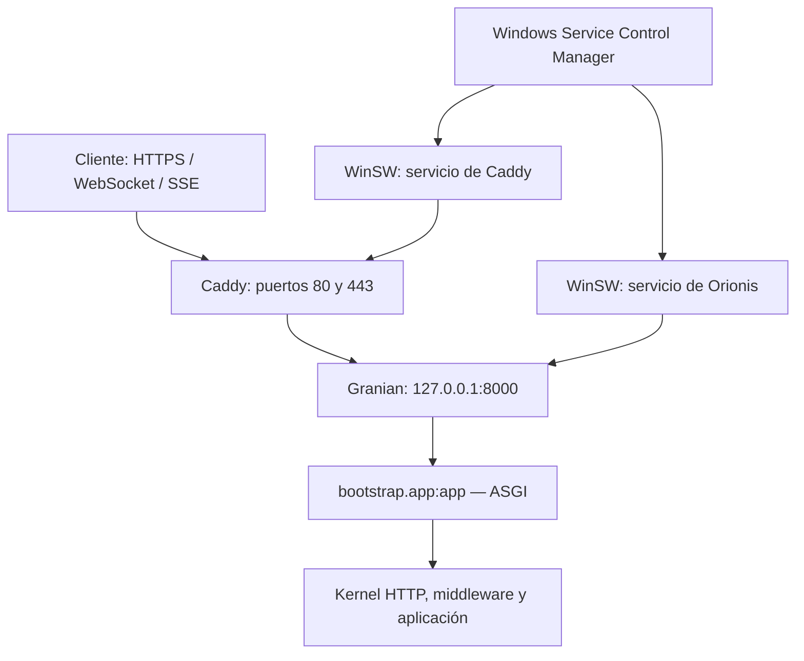

Esta guía utiliza Windows Server de 64 bits, una aplicación en `C:\Apps\Orionis\current`, Granian ASGI en `127.0.0.1:8000` y Caddy como entrada HTTPS pública. Sustituye `app.example.com` por tu dominio. Completa primero la [preparación de producción](/es/deployment).



<a id="windows-requirements"></a>

## 1. Preparar el servidor y el artefacto

Usa una edición de Windows Server compatible con las herramientas elegidas; el escenario de referencia es Windows Server 2022 o posterior, x64. Necesitas PowerShell, .NET Framework 4.8 o 4.8.1 habilitado para el wrapper indicado abajo, salida HTTPS para descargar dependencias y certificados, y permisos de administrador para registrar servicios y reglas de firewall. Revisa la [instalación de .NET en Windows Server](https://learn.microsoft.com/en-us/dotnet/framework/install/on-server-2019) si la característica no está habilitada.

El artefacto de tu aplicación debe contener `pyproject.toml`, su `uv.lock` actualizado, `reactor`, `bootstrap`, `config`, `app`, las rutas y los recursos utilizados. Despliega el código de tu aplicación; no reemplaces su bootstrap por el de otra plantilla ni copies un `.venv` de otra máquina.

Crea estas ubicaciones desde PowerShell elevado. Copia después tu artefacto en `C:\Apps\Orionis\current`:

```powershell
New-Item -ItemType Directory -Force -Path `
    C:\Apps\Orionis\current, `
    C:\Apps\Orionis\python, `
    C:\Services\Orionis\logs, `
    C:\Services\Caddy\logs, `
    C:\Services\Caddy\data, `
    C:\Services\Caddy\config, `
    C:\Tools\uv

Set-Location C:\Apps\Orionis\current
Get-Item pyproject.toml, uv.lock, reactor, bootstrap\app.py
```

Los servicios usarán rutas absolutas y un directorio de trabajo fijo. No dependerán del `PATH` ni del perfil del administrador que realiza el despliegue.

<a id="windows-python"></a>

## 2. Instalar Python y las dependencias bloqueadas

Instala uv en una ubicación explícita y guarda su Python administrado fuera del perfil personal. El componente actual requiere Python **3.14 o superior**; el ejemplo selecciona 3.14. El instalador y `uv python install` están documentados por [Astral](https://docs.astral.sh/uv/reference/installer/) y en su [guía de Python](https://docs.astral.sh/uv/guides/install-python/).

```powershell
$env:UV_INSTALL_DIR = 'C:\Tools\uv'
Invoke-RestMethod https://astral.sh/uv/install.ps1 | Invoke-Expression

$uvExe = 'C:\Tools\uv\uv.exe'
$env:UV_PYTHON_INSTALL_DIR = 'C:\Apps\Orionis\python'
& $uvExe python install 3.14

Set-Location C:\Apps\Orionis\current
& $uvExe sync --locked --no-default-groups --python 3.14
if ($LASTEXITCODE -ne 0) { throw 'No se pudo sincronizar el entorno.' }

& .\.venv\Scripts\python.exe -B -c "import sys, granian, orionis; print(sys.version); print(sys.executable)"
```

`--locked` rechaza un lockfile desactualizado; `--no-default-groups` excluye los grupos predeterminados de desarrollo. Los drivers que necesita la aplicación deben formar parte de sus dependencias bloqueadas. Consulta la [sincronización de proyectos de uv](https://docs.astral.sh/uv/concepts/projects/sync/).

<a id="windows-environment"></a>

## 3. Configurar la aplicación y su almacenamiento

Prepara el `.env` de producción en la raíz. Conserva el `APP_KEY` de esta instalación: cambiarlo durante cada publicación puede impedir leer datos previamente cifrados. Estas entradas se leen desde `config/app.py` y `config/http.py`:

```dotenv
APP_ENV=production
APP_DEBUG=bool:false
TRUSTED_PROXIES=list:["127.0.0.1"]
ALLOWED_HOSTS=list:["app.example.com"]
SESSION_DRIVER=file
SESSION_SECURE=bool:true
```

Añádelas al archivo existente junto con `APP_KEY` y las credenciales reales de tus servicios. No reemplaces el archivo completo por este fragmento. Para una aplicación nueva que todavía no tiene clave, sigue la [preparación común](/es/deployment). El componente de [entorno](/es/environment) se utiliza en configuración.

`TRUSTED_PROXIES` contiene la dirección del Caddy que conecta al backend, no la IP del visitante. Orionis acepta `X-Forwarded-For` y `X-Forwarded-Proto` cuando la conexión viene de un proxy confiable. La lista de hosts valida el dominio recibido. Consulta el [flujo de proxies](/es/deployment/reverse-proxies).

Para las rutas WEB, este ejemplo conserva las [sesiones](/es/sessions) en archivos bajo `storage/framework/sessions` y exige HTTPS para enviar su cookie. Conserva ese almacenamiento al publicar otra versión. Las rutas API no activan el flujo de sesión WEB.

Prepara el almacenamiento utilizado por este despliegue:

```powershell
New-Item -ItemType Directory -Force -Path `
    C:\Apps\Orionis\current\storage\framework, `
    C:\Apps\Orionis\current\storage\logs, `
    C:\Apps\Orionis\current\storage\app\private, `
    C:\Apps\Orionis\current\storage\app\public
```

La configuración predeterminada publica `storage/app/public` en `/static`. Si modificaste el disco `public` de `config/filesystems.py`, adapta tanto el montaje de Granian como la ruta pública de los siguientes ejemplos. Los archivos privados, `.env`, código y caché de bootstrap no deben quedar dentro del montaje público. Granian atiende ese montaje antes del kernel de Orionis: los archivos publicados no pasan por middleware de autenticación ni por las demás políticas HTTP de la aplicación.

<a id="windows-granian"></a>

## 4. Verificar Granian antes de crear los servicios

Desde la raíz, inicia temporalmente el mismo proceso que utilizará el servicio:

```powershell
& .\.venv\Scripts\python.exe -B -m granian `
    --interface asgi `
    --host 127.0.0.1 `
    --port 8000 `
    --workers 1 `
    --loop auto `
    --no-reload `
    --log-level info `
    --static-path-mount C:\Apps\Orionis\current\storage\app\public `
    --static-path-route /static `
    --static-path-dir-to-file index.html `
    bootstrap.app:app
```

El target es la instancia `app` exportada por `bootstrap/app.py`. ASGI ejecuta el lifespan de arranque y cierre. Puedes elegir `--interface rsgi` conservando el mismo target; en ese caso se utilizan los hooks RSGI. No añadas `--factory`: el bootstrap exporta una instancia, no una factory. Más detalles en [ASGI y RSGI](/es/application/server-entrypoints).

Se utiliza Granian directamente para fijar todos los argumentos del servicio, incluidos loopback, workers y recarga. Desde 1.0.13, `reactor serve --host 127.0.0.1` también permite elegir loopback; al omitir `--host`, su lanzamiento normal en producción usa `0.0.0.0`. En Windows ese comando selecciona un worker y loop `auto`; esta guía conserva esas decisiones. `--no-reload` evita recargar el código durante la ejecución del servicio.

En otra consola, comprueba la ruta de salud configurada en `app.withRouting(health="/up")`:

```powershell
curl.exe --fail --silent --show-error `
    --header "Host: app.example.com" `
    http://127.0.0.1:8000/up
```

Si tu aplicación cambió o deshabilitó esa ruta, utiliza su comprobación real. Detén el proceso de prueba con `Ctrl+C` antes de iniciar el servicio para liberar el puerto.

<a id="windows-services"></a>

## 5. Registrar Orionis como servicio con WinSW

Descarga el wrapper .NET de la [release oficial WinSW 2.12.0](https://github.com/winsw/winsw/releases/tag/v2.12.0), cuya sintaxis XML corresponde a estos ejemplos. No registres `python.exe` directamente con `sc.exe`: utiliza el wrapper que implementa la integración con el gestor de servicios.

```powershell
Invoke-WebRequest `
    -Uri https://github.com/winsw/winsw/releases/download/v2.12.0/WinSW.NET461.exe `
    -OutFile C:\Services\Orionis\orionis-service.exe

Copy-Item C:\Services\Orionis\orionis-service.exe `
    C:\Services\Caddy\caddy-service.exe
```

Crea `C:\Services\Orionis\orionis-service.xml` junto al ejecutable del mismo nombre base. La cuenta `LocalService`, el directorio de trabajo, las variables y los reintentos pertenecen a la [configuración del wrapper](https://github.com/winsw/winsw/blob/v2/doc/xmlConfigFile.md):

```xml
<service>
  <id>OrionisApp</id>
  <name>Orionis Application</name>
  <description>Orionis ASGI backend</description>
  <executable>C:\Apps\Orionis\current\.venv\Scripts\python.exe</executable>
  <arguments>-B -m granian --interface asgi --host 127.0.0.1 --port 8000 --workers 1 --loop auto --no-reload --log-level info --static-path-mount C:\Apps\Orionis\current\storage\app\public --static-path-route /static --static-path-dir-to-file index.html bootstrap.app:app</arguments>
  <workingdirectory>C:\Apps\Orionis\current</workingdirectory>
  <env name="PYTHONUTF8" value="1"/>
  <env name="PYTHONUNBUFFERED" value="1"/>
  <startmode>Automatic</startmode>
  <serviceaccount>
    <domain>NT AUTHORITY</domain>
    <user>LocalService</user>
  </serviceaccount>
  <onfailure action="restart" delay="10 sec"/>
  <stoptimeout>30 sec</stoptimeout>
  <logpath>C:\Services\Orionis\logs</logpath>
  <log mode="roll-by-size">
    <sizeThreshold>10240</sizeThreshold>
    <keepFiles>8</keepFiles>
  </log>
</service>
```

El wrapper captura stdout/stderr y rota sus archivos al alcanzar 10 MiB, conservando ocho archivos rotados por flujo. Estos archivos son distintos de los canales de la fachada `Log`. Consulta [logging de WinSW](https://github.com/winsw/winsw/blob/v2/doc/loggingAndErrorReporting.md) y [Logs de Orionis](/es/logging).

Al detener el servicio, WinSW intenta enviar `Ctrl+C` y espera hasta 30 segundos según `stoptimeout`; después puede forzar la terminación. Una finalización forzada no garantiza completar los hooks ni los bloques `finally` de aplicación. Ajusta el plazo a las operaciones de cierre de tu aplicación.

Concede lectura del código y del runtime, y escritura únicamente en las ubicaciones utilizadas por el proceso. El siguiente ejemplo de [ACL con `icacls`](https://learn.microsoft.com/en-us/windows-server/administration/windows-commands/icacls) está pensado para los directorios nuevos y dedicados creados arriba; conserva acceso completo para administradores y SYSTEM. Los SID evitan depender del idioma de Windows:

```powershell
icacls C:\Apps\Orionis /inheritance:r /grant:r `
    '*S-1-5-32-544:(OI)(CI)F' `
    '*S-1-5-18:(OI)(CI)F' `
    '*S-1-5-19:(OI)(CI)RX'

icacls C:\Apps\Orionis\current\storage /grant:r `
    '*S-1-5-19:(OI)(CI)M'

icacls C:\Services\Orionis /inheritance:r /grant:r `
    '*S-1-5-32-544:(OI)(CI)F' `
    '*S-1-5-18:(OI)(CI)F' `
    '*S-1-5-19:(OI)(CI)RX'

icacls C:\Services\Orionis\logs /grant:r `
    '*S-1-5-19:(OI)(CI)M'

& C:\Services\Orionis\orionis-service.exe install
& C:\Services\Orionis\orionis-service.exe start
Get-Service OrionisApp
```

`LocalService` es una identidad compartida entre los servicios configurados con esa cuenta. Si necesitas aislar aplicaciones o credenciales entre servicios, usa identidades dedicadas y ajusta las ACL a cada identidad. También concede los permisos que requieran rutas personalizadas o una base SQLite fuera de `storage`; no concedas escritura general al directorio de código.

<a id="windows-caddy"></a>

## 6. Configurar Caddy y HTTPS

Descarga el binario estándar **Windows amd64** desde [Caddy](https://caddyserver.com/download) y guárdalo como `C:\Services\Caddy\caddy.exe`. Crea `C:\Services\Caddy\Caddyfile`:

```text
app.example.com {
    log

    reverse_proxy 127.0.0.1:8000
}
```

Caddy conserva el host, genera los encabezados de forwarding y admite el upgrade WebSocket. Las respuestas SSE con `Content-Type: text/event-stream` se envían sin esperar el buffering periódico. Consulta la [referencia de `reverse_proxy`](https://caddyserver.com/docs/caddyfile/directives/reverse_proxy) y los [ajustes de streaming](/es/deployment/reverse-proxies).

El dominio debe resolver al servidor, los puertos TCP 80/443 deben ser accesibles y el directorio de datos debe ser persistente y escribible para obtener y renovar certificados. Revisa los [requisitos de HTTPS automático](https://caddyserver.com/docs/automatic-https). Este ejemplo termina TLS en Caddy; la conexión local con Granian usa HTTP.

Crea `C:\Services\Caddy\caddy-service.xml`. La [guía oficial de servicio en Windows](https://caddyserver.com/docs/running#windows-service) utiliza WinSW; aquí se fijan además sus directorios:

```xml
<service>
  <id>OrionisProxy</id>
  <name>Orionis Caddy Proxy</name>
  <executable>C:\Services\Caddy\caddy.exe</executable>
  <arguments>run --config C:\Services\Caddy\Caddyfile --adapter caddyfile</arguments>
  <workingdirectory>C:\Services\Caddy</workingdirectory>
  <env name="XDG_DATA_HOME" value="C:\Services\Caddy\data"/>
  <env name="XDG_CONFIG_HOME" value="C:\Services\Caddy\config"/>
  <startmode>Automatic</startmode>
  <serviceaccount>
    <domain>NT AUTHORITY</domain>
    <user>LocalService</user>
  </serviceaccount>
  <onfailure action="restart" delay="10 sec"/>
  <stoptimeout>30 sec</stoptimeout>
  <logpath>C:\Services\Caddy\logs</logpath>
  <log mode="roll-by-size">
    <sizeThreshold>10240</sizeThreshold>
    <keepFiles>8</keepFiles>
  </log>
</service>
```

Con estas variables Caddy guarda certificados bajo `C:\Services\Caddy\data\caddy` y configuración persistida bajo `C:\Services\Caddy\config\caddy`. Conserva esos directorios entre publicaciones; los certificados no son caché desechable. Véanse las [ubicaciones oficiales de Caddy](https://caddyserver.com/docs/conventions#file-locations).

```powershell
icacls C:\Services\Caddy /inheritance:r /grant:r `
    '*S-1-5-32-544:(OI)(CI)F' `
    '*S-1-5-18:(OI)(CI)F' `
    '*S-1-5-19:(OI)(CI)RX'

icacls C:\Services\Caddy\data /grant:r '*S-1-5-19:(OI)(CI)M'
icacls C:\Services\Caddy\config /grant:r '*S-1-5-19:(OI)(CI)M'
icacls C:\Services\Caddy\logs /grant:r '*S-1-5-19:(OI)(CI)M'

& C:\Services\Caddy\caddy.exe validate `
    --config C:\Services\Caddy\Caddyfile --adapter caddyfile
if ($LASTEXITCODE -ne 0) { throw 'Caddyfile inválido.' }

New-NetFirewallRule -DisplayName 'Orionis HTTPS proxy' `
    -Direction Inbound -Action Allow -Protocol TCP -LocalPort 80,443

& C:\Services\Caddy\caddy-service.exe install
& C:\Services\Caddy\caddy-service.exe start
Get-Service OrionisApp, OrionisProxy
```

La regla abre los puertos públicos del proxy mediante [`New-NetFirewallRule`](https://learn.microsoft.com/en-us/powershell/module/netsecurity/new-netfirewallrule). Si el servidor está en una nube o detrás de NAT, configura también las reglas externas. Granian sigue escuchando exclusivamente en loopback; no necesita una regla pública para el puerto 8000.

<a id="windows-verification"></a>

## 7. Comprobar y actualizar el despliegue

Verifica primero el backend, después el proxy desde una máquina externa:

```powershell
curl.exe --fail --silent --show-error `
    --header "Host: app.example.com" http://127.0.0.1:8000/up

curl.exe --fail --silent --show-error https://app.example.com/up
Get-NetTCPConnection -State Listen -LocalPort 8000
```

El backend debe aparecer con `LocalAddress=127.0.0.1`. Comprueba además una ruta real de aplicación y un archivo público; `/up` no verifica por sí sola la base de datos ni los servicios externos. Prueba tus conexiones `wss://` y SSE a través del dominio público cuando la aplicación las utilice, siguiendo [Realtime](/es/realtime).

Para modificar solo Caddy, valida y recarga su configuración:

```powershell
& C:\Services\Caddy\caddy.exe validate `
    --config C:\Services\Caddy\Caddyfile --adapter caddyfile
if ($LASTEXITCODE -ne 0) { throw 'Caddyfile inválido.' }

& C:\Services\Caddy\caddy.exe reload `
    --config C:\Services\Caddy\Caddyfile --adapter caddyfile
```

Para una publicación sencilla con interrupción controlada, detén Orionis y espera la detención antes de sustituir el código o su entorno:

```powershell
& C:\Services\Orionis\orionis-service.exe stopwait
Set-Location C:\Apps\Orionis\current
```

Publica el artefacto conservando `.env`, la clave y los datos persistentes. Repite la sincronización bloqueada con `UV_PYTHON_INSTALL_DIR` apuntando al mismo runtime; ejecuta después:

```powershell
& .\.venv\Scripts\python.exe -B reactor optimize:clear
if ($LASTEXITCODE -ne 0) { throw 'No se pudo limpiar la caché.' }

# Solo si la publicación incorpora migraciones pendientes.
& .\.venv\Scripts\python.exe -B reactor migrate
if ($LASTEXITCODE -ne 0) { throw 'No se completaron las migraciones.' }

& C:\Services\Orionis\orionis-service.exe start
```

La limpieza afecta las cachés locales y otros artefactos descritos en [caché de aplicación](/es/application/paths-and-caching); no actualiza procesos de otros servidores. Una actualización de este único backend interrumpe peticiones y conexiones largas: no es una estrategia de cero interrupciones. Para revertir código, ten en cuenta también la compatibilidad del esquema y los datos, según las [migraciones](/es/database/migrations).

Si el servicio no inicia, revisa los archivos de `C:\Services\Orionis\logs` o `C:\Services\Caddy\logs`, el directorio de trabajo, el acceso al runtime Python y las ACL del almacenamiento. Un `502` del proxy exige comprobar primero que Granian está activo y acepta la petición local. Los errores de certificado requieren comprobar DNS, acceso a 80/443 y escritura en los datos de Caddy.
