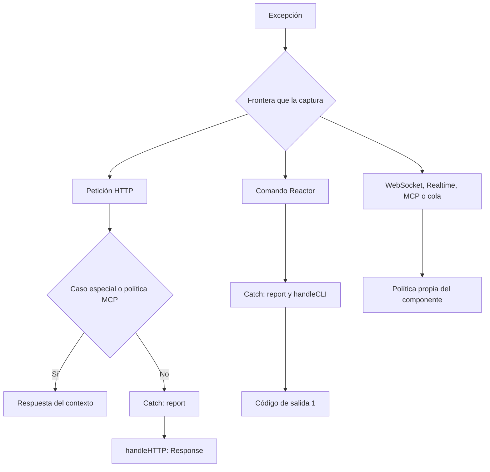

Registrar `app.withExceptionHandler(ExceptionHandler)` selecciona el manejador de la aplicación. Cada componente decide **cuándo lo invoca y qué método utiliza**. No instala un `try/except` alrededor de todo el proceso ni convierte cualquier fallo en una página HTTP.

## Qué frontera procesa cada fallo

<a id="context-boundaries"></a>

| Contexto | Tratamiento implementado | Participación del manejador registrado |
| --- | --- | --- |
| HTTP API y WEB | Respuestas especiales de validación, tamaño de cuerpo y fallback; los demás errores de la cadena se delegan. | `Catch.exception()` llama a `report()` y después a `handleHTTP()`. |
| Comando Reactor | Captura `Exception`, registra el fallo y devuelve código `1`. | `Catch.exception()` llama a `report()` y después a `handleCLI()`. |
| WebSocket directo | Ignora la desconexión esperada; ante otros errores registra un mensaje genérico, intenta cerrar y propaga. | El kernel WebSocket no llama automáticamente a `Catch`. |
| Método remoto Realtime | Devuelve un error del protocolo asociado al identificador de la invocación. | La traducción de la invocación no llama al manejador global. |
| MCP | Conserva JSON-RPC, resultados `isError` y estados propios del transporte. | El dispatcher y la política HTTP usan `report()` en sus fronteras de reporte; no `handleHTTP()` ni `handleCLI()`. |
| Tarea de respuesta / streaming HTTP | Cierra recursos y propaga fallos de entrega o del trabajo posterior. | Esa entrega está fuera del bloque de conversión de errores de la petición. |
| Job de cola | Aplica timeout, reintento o fallo persistido según la política del job y el worker. | El worker tiene su propia política; no llama a `Catch`. |
| Arranque y apagado | Propaga el fallo o comunica el fallo de lifespan al servidor ASGI. | No se presenta como una excepción de controlador o comando. |



## HTTP: convertir el fallo antes de enviar la respuesta

<a id="context-http"></a>

La lectura del cuerpo, la resolución de rutas, la construcción del controlador y sus middleware se ejecutan dentro del procesamiento HTTP. El kernel captura `Exception` y distingue estos casos:

- `PayloadTooLargeException`: respuesta `413`, sin pasar por el presentador global.
- `ValidationException` en API: `422` JSON con errores de campos. En WEB, el terminal de rutas genera la respuesta de validación dentro de la capa de sesión para conservar los datos flash y la redirección correspondiente.
- `RouteNotFound` con fallback registrado: ejecuta ese fallback; no equivale automáticamente a un error `500`.
- Una política de endpoint, como MCP: delega en esa política antes de las reglas anteriores.
- Los demás fallos: `Catch.exception(exception, request)` reporta y solicita `handleHTTP()` al manejador registrado.

La capa WEB de sesión también captura excepciones de sus componentes siguientes mientras la sesión está disponible. Un handler puede, por tanto, intervenir desde esa capa sin esperar al bloque exterior del kernel.

Para observar un error inesperado, registra esta clase y su acción como cualquier [controlador HTTP](/es/http/controllers):

```python
from orionis.http import JSONResponse
from orionis.support.facades import Route


class ErrorDemoController:
    async def show(self) -> JSONResponse:
        raise RuntimeError("Example controller failure")


Route.get("/examples/error", [ErrorDemoController, "show"])
```

Este ejemplo activa la política de errores; no devuelve el `JSONResponse` anotado. El modo debug, la excepción y el handler determinan la respuesta real. La [guía de excepciones HTTP](/es/http/exceptions) explica la página de diagnóstico y sus datos, y la [personalización del handler](/es/exceptions/handling-exceptions) explica cómo cambiar el resultado.

## CLI: excepción, retorno y salida del parser

<a id="context-cli"></a>

`Reactor.call()` abre un scope con contexto `CONSOLE`. Cuando falla la búsqueda, construcción o ejecución del comando con una `Exception`, registra el fallo, delega en `Catch` y devuelve `1` si el manejador termina correctamente. Durante la ejecución puede añadir el nombre de clase y método al mensaje de la excepción.

```python
from orionis.console.base import BaseCommand


class FailCommand(BaseCommand):
    signature = "examples:fail"
    description = "Demonstrate the command exception boundary."

    async def handle(self) -> int:
        raise RuntimeError("Example command failure")
```

Guarda el comando en el directorio de comandos de la aplicación y ejecútalo mediante una alternativa:

```shell
orionis examples:fail
python -B reactor examples:fail
```

Una acción que devuelve `1` por decisión propia también produce un estado no exitoso, pero **no ha lanzado una excepción**: no activa `Catch`. Los enteros retornados por la acción se conservan; otros resultados se normalizan a `0`.

La ayuda y los errores de argumentos siguen la salida del parser (`SystemExit`), con su código correspondiente; no pasan por `except Exception`. Tampoco se garantiza un retorno `1` si falla el propio servicio de logging o el manejador. Consulta [ejecución de comandos](/es/console/commands-and-arguments).

## WebSocket directo: cierre y desconexión

<a id="context-websocket"></a>

Después de aceptar una conexión WebSocket ya no se envía una página de excepción como respuesta HTTP. Un rechazo previo al handshake utiliza `socket.reject(status_code=...)`; una conexión aceptada utiliza mensajes y cierre WebSocket.

El kernel trata `WebSocketDisconnected` como una finalización esperada. Para otra `Exception`, registra `WebSocket handler failed`, intenta cerrar una conexión aceptada con `1011` si el transporte admite detalles de cierre, o `1000` si no los admite, y **vuelve a lanzar la excepción**. El bloque de limpieza cierra el socket si sigue abierto y libera su capacidad.

El adaptador RSGI no expone detalles de cierre WebSocket: ese valor alternativo no garantiza un código `1000` observado por el navegador. El `status` de su API de cierre se utiliza para el rechazo HTTP, no para transmitir un frame con código `1011`.

Este endpoint trata un error de entrada recuperable sin terminar la conexión:

```python
from orionis.http import WebSocket, WebSocketDisconnected
from orionis.support.facades import Route


async def double_number(socket: WebSocket) -> None:
    await socket.accept()
    try:
        while True:
            raw = await socket.receiveText()
            try:
                number = int(raw)
            except ValueError:
                await socket.sendJson({"error": "Send an integer."})
                continue
            await socket.sendJson({"result": number * 2})
    except WebSocketDisconnected:
        return


Route.websocket("/examples/double", double_number)
```

Colócalo en el [archivo de rutas WebSocket](/es/realtime/routing-and-lifecycle) registrado por la aplicación. El `except ValueError` solo cubre la conversión del dato: un error de infraestructura o de envío continúa hasta la frontera del kernel.

## Realtime: errores de invocación y de conexión

<a id="context-realtime"></a>

Un hub usa WebSocket, pero sus métodos `@remote` tienen una frontera adicional por invocación. Un fallo de un método suele finalizar esa invocación con `completion.error`; para un stream utiliza `stream_complete.error`. No requiere cerrar toda la conexión.

| Fallo de la invocación | Código enviado al cliente |
| --- | --- |
| `RPCError(code, message)` | El `code` indicado. |
| Validación de argumentos convertida por el binder | `validation_error`. |
| Autenticación / autorización | `unauthorized` / `forbidden`. |
| Vencimiento del timeout | `timeout`. |
| Cancelación | Intenta enviar `cancelled` y propaga la cancelación. |
| Otra `Exception` | `internal_error`. |

La respuesta del runtime utiliza `"Invocation failed"` como mensaje para los códigos controlados y `"Internal server error"` para `internal_error`. **No transmite el `message` de `RPCError`**, ni el texto de excepciones arbitrarias. Traduce el código en el cliente para presentar una explicación útil.

```python
from orionis.realtime import Hub, remote
from orionis.realtime.errors import RPCError
from orionis.support.facades import Route


class CalculationHub(Hub):
    @remote
    async def divide(self, numerator: float, denominator: float) -> float:
        if denominator == 0:
            raise RPCError("division_by_zero", "A nonzero divisor is required.")
        return numerator / denominator


Route.hub("/examples/calculations", CalculationHub)
```

Una invocación con divisor cero recibe, conservando su identificador:

```json
{"type":"completion","id":"calculation-1","error":{"code":"division_by_zero","message":"Invocation failed"}}
```

Los errores de protocolo de conexión son distintos: un mensaje inválido o un identificador activo duplicado puede terminar la conexión con el código de `ProtocolError` (`1002` por defecto). Un fallo fuera de la frontera del método, por ejemplo en `onConnect()`, se propaga tras la limpieza. Un error de `onDisconnect()` se registra y no debe impedir el cierre; ese hook dispone de un límite de cinco segundos. La traducción de errores remotos **no invoca automáticamente el handler global para reportar cada fallo**. Si necesitas un reporte adicional de una operación, añádelo en esa operación antes de volver a lanzar su excepción.

Consulta [hubs y métodos remotos](/es/realtime/hubs-and-methods) y el [protocolo y los streams](/es/realtime/protocol-and-streaming) para el cliente y la gestión de invocaciones.

## MCP: separar errores de herramienta y JSON-RPC

<a id="context-mcp"></a>

El transporte MCP preserva sus formatos aunque `app.debug` esté activo. El dispatcher reporta fallos inesperados mediante `app.getExceptionHandler()` y `app.call(handler, "report", exception=...)`, pero no solicita una página HTML ni una salida CLI. El reporte es una operación protegida: su fallo no sustituye el error original del protocolo.

Hay tres situaciones diferentes:

1. **Error esperado de negocio en una tool:** devuelve `McpResponse.error("mensaje seguro")`. El resultado tiene `isError: true`; no es una excepción ni un reporte automático del handler.
2. **Excepción inesperada durante la ejecución o normalización de una tool:** se reporta y devuelve un resultado con `isError: true` y texto `"Tool execution failed"`. La validación de entrada de tool produce `"Invalid tool arguments"` sin revelar el detalle interno.
3. **Error de protocolo, de prompt o de recurso:** usa el objeto JSON-RPC `error`. Los fallos inesperados de ejecución de recursos/prompts se reportan y se convierten en `-32603`, `"Internal error"`. `McpProtocolException` conserva su código, mensaje, `data` opcional y estado HTTP cuando corresponde; esos datos son explícitamente públicos.

```python
from orionis.mcp import McpResponse, Tool
from orionis.schemas import Schema


class DivisionInput(Schema):
    numerator: float
    denominator: float


class DivideTool(Tool[DivisionInput]):
    name = "divide"
    description = "Divide two numbers."
    input = DivisionInput

    async def handle(self, payload: DivisionInput) -> McpResponse:
        if payload.denominator == 0:
            return McpResponse.error("Use a nonzero denominator.")
        return McpResponse.text(str(payload.numerator / payload.denominator))
```

Registra `DivideTool` en `Server.tools`, como en la [guía de herramientas](/es/mcp/tools). La división por cero produce los siguientes campos de un resultado de herramienta; se omiten los metadatos `_meta` del servidor:

```json
{"jsonrpc":"2.0","id":1,"result":{"resultType":"complete","content":[{"type":"text","text":"Use a nonzero denominator."}],"isError":true}}
```

Un fallo de protocolo utiliza otra estructura:

```json
{"jsonrpc":"2.0","id":1,"error":{"code":-32603,"message":"Internal error"}}
```

La política HTTP de endpoints MCP también reporta errores de middleware/kernel y los traduce a respuestas JSON-RPC saneadas. El transporte captura por su cuenta determinados errores de lectura, protocolo o capacidad; no todos ellos pasan por `report()`. Las notificaciones válidas no generan una respuesta JSON-RPC y pueden recibir HTTP `202`. En STDIO la frontera del dispatcher conserva la misma separación entre resultado de herramienta y error de protocolo. Consulta [transportes MCP](/es/mcp/stdio-and-configuration) para su ejecución.

## Scheduler: código de salida, error de tarea y error de listener

<a id="context-scheduler"></a>

Las tareas programadas de comandos ejecutan `Reactor.call()`. Por ello, un comando que lanza una excepción capturada puede terminar con retorno `1` y producir **ejecución completada** de la tarea. Revisa `event.retval` en `onTaskExecuted()`; `onTaskError()` corresponde a una excepción que escapó de la función programada.

```python
from orionis.console.base import BaseTaskListener
from orionis.console.entities import TaskEvent


class CommandResultListener(BaseTaskListener):
    async def onTaskExecuted(self, event: TaskEvent) -> None:
        if event.retval != 0:
            self.warning(f"{event.signature}: exit code {event.retval}")

    async def onTaskError(self, event: TaskEvent) -> None:
        self.error(f"{event.signature}: {event.exception}")
```

Registra una **instancia** mediante `registerListener()` en la [configuración de tareas](/es/console/scheduler-listeners). Los fallos de listeners sync/async se registran y se intenta delegarlos a `ICatch`. Esa delegación necesita un scope activo con clave `kernel`; fuera de él puede fallar y el scheduler registra `Error in exception handler`. No asumas que todo listener ejecuta con el scope CLI del comando: la ejecución del listener es otra frontera. Su fallo no cambia retroactivamente el retorno del comando.

## Colas: conservar la política de reintentos

<a id="context-queues"></a>

El worker captura las excepciones del job, registra el intento y decide entre liberarlo con el retraso correspondiente o persistir un fallo terminal. Considera `max_tries`, `backoff`, `retry_until`, el tipo de error y si se solicitó propagación inmediata. Los errores de payload, configuración y reintento no se tratan como fallos transitorios reintentables.

Para una condición definitivamente inválida, un job puede marcar el fallo explícitamente:

```python
from dataclasses import dataclass
from orionis.queues import BaseJob, JobContext


@dataclass
class ValidateReportJob(BaseJob):
    report_id: int

    async def handle(self, context: JobContext) -> None:
        if self.report_id <= 0:
            await context.fail(ValueError("report_id must be positive"))
            return
```

`context.fail()` requiere el repositorio de fallos configurado: registra el fallo terminal y confirma esa transición sobre la reserva. En un job real, continúa con la operación después de comprobar sus entradas. Si capturas una excepción recuperable y terminas normalmente, el worker puede considerar completado el job; para que aplique su política de reintento deja que la excepción se propague o usa la transición explícita adecuada.

En ejecución inmediata con `raise_errors=True`, el worker desactiva los reintentos automáticos de ese intento, intenta registrar el fallo y vuelve a lanzar la excepción. Una cancelación intenta liberar el trabajo pendiente y se propaga. Consulta [fallos y reintentos](/es/queues/failures-and-retries) y [formas de ejecución](/es/queues/execution-modes).

La conexión `sync` utiliza precisamente esa ejecución inmediata: `await Queue.dispatch(job)` puede propagar el error al controlador o comando que despachó el job. Un error al enviar un job a otra conexión también se propaga al llamador; es distinto del fallo posterior que captura su worker.

## Streams, SSE y trabajo posterior a la respuesta

<a id="context-response-delivery"></a>

La conversión de una excepción del controlador termina al construir `Response`. Los adaptadores ASGI/RSGI realizan después la entrega, el consumo del stream y `response.runBackground()`. Un fallo en esas etapas puede ocurrir cuando los encabezados o el cuerpo ya fueron enviados: no se reemplazan automáticamente por otra respuesta del handler.

```python
from orionis.background import BackgroundTask
from orionis.http import JSONResponse


async def verify_report_id(report_id: int) -> None:
    if report_id <= 0:
        raise ValueError("Invalid report identifier")


class ReportController:
    async def show(self) -> JSONResponse:
        return JSONResponse(
            {"report_id": 42},
            background=BackgroundTask(verify_report_id, 42),
        )
```

`BackgroundTask` registra un error y vuelve a lanzarlo; no lo convierte en un resultado exitoso ni llama automáticamente a `Catch`. Un stream o una tarea fallida tampoco dispone de reintentos de cola por el hecho de ser trabajo asíncrono. Consulta [tareas asociadas a respuestas](/es/queues/background-tasks/response-tasks).

`BackgroundTasks` ejecuta sus tareas secuencialmente. Si una falla, la excepción interrumpe el recorrido y las tareas siguientes no se ejecutan.

En SSE, los adaptadores observan la desconexión, cancelan el envío y cierran el productor. El trabajo de fondo se ejecuta tras una entrega y limpieza completadas, no al abandonar el stream por desconexión. Un fallo del productor o de limpieza se propaga; evita prometer al cliente un nuevo JSON o HTML sobre un stream ya iniciado. Una excepción gestionada dentro del productor solo debe convertirse en un evento de aplicación si defines ese contrato con el cliente.

## Arranque, cancelación y ejecución fuera de un kernel

<a id="context-startup-and-cancellation"></a>

Una excepción al crear configuración, registrar proveedores, arrancar kernels o ejecutar hooks de ciclo de vida no equivale a una excepción de endpoint. El lifespan ASGI comunica `lifespan.startup.failed` o `lifespan.shutdown.failed` con el mensaje del fallo y termina ese flujo. El arranque CLI ocurre antes del bloque de ejecución del comando; un fallo allí no se transforma mediante `Reactor.call()`. Consulta [ciclo de vida](/es/application/lifecycle).

Los hooks RSGI de arranque y apagado ejecutan el ciclo de vida con el loop recibido y propagan sus errores; no generan esos mensajes de lifespan ASGI.

`except Exception` no captura `asyncio.CancelledError`, `SystemExit` ni `KeyboardInterrupt`. Los componentes que capturan `BaseException` para limpiar recursos vuelven a propagar el fallo; esa limpieza no implica que el handler global haya procesado el error. No pases manualmente una cancelación a `Catch` para simular un error ordinario.

El [contenedor](/es/application/container) propaga los errores de construcción e invocación a su llamador. Si lo usa un controlador, un comando o una tool, la frontera exterior descrita arriba decide el resultado. Una llamada desde código propio sin esa frontera no recibe automáticamente presentación HTTP/CLI.

`Catch.exception()` exige un scope activo y su clave `kernel`. Fuera de ese contexto, para **reportar explícitamente** desde un componente que dispone de `IApplication`, obtén el handler con `app.getExceptionHandler()` y ejecuta `report()` mediante `app.call()`. No solicites `handleHTTP()` ni `handleCLI()` si solo necesitas registrar el fallo.

La aplicación debe estar creada. El [ejemplo de reporte de errores recuperados](/es/exceptions/handling-exceptions#handler-recovered-errors) muestra este patrón con inyección; la [referencia de `Catch` y del handler](/es/exceptions/policies-and-reference) detalla sus contratos y requisitos. Este reporte explícito no instala una captura global ni una política de reintento.
