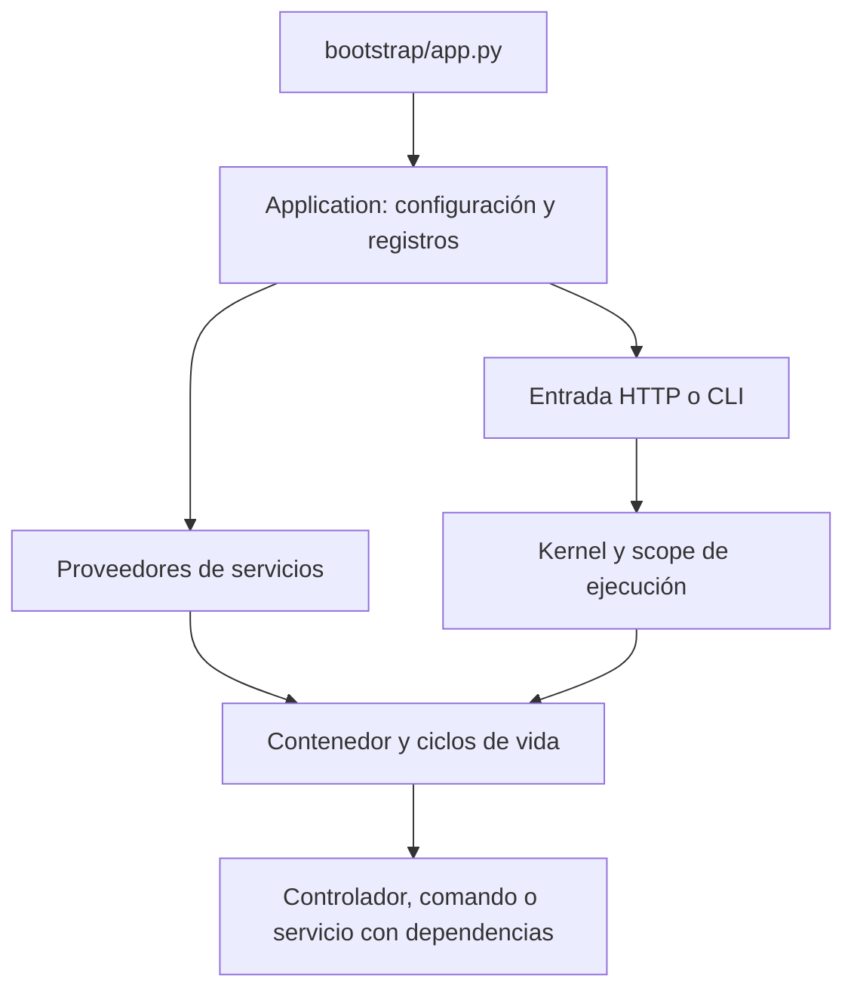

`Application` organiza el arranque y la ejecución de Orionis. Extiende `Container`: **la aplicación también es el contenedor** que registra y construye sus servicios. No necesitas crear un contenedor por separado para cada controlador o comando.

`IApplication` expresa ese contrato e incluye las operaciones de `IContainer`. La instancia se registra durante `create()` y puede recibirse mediante inyección. Los proveedores declaran servicios; el contenedor resuelve dependencias; los kernels HTTP y CLI coordinan cada solicitud o comando.

## Cómo se conectan



El bootstrap prepara metadatos. Una caché válida puede restaurarlos desde disco; las instancias de servicios se construyen en la memoria de cada proceso. Un singleton del contenedor no es una instancia compartida entre workers o servidores.

## Recorrido recomendado

| Necesidad | Guía |
|---|---|
| Creación, arranque y cierre | [Ciclo de vida](/es/getting-started/application-lifecycle) |
| Integración del servidor y protocolos | [ASGI y RSGI](/es/getting-started/server-entrypoints) |
| Inyectar la aplicación y consultar sus servicios | [IApplication y API](/es/getting-started/application-api) |
| Configurar el archivo de arranque | [Opciones de bootstrap](/es/getting-started/bootstrap-options) |
| Definir y consultar configuración | [Configuración de aplicación](/es/getting-started/configuration) |
| Rutas físicas y caché por despliegue | [Directorios y caché](/es/getting-started/paths-and-caching) |
| Registrar clases e invocar callables con DI | [Contenedor](/es/architecture/service-container) y [registro e invocación](/es/architecture/service-container/bindings-and-invocation) |
| Elegir transient, singleton o scoped | [Scopes y concurrencia](/es/architecture/service-container/scopes-and-concurrency) |
| Organizar registros e inicialización | [Proveedores](/es/architecture/service-container/providers-and-facades) |
| Exponer un servicio mediante fachada | [Fachadas sync y async](/es/architecture/service-container/facades) |

Las variables `.env` se leen exclusivamente en archivos de configuración; su guía independiente es [Entorno](/es/architecture/environment). Durante runtime usa los valores resueltos con `app.config()`. Las APIs de Database, Storage, HTTP o Queues se explican en sus secciones; aquí se documenta cómo la aplicación las integra.

## Un ejemplo de inyección

Guarda este controlador en `app/http/controllers/app_info_controller.py`:

```python
from orionis.foundation.contracts.application import IApplication
from orionis.http import JSONResponse


class AppInfoController:
    def __init__(self, app: IApplication) -> None:
        self.app = app

    async def __call__(self) -> JSONResponse:
        return JSONResponse({
            "name": self.app.config("app.name"),
            "created": self.app.isCreated,
        })
```

En un archivo de rutas API:

```python
from app.http.controllers.app_info_controller import AppInfoController
from orionis.support.facades import Route

Route.get("/app-info", AppInfoController)
```

La ruta entrega la clase al contenedor. No construyas otra `Application` dentro del manejador. La [referencia de IApplication](/es/getting-started/application-api) muestra también inyección por método y límites de configuración compartida.
