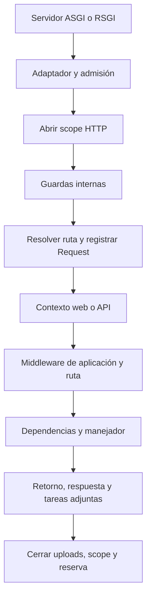
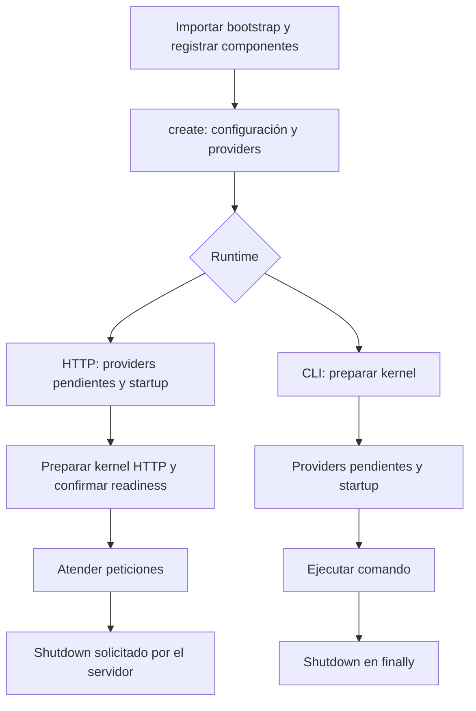

Esta guía conecta el procesamiento HTTP, el bootstrap y la estructura del proyecto. Los ejemplos de archivos completos utilizan el stack SSR; cada stack conserva los componentes que necesita.

## Arquitectura general y ASGI/RSGI

`Application` reúne la configuración, el contenedor de servicios y los puntos de entrada de la aplicación. Expone ASGI mediante `__call__(scope, receive, send)` y RSGI mediante `__rsgi__(scope, protocol)`. Sus adaptadores normalizan los metadatos y el acceso al cuerpo, y delegan en el mismo kernel HTTP. Los controladores utilizan `Request`, dependencias y respuestas de Orionis sin escribir implementaciones diferentes para cada servidor.

ASGI conecta aplicaciones asíncronas de Python con servidores como [Uvicorn](https://github.com/Kludex/uvicorn) y [Hypercorn](https://github.com/pgjones/hypercorn). RSGI es la interfaz utilizada por [Granian](https://github.com/emmett-framework/granian), un servidor implementado en Rust. Recomendamos Granian: su diseño busca una implementación HTTP correcta y un rendimiento estable, y el comando `serve` de Orionis lo utiliza por defecto con RSGI. También puede ejecutar la aplicación mediante ASGI.

Los eventos de startup y shutdown preparan y cierran el contexto de ejecución de la aplicación; no se ejecutan por cada petición. En el arranque HTTP habitual se inicializa el kernel y se preparan rutas, planes de invocación y middleware antes de anunciar que la aplicación está lista.

## Ciclo de vida de una petición HTTP

El recorrido de una petición admitida sigue este orden:

1. **Entrada y adaptación.** El servidor llama al punto de entrada ASGI o RSGI. Orionis selecciona el manejador HTTP y construye el adaptador que expone método, ruta, encabezados y datos de conexión.
2. **Comprobaciones previas a la admisión.** Una política especial de endpoint, cuando existe, puede responder inmediatamente. Después, el kernel intenta reservar capacidad de ejecución; si está agotada, responde `503` con `Retry-After: 1`, sin abrir un scope de petición.
3. **Contexto de petición.** El kernel abre un scope del contenedor mediante `ContextVar` y lo identifica como contexto HTTP. Los servicios `scoped` resueltos durante ese trabajo pertenecen a ese scope. En este momento todavía no existe el objeto `Request` de la ruta.
4. **Guardas internas.** Se procesan proxies de confianza, mantenimiento, seguridad y CORS; después se comprueban los encabezados de longitud del cuerpo y el límite de frecuencia, cuando está habilitado. Estas comprobaciones pueden producir respuestas anticipadas sin ejecutar controladores.
5. **Resolución de ruta.** El resolver busca el método y la ruta compilada y convierte sus parámetros. `HEAD` utiliza la ruta `GET`; `OPTIONS` puede responder con los métodos admitidos. Tras una coincidencia HTTP se crea `Request`, con sus parámetros y límites, y se registra en el scope. El cuerpo se lee cuando se solicita.
6. **Contexto web o API.** Una ruta web ordinaria ejecuta sesión, CSRF e identidad de sesión, en ese orden. Una ruta API resuelve identidad por token. Resolver identidad permite invitados; la protección exige middleware de autenticación o autorización. `public()` omite estas capas de contexto.
7. **Middleware de aplicación y ruta.** A continuación se ejecutan los registrados con `withMiddleware()` y luego los propios de la ruta, respetando las exclusiones configuradas. `public()` conserva estos middleware. Cada capa recibe `Request` y una continuación `call_next()` utilizable una sola vez; puede devolver una respuesta sin continuar.
8. **Invocación con dependencias.** El contenedor invoca la función o construye el controlador e invoca su acción, resolviendo dependencias y parámetros. El manejador devuelve `Response`; un `dict` o `msgspec.Struct` se convierte en respuesta JSON. Las rutas de vista renderizan su plantilla.
9. **Retorno y envío.** El resultado vuelve por las capas de middleware y se guarda la sesión cuando corresponde. El kernel aplica el procesamiento final de CORS y el adaptador entrega estado, encabezados y contenido mediante el protocolo seleccionado. Las tareas adjuntas a la respuesta se esperan después del envío satisfactorio, mientras el scope sigue activo.
10. **Finalización.** En `finally`, el kernel cierra los archivos multipart retenidos por `Request`, sale del scope y libera la capacidad reservada. El scope elimina referencias y restaura el contexto anterior: no llama automáticamente a `close()` o `aclose()` de servicios arbitrarios ni espera tareas creadas libremente. Cada propietario debe cerrar sus recursos y esperar su trabajo antes de abandonar el scope.

Las excepciones del procesamiento se traducen en respuestas mediante las reglas del kernel, un fallback o el manejador configurado con `withExceptionHandler()`. La validación web ordinaria se convierte dentro de la sesión para conservar errores; la API recibe errores estructurados. Los fallos durante el envío o las tareas posteriores se propagan fuera de esa traducción: una respuesta ya iniciada no puede sustituirse por otra. La cancelación también activa la limpieza.

El diagrama representa el recorrido HTTP normal admitido. Las respuestas anticipadas y los errores pueden omitir etapas posteriores.



Amplía estos contratos en [Controladores HTTP](/es/http/controllers), [Middleware y seguridad](/es/http/middleware) y [Scopes y concurrencia](/es/application/container/scopes-and-concurrency). Los flujos específicos se explican en [WebSockets](/es/realtime/websocket), [Streaming y SSE](/es/realtime/streaming-and-sse) y [MCP](/es/mcp).

## Estructura del proyecto

Este árbol abreviado corresponde al **stack SSR**, la variante que incluye el `bootstrap/app.py` explicado en esta sección. Blank es el stack predeterminado del instalador y ofrece una base menor, sin estos controladores, modelos, vistas, scheduler ni migraciones iniciales. Consulta [Instalación y stacks](/es/getting-started/installation) para elegir tu punto de partida.

```text
proyecto/
├── app/
│   ├── console/
│   │   ├── commands/inspire_command.py
│   │   └── scheduler.py
│   ├── exceptions/handler.py
│   ├── http/
│   │   ├── controllers/
│   │   ├── middleware/global_middleware.py
│   │   └── schemas/
│   ├── models/user.py
│   └── providers/app_service_provider.py
├── bootstrap/
│   ├── app.py
│   └── lifespan.py
├── config/
├── database/
│   ├── factories/
│   ├── migrations/
│   ├── schemas/
│   └── seeders/
├── resources/
│   ├── lang/
│   └── views/
├── routes/
│   ├── ai.py
│   ├── api.py
│   ├── console.py
│   ├── web.py
│   └── websocket.py
├── storage/
│   └── app/public/
├── tests/test_example.py
├── .env.example
├── .env.reference
├── .python-version
├── pyproject.toml
└── reactor
```

El árbol omite archivos secundarios y las otras carpetas de `resources/`, fuera del alcance de esta explicación. `.env`, `.venv` y `uv.lock` se preparan al instalar el proyecto. Directorios como `storage/app/private`, `storage/framework` y `storage/logs` aparecen según los servicios utilizados; su contenido es de ejecución. El registro de rutas de Orionis contempla más ubicaciones posibles, pero no significa que cada stack las cree todas.

## Directorio app

`app/` contiene los componentes propios de la aplicación. En SSR se distribuyen así:

| Ubicación | Responsabilidad |
| --- | --- |
| `app/http/controllers/` | Manejadores HTTP: respuestas API, autenticación, dashboard, perfil y páginas administrativas de ejemplo. |
| `app/http/middleware/` | Interceptar solicitudes y delegar al siguiente paso. `GlobalMiddleware` es el punto de extensión incluido. |
| `app/http/schemas/` | Declarar los datos y reglas de validación de formularios de autenticación y perfil. |
| `app/models/` | Representar entidades persistentes; SSR incluye `User`. |
| `app/providers/` | Registrar servicios en el contenedor y realizar la preparación prevista por los providers. |
| `app/console/` | Comandos propios en `commands/` y declaración de tareas en `scheduler.py`. |
| `app/exceptions/` | Personalizar el tratamiento de excepciones mediante `handler.py`. |

La tabla describe ubicaciones, no una ejecución automática de todos sus componentes. Para implementarlos, continúa con [Contenedor de servicios](/es/application/container), [Validación](/es/validation/declaring-schemas), [Comandos](/es/console/commands-and-arguments), [Programación de tareas](/es/console/task-scheduling) y [Excepciones](/es/exceptions).

## Directorio bootstrap y ciclo de vida de la aplicación

`bootstrap/` conecta la configuración y los componentes con `Application`. `app.py` construye y prepara la aplicación; `lifespan.py` reúne las acciones que deben ejecutarse al iniciar o cerrar un contexto.

### Archivo bootstrap/app.py

Este es el archivo completo de la referencia SSR examinada:

```python
from pathlib import Path
from orionis import Application
from app.console.scheduler import Scheduler
from app.exceptions.handler import ExceptionHandler
from app.http.middleware.global_middleware import GlobalMiddleware
from app.providers.app_service_provider import AppServiceProvider
from bootstrap.lifespan import register_lifespan_callbacks

# Create the application instance with caching enabled.
app = Application(
    base_path=Path(__file__).parent.parent,
)

# Compile the application with caching and invalidation paths.
app.compile(
    path="storage/framework/bootstrap",
    invalidation_paths=[
        "app",
        "bootstrap",
        "config",
        "database",
        "resources",
        "routes",
        ".env",
    ],
)

# Register callbacks for a specific application lifespan event.
register_lifespan_callbacks(app)

# Register route files for the different runtime contexts.
app.withRouting(
    ai="routes/ai.py",
    api="routes/api.py",
    console="routes/console.py",
    web="routes/web.py",
    websocket="routes/websocket.py",
    health="/up",
)

# Attach the scheduler for scheduled CLI jobs.
app.withScheduler(Scheduler)

# Set the global exception handler for unhandled exceptions.
app.withExceptionHandler(ExceptionHandler)

# Register service providers for dependency injection.
app.withProviders(
    AppServiceProvider,
    # ...
)

# Register global middleware for HTTP request processing.
app.withMiddleware(
    GlobalMiddleware,
    # ...
)

# Boot the application and prepare the runtime environment.
app.create()
```

**Application y base_path.** `Application` extiende el contenedor de dependencias y coordina configuración, providers, rutas y entradas HTTP/CLI. `Path(__file__).parent.parent` fija la raíz a partir de la ubicación de `bootstrap/app.py`. Las rutas relativas de la configuración de arranque se resuelven respecto a esa base. Instanciar la clase no habilita por sí solo la caché: esa responsabilidad corresponde a la siguiente llamada.

**compile().** Activa la caché de metadatos de arranque en `storage/framework/bootstrap`; no compila el código Python de la aplicación. Comprueba las rutas de invalidación y recupera una instantánea válida, o permite reconstruirla. En directorios examina recursivamente archivos `*.py`; los archivos indicados expresamente, como `.env`, también participan. Por ello, incluir `resources` no vigila cambios en todas sus plantillas o traducciones.

Se llama antes de registrar componentes porque una instantánea válida restaura la configuración compilada y hace que los métodos `with…` reutilicen esa información. No es un sistema de recarga en vivo: después de cambiar el bootstrap hay que invalidar la instantánea cuando corresponda y reiniciar el proceso. Consulta [Directorios y caché](/es/application/paths-and-caching).

**register_lifespan_callbacks().** Registra funciones para eventos; no las ejecuta al importar este archivo.

**withRouting().** Declara y valida archivos de rutas AI, API, consola, web y WebSocket. Los cargadores correspondientes los procesan después. `health="/up"` es la URL especial de salud. La sección de rutas explica los tipos admitidos y el uso de varios archivos.

**withScheduler().** Registra la clase `Scheduler` que declara tareas de consola. No empieza a ejecutar tareas durante el bootstrap.

**withExceptionHandler().** Selecciona la clase que reporta y transforma excepciones cuando el runtime la necesita. Registrar el handler no ejecuta sus métodos de tratamiento.

**withProviders().** Incorpora proveedores al registro del contenedor. Durante `create()` se instancian los eager providers y se llama a su `register()`; los `boot()` síncronos se ejecutan entonces y los asíncronos quedan pendientes hasta el arranque asíncrono. Los providers diferidos se resuelven cuando se solicita su servicio. Consulta [Providers](/es/application/container/providers).

**withMiddleware().** Registra las clases globales del pipeline HTTP. Su preparación y ejecución pertenecen al kernel; no procesan una petición durante `create()`. En el recorrido HTTP normal se ejecutan después de resolver la ruta y sus capas de contexto.

**create().** Registra la propia aplicación como `IApplication`, carga y valida configuración, rutas de directorios y metadatos de componentes, prepara providers, establece zona horaria/locale y conserva las políticas del worker. Guarda la caché de configuración cuando debe reconstruirse. Es idempotente: una aplicación ya creada no repite esa preparación.

Los registros `with…` se realizan antes de `create()`. Que `isCreated` sea verdadero no significa que el kernel HTTP esté listo: `create()` no abre un puerto, no ejecuta callbacks STARTUP/SHUTDOWN ni espera los `boot()` asíncronos. El servidor o Reactor conducen esas fases. Para una integración sin esos runtimes existe `await app.boot()`: crea la aplicación y espera providers, sin ejecutar sus eventos HTTP/CLI. Consulta [Ciclo de vida y recursos](/es/application/lifecycle).

### Archivo bootstrap/lifespan.py

Un evento de lifespan representa el inicio o cierre del contexto de ejecución de la aplicación. `Lifespan.STARTUP` y `Lifespan.SHUTDOWN` identifican el momento; `Runtime.CLI` y `Runtime.HTTP` limitan el contexto. Sin `runtime`, el callback es general.

Este es el registro incluido en SSR, con las docstrings resumidas:

```python
from typing import TYPE_CHECKING
from orionis.foundation.enums.lifespan import Lifespan
from orionis.foundation.enums.runtimes import Runtime

if TYPE_CHECKING:
    from orionis.foundation.contracts.application import IApplication

async def on_startup() -> None:
    """Handle application startup."""
    # Add application startup behavior here.

async def on_shutdown() -> None:
    """Handle application shutdown."""
    # Add application shutdown behavior here.

async def on_startup_cli() -> None:
    """Handle CLI startup."""
    # Add CLI startup behavior here.

async def on_shutdown_cli() -> None:
    """Handle CLI shutdown."""
    # Add CLI shutdown behavior here.

async def on_startup_http() -> None:
    """Handle HTTP startup."""
    # Add HTTP startup behavior here.

async def on_shutdown_http() -> None:
    """Handle HTTP shutdown."""
    # Add HTTP shutdown behavior here.

def register_lifespan_callbacks(app: IApplication) -> None:
    """Register application callbacks through the native lifecycle API."""
    # Register generic callbacks before the runtime-specific callbacks.
    app.on(Lifespan.STARTUP, on_startup)
    app.on(Lifespan.SHUTDOWN, on_shutdown)
    app.on(Lifespan.STARTUP, on_startup_cli, runtime=Runtime.CLI)
    app.on(Lifespan.SHUTDOWN, on_shutdown_cli, runtime=Runtime.CLI)
    app.on(Lifespan.STARTUP, on_startup_http, runtime=Runtime.HTTP)
    app.on(Lifespan.SHUTDOWN, on_shutdown_http, runtime=Runtime.HTTP)
```

| Callback | Evento | Momento de ejecución |
| --- | --- | --- |
| `on_startup` | STARTUP general | Al iniciar un contexto HTTP o una invocación de consola. |
| `on_shutdown` | SHUTDOWN general | Al cerrar normalmente ese contexto. |
| `on_startup_cli` | STARTUP CLI | Antes de ejecutar el comando, una vez preparado su kernel. |
| `on_shutdown_cli` | SHUTDOWN CLI | En la finalización del comando después de un startup satisfactorio. |
| `on_startup_http` | STARTUP HTTP | Durante el arranque solicitado por el servidor, antes de preparar el kernel HTTP. |
| `on_shutdown_http` | SHUTDOWN HTTP | Cuando el servidor solicita el cierre de la aplicación. |

En HTTP se combinan los callbacks generales con los HTTP; en consola, los generales con los CLI. Son conjuntos: un mismo callable repetido se deduplica y no hay orden garantizado entre callbacks, tampoco un orden inverso para shutdown. Si dos acciones dependen entre sí, coordínalas dentro de un mismo callback.

El arranque HTTP normal espera los eager providers asíncronos, ejecuta los callbacks de startup y prepara ambos manejadores HTTP antes de confirmar readiness al servidor. ASGI utiliza mensajes `lifespan`; Granian/RSGI llama a los hooks de inicialización y cierre de Orionis. Con un servidor ASGI, habilita su soporte de lifespan para ejecutar esos eventos.



Usa startup para preparar recursos propios del contexto, y shutdown para cerrarlos durante su terminación normal. Los callbacks pueden ser síncronos o asíncronos y se invocan mediante el contenedor, con resolución de dependencias. Para añadir uno más, define `async def warm_resources() -> None: ...` en el archivo y regístralo:

```python
app.on(Lifespan.STARTUP, warm_resources, runtime=Runtime.HTTP)
```

Regístralo antes de que ocurra el evento. Los callbacks no se ejecutan por cada petición ni al llamar a `create()`.

**Errores y cierre.** Un callback que falla interrumpe la iteración: no existe rollback ni garantía de ejecutar los restantes. En ASGI, un fallo de startup se comunica como `lifespan.startup.failed`; en RSGI se propaga desde la inicialización. Un fallo durante el cierre se comunica como `lifespan.shutdown.failed` en ASGI y se propaga desde el hook RSGI. En CLI, el startup queda fuera del `try/finally` del comando: si falla, no se ejecuta automáticamente shutdown. Tras un startup correcto, el comando sí tiene shutdown en `finally`, aunque falle su ejecución. Un cierre abrupto del proceso tampoco garantiza callbacks; cada recurso debe contemplar su propia limpieza.

### Recuperar bootstrap/lifespan.py

Si falta el archivo, ejecuta desde la raíz una de estas alternativas:

```bash
orionis bootstrap:lifespan
python -B reactor bootstrap:lifespan
```

El comando crea el stub local y asegura el import y la llamada a `register_lifespan_callbacks(app)` en `bootstrap/app.py`. Si `lifespan.py` ya existe, conserva sus callbacks y comprueba la función de registro; aun así, puede actualizar `app.py` para conectarla. No admite argumentos propios ni `--force`.

La aplicación debe poder importar su bootstrap para ejecutar el comando. Si eliminaste `lifespan.py` pero `app.py` aún lo importa, retira temporalmente ese import y su llamada; el comando podrá generar el archivo y volver a registrar ambos.

## Directorio `config/`

Los archivos de `config/` personalizan los subsistemas de la aplicación mediante dataclasses inmutables que heredan entidades del núcleo. Durante la creación, Orionis obtiene los valores del núcleo, descubre las dataclasses locales y aplica su configuración. El nombre del archivo identifica la sección: `config/cache.py` corresponde a `cache`.

No es obligatorio conservar los dieciséis archivos en todos los stacks. Una sección sin archivo local utiliza las entidades del núcleo, que también consultan variables de entorno. Los valores de las fichas siguientes son los predeterminados de los archivos locales examinados cuando sus variables están ausentes; una personalización puede diferir de la entidad heredada. Consulta [Configuración tipada](/es/application/configuration) para acceder a los valores efectivos.

### `app.py`: identidad y entorno

Define nombre, entorno, depuración, localización y cifrado. `APP_NAME` utiliza `Orionis Application`; `APP_ENV`, `development`; `APP_DEBUG`, `True`; `APP_TIMEZONE`, `UTC`; y `APP_LOCALE`/`APP_FALLBACK_LOCALE`, `en`. También configura la ruta de traducciones y el cifrado `AES-256-CBC`. Una `APP_KEY` ausente o interpretada como `None` provoca la generación y persistencia de una clave; una clave existente debe ser válida para el cifrado.

### `auth.py`: identidad y autenticación

Selecciona `AUTH_GUARD=session`, con alternativa `token`; `AUTH_MODEL=app.models.user.User` y `AUTH_USERNAME=email` identifican el modelo y su campo de acceso. Configura sesiones, tokens personales, recuperación de contraseña y acceso persistente. El archivo propone `AUTH_REDIRECT_TO=/login`, mientras la entidad del núcleo usa `None`, que conserva la respuesta 401. Configurar estas opciones no crea el modelo, sus tablas ni las rutas. Continúa con [Autenticación](/es/authentication).

### `cache.py`: almacenes de caché

`CACHE_STORE=file` selecciona almacenamiento en archivos; `CACHE_FILE_PATH=storage/framework/cache/data` define su ubicación. También declara almacenes `memory`, `redis`, `memcached` y `database`. `CACHE_PREFIX` añade un prefijo a las claves: este archivo utiliza una cadena vacía como predeterminado; el núcleo utiliza `orionis`. Las conexiones externas necesitan su servicio disponible; declarar sus opciones no lo instala. Consulta [Caché](/es/cache).

### `database.py`: conexiones y motores

`DB_CONNECTION=sqlite` elige la conexión activa y `DB_DATABASE=database/database.sqlite` su archivo local. Declara además MySQL, PostgreSQL, Oracle, SQL Server y Redshift, con parámetros como `DB_HOST`, `DB_PORT`, `DB_USERNAME` y `DB_PASSWORD`. Sus puertos y opciones dependen del motor: Oracle admite servicio/SID/DSN/TNS; SQL Server define el driver ODBC; Redshift incluye SSL e IAM. Definir conexiones no crea bases externas ni ejecuta migraciones. Consulta [Conexiones](/es/database/connections).

### `filesystems.py`: discos de almacenamiento

`FILESYSTEM_DISK=local` selecciona el disco predeterminado. `LOCAL_PATH=storage/app/private` y `PUBLIC_PATH=storage/app/public` separan almacenamiento privado y público; `PUBLIC_URL=/static` define el prefijo público. También configura credenciales, región y destino de S3, Azure y GCS. Esas opciones no crean infraestructura cloud ni convierten los archivos privados en públicos. Consulta [Almacenamiento](/es/storage).

### `hashing.py`: contraseñas y costes

`HASH_DRIVER=argon2` selecciona Argon2id; `bcrypt` es la alternativa. `ARGON_MEMORY=65536` expresa memoria en KiB, `ARGON_THREADS=4` el paralelismo y `ARGON_TIME=3` las iteraciones. `BCRYPT_ROUNDS=12` controla el coste de bcrypt. Estos parámetros afectan al cálculo y comprobación de hashes, no al cifrado reversible configurado en `app.py`. Consulta [Hashing](/es/cryptography/hashing).

### `http.py`: políticas del servidor HTTP

Agrupa límites de cuerpos y multipart, WebSocket, proxies, hosts, CORS, CSRF y limitación de peticiones. `HTTP_MAX_BODY_SIZE` permite 16 MiB y `HTTP_MAX_CONCURRENT_REQUESTS`, 128. `TRUSTED_PROXIES` comienza con `127.0.0.1`. Desde 1.0.13, CORS HTTP usa `allow_origins=["*"]` por defecto; las listas de métodos, cabeceras permitidas y cabeceras expuestas siguen vacías, y `allow_credentials=False`. Consulta [CORS HTTP](/es/http/middleware#cors-http) para configurar peticiones desde clientes web. La limitación de peticiones está desactivada y CSRF activado por defecto. `HTTP_MONITOR_DISCONNECTS=False` controla la supervisión adicional durante el manejador; esta variable la consume el archivo local, mientras el núcleo conserva `False` como valor constante.

### `logging.py`: archivos y rotación

`LOG_CHANNEL=stack` y `LOG_LEVEL=info` seleccionan el canal y nivel. Aquí `stack` escribe un archivo simple, `storage/logs/stack.log`; no agrega otros canales. Hay alternativas `hourly`, `daily`, `weekly`, `monthly` y `chunked`. `LOG_PATH` modifica la ruta del canal activo; `LOG_RETENTION` su retención temporal. Para rotación por tamaño, `LOG_MB_SIZE=10` y `LOG_FILES=5` definen tamaño y cantidad. Los archivos se generan según el canal utilizado.

### `mail.py`: transporte y remitente

`MAIL_MAILER=smtp` selecciona SMTP; también existe el transporte `file`, que escribe en `MAIL_FILE_PATH=storage/mail`. `MAIL_PORT=587` y `MAIL_ENCRYPTION=TLS` son los valores iniciales de SMTP. Host, usuario, contraseña y dirección del remitente comienzan vacíos; `MAIL_FROM_NAME` utiliza `APP_NAME` si existe. Estos valores no constituyen por sí solos una conexión SMTP lista para enviar. Consulta [Correo](/es/mail).

### `mcp.py`: límites del protocolo MCP

`MCP_DEFAULT_PAGE_SIZE=50` y `MCP_MAX_PAGE_SIZE=100` controlan paginación. `MCP_MAX_REQUEST_SIZE` recurre a `HTTP_MAX_BODY_SIZE` y después a 1 MiB; la concurrencia recurre a `HTTP_MAX_CONCURRENT_REQUESTS` y después a 32. Son variables de entorno, no los valores efectivos de `http.py`. También limita suscripciones, búsqueda de herramientas y respuestas. `CORS_ALLOW_ORIGINS` aporta los orígenes admitidos: una lista vacía rechaza una petición MCP HTTP que presente `Origin`. Los servidores se registran en las rutas AI. Consulta [MCP](/es/mcp).

### `queue.py`: ejecución de trabajos

`QUEUE_CONNECTION=sync` ejecuta trabajos en el proceso que los despacha; las alternativas son `database` y `redis`. `QUEUE_TABLE=jobs` y `QUEUE_FAILED_TABLE=failed_jobs` nombran tablas; no las crean. El worker propone `QUEUE_WORKER_CONCURRENCY=1`, `QUEUE_WORKER_TIMEOUT=60.0` segundos y `QUEUE_WORKER_TRIES=3`. Configurar un backend no inicia un worker. Consulta [Colas](/es/queues).

### `realtime.py`: invocaciones y grupos

Controla los límites de los hubs en tiempo real: `REALTIME_MAX_MESSAGE_SIZE=1048576` bytes, `REALTIME_MAX_CONCURRENT_INVOCATIONS=16` y `REALTIME_MAX_PENDING_CLIENT_INVOCATIONS=32` por conexión. `REALTIME_INVOCATION_TIMEOUT` y `REALTIME_CLIENT_RESULT_TIMEOUT` utilizan 30 segundos; `REALTIME_MAX_GROUPS_PER_CONNECTION=64` limita las membresías. Estas opciones regulan recursos y ejecución; no registran hubs ni configuran un broker externo. Consulta [Tiempo real](/es/realtime).

### `scheduler.py`: almacenamiento y ejecución de tareas

`TASKS_STORE=memory` utiliza almacenamiento del proceso; también hay Redis y base de datos. `TASKS_MAX_INSTANCES=1` limita instancias simultáneas por tarea, `TASKS_COALESCE=True` agrupa ejecuciones atrasadas y `TASKS_MISFIRE_GRACE_TIME=30` permite treinta segundos de retraso. `TASKS_REPLACE_EXISTING=True` conserva el reemplazo de identificadores existentes; `TASKS_JITTER=0` no añade demora aleatoria. Las definiciones de tareas y el arranque del scheduler se realizan aparte. Consulta [Programación de tareas](/es/console/task-scheduling).

### `session.py`: persistencia y cookie

`SESSION_DRIVER=memory` mantiene sesiones en el proceso; admite `file`, `database` y `cache`. `SESSION_LIFETIME=120` está expresado en minutos. `SESSION_FILES=storage/framework/sessions` corresponde al driver de archivos. La cookie predeterminada es `sessionid`, con `SESSION_HTTP_ONLY=True`, `SESSION_SECURE=False` y SameSite `lax`. La memoria de un worker no es un almacén compartido entre procesos. Consulta [Sesiones](/es/sessions).

### `testing.py`: descubrimiento y resultados

Configura el ejecutor de pruebas: `TESTING_START_DIR=tests`, `TESTING_FILE_PATTERN=test_*.py` y `TESTING_METHOD_PATTERN=test*` determinan el descubrimiento. `TESTING_VERBOSITY=2` corresponde al modo detallado, `TESTING_FAIL_FAST=False` permite continuar tras fallos y `TESTING_CACHE_RESULTS=False` desactiva la caché de resultados. Estas opciones no ejecutan pruebas durante el arranque de la aplicación. Consulta [Testing](/es/testing).

### `view.py`: plantillas Jinja2

`VIEW_PATHS=["resources/views"]` determina dónde buscar plantillas. `VIEW_CACHE_SIZE=400` limita la caché LRU en memoria: `0` la desactiva y `-1` elimina el límite. `VIEW_CACHE_PATH=storage/framework/views` habilita caché de bytecode en disco; `None` la desactiva. `APP_DEBUG=True` controla la recarga automática y `VIEW_AUTOESCAPE=True` activa escape HTML. Esto no significa que todas las vistas se compilen al iniciar. Consulta [Vistas](/es/views).

### Variables de entorno y predeterminados

`Env` carga `.env` desde el directorio de trabajo actual y sus valores prevalecen sobre variables homónimas del proceso (`override=True`). Ejecuta los comandos desde la raíz de la aplicación. `.env.reference` es documentación de opciones, no un segundo archivo cargado automáticamente.

Estos ejemplos pertenecen a los archivos examinados:

```python
# config/app.py
default_factory=lambda: Env.get("APP_DEBUG", True)

# config/cache.py
default_factory=lambda: Env.get("CACHE_PREFIX", "")
```

Si una variable no existe, se utiliza el segundo argumento. `APP_DEBUG=False` se interpreta como booleano y `CACHE_PREFIX=shop` aporta el prefijo `shop`. En cambio, `APP_DEBUG=` o `CACHE_PREFIX=` están definidos: el parser los convierte en `None`, no en sus predeterminados. Sus entidades rechazan ese valor por no tener el tipo requerido. Los literales `null`, `none`, `nil` y `nan` también representan `None`; los prefijos tipados permiten expresar otros valores. Revisa el tipo esperado antes de editar `.env`.

### Recuperar archivos de configuración

Desde la aplicación, utiliza una de estas formas para recuperar todos los archivos faltantes:

```bash
orionis bootstrap:config
python -B reactor bootstrap:config
```

Para recuperar únicamente `database.py`:

```bash
orionis bootstrap:config database
python -B reactor bootstrap:config database
```

El argumento opcional es el nombre del módulo sin `.py`. El comando consulta por red el árbol `config/` de la rama oficial `master` del repositorio de esqueletos y verifica las descargas antes de escribir. Los nombres disponibles proceden de ese catálogo; una opción inexistente produce un error con las alternativas.

Los archivos existentes se conservan y aparecen como `EXISTS`; los nuevos, como `CREATED`. No existe una opción `--force` para reemplazarlos. Esta recuperación no restaura personalizaciones eliminadas ni copia necesariamente la configuración de la rama original del stack. Cuando crea archivos, invalida las cachés compiladas pertinentes. La aplicación debe poder importar su bootstrap y crear su configuración para ejecutar el comando; no repara errores de sintaxis o valores inválidos que impidan ese arranque.

## Directorio database

Sus cuatro carpetas separan responsabilidades de persistencia:

| Carpeta | Concepto y ejemplo en SSR |
| --- | --- |
| `factories/` | Generan atributos de modelos para pruebas o datos de ejemplo. `UserFactory.definition()` prepara nombre, correo y estado; persistir exige una operación posterior y los campos obligatorios, como la contraseña ya hasheada. |
| `migrations/` | Expresan cambios del esquema: `up()` los aplica y `down()` define su reversión. SSR incluye migraciones para usuarios, autorización, sesiones y otros servicios. |
| `schemas/` | Definiciones de tablas con columnas, tipos y restricciones. Por ejemplo, `USERS_V1` es un `TableDefinition` utilizado por una migración. |
| `seeders/` | Insertan datos iniciales o de ejemplo. Se solicitan explícitamente con `migrate --seed`; revisa el seeder administrativo y sus credenciales antes de ejecutarlo. |

Estos schemas describen almacenamiento relacional; los de `app/http/schemas/` validan entradas. Amplía en [Factories y pruebas](/es/orm/factories), [Esquemas de base de datos](/es/database/schema) y [Migraciones y seeders](/es/database/migrations).

## Directorio resources

`resources/lang/` incluye `en.json` y `es.json`, diccionarios de traducción seleccionados según el locale y fallback configurados. El sistema también admite archivos agrupados como `es/messages.json`, aunque esa estructura no viene creada en SSR. Consulta [Localización](/es/localization).

`resources/views/` contiene plantillas Jinja: páginas, layouts, parciales y correos. Con los valores iniciales, `response.view("home.index")` busca `resources/views/home/index.html`. El motor realiza renderizado asíncrono y permite herencia de layouts e inclusión de parciales. Consulta [Vistas](/es/views).

## Directorio routes

`withRouting()` registra archivos para cinco contextos:

| Contexto | Archivo SSR | Responsabilidad |
| --- | --- | --- |
| `web` | `routes/web.py` | Rutas HTTP del sitio y sus formularios. |
| `api` | `routes/api.py` | Rutas HTTP de la API. El prefijo se declara en las rutas, no lo añade el nombre del archivo. |
| `websocket` | `routes/websocket.py` | WebSockets y hubs, con middleware propios de conexión. |
| `console` | `routes/console.py` | Comandos declarados mediante la fachada Reactor. |
| `ai` | `routes/ai.py` | Registro de servidores MCP mediante la fachada Mcp. |

Cada contexto acepta una cadena, una lista de cadenas o `None`, sin admitir tuplas. Las listas conservan el orden y permiten dividir registros por dominio. Este ejemplo distribuye las rutas API en archivos de usuarios, productos y pedidos:

```python
app.withRouting(
    ai="routes/ai.py",
    api=[
        "routes/v1/users.py",
        "routes/v1/products.py",
        "routes/v1/orders.py",
    ],
    console="routes/console.py",
    web="routes/web.py",
    websocket="routes/websocket.py",
    health="/up",
)
```

Los tres archivos API son una organización propuesta: debes crearlos con sus declaraciones de rutas HTTP antes de usar el fragmento. La carpeta `v1` organiza los archivos; el prefijo de URL se declara en las rutas. Los archivos configurados se validan; registrar su ubicación no equivale a ejecutar inmediatamente todos sus manejadores.

`health` es distinto: acepta una cadena o `None` y representa la URL de salud, no un archivo ni una lista. Si falta o vale `None`, la aplicación utiliza `/up`. Consulta [Rutas HTTP](/es/http/routing) y [Servidores MCP](/es/mcp).

## Directorio storage

`storage/app/private/` es la raíz inicial del disco `local`, apropiada para documentos internos. Ese disco no proporciona URL pública. `storage/app/public/` es la del disco `public`, cuya URL inicial es `/static`; `asset()` utiliza este disco por defecto.

Al ejecutar `reactor serve`, Orionis configura el montaje de la carpeta pública en Granian. No requiere un enlace simbólico. Otro servidor ASGI necesita su propia configuración de estáticos o un proxy. La ubicación privada no se publica mediante ese montaje. Consulta [Almacenamiento](/es/storage).

`storage/framework/` guarda artefactos según la configuración y el uso:

| Ubicación inicial | Contenido y generación |
| --- | --- |
| `bootstrap/config` | Configuración y metadatos de arranque/providers guardados por `create()` cuando la compilación necesita reconstruirse. |
| `bootstrap/routes` | Rutas compiladas al cargar las rutas del kernel HTTP. |
| `bootstrap/commands` | Metadatos de comandos al cargarse la consola. |
| `views/` | Bytecode Jinja al compilar plantillas, si está habilitada la caché de vistas. |
| `cache/data/` | Valores del store de caché en archivos cuando se utiliza. |
| `cache/testing/` | Resultados JSON sólo si `testing.cache_results` está activado. |

Las tres primeras entradas son archivos sin extensión dentro del path elegido por `compile()` en SSR. Los metadatos de providers no implican un directorio `services/` separado. La caché de vistas tiene su propia política, independiente de la instantánea de bootstrap. Consulta [Directorios y caché](/es/application/paths-and-caching).

`storage/logs/` recibe los registros según los canales configurados. Por ejemplo, el canal inicial `stack` usa `storage/logs/stack.log`; otros canales pueden rotar archivos o usar otra ruta. Consulta [Logging](/es/logging).

## Directorio tests

Utiliza `TestCase` de Orionis para integrar assertions, pruebas síncronas/asíncronas e inyección del contenedor:

```python
from orionis.foundation.contracts.application import IApplication
from orionis.test import TestCase

class TestProject(TestCase):
    async def testApplication(self, app: IApplication) -> None:
        self.assertEqual(app.path("root"), app.basePath)
```

Guárdalo, por ejemplo, en `tests/test_project.py` y ejecuta `uv run python -B reactor test`. El runner carga y prueba la aplicación existente. Sus convenciones iniciales son archivos `test_*.py` y métodos `test*`; recorre también subdirectorios sin `__init__.py`. Los patrones pueden ajustarse en `config/testing.py`. Consulta [Pruebas](/es/testing).

## Archivos de la raíz

`.env` contiene valores concretos del entorno. `.env.example` ofrece la base mínima que se copia al instalar; `.env.reference` documenta opciones y ejemplos adicionales, sin cargarse automáticamente como configuración. Los archivos de `config/` determinan cómo se consumen esas variables. Consulta [Configuración](/es/application/configuration).

`pyproject.toml` declara metadatos y dependencias; `uv.lock` registra su resolución y `.python-version` orienta la selección del intérprete. `uv sync` prepara la `.venv` del proyecto según esos archivos.

`reactor` pertenece a la aplicación: carga `bootstrap.app`, prepara la ejecución de consola/STDIO y entrega los argumentos a `app.handleCommand()` mediante el loop de Orionis. Puedes adaptar ese punto de entrada si tu integración lo necesita; modificarlo no es obligatorio.

El ejecutable `orionis` del núcleo también carga la aplicación desde el directorio actual. Es distinto del ejecutable homónimo del instalador. Dentro del proyecto, `uv run python -B reactor ...` identifica expresamente su punto de entrada local. Con el entorno del proyecto activo, estas son dos alternativas para ejecutar sus pruebas:

```bash
orionis test
python -B reactor test
```

Consulta [Consola](/es/console).
