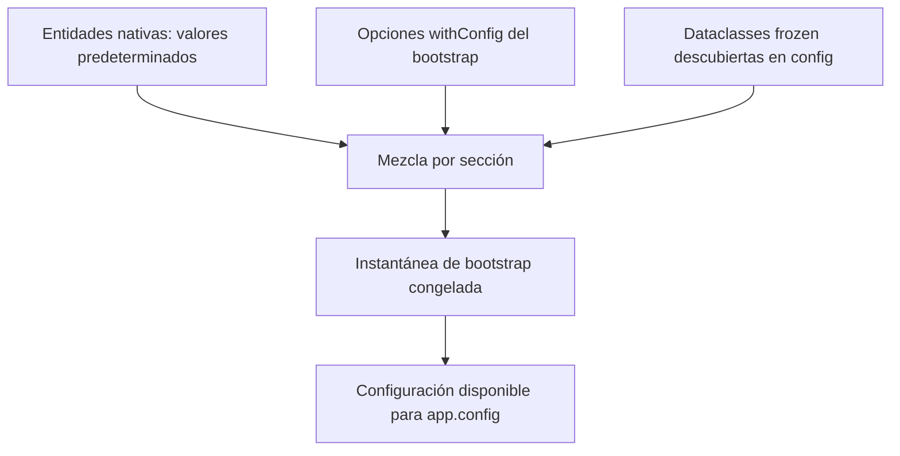

Los archivos de `config/` describen cómo funciona cada instalación de la aplicación: conexiones, drivers, límites, cookies, correo y demás servicios. Son el lugar para leer variables con `Env` o `env()`; durante la ejecución, los componentes consumen los valores resueltos mediante una `IApplication` inyectada y `app.config(...)`.

La guía de [Entorno](/es/architecture/environment) explica `.env`, sus tipos y la persistencia JSON. Aquí se documentan la composición de configuración, las entidades nativas y los validadores que puedes reutilizar en archivos propios.

<a id="configuration-merge"></a>

## Cómo se construye la configuración



Sin una caché compilada válida, la aplicación:

1. Construye diccionarios independientes con los valores predeterminados de las 16 secciones nativas.
2. Incorpora los diccionarios guardados mediante `withConfig...()` en `bootstrap/app.py`.
3. Descubre e instancia las dataclasses congeladas de `config/`; sus valores se aplican al final.
4. Congela la instantánea del bootstrap y prepara la configuración utilizada por la aplicación.

La combinación se hace con `dict.update()` **por sección**, no mediante una mezcla recursiva universal. Si reemplazas un diccionario anidado, incluye su configuración completa. Además, una dataclass de `config/app.py` puede reemplazar un valor configurado antes con `withConfigApp(...)`.

Cada llamada a un mismo `withConfig...()` sustituye el diccionario de esa sección guardado por la llamada anterior. Agrupa las opciones relacionadas en una sola llamada. Cuando se recupera un bootstrap compilado, esos setters no lo reconstruyen: consulta [Caché de configuración](/es/architecture/environment/compiled-configuration) y [Opciones de bootstrap](/es/getting-started/bootstrap-options).

<a id="configuration-validation"></a>

## Qué valida una entidad y qué hace un setter

Construir una entidad nativa ejecuta su validación y normalización. Según el campo, puede comprobar rangos, tipos estrictos, enums y la estructura de opciones anidadas. Por ejemplo:

```python
from orionis.foundation.config.hashing import Bcrypt


settings = Bcrypt(rounds=12)
assert settings.rounds == 12

try:
    Bcrypt(rounds=32)
except ValueError:
    print("The rounds setting is outside the supported range.")
```

Los setters `withConfig...(**options)` guardan diccionarios para la mezcla; **no construyen automáticamente la entidad equivalente ni revalidan todas las opciones**. Que un constructor rechace un valor no implica que el setter del mismo nombre lo rechace en ese punto. Los consumidores pueden realizar comprobaciones adicionales al inicializarse, pero no existe una revalidación universal de toda la mezcla mediante `Configuration`.

Las dataclasses descubiertas se instancian realmente: si heredan de una entidad nativa y conservan su `__post_init__()`, ejecutan sus comprobaciones. Una excepción durante esa construcción se propaga como `RuntimeError` desde la carga de configuración, conservando la causa. Las anotaciones de una dataclass propia, por sí solas, no convierten ni validan todos sus campos.

`frozen=True` impide reasignar sus atributos, pero no convierte automáticamente todos los diccionarios y listas internos en estructuras inmutables. La congelación del bootstrap corresponde al proceso de la aplicación y transforma los contenedores tratados, como diccionarios, listas y tuplas; no congela cualquier objeto arbitrario.

<a id="configuration-sections"></a>

## Las 16 secciones nativas

Todas son opcionales al construir `Configuration`: cada una tiene una fábrica predeterminada de su entidad. Las opciones particulares, variables, drivers y restricciones se documentan en las guías del componente correspondiente.

| Sección | Entidad principal | Referencia de sus opciones |
| --- | --- | --- |
| `app` | `App` | [Identidad, entorno y clave](#configuration-app). |
| `auth` | `Auth` | [Autenticación y guards](/es/security/authentication/configuration-and-guards). |
| `cache` | `Cache` | [Stores y configuración de caché](/es/services/cache/configuration). |
| `database` | `Database` | [Conexiones de base de datos](/es/database/configuration). |
| `filesystems` | `Filesystems` | [Discos y configuración de almacenamiento](/es/services/storage/configuration). |
| `hashing` | `Hashing` | [Hashing y sus drivers](/es/security/hashing/password-storage). |
| `http` | `HTTP` | [Middleware y políticas HTTP](/es/http/middleware-and-security), [payloads](/es/http/forms-and-uploads) y [WebSocket](/es/http/websockets). |
| `logging` | `Logging` | [Canales de logging](/es/services/logging/writing-logs) y [rotación](/es/services/logging/rotation-and-lifecycle). |
| `mail` | `Mail` | [Mailers y contenido de correo](/es/services/mail/configuration). |
| `mcp` | `McpConfig` | [Transporte y configuración MCP](/es/protocols/mcp/transports-and-configuration). |
| `queue` | `Queue` | [Conexiones, workers y persistencia de colas](/es/asynchronous/queues/configuration). |
| `realtime` | `RealtimeConfig` | [Límites de mensajes e invocaciones](/es/asynchronous/realtime/protocol-and-streaming). |
| `scheduler` | `Scheduler` | [Programación y persistencia](/es/console/scheduler-configuration). |
| `session` | `Session` | [Duración, almacenamiento y cookies](/es/http/sessions/configuration-and-security). |
| `testing` | `Testing` | [Ejecución y configuración de pruebas](/es/testing/writing-and-running-tests). |
| `view` | `View` | [Motor de vistas y extensiones](/es/services/views/configuration-and-extensions). |

<a id="configuration-container"></a>

## `Configuration`: reunir entidades o diccionarios

La clase `orionis.foundation.config.startup.Configuration` es una dataclass congelada con argumentos únicamente por nombre. Acepta, para cada sección de la tabla, **su entidad correspondiente o un `dict`**. No acepta `None` como sustituto de una sección; si omites el argumento, construye su valor predeterminado.

Cuando recibe un diccionario, construye `Entidad(**opciones)` y ejecuta sus validaciones. Cuando recibe una instancia del tipo esperado, la conserva; un tipo distinto produce `TypeError`. Los campos desconocidos del diccionario fallan al construir la entidad. Algunas entidades normalizan sus subestructuras a entidades y otras conservan diccionarios validados: no supongas una misma representación interna para todos los componentes.

```python
from orionis.foundation.config.app import App, Environments
from orionis.foundation.config.startup import Configuration


# Fixed key exclusively for this isolated validation example.
settings = Configuration(
    app=App(name="Reports", env=Environments.TESTING, key=b"k" * 32),
    hashing={"bcrypt": {"rounds": 12}},
    view={"cache_size": 0, "autoescape": False},
)

assert settings.app.name == "Reports"
assert settings.hashing.bcrypt.rounds == 12
assert settings.view.autoescape is False
assert settings.toDict()["app"]["env"] == "testing"
```

`toDict()` se hereda de `BaseEntity` y permite obtener la representación de datos. Construir `Configuration` **no configura ni arranca automáticamente `Application`**: no existe un paso implícito que la vincule con `bootstrap/app.py`. La aplicación utiliza su propia carga de defaults, setters y dataclasses descrita arriba.

No cambies la clave de un proyecto existente por la clave fija del ejemplo. Los valores predeterminados de entidades pueden leer el entorno y `App` puede generar y persistir una clave cuando falta; una construcción de configuración no debe tratarse como una operación sin efectos bajo todas las condiciones.

<a id="configuration-app"></a>

## Opciones de la aplicación: `App`

Importa `App`, `Cipher` y `Environments` desde `orionis.foundation.config.app`. Los valores siguientes son los predeterminados de respaldo; el entorno leído por la entidad puede reemplazarlos.

| Campo | Tipo y predeterminado | Propósito y validación |
| --- | --- | --- |
| `name` | `str`, `"Orionis Application"` | Nombre no vacío de la aplicación. |
| `env` | `str \| Environments`, `"development"` | `development`, `testing` o `production`; se normaliza al valor de enum. |
| `debug` | `bool`, `True` | Activa el detalle de depuración; no acepta una cadena como sustituto de booleano. |
| `timezone` | `str`, `"UTC"` | Zona reconocida por `ZoneInfo`. |
| `locale` | `str`, `"en"` | Locale principal no vacío. |
| `fallback_locale` | `str`, `"en"` | Locale alternativo no vacío. |
| `language_path` | `str`, `"resources/lang/"` | Ruta de traducciones no vacía; consulta [Localización](/es/services/localization). |
| `cipher` | `str \| Cipher`, `"AES-256-CBC"` | Algoritmo normalizado y utilizado para validar la longitud de la clave; consulta [Cifrado](/es/security/encryption). |
| `key` | `str \| bytes \| None`, `None` | Se normaliza a bytes. Admite representación `base64:`; exige la longitud exacta del cipher. Si falta, genera y persiste una clave. |
| `maintenance` | `bool`, `False` | Ajuste de mantenimiento; su estado efectivo también tiene en cuenta el marcador de mantenimiento de la aplicación. |

`Environments` contiene `DEVELOPMENT`, `TESTING` y `PRODUCTION`. `Cipher` contiene los algoritmos disponibles; sus claves y usos se explican en la guía de cifrado enlazada. La normalización acepta el miembro, su nombre o su valor textual según las reglas de `normalize_enum()`.

<a id="configuration-own"></a>

## Crear una sección propia

Por ejemplo, crea `config/payments.py`:

```python
from dataclasses import dataclass
from orionis.foundation.config.validation import validate_integer, validate_string


@dataclass(frozen=True, kw_only=True)
class Payments:
    currency: str = "USD"
    receipt_limit: int = 100

    def __post_init__(self) -> None:
        validate_string(self.currency, "currency")
        validate_integer(self.receipt_limit, "receipt_limit", minimum=1)
```

La sección procede del módulo: después de crear la aplicación, está disponible como `app.config("payments.currency")`. Mantén una dataclass de configuración concreta por sección para evitar depender de un orden de mezcla entre varias clases que escriban las mismas claves. Evita I/O de red en su construcción: se importa e instancia durante el arranque.

Para valores procedentes de `.env`, utiliza la lectura y `default_factory` explicadas en [Entorno](/es/architecture/environment). Para consumir o cambiar valores durante la ejecución, consulta la [API de aplicación](/es/getting-started/application-api); los cambios de proceso no reescriben los archivos de configuración ni garantizan la reconfiguración de managers ya creados.

<a id="configuration-validation-helpers"></a>

## Validadores reutilizables de configuración

Estas diez funciones están en `orionis.foundation.config.validation`. Validan opciones de configuración; no sustituyen los [schemas de payloads](/es/validation). Las funciones `validate_*` devuelven `None` al aceptar el valor y no lo convierten; `normalize_enum()` y `copy_string_list()` sí devuelven un resultado.

<a id="configuration-validate-integer"></a>

### Enteros, cadenas y booleanos

```text
validate_integer(value: object, name: str, *, minimum: int = 0, maximum: int | None = None) -> None
validate_string(value: object, name: str, *, allow_empty: bool = False) -> None
validate_boolean(value: object, name: str) -> None
```

`validate_integer()` exige `int` y rechaza `bool`; sus límites son inclusivos. `validate_string()` exige `str` y rechaza texto vacío o compuesto solo por espacios salvo `allow_empty=True`. `validate_boolean()` exige un booleano real, sin convertir `1` o `"true"`. Un tipo incorrecto produce `TypeError`; un valor fuera de rango o una cadena vacía no permitida produce `ValueError`.

```python
from orionis.foundation.config.validation import (
    validate_boolean,
    validate_integer,
    validate_string,
)


validate_integer(25, "page_size", minimum=1, maximum=100)
validate_string("reports", "name")
validate_string("", "optional_label", allow_empty=True)
validate_boolean(False, "enabled")
```

<a id="configuration-normalize-enum"></a>
<a id="configuration-copy-string-list"></a>

### Enums y listas de cadenas

```text
normalize_enum(value: object, enum_type: type[Enum], name: str) -> object
copy_string_list(value: object, name: str) -> list[str]
```

`normalize_enum()` acepta un miembro del enum o una cadena con el nombre o valor de un miembro, ignorando mayúsculas y espacios exteriores. Devuelve su `.value`. Un tipo inadecuado produce `TypeError` y una cadena desconocida, `ValueError`.

`copy_string_list()` exige una lista, no una tupla; valida que todos sus elementos sean cadenas no vacías y devuelve una copia independiente. Conserva el contenido y el orden; no recorta ni transforma las cadenas.

```python
from orionis.foundation.config.app import Environments
from orionis.foundation.config.validation import copy_string_list, normalize_enum


assert normalize_enum(" PRODUCTION ", Environments, "env") == "production"
original = ["api", "reports"]
copied = copy_string_list(original, "channels")
assert copied == original and copied is not original
```

<a id="configuration-validate-cookie-name"></a>
<a id="configuration-validate-name"></a>

### Nombres de cookies e identificadores

```text
validate_cookie_name(value: object, name: str) -> None
validate_name(value: object, name: str, *, table: bool = False) -> None
```

El primero comprueba el nombre con el serializador de cookies HTTP. El segundo acepta identificadores de 1 a 128 caracteres que comienzan con un carácter alfanumérico y continúan con letras ASCII, números, `_`, `.` o `-`. Con `table=True` aplica `[A-Za-z_]\w*` en ASCII para un nombre de tabla no cualificado. No añade comillas SQL ni valida datos de una consulta.

```python
from orionis.foundation.config.validation import validate_cookie_name, validate_name


validate_cookie_name("orionis_session", "cookie")
validate_name("reports-primary", "connection")
validate_name("job_results", "table", table=True)
```

Ambas funciones rechazan tipos no textuales con `TypeError` y nombres inválidos con `ValueError`.

<a id="configuration-validate-seconds"></a>
<a id="configuration-validate-driver"></a>
<a id="configuration-validate-http-origin"></a>

### Duraciones, drivers de colas y orígenes HTTP

```text
validate_seconds(value: object, name: str, *, positive: bool = False) -> None
validate_driver(value: object, expected: Drivers) -> None
validate_http_origin(origin: str) -> None
```

`validate_seconds()` admite `int` y `float` finitos, rechaza `bool` y números negativos, y rechaza cero con `positive=True`. `validate_driver()` comprueba que un driver textual coincida exactamente con el `Drivers` esperado de **colas**; no es un validador genérico para todos los enums llamados `Drivers`.

`validate_http_origin()` acepta un origen HTTP o HTTPS explícito con host y puerto válido cuando se indica. Rechaza comodines, espacios, caracteres no ASCII, credenciales, rutas, query y fragmentos. No modifica su representación; `https://app.example.test/` tiene una ruta y no equivale al origen sin `/` para este validador.

```python
from orionis.foundation.config.queue.enums import Drivers
from orionis.foundation.config.validation import (
    validate_driver,
    validate_http_origin,
    validate_seconds,
)


validate_seconds(0.5, "timeout", positive=True)
validate_driver("redis", Drivers.REDIS)
validate_http_origin("https://app.example.test:8443")
```

Los tipos inválidos producen `TypeError`; las duraciones, drivers u orígenes fuera de las reglas producen `ValueError`.

<a id="configuration-logging-validators"></a>

## Validadores específicos de logging

El paquete `orionis.foundation.config.logging.validators` expone dos objetos invocables:

```text
IsValidPath(value: str, *, suffix: bool = False) -> None
IsValidLevel(value: Level | int | str) -> None
IsValidLevel.normalize(value: Level | int | str) -> int
```

`IsValidPath` exige una cadena no vacía terminada en `.log`; con `suffix=True` también exige el marcador literal `{suffix}`. Comprueba el formato, no la existencia ni los permisos del archivo. `IsValidLevel` acepta `Level`, un entero permitido o un nombre textual de nivel; `normalize()` devuelve el entero canónico y `IsValidLevel(...)` solo valida. Los niveles son `DEBUG=10`, `INFO=20`, `WARNING=30`, `ERROR=40` y `CRITICAL=50`.

```python
from orionis.foundation.config.logging.validators import IsValidLevel, IsValidPath


IsValidPath("storage/logs/application.log")
IsValidPath("storage/logs/application-{suffix}.log", suffix=True)
IsValidLevel("warning")
assert IsValidLevel.normalize(" INFO ") == 20
```

Los tipos incorrectos producen `TypeError` y los formatos o niveles no admitidos producen `ValueError`. Consulta [Logging](/es/services/logging) para elegir canales, rutas y rotación.

<a id="configuration-secret-key"></a>

## Helper de generación de secretos

```text
SecretKey.random(length: int = 32) -> str
```

`orionis.foundation.config.session.helpers.secret_key.SecretKey.random()` delega en la generación segura de bytes aleatorios y devuelve su representación hexadecimal: el valor predeterminado genera 32 bytes y una cadena de 64 caracteres. `length` es la cantidad de bytes, no la longitud del texto resultante. El helper no guarda la clave ni modifica la configuración.

```python
from orionis.foundation.config.session.helpers.secret_key import SecretKey


generated_key = SecretKey.random()
assert len(generated_key) == 64
```

Utilízalo al preparar un secreto que tu componente vaya a conservar en la configuración segura del despliegue. No lo llames como fábrica para cambiar un secreto persistente en cada arranque o worker. Aunque está ubicado en `config/session/helpers`, el servicio de sesiones actual no lo utiliza automáticamente ni expone un campo `secret_key` para conectarlo: no necesitas añadir ese ajuste a `config/session.py`. El helper no añade validación propia de `length`; los argumentos inválidos propagan los errores del generador utilizado.

<a id="configuration-type-index"></a>

## Referencia de familias de configuración

La tabla de secciones enlaza la configuración operativa de cada componente. Los tipos auxiliares de esas familias se enumeran a continuación para localizar su referencia; las opciones de Database, correo, storage o autenticación se mantienen en sus guías y no se duplican aquí.

| Familia y referencia | Clases y enums definidos |
| --- | --- |
| [app](/es/getting-started/configuration#configuration-app) | `App`, `Cipher`, `Environments` |
| [auth](/es/security/authentication/configuration-and-guards) | `Auth`, `Identity`, `PasswordReset`, `RememberAuth`, `SessionAuth`, `Tokens`, `Guards` |
| [cache](/es/services/cache/configuration) | `Cache`, `Database`, `File`, `Memcached`, `Memory`, `Redis`, `Stores`, `Drivers` |
| [database](/es/database/configuration) | `Connections`, `Database`, `MySQL`, `Oracle`, `PGSQL`, `Redshift`, `SQLite`, `SQLServer`, `ConnectionName`, `MySQLCharset`, `MySQLCollation`, `MySQLEngine`, `OracleEncoding`, `OracleNencoding`, `PGSQLCharset`, `PGSQLCollation`, `PGSQLSSLMode`, `RedshiftSSLMode`, `SQLiteForeignKey`, `SQLiteJournalMode`, `SQLiteSynchronous`, `SQLServerCharset` |
| [filesystems](/es/services/storage/configuration) | `S3`, `Azure`, `Disks`, `Filesystems`, `GCS`, `Local`, `Public`, `DiskName` |
| [hashing](/es/security/hashing/password-storage) | `Argon2`, `Bcrypt`, `Hashing`, `Drivers` |
| [http](/es/http/middleware-and-security) | `HTTPBodyLimits`, `Cors`, `HTTPCsrf`, `HTTP`, `HTTPProxies`, `HTTPRateLimit`, `Redis`, `HTTPSecurity`, `HTTPWebSocket` |
| [logging](/es/services/logging/writing-logs) | `Channels`, `Chunked`, `Daily`, `Hourly`, `Logging`, `Monthly`, `Stack`, `Weekly`, `Level` |
| [mail](/es/services/mail/configuration) | `File`, `FromAddress`, `Mail`, `Mailers`, `Smtp`, `MailDriver` |
| [mcp](/es/protocols/mcp/transports-and-configuration) | `McpConfig` |
| [queue](/es/asynchronous/queues/configuration) | `Connections`, `Database`, `Failed`, `Queue`, `Redis`, `Sync`, `Worker`, `Drivers` |
| [realtime](/es/asynchronous/realtime/protocol-and-streaming) | `RealtimeConfig` |
| [scheduler](/es/console/scheduler-configuration) | `Database`, `Memory`, `Redis`, `Scheduler`, `Stores`, `Drivers` |
| [session](/es/http/sessions/configuration-and-security) | `Session`, `SessionDriver`, `SameSitePolicy`, `SecretKey` |
| [testing](/es/testing/writing-and-running-tests) | `Testing`, `VerbosityMode` |
| [view](/es/services/views/configuration-and-extensions) | `View` |

Continúa con la [API de aplicación](/es/getting-started/application-api), [Opciones de bootstrap](/es/getting-started/bootstrap-options) y [Proveedores de servicios](/es/architecture/service-container/providers-and-facades).
