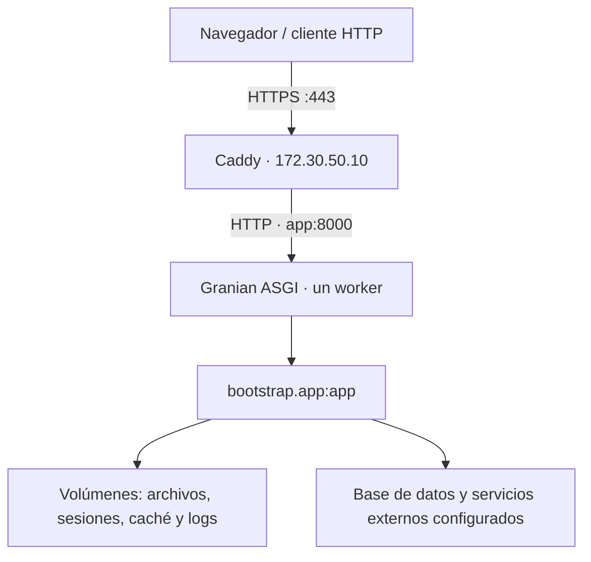

Esta guía ejecuta una aplicación Orionis en contenedores Linux: Caddy recibe HTTPS y Granian atiende únicamente dentro de la red de Compose. Utiliza el proyecto creado por el [instalador](/es/getting-started/installation), con su `pyproject.toml`, `uv.lock`, `bootstrap/app.py` y archivo `reactor`. No copies el repositorio del framework dentro de la aplicación.



<a id="docker-requirements"></a>

## 1. Preparar el proyecto y el servidor

Necesitas Docker Engine con contenedores Linux, Docker Compose con soporte para `env_file.format: raw`, acceso al registro de imágenes y al índice de dependencias durante el build. El ejemplo utiliza esa opción disponible desde Compose 2.30. [Referencia de `env_file`](https://docs.docker.com/reference/compose-file/services/#env_file).

```shell
docker version
docker compose version
```

El host debe permitir conexiones entrantes TCP a los puertos 80 y 443. Sustituye `app.example.com` en los archivos siguientes por un dominio real cuyo DNS apunte al servidor. Los puertos 8000 y los de los servicios privados no se publican.

Conserva el lockfile aprobado para la versión de tu aplicación. Añade previamente a `pyproject.toml` y `uv.lock` los extras que requiera tu motor de base de datos o almacenamiento. SQLite y el almacenamiento local no requieren extras. Los drivers que necesiten bibliotecas del sistema —por ejemplo, un controlador ODBC— requieren incorporarlas a la imagen, además del extra de Python; revisa [los drivers de Database](/es/database/drivers).

<a id="docker-image"></a>

## 2. Crear la imagen

Crea `Dockerfile` en la raíz del proyecto:

```dockerfile
ARG PYTHON_IMAGE=python:3.14-slim-bookworm
ARG UV_IMAGE=ghcr.io/astral-sh/uv:0.11.30

FROM ${UV_IMAGE} AS uv_binary

FROM ${PYTHON_IMAGE} AS build
COPY --from=uv_binary /uv /usr/local/bin/uv
ENV UV_PYTHON_DOWNLOADS=0 UV_LINK_MODE=copy
WORKDIR /app
COPY . .
RUN uv sync --locked --no-default-groups --no-editable

FROM ${PYTHON_IMAGE} AS runtime
ENV PATH="/app/.venv/bin:${PATH}" \
    PYTHONDONTWRITEBYTECODE=1 \
    PYTHONUNBUFFERED=1 \
    PYTHONUTF8=1
WORKDIR /app
RUN groupadd --gid 10001 orionis \
    && useradd --uid 10001 --gid 10001 --no-create-home orionis
COPY --from=build /app /app
RUN mkdir -p storage/app/private storage/app/public \
        storage/framework/sessions storage/framework/cache/data storage/logs \
    && touch .env \
    && chown -R 10001:10001 storage \
    && chown 10001:10001 .env
USER 10001:10001
EXPOSE 8000
STOPSIGNAL SIGTERM
CMD ["python", "-B", "-m", "granian", "--interface", "asgi", "--host", "0.0.0.0", "--port", "8000", "--workers", "1", "--loop", "uvloop", "--no-reload", "--workers-kill-timeout", "30", "--log-level", "info", "--static-path-mount", "/app/storage/app/public", "--static-path-route", "/static", "--static-path-dir-to-file", "index.html", "bootstrap.app:app"]
```

El intérprete y las bibliotecas del entorno se construyen sobre la misma imagen base que los ejecutará. `uv sync --locked` rechaza un lockfile desactualizado; `--no-default-groups` excluye los grupos de desarrollo predeterminados. La etapa final no necesita uv. El patrón de construcción se apoya en [la integración oficial de uv con Docker](https://docs.astral.sh/uv/guides/integration/docker/).

Los argumentos de imagen permiten sustituir las herramientas sin modificar la aplicación. En tu pipeline fija las imágenes base aprobadas por digest y conserva la etiqueta o digest de la imagen resultante de cada despliegue; un tag mutable no identifica por sí solo un artefacto inmutable.

El `CMD` ejecuta Granian directamente, con el punto de entrada real `bootstrap.app:app`. Su proceso recibe las señales del contenedor y ejecuta el inicio y cierre ASGI de Orionis. El worker único es una elección explícita: `reactor serve` selecciona el número de CPU en Linux y no ofrece una opción `--workers`. La alternativa RSGI utiliza el mismo objeto y se describe en [la preparación común](/es/getting-started/deployment-and-reference). Consulta [los puntos de entrada](/es/getting-started/server-entrypoints).

El montaje estático reproduce los valores predeterminados del disco público. Si cambias su ruta o URL en `config/filesystems.py`, cambia también estos argumentos. Esto no expone el disco privado.

Crea `.dockerignore`:

```text
.git
.venv
.env
.env.*
*.env
__pycache__
**/__pycache__
*.pyc
.pytest_cache
.ruff_cache
node_modules
storage
database/*.sqlite
database/*.sqlite-*
```

Quedan fuera los secretos, entornos locales, archivos de usuarios y cachés de ejecución. La imagen crea un `.env` **vacío** porque el componente de entorno prepara ese archivo al inicializarse, incluso cuando todos los valores se suministran mediante variables del proceso. El usuario 10001 puede acceder a ese archivo y escribir en `storage`; el código y `.venv` permanecen propiedad de root.

Si tu frontend genera assets, compílalos antes de publicar y añádelos explícitamente a la etapa correspondiente de tu imagen o a su mecanismo de publicación. Este `.dockerignore` excluye todo `storage`, incluido su contenido público; no depende de los archivos locales del equipo que construye.

<a id="docker-environment"></a>

## 3. Proporcionar la configuración de producción

Crea `.runtime.env` junto a `compose.yaml`, fuera del control de versiones, con permisos restringidos. No se incorpora a la imagen:

```dotenv
APP_NAME=Orionis Application
APP_ENV=production
APP_DEBUG=bool:false
APP_KEY=REPLACE_WITH_YOUR_EXISTING_APPLICATION_KEY
TRUSTED_PROXIES=list:["172.30.50.10"]
ALLOWED_HOSTS=list:["app.example.com", "localhost"]
SESSION_DRIVER=file
SESSION_SECURE=bool:true
CACHE_STORE=file
FILESYSTEM_DISK=local
DB_CONNECTION=sqlite
DB_DATABASE=/app/storage/app/private/database.sqlite
QUEUE_CONNECTION=sync
LOG_CHANNEL=daily
LOG_LEVEL=info
LOG_RETENTION=int:14
```

Sustituye `APP_KEY` por la clave privada real de la aplicación, conservándola entre recreaciones. El instalador ya la genera; para un proyecto que aún no tenga clave, ejecuta una única vez `python -B reactor key:generate` desde su entorno preparado y guarda el valor generado en tu gestor de secretos. No generes una clave nueva en cada inicio del contenedor.

`format: raw` entrega los valores literalmente: no rodees cada valor con comillas externas. Conserva las comillas internas de las listas y el prefijo `base64:` de la clave, si lo tiene. Los prefijos `bool:`, `int:` y `list:` los interpreta Orionis al leer la configuración. No montes simultáneamente otro `.env` con valores distintos: el cargador del framework lo lee con prioridad sobre las variables del proceso. Consulta [Entorno](/es/architecture/environment).

Este ejemplo usa SQLite dentro del volumen privado para que su archivo sobreviva a la recreación del contenedor. Para una base externa, sustituye esas dos variables por la configuración real del motor y su servicio. `localhost` dentro de `app` identifica al propio contenedor; un servidor externo o un servicio de Compose necesita su dirección o nombre de servicio.

<a id="docker-compose"></a>

## 4. Configurar Compose y el proxy inverso

Crea `compose.yaml`:

```yaml
name: orionis-production

services:
  app:
    image: orionis-app:production
    build:
      context: .
    init: true
    restart: unless-stopped
    env_file:
      - path: ./.runtime.env
        format: raw
    expose:
      - "8000"
    volumes:
      - app_files:/app/storage/app
      - sessions:/app/storage/framework/sessions
      - cache_data:/app/storage/framework/cache/data
      - app_logs:/app/storage/logs
    networks:
      backend: {}
    healthcheck:
      test: ["CMD", "python", "-B", "-c", "from urllib.request import Request, urlopen; r = urlopen(Request('http://127.0.0.1:8000/up', headers={'Host': 'localhost', 'Accept': 'application/json'}), timeout=3); assert r.status == 200"]
      interval: 30s
      timeout: 5s
      start_period: 30s
      retries: 3
    stop_grace_period: 40s

  proxy:
    image: caddy:2
    restart: unless-stopped
    depends_on:
      app:
        condition: service_healthy
    ports:
      - "80:80"
      - "443:443"
    volumes:
      - ./Caddyfile:/etc/caddy/Caddyfile:ro
      - caddy_data:/data
      - caddy_config:/config
    networks:
      backend:
        ipv4_address: 172.30.50.10

networks:
  backend:
    ipam:
      config:
        - subnet: 172.30.50.0/24

volumes:
  app_files:
  sessions:
  cache_data:
  app_logs:
  caddy_data:
  caddy_config:
```

Elige una subred libre en tu infraestructura. Si modificas la IP fija de Caddy, actualiza también `TRUSTED_PROXIES`. Orionis solo acepta `X-Forwarded-For` y `X-Forwarded-Proto` cuando el peer inmediato pertenece a su lista de confianza; aquí se autoriza exclusivamente `172.30.50.10`. `ALLOWED_HOSTS` contiene nombres, sin esquema ni puerto. `localhost` permite la comprobación interna de salud.

Crea `Caddyfile`:

```text
app.example.com {
    reverse_proxy app:8000
    log
}
```

Caddy conserva `Host`, establece los encabezados reenviados y admite el upgrade WebSocket. Las respuestas `text/event-stream` se transmiten inmediatamente; no configures buffers para acumular SSE. [Comportamiento de `reverse_proxy`](https://caddyserver.com/docs/caddyfile/directives/reverse_proxy).

Con un dominio público y los puertos accesibles, Caddy gestiona los certificados HTTPS. Los volúmenes `/data` y `/config` conservan su estado al recrear el contenedor. [Requisitos de HTTPS automático](https://caddyserver.com/docs/automatic-https). Si tu infraestructura ya termina TLS antes de Caddy, adapta ambos saltos y sus listas de confianza siguiendo [proxies inversos](/es/getting-started/deployment/reverse-proxies); no copies esta topología como si incluyera un CDN o balanceador adicional.

<a id="docker-start"></a>

## 5. Construir, comprobar y arrancar

Ejecuta los comandos desde el directorio que contiene los cuatro archivos. La validación silenciosa evita imprimir la configuración resuelta con sus secretos:

```shell
docker compose config --quiet
docker compose build app
docker compose run --rm --no-deps app python -B reactor about
docker compose run --rm --no-deps app python -B reactor route:list
docker compose run --rm --no-deps proxy caddy validate --config /etc/caddy/Caddyfile --adapter caddyfile
```

Valida Caddy antes de su primer arranque. Si el proxy ya está ejecutándose, utiliza `docker compose exec proxy caddy validate --config /etc/caddy/Caddyfile --adapter caddyfile`: un segundo contenedor de ese servicio no puede ocupar simultáneamente su IP fija.

Si tu proyecto utiliza migraciones, haz una copia de seguridad y ejecútalas **una sola vez por despliegue**, antes de admitir tráfico. El comando no genera ni ejecuta seeders salvo que los solicites por separado:

```shell
docker compose run --rm --no-deps app python -B reactor migrate
docker compose up -d --wait
docker compose ps
docker compose logs --tail 100 app proxy
```

Abre `https://app.example.com/up` y después tu ruta real de aplicación. `/up` comprueba el estado HTTP de Orionis y devuelve 503 en mantenimiento; no prueba automáticamente la conectividad con la base de datos, Redis o una cola. Si cambiaste `withRouting(health=...)`, actualiza también la comprobación de Compose.

La comprobación marca el contenedor como `healthy` o `unhealthy`; `restart: unless-stopped` reinicia un proceso que termina, no un proceso vivo que simplemente queda `unhealthy`. Investiga los logs o integra tu orquestador de recuperación. [Políticas de reinicio de Docker](https://docs.docker.com/engine/containers/start-containers-automatically/). El timeout de cierre de Granian es de 30 segundos en este ejemplo y Compose concede 40; una conexión larga que no finalice puede cerrarse al agotar ese presupuesto.

<a id="docker-state"></a>

## 6. Conservar los datos y publicar nuevas versiones

| Directorio | Persistencia del ejemplo | Contenido y alcance |
| --- | --- | --- |
| `storage/app` | Volumen `app_files` | Archivos de la aplicación y SQLite del ejemplo. Un volumen existente no se reemplaza con assets de una imagen nueva. |
| `storage/framework/sessions` | Volumen `sessions` | Sesiones del driver `file`; las sesiones `memory` se perderían al terminar el proceso. |
| `storage/framework/cache/data` | Volumen `cache_data` | Datos de la caché `file`. Invalida claves incompatibles con una nueva versión. |
| `storage/logs` | Volumen `app_logs` | Logs de aplicación; son distintos de los logs de proceso visibles con Compose. |
| `storage/framework/bootstrap` | Capa escribible del contenedor | Caché de configuración, rutas y comandos; se reconstruye en cada recreación. |
| Otros subdirectorios de `storage/framework` | Capa escribible del contenedor | Archivos temporales y cachés regenerables que utilicen los componentes configurados. |

Los volúmenes nombrados sobreviven al contenedor y pertenecen al host Docker. El montaje inicial recibe los directorios de la imagen con su propietario 10001; si importas volúmenes o cambias ese UID, corrige sus permisos antes de iniciar. Un volumen local no proporciona replicación entre servidores. [Ciclo de vida de volúmenes](https://docs.docker.com/engine/storage/volumes/).

No hornees una caché de bootstrap con secretos o rutas de otro entorno. Se genera después de recibir `.runtime.env`; tampoco se comparte como volumen entre releases. Cambiar variables y hacer solo `restart` conserva los archivos y el entorno del contenedor existente: recrea `app` para aplicar configuración y eliminar su caché local anterior.

Con el código, lockfile e imagen aprobados para la siguiente versión:

```shell
docker compose build app
docker compose run --rm --no-deps app python -B reactor migrate
docker compose up -d --force-recreate --wait app
docker compose exec proxy caddy reload --config /etc/caddy/Caddyfile --adapter caddyfile
docker compose ps
```

La recarga del proxy hace que vuelva a resolver el backend recreado. Esta receta tiene una sola instancia de aplicación y puede interrumpir conexiones durante el reemplazo; un despliegue progresivo necesita un balanceador y una estrategia adicional. Conserva la imagen anterior y verifica la compatibilidad de las migraciones antes de planificar una reversión.

`docker compose down` detiene los servicios conservando los volúmenes nombrados. No añadas `--volumes` si necesitas esos datos. Programa copias de seguridad de los archivos, SQLite o la base externa y los certificados correspondientes; la retención de [Logs](/es/services/logging/rotation-and-lifecycle) se configura independientemente.

<a id="docker-background"></a>

## 7. Separar procesos y comprobar el tráfico persistente

El servicio `app` ejecuta HTTP; registrar un scheduler en bootstrap no inicia su bucle y `QUEUE_CONNECTION=sync` no crea un worker. Para colas durables y tareas programadas, utiliza servicios independientes de la misma imagen, con sus comandos reales, configuración compatible, persistencia requerida y comprobaciones propias. Consulta [workers](/es/asynchronous/queues/workers-and-failures) y [scheduler](/es/console/scheduler-execution).

Prueba tus endpoints WebSocket, Realtime, SSE y MCP a través de la URL HTTPS pública. No basta con que `/up` responda. Este ejemplo conserva la ruta completa del request y no monta la aplicación bajo un prefijo adicional.

Un worker no distribuye automáticamente su estado entre contenedores. Antes de incrementar réplicas, revisa [grupos Realtime](/es/asynchronous/realtime/groups-and-deployment), [sesiones y concurrencia](/es/http/sessions/stores-and-concurrency) y [eventos MCP](/es/protocols/mcp/advanced-workflows): sus políticas de almacenamiento, afinidad o estado local requieren decisiones explícitas del despliegue.
