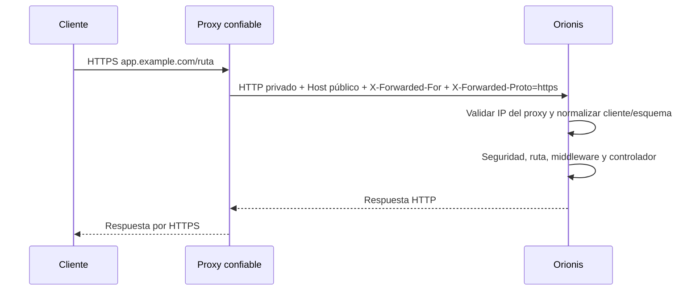

El proxy recibe HTTPS y reenvía HTTP a Granian por una conexión privada. Solo el proxy debe alcanzar el puerto del backend. Las guías de [Windows](/es/getting-started/deployment/windows-server), [Linux](/es/getting-started/deployment/linux) y [Docker](/es/getting-started/deployment/docker) incluyen su configuración completa; esta página explica el contrato que deben respetar.

## Identidad de cliente y esquema

Orionis ejecuta `ProxiesMiddleware` antes de resolver rutas. Solo acepta encabezados reenviados cuando la **IP del par que se conecta al backend** pertenece a `http.proxies.trusted_proxies`, configurado en `config/http.py`. El valor predeterminado contiene `127.0.0.1`.

```dotenv
# Proxy en el mismo servidor, conectado por IPv4 loopback.
TRUSTED_PROXIES=list:["127.0.0.1"]
ALLOWED_HOSTS=list:["app.example.com"]
```

| Dato | Comportamiento real |
| --- | --- |
| `X-Forwarded-For` | Reúne los encabezados y recorre la cadena de derecha a izquierda hasta el primer salto no confiable. Omite valores que no sean IP válidas. |
| `X-Forwarded-Proto` | Acepta el primer encabezado si su valor completo es `http` o `https`. No acepta una lista como `https,http`. |
| `Host` | Debe conservar el dominio público; la seguridad HTTP y la construcción de URLs lo utilizan. |
| `Forwarded`, `X-Forwarded-Host`, `X-Forwarded-Prefix` | No sustituyen a los datos anteriores en este middleware. No habilitan automáticamente un despliegue bajo un subdirectorio. |

La confianza admite IP y CIDR. Usa las direcciones precisas de tu proxy, incluyendo `::1` solo si realmente conecta por IPv6. No copies rangos amplios por comodidad. En Docker, `127.0.0.1` identifica el propio contenedor: la guía asigna una IP privada estable a Caddy y confía únicamente en ella.

Con varios proxies, protege también el primer salto público y configura allí qué encabezados puede aceptar de su propio upstream. Estas guías suponen **un único proxy público** y no una CDN adicional. El proxy de borde reemplaza los valores suministrados por clientes; el backend no debe quedar accesible por otra ruta que permita hacerse pasar por ese proxy.



## WebSocket, SSE y MCP

Preserva la ruta completa, query string, método y `Origin`. El origen de WebSocket debe coincidir con la política de `http.websocket.allow_origins`; su configuración predeterminada permite el mismo origen. No añadas `*` para compensar un `Host` o esquema incorrecto. Consulta [WebSocket](/es/http/websockets).

Nginx necesita reenviar explícitamente `Upgrade` y `Connection` para WebSocket; la guía usa un `map`, HTTP/1.1 hacia Granian y tiempos de inactividad ampliados. Para SSE utiliza `proxy_buffering off`; `proxy_request_buffering off` permite reenviar progresivamente cuerpos de petición. Ajusta además el límite de uploads del proxy y el de Orionis según los payloads reales. [WebSocket en Nginx](https://nginx.org/en/docs/http/websocket.html) y [directivas de proxy](https://nginx.org/en/docs/http/ngx_http_proxy_module.html).

Caddy gestiona el upgrade WebSocket y descarga inmediatamente respuestas `text/event-stream`. Los ejemplos conservan ese comportamiento; no fuerzan `flush_interval -1` globalmente, porque también cambia la cancelación del backend al desconectar el cliente. [Proxy de Caddy](https://caddyserver.com/docs/caddyfile/directives/reverse_proxy).

No caches ni transformes respuestas SSE, tokens o sesiones en el proxy. Para [SSE](/es/http/streaming-and-sse) y [MCP por HTTP](/es/protocols/mcp/http-and-clients), comprueba recepción incremental y desconexión. Los timeouts entre lecturas no hacen infinita una conexión ni sustituyen los heartbeats de la aplicación. Reiniciar un proceso cierra sus conexiones; los clientes deben poder reconectar.

## Comprobar el proxy con una ruta temporal

En `routes/api.py`, registra esta ruta sin middleware de autenticación propio, solo durante una comprobación controlada. El contexto API no añade automáticamente un prefijo `/api`:

```python
from orionis.http import JSONResponse, Request
from orionis.support.facades import Route


async def deployment_check(request: Request) -> JSONResponse:
    return JSONResponse({
        "client": request.ip,
        "scheme": request.scheme,
        "url": request.url,
    })


Route.get("/_deployment/check", deployment_check)
```

Reinicia la aplicación tras añadirla. Desde otro equipo:

```shell
curl -fsS https://app.example.com/_deployment/check
curl -fsS -H "X-Forwarded-For: 192.0.2.123" https://app.example.com/_deployment/check
```

Ambas respuestas deben mostrar la IP observada por el proxy —puede ser la de tu NAT—, `scheme: "https"` y el dominio público en `url`. El segundo comando no debe imponer la IP ficticia. Un resultado HTTP 400 puede indicar `ALLOWED_HOSTS` incorrecto; un esquema `http` suele indicar que no coincide la IP confiable o el encabezado.

Comprueba luego `/up` por HTTPS. Para probar el backend local con una lista de hosts restringida, proporciona el mismo `Host`:

```shell
curl -fsS -H "Host: app.example.com" -H "Accept: application/json" http://127.0.0.1:8000/up
```

En Windows utiliza `curl.exe`; en Docker ejecuta la comprobación dentro de la red privada como indica su guía. Una respuesta 200 del backend no verifica el certificado, DNS o proxy: realiza ambas pruebas. Elimina la ruta temporal y reinicia al terminar.

## Diagnosticar una publicación

| Síntoma | Comprobación concreta |
| --- | --- |
| 502 o conexión rechazada | Servicio iniciado, puerto y upstream coincidentes, directorio correcto y errores del proceso Granian. |
| 400 por dominio | `Host` recibido y lista `ALLOWED_HOSTS`; no cambies el host público por `127.0.0.1`. |
| IP de proxy o esquema incorrecto | IP real del par del backend, `TRUSTED_PROXIES`, configuración efectiva y caché de bootstrap anterior. |
| Cookies o WebSocket fallan con HTTPS | Esquema y dominio públicos, `SESSION_SECURE`, política de origen y encabezados de upgrade. |
| Eventos llegan juntos o se cortan | Buffering, timeouts/heartbeats y reinicios del proxy o aplicación. |
| `/static` devuelve 404 | Archivo en el disco público y argumentos de montaje; la ejecución directa de Granian no lee `config/filesystems.py`. |

Los fallos antes de completar el arranque pertenecen a los logs del supervisor. Los errores dentro de la aplicación se investigan con [Logs](/es/services/logging) y [Exceptions](/es/architecture/exception-handling), con `APP_DEBUG=bool:false` en producción.
