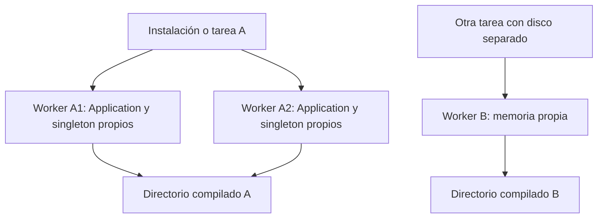

La aplicación resuelve directorios y puede persistir metadatos de arranque en archivos. Ambos pertenecen a una instalación concreta: no convierten servicios, scopes ni datos del proceso en estado distribuido.

<a id="directory-construction"></a>
## Acceder a los directorios

```text
Directory(app: IApplication) -> None
```

`orionis.foundation.directory.Directory` implementa `IDirectory` y captura una copia del mapa de rutas de una aplicación configurada. Antes de crear la configuración, `app.path()` lanza `RuntimeError`; construye Directory después de esa etapa. Sus métodos son síncronos y devuelven `Path`. No crean carpetas ni leen archivos de negocio.

Puedes recibir la clase concreta por DI o construir `Directory(app)` cuando ya tienes una `IApplication`. No se registra aquí un binding automático `IDirectory` que debas asumir al solicitar el contrato.

```python
from orionis.foundation.directory import Directory
from orionis.http import JSONResponse


class LocationsController:
    async def __call__(self, directory: Directory) -> JSONResponse:
        return JSONResponse({"views": str(directory.resourcesViews())})
```

Una ruta que invoque este controlador permite que el contenedor construya Directory con la misma aplicación. Para operaciones de archivos utiliza [Storage](/es/services/storage), en lugar de dispersar rutas físicas en el código de negocio.

<a id="directory-methods"></a>
## Referencia completa de Directory

Todos los métodos siguientes tienen firma `nombre() -> Path`, sin argumentos adicionales. Son accesos al mapa capturado; una clave ausente en un mapa incompleto produce `KeyError`. Los defaults se resuelven respecto a `basePath`.

| Método | Clave de app.path | Ruta predeterminada |
|---|---|---|
| `root()` | `root` | `.` |
| `app()` | `app` | `app` |
| `appConsole()` | `app_console` | `app/console` |
| `appConsoleCommands()` | `app_console_commands` | `app/console/commands` |
| `appConsoleListeners()` | `app_console_listeners` | `app/console/listeners` |
| `appExceptions()` | `app_exceptions` | `app/exceptions` |
| `appHttp()` | `app_http` | `app/http` |
| `appHttpControllers()` | `app_http_controllers` | `app/http/controllers` |
| `appHttpMiddleware()` | `app_http_middleware` | `app/http/middleware` |
| `appHttpSchemas()` | `app_http_schemas` | `app/http/schemas` |
| `appHttpSchemasRules()` | `app_http_schemas_rules` | `app/http/schemas/rules` |
| `appModels()` | `app_models` | `app/models` |
| `appMcp()` | `app_mcp` | `app/mcp` |
| `appMcpServers()` | `app_mcp_servers` | `app/mcp/servers` |
| `appMcpTools()` | `app_mcp_tools` | `app/mcp/tools` |
| `appMcpResources()` | `app_mcp_resources` | `app/mcp/resources` |
| `appMcpPrompts()` | `app_mcp_prompts` | `app/mcp/prompts` |
| `appRealtime()` | `app_realtime` | `app/realtime` |
| `appRealtimeSockets()` | `app_realtime_sockets` | `app/realtime/sockets` |
| `appRealtimeHubs()` | `app_realtime_hubs` | `app/realtime/hubs` |
| `appProviders()` | `app_providers` | `app/providers` |
| `appNotifications()` | `app_notifications` | `app/notifications` |
| `appServices()` | `app_services` | `app/services` |
| `appFacades()` | `app_facades` | `app/facades` |
| `appJobs()` | `app_jobs` | `app/jobs` |
| `appContracts()` | `app_contracts` | `app/contracts` |
| `bootstrap()` | `bootstrap` | `bootstrap` |
| `config()` | `config` | `config` |
| `database()` | `database` | `database` |
| `databaseFactories()` | `database_factories` | `database/factories` |
| `databaseMigrations()` | `database_migrations` | `database/migrations` |
| `databaseSchemas()` | `database_schemas` | `database/schemas` |
| `databaseSeeders()` | `database_seeders` | `database/seeders` |
| `resources()` | `resources` | `resources` |
| `resourcesCss()` | `resources_css` | `resources/css` |
| `resourcesJs()` | `resources_js` | `resources/js` |
| `resourcesLang()` | `resources_lang` | `resources/lang` |
| `resourcesViews()` | `resources_views` | `resources/views` |
| `routes()` | `routes` | `routes` |
| `storage()` | `storage` | `storage` |
| `storageApp()` | `storage_app` | `storage/app` |
| `storageAppPrivate()` | `storage_app_private` | `storage/app/private` |
| `storageAppPublic()` | `storage_app_public` | `storage/app/public` |
| `storageFramework()` | `storage_framework` | `storage/framework` |
| `storageLogs()` | `storage_logs` | `storage/logs` |
| `tests()` | `tests` | `tests` |

`root()` siempre es `basePath`. Los métodos equivalentes de `IDirectory` expresan el mismo contrato. `app.path()` expone el registro congelado completo; `app.path("clave")` devuelve la ruta o `None` si no existe.

Configura cambios con `withConfigPaths()` antes de crear la aplicación, utilizando las claves de la tabla. Una cadena relativa usa la raíz del proyecto; un `Path` relativo usa el directorio de trabajo. Cada clave tiene su default independiente: cambiar `app` no relocaliza automáticamente `app_models`. Se reconstruye el registro entero en cada llamada; consulta [Opciones de bootstrap](/es/getting-started/bootstrap-options#bootstrap-paths).

<a id="bootstrap-disk-cache"></a>
## Qué guarda la caché

```python
# bootstrap/app.py, antes de app.create().
app.compile(
    path="storage/framework/bootstrap",
    invalidation_paths=["app", "bootstrap", "config", "routes", ".env"],
)
```

`compile(path=None, invalidation_paths=None) -> None` activa la persistencia. Sin un path explícito utiliza `storage/framework/cache`. El bootstrap generado selecciona `storage/framework/bootstrap` y vigila también otros directorios del proyecto. Los archivos se crean cuando cada componente necesita persistir su información:

| Archivo JSON sin extensión | Alcance |
|---|---|
| `config` | Configuración resuelta y metadatos de directorios, proveedores, rutas, middleware, kernels, scheduler y handler. |
| `commands` | Registro y argumentos de comandos de Reactor. |
| `routes` | Registro compilado de rutas HTTP. |

No guarda objetos de servicios vivos, conexiones abiertas, event loops, locks de asyncio, usuarios autenticados ni instancias scoped. Tampoco es la caché de negocio administrada por la fachada Cache.

El archivo contiene metadatos de formato, generación y hash de fuentes junto a los datos serializados. La escritura usa un temporal hermano y reemplaza el destino. Ese reemplazo evita un archivo parcialmente escrito, pero no es un lock distribuido que coordine todos los procesos que regeneran contenido. [Entorno: persistencia JSON](/es/architecture/environment/compiled-configuration) detalla tipos, credenciales, invalidación, archivos corruptos y por qué no hay `env.json`.

Un acierto de `config` en `compile()` restaura y congela el bootstrap antes de los registros posteriores. Los `with...` reutilizan esa instantánea. Los callbacks de lifespan se registran por proceso y no se guardan en esos archivos; los proveedores vuelven a registrar sus servicios en cada contenedor.

<a id="cache-deployment-scope"></a>
## Worker, servidor y tarea de Fargate

| Nivel | Memoria de aplicación | Archivos compilados |
|---|---|---|
| Solicitud o comando | Tiene su scope; comparte la aplicación de su proceso. | No se crea una caché por petición o comando. |
| Varios workers del mismo servidor | Cada proceso conserva su Application, bindings, singleton y locks. | Pueden reutilizar archivos si resuelven el mismo directorio del mismo filesystem. |
| Servidores o contenedores con discos separados | No comparten memoria. | Generan cachés independientes aunque la cadena de path sea idéntica. |
| Varias tareas Fargate con almacenamiento local | Cada proceso y tarea conserva su propio estado. | Una tarea no utiliza automáticamente los archivos locales de otra. |
| Volumen montado explícitamente en común | No convierte los contenedores en una sola aplicación. | Solo comparten archivos que realmente estén dentro del volumen montado. |

En Fargate, el almacenamiento efímero pertenece a la tarea; los contenedores Linux de una misma tarea pueden compartirlo si así se configuran sus volúmenes y montajes. No equivale a un disco global del servicio. Consulta [almacenamiento efímero de tareas](https://docs.aws.amazon.com/AmazonECS/latest/developerguide/fargate-task-storage.html).

Un almacenamiento persistente y compartido como EFS requiere configuración explícita en el despliegue. Esa capacidad de infraestructura no hace que Orionis coordine automáticamente su caché entre tareas. La diferencia entre almacenamiento efímero y persistente se describe en [opciones de almacenamiento de ECS](https://docs.aws.amazon.com/AmazonECS/latest/developerguide/using_data_volumes.html).

La consecuencia para Orionis se deriva de su uso de rutas locales: planifica la regeneración al reemplazar una tarea y no uses la existencia de un archivo de otra instalación como garantía. El snapshot contiene paths absolutos y referencias de componentes; mezclar releases o configuraciones diferentes en el mismo directorio puede restaurar datos incorrectos. La huella vigila archivos, no un identificador de servidor ni una task de AWS.



<a id="cache-refresh"></a>
## Cambios, invalidación y limpieza

El hash considera rutas, mtime y tamaño de los archivos vigilados. Los directorios aportan `*.py`; `.env` debe declararse como archivo y existir cuando se llama a `compile()`. Cambios exclusivos en variables del sistema no alteran esa huella. No se reconstruye la configuración de procesos ya iniciados.

Para forzar la reconstrucción en la instalación afectada, puedes ejecutar:

```shell
orionis optimize:clear
python -B reactor optimize:clear
```

Son alternativas. El comando elimina los artefactos compilados y también bytecode y directorios de construcción del proyecto: consulta [su alcance completo](/es/console/built-in-application#command-optimize-clear). Un CLI con otro filesystem no borra el disco de una tarea remota. Reinicia los workers que deben cargar los cambios; borrar un archivo no elimina servicios singleton ya construidos ni vuelve a ejecutar la configuración de una aplicación existente.

`optimize` valida fuentes Python en memoria; no es un precalentamiento de toda la caché. Para entender la primera creación y los arranques con snapshot válido consulta [Ciclo de vida](/es/getting-started/application-lifecycle).
