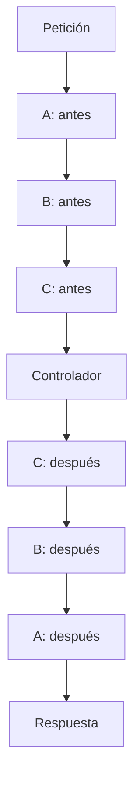

Un middleware intercepta una petición HTTP y puede ejecutar lógica antes y después del siguiente componente de la cadena: otro middleware o el controlador. Permite compartir comportamientos sin repetirlos en cada acción.

Sus usos habituales incluyen autenticación y autorización, condiciones de acceso, registro de peticiones, manipulación de encabezados y medición del tiempo de procesamiento. Cada middleware decide si continúa la cadena o devuelve una respuesta inmediatamente.

## Crear un middleware con el CLI

Ejecuta una de estas alternativas desde la raíz del proyecto, con su entorno Python activo:

```bash
orionis make:http-middleware global
```

O mediante el archivo local `reactor`:

```bash
python -B reactor make:http-middleware global
```

Ambos generan `app/http/middleware/global_middleware.py` con la clase `GlobalMiddleware`. Son alternativas para crear el mismo archivo.

El único argumento del comando es `name`: un texto posicional obligatorio, sin valor predeterminado. No hay opciones propias del generador; `-h` o `--help` muestran la ayuda.

Utiliza nombres en `snake_case`. El generador añade el sufijo `_middleware` al archivo y `Middleware` a la clase cuando falta, y permite subdirectorios:

| Nombre recibido | Clase | Archivo generado |
| --- | --- | --- |
| `global` | `GlobalMiddleware` | `app/http/middleware/global_middleware.py` |
| `timing` | `TimingMiddleware` | `app/http/middleware/timing_middleware.py` |
| `access/check_access` | `CheckAccessMiddleware` | `app/http/middleware/access/check_access_middleware.py` |

El destino corresponde a la ruta de aplicación `app_http_middleware`; si la personalizas, el generador utiliza esa ubicación. Crea los directorios intermedios, pero no sobrescribe archivos existentes. Usa nombres relativos válidos: no admite rutas absolutas ni segmentos `..`.

:::note
Escribir `GlobalMiddleware` como argumento produce `globalmiddleware.py`: el generador no separa las palabras de un nombre PascalCase. Usa `global` o `global_middleware` para obtener `global_middleware.py`.
:::

## Estructura de un middleware

La plantilla genera los imports públicos, una clase derivada de `BaseMiddleware` y un `handle()` que delega la petición. Este esqueleto conserva ese comportamiento y añade manualmente `__slots__ = ()`:

```python
from orionis.http import BaseMiddleware, NextCallable, Request, Response


class GlobalMiddleware(BaseMiddleware):

    __slots__ = ()

    async def handle(
        self,
        request: Request,
        call_next: NextCallable,
    ) -> Response:
        """
        Delegate the request without modifying it.

        Parameters
        ----------
        request : Request
            Incoming HTTP request.
        call_next : NextCallable
            No-argument callable for continuing the middleware chain.

        Returns
        -------
        Response
            Response returned by the next middleware or route handler.
        """
        # Forward the request through the middleware chain.
        return await call_next()
```

- **`BaseMiddleware`** define la base HTTP. Debes implementar `handle()`; su implementación base lanza `NotImplementedError`.
- **`__slots__ = ()`** declara que la clase no añade atributos de instancia. En esta jerarquía evita un diccionario dinámico de atributos en esa subclase. Es opcional y no aparece en la plantilla generada; tampoco proporciona aislamiento entre peticiones.
- **`async def handle()`** recibe la petición y su continuación, procesa la capa y devuelve una `Response`.
- **`request`** es la misma instancia de `Request` que reciben las capas siguientes. Puedes compartir datos de esa petición mediante `request.state`.
- **`NextCallable`** representa `Callable[[], Awaitable[Response]]`: se llama sin argumentos y su resultado debe esperarse.
- **`await call_next()`** ejecuta la siguiente capa o el manejador final. Cuando termina, devuelve su respuesta a este middleware.
- **`Response`** es la respuesta HTTP que debes devolver, tanto al continuar como al responder anticipadamente.

Este middleware delega sin modificar la petición ni la respuesta. No transmite por sí mismo la respuesta al cliente.

## Lógica previa y respuesta anticipada

Para preparar los ejemplos siguientes, genera sus archivos:

```bash
orionis make:http-middleware client_context
orionis make:http-middleware response_header
orionis make:http-middleware timing
```

En `app/http/middleware/client_context_middleware.py`, exige una cabecera antes de continuar:

```python
from orionis.http import BaseMiddleware, NextCallable, Request, Response, response


class ClientContextMiddleware(BaseMiddleware):
    __slots__ = ()

    async def handle(
        self,
        request: Request,
        call_next: NextCallable,
    ) -> Response:
        client_id = request.headers.get("X-Client-Id")
        if not client_id:
            return response.json(
                {"message": "X-Client-Id is required."},
                status_code=400,
            )

        request.state.client_id = client_id
        return await call_next()
```

El middleware recibe la petición, comprueba la cabecera y guarda el identificador en `request.state` para los componentes siguientes. Este ejemplo valida un dato de entrada; para autenticar una identidad utiliza los mecanismos de [autenticación](/es/security/authentication).

Si falta la cabecera, devuelve una respuesta JSON `400` sin ejecutar `call_next()`. Las capas posteriores y el controlador no se ejecutan. Los middleware anteriores que ya estaban esperando su continuación reciben esa respuesta y pueden ejecutar su lógica posterior.

## Lógica posterior a la siguiente capa

En `app/http/middleware/response_header_middleware.py`, captura la respuesta y modifica sus encabezados:

```python
from orionis.http import BaseMiddleware, NextCallable, Request, Response


class ResponseHeaderMiddleware(BaseMiddleware):
    __slots__ = ()

    async def handle(
        self,
        request: Request,
        call_next: NextCallable,
    ) -> Response:
        response = await call_next()
        response.setHeader("X-Application", "Orionis")
        return response
```

`setHeader()` reemplaza el valor del encabezado y devuelve `None`; devuelve el objeto `response` después de modificarlo. La respuesta puede proceder del controlador o de otro middleware que haya interrumpido la cadena.

La lógica posterior se ejecuta cuando el control regresa desde `await call_next()`, antes del envío al cliente. No mide la entrega completa de una respuesta en streaming ni equivale a una tarea posterior al envío. Consulta [Respuestas](/es/http/responses) para otras operaciones admitidas.

## Lógica previa y posterior en un mismo middleware

En `app/http/middleware/timing_middleware.py`, mide la ejecución de las capas siguientes:

```python
from time import perf_counter
from orionis.http import BaseMiddleware, NextCallable, Request, Response


class TimingMiddleware(BaseMiddleware):
    __slots__ = ()

    async def handle(
        self,
        request: Request,
        call_next: NextCallable,
    ) -> Response:
        started_at = perf_counter()
        response = await call_next()
        elapsed_ms = (perf_counter() - started_at) * 1000
        response.setHeader("X-Process-Time-Ms", f"{elapsed_ms:.3f}")
        return response
```

El inicio del reloj ocurre antes de continuar; el cálculo y el encabezado se añaden al regresar. Así, el middleware envuelve la ejecución del siguiente componente. El valor incluye el trabajo de las capas posteriores y del manejador, hasta que devuelven su respuesta.

`started_at` es una variable local. El kernel puede reutilizar una instancia de middleware entre peticiones: conserva los datos de cada petición en variables locales o en `request.state`, incluso si utilizas `__slots__`.

## Inyección de dependencias en middleware

Orionis construye los middleware mediante el contenedor, por lo que puedes recibir servicios anotados en `__init__`. En `app/services/duration_formatter.py`, define un servicio sin estado de petición:

```python
class DurationFormatter:
    def milliseconds(self, seconds: float) -> str:
        return f"{seconds * 1000:.3f}"
```

En `app/http/middleware/timed_response_middleware.py`, solicita ese servicio en el constructor:

```python
from time import perf_counter

from app.services.duration_formatter import DurationFormatter
from orionis.http import BaseMiddleware, NextCallable, Request, Response


class TimedResponseMiddleware(BaseMiddleware):
    __slots__ = ("_formatter",)

    def __init__(self, formatter: DurationFormatter) -> None:
        self._formatter = formatter

    async def handle(
        self,
        request: Request,
        call_next: NextCallable,
    ) -> Response:
        started_at = perf_counter()
        response = await call_next()
        response.setHeader(
            "X-Process-Time-Ms",
            self._formatter.milliseconds(perf_counter() - started_at),
        )
        return response
```

Por ejemplo, en `routes/api.py`:

```python
from app.http.middleware.timed_response_middleware import TimedResponseMiddleware
from orionis.http import JSONResponse, response
from orionis.support.facades import Route


async def timed_status() -> JSONResponse:
    return response.json({"status": "ok"})


Route.get("/timed-status", timed_status).middleware(TimedResponseMiddleware)
```

`GET /timed-status` devuelve el estado y el encabezado calculado con el servicio inyectado. `DurationFormatter` es concreto y autoconstruible; los contratos abstractos requieren su registro en el [contenedor](/es/architecture/service-container/bindings-and-invocation).

**`handle()` mantiene la firma `handle(request, call_next)`**. El kernel lo llama directamente; añadir un tercer parámetro de servicio no activa inyección. Usa el constructor para esos servicios y el parámetro `request` para los datos de la petición actual.

Las instancias se preparan durante el arranque y se reutilizan. Sus dependencias deben poder resolverse entonces y ser seguras para compartir entre peticiones. No solicites `Request` ni servicios que necesiten un scope HTTP activo en este constructor. Conserva temporizadores, usuarios y otros datos de cada petición en variables locales o en `request.state`.

## Registrar middleware globales

En `bootstrap/app.py`, utiliza la instancia `app` del bootstrap y añade el registro antes de `app.create()`:

```python
from app.http.middleware.global_middleware import GlobalMiddleware
from app.http.middleware.timing_middleware import TimingMiddleware

app.withMiddleware(
    GlobalMiddleware,
    TimingMiddleware,
)
```

Para registrar sólo uno, utiliza `app.withMiddleware(GlobalMiddleware)`. El método acepta clases como argumentos individuales, conserva su orden y evita registros duplicados. Pasa las clases sin instanciarlas.

El registro almacena la configuración; no ejecuta `handle()` en ese momento. Los middleware se incorporan a las rutas HTTP al compilarlas, y el kernel prepara sus instancias mediante el contenedor durante su arranque.

:::note[Alcance de los middleware globales]
Los globales de aplicación se ejecutan en las rutas HTTP que los incorporan, después de resolver la ruta y establecer el contexto API o WEB. Los controles internos de proxies, mantenimiento, seguridad, CORS y rate limit son capas previas del kernel.

Una respuesta anticipada del kernel, el `OPTIONS` automático o una ruta no resuelta con su posible fallback no pasan por estos middleware globales. Tampoco se agregan a las rutas WebSocket. Consulta los [flujos API y WEB](/es/http/routing#capas-autom%C3%A1ticas-de-api) para ver la diferencia.
:::

Si cambias el registro en una aplicación con configuración compilada, revisa la [invalidación de caché y el reinicio del proceso](/es/getting-started/paths-and-caching).

## Asignar middleware a una ruta

En el archivo registrado como API, normalmente `routes/api.py`, importa las clases y utiliza `.middleware(...)`:

```python
from app.http.middleware.client_context_middleware import ClientContextMiddleware
from app.http.middleware.response_header_middleware import ResponseHeaderMiddleware
from orionis.http import Request, response
from orionis.support.facades import Route


async def client_profile(request: Request):
    return response.json({"client_id": request.state.client_id})


Route.get("/client", client_profile).middleware(
    ClientContextMiddleware,
    ResponseHeaderMiddleware,
)
```

`GET /client` sin `X-Client-Id` recibe el JSON `400` del primer middleware. Con `X-Client-Id: demo`, el manejador devuelve `{"client_id": "demo"}` y el segundo middleware añade `X-Application: Orionis`.

Una clase registrada únicamente en esta ruta no se añade a las demás. `.middleware()` admite una o varias clases; también puedes pasar una lista o tupla de clases.

### Middleware en grupos de rutas

Este es un ejemplo alternativo de `routes/api.py`, con dos rutas que comparten la misma condición:

```python
from app.http.middleware.client_context_middleware import ClientContextMiddleware
from app.http.middleware.response_header_middleware import ResponseHeaderMiddleware
from orionis.http import Request, response
from orionis.support.facades import Route


async def profile(request: Request):
    return response.json({"client_id": request.state.client_id})


async def orders(request: Request):
    return response.json({"client_id": request.state.client_id, "orders": []})


Route.group(
    prefix="/client",
    middleware=[ClientContextMiddleware, ResponseHeaderMiddleware],
    routes=[
        Route.get("/profile", profile),
        Route.get("/orders", orders),
    ],
)
```

Ambas rutas, `/client/profile` y `/client/orders`, heredan los middleware del grupo en el orden declarado. Así evitas repetir la configuración. Los grupos interiores heredan primero las capas de sus padres; consulta [Grupos y grupos anidados](/es/http/routing#grupos-y-grupos-anidados).

### Elegir el alcance

| Alcance | Cuándo utilizarlo | Registro |
| --- | --- | --- |
| Aplicación | Comportamiento común a las rutas HTTP, como medición de tiempos. | `app.withMiddleware(...)` |
| Grupo | Varias rutas comparten una condición o política. | `Route.group(middleware=..., routes=[...])` |
| Ruta | La condición corresponde a un endpoint concreto. | `Route.get(...).middleware(...)` |

Cuando coinciden, se combinan los niveles. Para excluir una clase explícita utiliza `.withOutMiddleware(Clase)` en una ruta o `without_middleware=[Clase]` en un grupo. Las exclusiones se aplican por clase exacta y pueden quitar también un middleware global; no eliminan las capas internas de sesión, CSRF, identidad ni los controles compartidos del kernel.

## Orden de ejecución y encadenamiento

Orionis construye la cadena con este orden de entrada:

**Globales de aplicación → grupo exterior → grupo interior → ruta → manejador.**

El compilador conserva la primera aparición de cada clase y elimina duplicados, después de aplicar las exclusiones. Usa argumentos ordenados, listas o tuplas cuando el orden importe.

Imagina tres middleware con lógica previa y posterior: A es global, B pertenece al grupo y C a la ruta. Si todos continúan y no hay excepciones, el recorrido es:



Cada `await call_next()` deja pendiente la capa actual mientras ejecuta las siguientes. Cuando termina el controlador, primero se reanuda la capa más cercana a él; por eso el retorno invierte el orden de entrada.

Si B responde sin continuar, C y el controlador se omiten, pero A recibe la respuesta de B y puede ejecutar su lógica posterior.

## Consideraciones de implementación

- Implementa `handle()` con `async def` y devuelve una `Response` válida. Para una respuesta JSON anticipada utiliza `response.json(...)`, como en el ejemplo.
- Llama a `call_next()` sin argumentos y espéralo con `await`. Cada continuación sólo se puede consumir una vez; repetirla produce `RuntimeError`, incluso si el primer intento lanzó una excepción.
- Comparte datos propios mediante `request.state`. El resto de la cadena recibe ese mismo objeto `Request`; los métodos de respuesta, como `setHeader()`, actúan sobre la respuesta que devolverás.
- Las instancias pueden atender varias peticiones. No guardes en `self` datos de la petición, su usuario, la respuesta o el inicio de su medición.
- Si una capa posterior lanza una excepción, no se ejecutan las instrucciones normales que siguen a `await call_next()`. Utiliza `try/finally` para liberar recursos que posea el middleware; las capas HTTP y el kernel delegan el tratamiento del fallo al sistema de [Excepciones](/es/http/exceptions).
