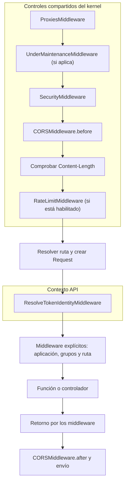
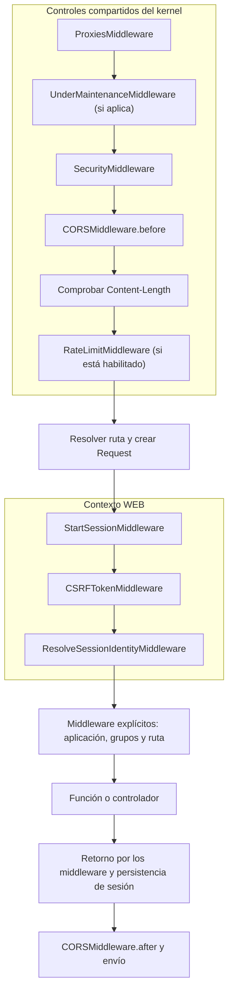

Las rutas relacionan un método HTTP y un path con la función o acción de controlador que atenderá la petición. Orionis las registra durante el arranque y prepara su resolución antes de ejecutar sus manejadores.

## Separar rutas API y WEB

En `bootstrap/app.py`, los argumentos `api` y `web` de `app.withRouting(...)` identifican los archivos de cada contexto; normalmente son `routes/api.py` y `routes/web.py`. El loader marca las declaraciones de cada archivo con ese contexto y el kernel selecciona su tratamiento:

| Contexto | Comportamiento automático | Uso habitual |
| --- | --- | --- |
| WEB, con estado | Inicia la sesión, aplica CSRF y resuelve la identidad de sesión, en ese orden. | Navegación y formularios que necesitan continuidad entre peticiones mediante una cookie de sesión. |
| API, sin estado de sesión automático | Resuelve la identidad mediante un token Bearer; no incorpora las capas automáticas de sesión ni CSRF. | Clientes que envían las credenciales necesarias en cada petición. |

Separarlos evita cargar el tratamiento de sesión de navegador en endpoints que no lo necesitan y permite conservarlo en formularios y páginas que sí dependen de él. Sin estado no significa que una API no pueda guardar datos en una base de datos: describe su tratamiento HTTP de sesión.

El contexto depende del argumento de `withRouting()`, no del nombre físico del archivo ni del prefijo de URL. Un path `/api/products` declarado como WEB sigue siendo WEB. El registro API tampoco añade `/api` a sus URLs: debes escribirlo en la ruta o en un grupo.

Ambos resolutores de identidad permiten invitados. Para exigir una identidad, utiliza el middleware de autenticación correspondiente; devolver JSON desde una ruta WEB no la convierte en API ni la hace pública. Consulta [Middlewares](/es/http/middleware) y [Autenticación](/es/authentication).

Los gráficos muestran el flujo habitual de una petición HTTP admitida que continúa hasta una ruta. Los controles compartidos del kernel se ejecutan **antes de resolver la ruta**, tanto en API como en WEB. Después se aplican las capas del contexto y los middleware explícitos, en este orden: **aplicación → grupos → ruta**.

### Capas automáticas de API



API resuelve la identidad mediante un token Bearer y permite invitados; no inicia una sesión ni añade la comprobación CSRF de WEB. Los controles compartidos de seguridad, CORS y rate limit también se aplican a API según su configuración.

### Capas automáticas de WEB



WEB restaura o inicia la sesión, aplica la política CSRF y resuelve la identidad de sesión antes del código de la aplicación. La respuesta recorre los middleware en orden inverso y la capa de sesión persiste sus cambios antes del procesamiento final de CORS.

:::note[Condiciones del recorrido]
- `ProxiesMiddleware` sólo normaliza IP y esquema cuando la petición procede de un proxy configurado como confiable. `SecurityMiddleware` comprueba el formato de las cabeceras y `Host`; la lista de hosts permitidos se aplica cuando está configurada.
- `UnderMaintenanceMiddleware` responde con `503` cuando hay mantenimiento. El kernel exceptúa de este control el health check y los recursos internos de sus páginas predeterminadas.
- `RateLimitMiddleware` sólo se ejecuta si `http.rate_limit.rate_limit_enabled` está habilitado; está deshabilitado por defecto. La comprobación de `Content-Length` es un control del kernel, no otro middleware.
- Una respuesta anticipada o un error puede detener el recorrido. El preflight CORS permitido, los recursos internos atendidos por el kernel y el `OPTIONS` automático pueden responder antes del contexto API/WEB. `CORSMiddleware.after` también procesa las respuestas anticipadas que envía el kernel.
:::

## Importar Route y declarar una ruta

Importa siempre la fachada desde el paquete público:

```python
from orionis.support.facades import Route
```

`Route` ya está expuesto por `orionis.support.facades.__init__`; no necesitas importarlo desde su archivo interno `router.py`.

Este ejemplo completo puede colocarse en el archivo registrado como API:

```python
from orionis.http import response
from orionis.support.facades import Route

async def list_products():
    return response.json({"products": []})

Route.get("/products", list_products).name("products.index")
```

`GET /products` devuelve `{"products": []}`. La declaración registra el manejador; la función se ejecuta al recibir una petición que coincide.

Los métodos HTTP reciben `path` y `action`. Una acción puede ser una función Python síncrona o asíncrona, una clase con `__call__` o una pareja `[ProductController, "show"]` que referencia un controlador importado. Conserva las funciones y clases en módulos importables. Si omites `action`, completa la ruta con `.action(ProductController, "show")` antes de exportar o compilar las rutas. La implementación de controladores se explica en [Controladores](/es/http/controllers).

### Rutas a métodos de un controlador

Los ejemplos con funciones y controladores son alternativas: registra una sola acción por combinación de método HTTP y path. Si pruebas la siguiente variante, sustituye las declaraciones equivalentes que ya tengas.

Guarda este controlador en `app/http/controllers/product_controller.py`:

```python
from orionis.http import JSONResponse, response
from orionis.http.base import BaseController

class ProductController(BaseController):
    async def index(self) -> JSONResponse:
        return response.json({"products": []})

    async def show(self, product_id: int) -> JSONResponse:
        return response.json({"id": product_id})
```

En `routes/api.py`, importa la clase y registra cada acción mediante `[Clase, "método"]`:

```python
from app.http.controllers.product_controller import ProductController
from orionis.support.facades import Route

Route.get("/products", [ProductController, "index"]).name("products.index")
Route.get("/products/{product_id:int}", [ProductController, "show"]).name("products.show")
```

`GET /products` invoca `index()` y devuelve `{"products": []}`. `GET /products/42` invoca `show(product_id=42)` y devuelve `{"id": 42}`. El nombre `product_id` de la firma coincide con el parámetro del path.

Pasa la clase y el nombre del método, sin instanciarla ni ejecutar la acción en el archivo de rutas. Orionis prepara la invocación durante el arranque y construye el controlador mediante el contenedor al atender la petición; también resuelve sus dependencias.

### Controlador con `__call__`

Para un controlador dedicado a una sola acción, implementa `__call__`. Guarda este ejemplo en `app/http/controllers/show_product_controller.py`:

```python
from orionis.http import JSONResponse, response
from orionis.http.base import BaseController

class ShowProductController(BaseController):
    async def __call__(self, product_id: int) -> JSONResponse:
        return response.json({"id": product_id})
```

Registra la clase directamente en `routes/api.py`:

```python
from app.http.controllers.show_product_controller import ShowProductController
from orionis.support.facades import Route

Route.get("/products/{product_id:int}", ShowProductController).name("products.show")
```

Aquí no se indica un nombre de método: Orionis reconoce la clase invocable y utiliza `__call__`. `GET /products/42` devuelve `{"id": 42}`, con la misma conversión de parámetros e inyección de dependencias que una acción con nombre. Pasa `ShowProductController`, sin `()`; este registro sustituye al ejemplo anterior para ese mismo endpoint.

## Métodos HTTP soportados

Estos son los métodos de registro HTTP disponibles. La operación concreta y sus efectos los define tu manejador:

| Método de Route | Verbo HTTP | Uso habitual |
| --- | --- | --- |
| `Route.post(path, action)` | `POST` | Enviar datos para crear un recurso o ejecutar una operación. |
| `Route.get(path, action)` | `GET` | Obtener la representación de un recurso. |
| `Route.query(path, action)` | `QUERY` | Consultar recursos mediante el cuerpo de la petición. |
| `Route.put(path, action)` | `PUT` | Reemplazar la representación de un recurso. |
| `Route.delete(path, action)` | `DELETE` | Eliminar un recurso. |
| `Route.patch(path, action)` | `PATCH` | Aplicar una modificación parcial. |

`Route.query()` registra el método HTTP **QUERY**, definido por el IETF en el [RFC 10008: The HTTP QUERY Method](https://www.rfc-editor.org/rfc/rfc10008.html). El RFC lo especifica como seguro (sin solicitar cambios en el recurso) e idempotente, con la consulta en el cuerpo de la petición. El manejador debe respetar esa semántica.

No añade parámetros a la URL. Una petición `GET /products?category=books` continúa correspondiendo a `Route.get("/products", ...)`. Las declaraciones no incluyen el query string.

### HEAD automático

No se registra una ruta HEAD separada. Cuando existe una ruta GET, una petición HEAD utiliza su misma resolución y ejecuta su manejador y middleware. El adaptador omite el cuerpo al enviarlo, conservando los encabezados que correspondan.

Por ejemplo, `HEAD /products` utiliza la ruta GET del ejemplo anterior. HEAD no evita el trabajo del manejador; evita enviar su contenido al cliente.

### OPTIONS automático

El kernel atiende OPTIONS antes de construir el `Request` de una ruta y de ejecutar sus middleware. Devuelve `200` con `Allow`, calculado a partir de los métodos registrados para el path:

- Una ruta GET aporta también HEAD.
- Si hay métodos disponibles, se incluye OPTIONS.
- Una ruta con QUERY añade `Accept-Query: application/json, application/x-www-form-urlencoded`.

Para un path registrado con GET y POST, `Allow` es `GET, HEAD, OPTIONS, POST`. En un path desconocido, OPTIONS devuelve `200` con `Allow` vacío; si hay fallback, anuncia `GET, HEAD, OPTIONS`. Las políticas previas del kernel todavía pueden responder antes.

El **preflight CORS** es otro caso: un OPTIONS con `Origin` y `Access-Control-Request-Method` puede resolverse antes con `204` si el origen está permitido. Sus encabezados `Access-Control-Allow-*` proceden de la configuración CORS, no de la enumeración del router. Si tu cliente usa QUERY entre orígenes, inclúyelo expresamente en los métodos CORS permitidos; la expansión actual de `*` no lo incluye. Consulta [Middlewares y políticas HTTP](/es/http/middleware).

## Parámetros de ruta

Escribe los parámetros como `{nombre:tipo}`. Sólo estos cuatro tipos están registrados nativamente:

| Tipo | Sintaxis de ejemplo | Coincidencia y valor entregado |
| --- | --- | --- |
| `str` | `/users/{username}` o `/users/{username:str}` | Segmento no vacío sin `/`; entrega `str`. Es el tipo implícito. |
| `slug` | `/articles/{slug:slug}` | Letras minúsculas ASCII, dígitos y guiones; entrega `str`. No admite espacios ni `_`. |
| `int` | `/products/{product_id:int}` | Dígitos sin signo; entrega `int`. Admite cero; no admite negativos ni decimales. |
| `uuid` | `/orders/{order_id:uuid}` | UUID hexadecimal con formato `8-4-4-4-12`; entrega `uuid.UUID`. Admite hexadecimal en mayúsculas o minúsculas. |

El placeholder determina la conversión. Una anotación en el manejador no cambia por sí sola el patrón de una ruta.

```python
from orionis.http import response
from orionis.support.facades import Route

async def show_product(product_id: int):
    return response.json({"id": product_id})

Route.get("/products/{product_id:int}", show_product)
```

`GET /products/42` entrega el entero `42`. El kernel pasa los parámetros de ruta al manejador por nombre: debes aceptarlos en su firma, también si inyectas `Request`, o recibirlos mediante `**kwargs`. Como acceso complementario, `request.routeParam("product_id")` devuelve un parámetro y `request.routeParams()` devuelve todos los valores convertidos.

Una entrada como `/products/abc` no coincide con esa ruta; no produce un error de validación del payload. Si no existe otra coincidencia, se trata como ruta ausente.

No hay convertidores nativos `float` o `path` ni segmentos opcionales. Un tipo desconocido o un nombre de parámetro inválido o repetido produce un error al compilar las rutas.

## Grupos y grupos anidados

`Route.group()` permite compartir un prefijo y middleware entre varias rutas. Un grupo dentro de otro añade su prefijo al del padre y hereda sus middleware.

Este ejemplo para `routes/api.py` reutiliza el `ProductController` definido anteriormente y utiliza sólo dos niveles. El grupo exterior exige autenticación por token para las dos rutas del grupo interior:

```python
from app.http.controllers.product_controller import ProductController
from orionis.auth.middleware import AuthenticateTokenMiddleware
from orionis.support.facades import Route

Route.group(
    prefix="/api",
    middleware=AuthenticateTokenMiddleware,
    routes=[
        Route.group(
            prefix="/products",
            routes=[
                Route.get("/", [ProductController, "index"]).name("api.products.index"),
                Route.get("/{product_id:int}", [ProductController, "show"]).name("api.products.show"),
            ],
        ),
    ],
)
```

| Petición | Acción | Nombre |
| --- | --- | --- |
| `GET /api/products` | `ProductController.index` | `api.products.index` |
| `GET /api/products/42` | `ProductController.show(product_id=42)` | `api.products.show` |

`AuthenticateTokenMiddleware` se pasa como clase, sin `()`, y se hereda en ambas rutas. Es una protección añadida expresamente en este ejemplo; la resolución de identidad automática de API permite invitados.

El prefijo exterior `/api` se une al interior `/products`. La ruta `"/"` representa la raíz del grupo y `"/{product_id:int}"` añade el parámetro. Los nombres se declaran expresamente con `.name()`; los grupos no los prefijan.

`routes` recibe las rutas y grupos creados en la lista. `group()` devuelve un `RouteGroup` que permite anidarlos; no funciona como decorador ni como contexto `with` para declaraciones posteriores.

### Opciones de group()

Estas opciones de `group()` se pasan por nombre:

| Opción | Tipo admitido | Predeterminado | Efecto |
| --- | --- | --- | --- |
| `prefix` | `str \| None` | `None` | Anteponer un path a todos los descendientes. Se normalizan espacios exteriores y barras; `None`, `""` o `"/"` no añaden segmentos. |
| `middleware` | `MiddlewareInput \| None` | `None` | Incorporar clases de middleware antes de las de los grupos interiores y las rutas. |
| `without_middleware` | `MiddlewareInput \| None` | `None` | Excluir clases del conjunto final de middleware explícitos. Las exclusiones se acumulan. |
| `routes` | `Sequence[FluentRoute \| RouteGroup] \| None` | `None` en la firma | Miembros del grupo. Debes proporcionar una secuencia no vacía de rutas o grupos; omitirla o enviar `[]` produce un error. |

Para `routes` utiliza una lista o tupla de resultados de `Route.get(...)`, otros métodos HTTP o `Route.group(...)`. No acepta generadores, sets, strings ni funciones que declaren rutas. No reutilices una misma instancia de ruta en distintas ramas esperando obtener copias: los grupos modifican esa ruta, y repetir un miembro dentro del grupo se rechaza.

`MiddlewareInput` admite una clase o una colección de clases, como una lista o tupla; no recibe instancias ni nombres de texto. También admite sets, que se ordenan por nombre de importación. Utiliza listas o tuplas cuando el orden forme parte de tu intención.

### Herencia de middleware

El orden de middleware explícitos es: **aplicación → grupo exterior → grupo interior → ruta**. El compilador elimina duplicados y aplica las exclusiones por clase exacta; una exclusión de un padre también afecta a sus descendientes. Estas exclusiones no eliminan las capas internas de sesión, CSRF o identidad.

## Fallback para rutas ausentes

El método se llama `Route.fallback()`. Registra una respuesta alternativa para un path que no encuentra una ruta:

```python
from orionis.http import Response, response
from orionis.support.facades import Route

async def not_found() -> Response:
    return response.json({"message": "Endpoint not found"}, status_code=404)

Route.fallback(not_found)
```

Úsalo para personalizar la respuesta de un endpoint inexistente, por ejemplo el 404 JSON de una API. Si no defines fallback, se conserva el tratamiento de ruta ausente del framework.

Hay **un solo fallback para todo el router**, compartido por los archivos API y WEB. No queda limitado por el archivo donde lo declaras ni por un prefijo. La segunda declaración produce `FallbackRouteAlreadyRegisteredException`.

El registro devuelve `None`, por lo que no admite encadenar `.name()`, `.middleware()` ni opciones de grupo. Su manejador debe devolver una `Response` y establecer expresamente el estado deseado: Orionis no fuerza `404` ni convierte aquí un diccionario en JSON.

El fallback no es un manejador general de excepciones y no resuelve un método incorrecto: un path existente con otro verbo produce `405`. Al no haber una ruta coincidente, no se construye el `Request` de esa ruta ni se ejecutan sus capas de contexto y middleware; por ello, el ejemplo no solicita `Request` como dependencia. Consulta [Excepciones](/es/http/exceptions) para otros errores.

## Consultar las rutas registradas

Desde la raíz del proyecto y con su entorno Python activo, puedes utilizar cualquiera de estas dos alternativas:

```bash
python -B reactor route:list
```

O el comando directo del framework instalado en ese entorno:

```bash
orionis route:list
```

Ambos muestran las rutas HTTP registradas, ordenadas por URI, y su total. La tabla incluye `Method` (método HTTP), `URI` (path), `Name` (nombre), `Action` (manejador) y `Middleware`. Utilízala para comprobar los prefijos, parámetros, acciones y middleware heredados de los grupos.

:::note
La columna `Middleware` muestra los middleware explícitos de aplicación, grupos y rutas. Las capas automáticas de API y WEB representadas en los gráficos no aparecen en esa columna.
:::

## Resolución y conflictos

Las rutas estáticas se consultan antes que las dinámicas. Las dinámicas se ordenan por especificidad de sus segmentos; si empatan, conservan el orden de registro. No supongas que `{id:int}` tiene prioridad automática sobre `{name:str}` cuando ambas pueden coincidir: evita solapamientos o declara primero la más específica.

Los duplicados del mismo método/path, los patrones dinámicos estructuralmente equivalentes y los nombres de ruta incompatibles producen errores de compilación. Un grupo no aporta prioridad numérica ni cambia el contexto API/WEB de sus miembros.

Al añadir o cambiar declaraciones, reinicia el proceso y comprueba la invalidación de la caché si la aplicación utiliza rutas compiladas. Consulta [Directorios y caché de arranque](/es/application/paths-and-caching).
