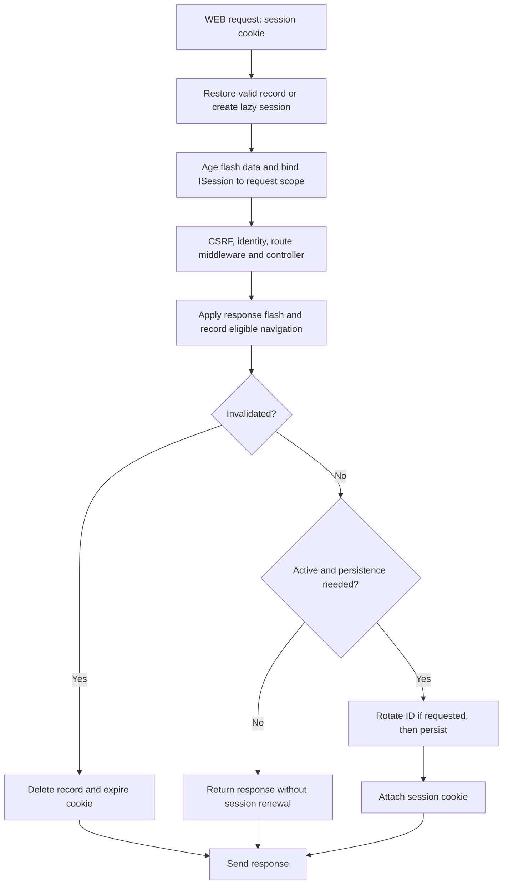

La configuración de sesiones se encuentra en `config/session.py`, en la clase `BootstrapSession`. Sus campos heredan la validación de `orionis.foundation.config.session.Session` y leen las variables de entorno al construir la configuración de la aplicación.

Configura el almacenamiento y la cookie antes de arrancar los workers. El gestor conserva esos valores durante su vida útil; cambiar una variable de entorno no reconfigura una petición que ya está en curso.

## Todas las opciones de configuración

Los valores siguientes son los predeterminados de `config/session.py` cuando no existe una variable de entorno que los sustituya.

### Almacenamiento y duración

| Campo y variable de entorno | Predeterminado | Función |
|---|---|---|
| `driver` · `SESSION_DRIVER` | `"memory"` | Almacén del servidor: `memory`, `file`, `database` o `cache`. También admite miembros de `SessionDriver` al configurar en Python. |
| `lifetime` · `SESSION_LIFETIME` | `120` | Duración en **minutos** de un registro desde su última persistencia. Entero mayor que cero. |
| `expire_on_close` · `SESSION_EXPIRE_ON_CLOSE` | `False` | Si es `True`, omite `Max-Age` y emite una cookie de sesión del navegador. El registro del servidor sigue sujeto a `lifetime`. |
| `renewal_interval` · `SESSION_RENEWAL_INTERVAL` | `0` | Intervalo en **segundos** para renovar datos escalares sin cambios. `0` renueva en cada guardado de una sesión activa. |
| `track_previous_url` · `SESSION_TRACK_PREVIOUS_URL` | `True` | Recuerda la URL de una navegación GET/HEAD con respuesta 200–299, excluyendo AJAX y peticiones que solicitan JSON. |
| `files` · `SESSION_FILES` | `"storage/framework/sessions"` | Directorio del driver `file`. Una ruta relativa se resuelve desde la raíz del proyecto. Usa una ruta no vacía cuando selecciones ese driver. |
| `connection` · `SESSION_DB_CONNECTION` | `None` | Conexión de base de datos del driver `database`; `None` usa la predeterminada. |
| `table` · `SESSION_DB_TABLE` | `"sessions"` | Tabla del driver `database`. |
| `cache` · `SESSION_CACHE_STORE` | `None` | Store del driver `cache`; `None` usa el store de caché predeterminado. |

Consulta [almacenes y concurrencia](/es/http/sessions/stores-and-concurrency) para elegir el driver y preparar sus dependencias.

### Identidad y alcance de la cookie

| Campo y variable de entorno | Predeterminado | Función |
|---|---|---|
| `cookie` · `SESSION_COOKIE` | `"sessionid"` | Nombre de la cookie que contiene el identificador de sesión. Debe ser un nombre de cookie válido. |
| `path` · `SESSION_PATH` | `"/"` | Ruta de la cookie; debe comenzar por `/`. |
| `domain` · `SESSION_DOMAIN` | `None` | Omite `Domain` y limita la cookie al host que la emite. Un dominio explícito debe ser una cadena no vacía, sin punto inicial/final ni puntos consecutivos. |

### Política de seguridad

| Campo y variable de entorno | Predeterminado | Función |
|---|---|---|
| `secure` · `SESSION_SECURE` | `False` | Añade `Secure` para restringir el envío de la cookie a HTTPS. |
| `http_only` · `SESSION_HTTP_ONLY` | `True` | Añade `HttpOnly` para impedir la lectura de la cookie de sesión desde JavaScript. |
| `same_site` · `SESSION_SAME_SITE` | `"lax"` | Política `lax`, `strict` o `none`. En Python también admite `SameSitePolicy`. `none` exige `secure=True`. |
| `partitioned` · `SESSION_PARTITIONED` | `False` | Añade el atributo `Partitioned` a la cookie cuando se activa. No cambia el driver ni separa los registros del servidor. |

Los campos booleanos deben ser booleanos reales en la configuración de Python. `renewal_interval` debe ser un entero entre `0` y `lifetime * 60 - 1`. Los nombres de driver y las políticas SameSite se normalizan a minúsculas.

Los valores `None` de las tablas son valores de Python: conserva el predeterminado si no necesitas configurar ese campo. Evita establecer un dominio o una conexión vacíos en el archivo de configuración.

## Ejemplo de configuración

Estas variables conservan una cookie válida para desarrollo local por HTTP y permiten omitir renovaciones durante cinco minutos cuando la sesión solo contiene datos escalares sin cambios:

```dotenv
SESSION_DRIVER=memory
SESSION_LIFETIME=120
SESSION_EXPIRE_ON_CLOSE=false
SESSION_RENEWAL_INTERVAL=300
SESSION_TRACK_PREVIOUS_URL=true
SESSION_COOKIE=sessionid
SESSION_PATH=/
SESSION_SECURE=false
SESSION_HTTP_ONLY=true
SESSION_SAME_SITE=lax
SESSION_PARTITIONED=false
```

El driver `memory` pertenece a un proceso. Para desplegar varios workers o conservar sesiones después de un reinicio, selecciona un almacén adecuado en [la guía de drivers](/es/http/sessions/stores-and-concurrency).

En un despliegue HTTPS, ajusta como mínimo:

```dotenv
SESSION_SECURE=true
SESSION_HTTP_ONLY=true
SESSION_SAME_SITE=lax
```

`SameSite=strict` restringe más el envío entre sitios; `none` permite el contexto entre sitios y exige `secure=True`. El atributo `Partitioned` es una opción de la cookie, no un mecanismo de autenticación. El framework no activa `Secure` automáticamente al configurar `partitioned=True`.

## Cómo transcurre una petición

El middleware de sesiones está integrado en la cadena normal de rutas **WEB**. Restaura el registro, envejece los datos flash, publica la sesión como `request.state.session` y registra `ISession` en el contenedor de la petición. Después permite ejecutar los demás middleware y el controlador.

Al recibir la respuesta aplica los datos flash adjuntos, actualiza la URL de navegación cuando corresponde y guarda la sesión antes de enviar la respuesta.



Una cookie ausente, un identificador mal formado o un registro ausente/expirado producen una sesión nueva y perezosa. El identificador entrante se valida antes de consultar el almacén. La primera escritura activa la sesión y genera su identificador.

**Que tu controlador solo lea no implica que la petición no cree una sesión.** La protección CSRF puede guardar su token y el seguimiento de navegación puede escribir la URL. Las rutas API no restauran ni guardan sesiones automáticamente; utiliza el contexto WEB para los ejemplos de esta sección.

## Expiración y renovación

Al persistir una sesión, Orionis establece su expiración en `ahora + lifetime`. Si `expire_on_close=False`, la cookie recibe `Max-Age=lifetime * 60`. Si es `True`, omite `Max-Age`; el plazo del registro en el servidor sigue existiendo y cerrar el navegador no ejecuta una eliminación inmediata en el almacén.

Con `renewal_interval=0` se guarda y se renueva la cookie en cada respuesta de una sesión activa. Con un intervalo positivo, una sesión restaurada que solo contiene escalares inmutables puede conservar su vencimiento y omitir la escritura y el `Set-Cookie` hasta que corresponda renovarla. El límite se comprueba cuando la respuesta está lista.

Las sesiones nuevas, las modificaciones, el envejecimiento de datos flash y las solicitudes de rotación siguen persistiendo. También se guardan de forma conservadora los payloads con listas, diccionarios u otros valores no escalares, porque pueden cambiar mediante una referencia sin activar `dirty`. Leer una sesión sigue consultando su almacén; el intervalo reduce renovaciones, no elimina las lecturas.

El seguimiento de una URL diferente también modifica datos. Por eso el intervalo es una optimización para sesiones sin cambios, no una promesa de que todas las peticiones esperen ese número de segundos antes de guardar.

## Rotar o invalidar desde un controlador

`regenerate()` solicita un nuevo identificador **conservando los datos**. El cambio no es inmediato: el gestor elimina el registro anterior, asigna otro ID y persiste al procesar la respuesta. Evita usar el valor de `Session.id` dentro del controlador como si ya fuera el identificador rotado.

`invalidate()` vacía los datos y solicita eliminar el registro y expirar la cookie. `clear()` solo vacía los valores; conserva la identidad de sesión y no equivale a una invalidación.

Por ejemplo, en `routes/web.py`:

```python
from orionis.http import JSONResponse
from orionis.support.facades import Route, Session


class SessionLifecycleController:

    async def rotate(self) -> JSONResponse:
        Session.regenerate()
        return JSONResponse({"message": "Session rotation requested."})

    async def reset(self) -> JSONResponse:
        Session.invalidate()
        return JSONResponse({"message": "Session cleared."})


Route.post("/session/rotate", [SessionLifecycleController, "rotate"])
Route.post("/session/reset", [SessionLifecycleController, "reset"])
```

Estos endpoints modifican estado y requieren el token CSRF de la sesión, como las demás peticiones POST de rutas WEB. Consulta [middleware HTTP](/es/http/middleware-and-security) para la integración con formularios y encabezados.

La API de [autenticación por sesión](/es/security/authentication/identity-and-session) ya rota el ID al iniciar sesión y reemplaza explícitamente el token CSRF. Para cerrar una sesión autenticada, utiliza su operación de logout: también coordina la identidad y la cookie de “recordarme”. El ejemplo `reset` demuestra la invalidación de datos de sesión, no sustituye ese flujo.

La rotación de sesión por sí sola conserva el token CSRF existente, porque conserva los datos. La invalidación los elimina; una petición posterior obtiene una sesión y un token nuevos.

## Fallos y precauciones de uso

- No construyas una sesión nueva en cada controlador ni compartas una instancia entre peticiones. Usa [la fachada o la inyección de `ISession`](/es/http/sessions/state-and-flash).
- El middleware es responsable de `SessionManager.start()`, `save()` y `abort()`, que son operaciones asíncronas de infraestructura. Las operaciones de datos del controlador son síncronas; no guardes manualmente una segunda vez.
- Una excepción del controlador que se transforma en respuesta todavía puede persistir datos flash y cambios de sesión. Si la petición no puede producir respuesta o se cancela, `abort()` elimina los IDs marcados para invalidación o reemplazo sin emitir una cookie nueva.
- Un registro restaurado que otra petición haya revocado no se vuelve a crear mediante una actualización tardía. Consulta [concurrencia](/es/http/sessions/stores-and-concurrency) para el alcance de esa protección.
- La cookie transporta el identificador, no el payload completo. Los almacenes de sesiones no cifran automáticamente cada payload; limita los datos guardados a los necesarios.
- `HttpOnly` protege la lectura de la cookie desde scripts y no reemplaza la protección CSRF. La cookie de sesión y la cookie opcional `XSRF-TOKEN` tienen propósitos distintos.

Si la sesión no se conserva entre peticiones, revisa el encabezado `Set-Cookie`, el envío posterior de la cookie, su dominio/ruta, `Secure` y el driver seleccionado. Si una petición WEB de escritura falla por CSRF, utiliza el token de la misma sesión. Los errores reales del backend se propagan; no se ocultan emitiendo una cookie que prometa datos que no se pudieron guardar.
