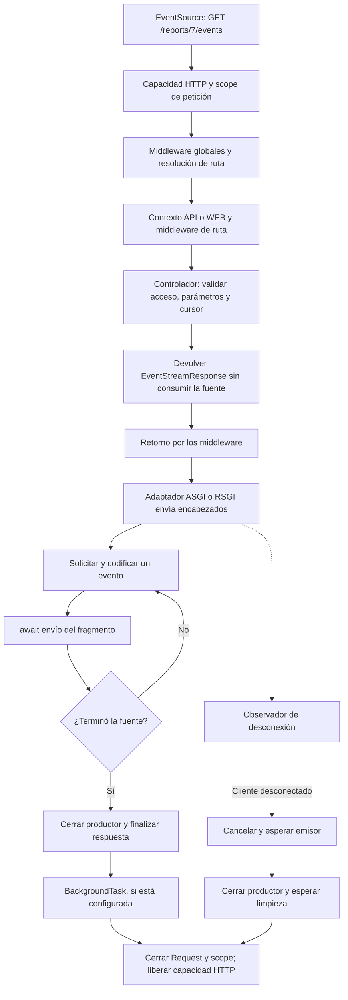

**Server-Sent Events (SSE)** mantiene abierta una respuesta HTTP para enviar eventos de texto desde Orionis al navegador. Úsalo para progreso de trabajos, notificaciones y paneles. El cliente abre la conexión con `EventSource`; para enviar datos al servidor utiliza otra petición HTTP.

`StreamingResponse` entrega bytes progresivamente, por ejemplo un CSV. `EventStreamResponse` añade el formato SSE y la gestión de su conexión. Para comunicación bidireccional en una misma conexión, consulta [WebSocket](/es/http/websockets) o los [Hubs de Realtime](/es/asynchronous/realtime). El [streaming de Realtime](/es/asynchronous/realtime/protocol-and-streaming) utiliza el protocolo del Hub y no SSE.

## Rutas y preparación

SSE utiliza una ruta HTTP `GET` corriente. No requiere `Route.websocket()` ni `Route.hub()`. Importa `Route` desde `orionis.support.facades`.

Estos ejemplos utilizan `routes/api.py`. Confirma que ese archivo aparece en la llamada existente de `bootstrap/app.py`, antes de `app.create()`:

```python
app.withRouting(
    ai="routes/ai.py",
    api="routes/api.py",
    console="routes/console.py",
    web="routes/web.py",
    websocket="routes/websocket.py",
    health="/up",
)
```

Conserva los demás argumentos de tu aplicación. El contexto API selecciona el flujo HTTP sin sesiones WEB; no añade el prefijo `/api`. Los [middleware HTTP](/es/http/middleware-and-security) globales, de contexto y de ruta se aplican como en otras rutas HTTP. Una ruta WEB también puede devolver SSE si necesitas su contexto de sesión.

`{report_id:int}` convierte el segmento a `int` y lo entrega al controlador por nombre. También puedes utilizar `str`, `slug` y `uuid`; consulta [Rutas HTTP](/es/http/routing). La guía de [rutas y ciclos de vida](/es/asynchronous/realtime/routing-and-lifecycle) compara este registro con WebSocket y Realtime.

## Inyección por constructor y por acción

Un endpoint SSE utiliza la misma inyección que cualquier [controlador HTTP](/es/http/request-lifecycle). El constructor puede recibir servicios compartidos por sus acciones y el método puede solicitar los que necesita ese endpoint.

Guarda estos servicios concretos en `app/services/report_events.py`. La fuente simula progreso; en una aplicación real, sustituye su implementación por la consulta del estado de un trabajo existente:

```python
import asyncio
import json
from collections.abc import AsyncIterator


class ReportEventFormatter:
    def format(self, report_id: int, percent: int) -> str:
        return json.dumps({"report_id": report_id, "percent": percent})


class ReportProgressSource:
    async def percentages(self) -> AsyncIterator[int]:
        for percent in (25, 50, 75, 100):
            await asyncio.sleep(0.5)
            yield percent
```

En `app/http/controllers/injected_report_controller.py`:

```python
from collections.abc import AsyncIterator

from app.services.report_events import ReportEventFormatter, ReportProgressSource
from orionis.http import EventStreamResponse, ServerSentEvent, response
from orionis.http.base import BaseController


class InjectedReportController(BaseController):
    def __init__(self, formatter: ReportEventFormatter) -> None:
        self._formatter = formatter

    async def events(
        self,
        report_id: int,
        source: ReportProgressSource,
    ) -> EventStreamResponse:
        async def progress() -> AsyncIterator[ServerSentEvent]:
            async for percent in source.percentages():
                yield ServerSentEvent(
                    event="progress",
                    data=self._formatter.format(report_id, percent),
                )
            yield ServerSentEvent(event="done", data="complete")

        return response.eventStream(progress())
```

Registra esta acción en `routes/api.py`:

```python
from app.http.controllers.injected_report_controller import InjectedReportController
from orionis.support.facades import Route


Route.get(
    "/reports/{report_id:int}/dependency-events",
    [InjectedReportController, "events"],
)
```

Orionis construye `ReportEventFormatter` para el constructor y resuelve `ReportProgressSource` al invocar `events()`. El cliente sólo proporciona `report_id` en la ruta; los servicios se resuelven en el servidor. No necesitas registrar estos concretos sin dependencias. Los contratos abstractos y la reutilización de instancias se configuran en el [contenedor](/es/architecture/service-container/bindings-and-invocation).

Puedes abrir esta ruta con el cliente `EventSource` mostrado más adelante: recibe cuatro eventos `progress` y uno `done`; cierra la conexión al recibir `done`. Este ejemplo aislado no implementa reanudación por `Last-Event-ID`; el siguiente ejemplo sí muestra esa validación.

La función interna `progress()` captura los servicios ya resueltos. Añadirle parámetros anotados no activa inyección: el productor se ejecuta como un generador Python, después de devolver la respuesta. El scope HTTP permanece abierto durante el envío del stream y se cierra al terminar su procesamiento; no conserves sus servicios para utilizarlos después de ese cierre.

## Ejemplo completo: progreso de un informe

Esta demostración genera cuatro estados separados por una espera asíncrona. Permite comprobar eventos y reconexión sin añadir colas. En una aplicación real, el productor debe leer el estado del trabajo existente; abrir o reconectar el stream no debe iniciar otra vez ese trabajo.

### Controlador y productor

Crea `app/http/controllers/report_progress_controller.py`:

```python
import asyncio
import json
from collections.abc import AsyncIterator

from orionis.http import EventStreamResponse, JSONResponse, Request, ServerSentEvent, response
from orionis.http.base import BaseController


class ReportProgressController(BaseController):

    async def events(
        self,
        request: Request,
        report_id: int,
    ) -> EventStreamResponse | JSONResponse:
        cursor = request.headers.get("last-event-id", "0")

        # Validate before returning the response, while its status can change.
        if (
            not cursor.isascii()
            or not cursor.isdecimal()
            or len(cursor) > 1
            or int(cursor) > 4
        ):
            return response.json(
                {"message": "Last-Event-ID must be an integer from 0 to 4."},
                status_code=400,
            )

        last_step = int(cursor)

        async def progress() -> AsyncIterator[ServerSentEvent]:
            # This controls browser reconnection, not server-side retries.
            yield ServerSentEvent(retry=1500)

            for step in range(last_step + 1, 5):
                await asyncio.sleep(0.5)
                yield ServerSentEvent(
                    event="progress",
                    id=str(step),
                    data=json.dumps({
                        "report_id": report_id,
                        "percent": step * 25,
                    }),
                )

            yield ServerSentEvent(
                event="done",
                data=json.dumps({"report_id": report_id, "percent": 100}),
            )

        return response.eventStream(progress())
```

`Request` se inyecta desde el scope HTTP y `report_id` procede de la ruta. `progress()` devuelve un generador asíncrono: llamarlo no consume eventos. El adaptador los solicita durante la entrega. No uses `asyncio.run()` dentro del controlador.

Valida antes de devolver la respuesta: una comprobación dentro del generador puede fallar cuando ya se enviaron los encabezados. Los identificadores `1…4` pertenecen a este ejemplo; no son una restricción de Orionis.

### Registrar los endpoints

Añade en `routes/api.py`:

```python
from app.http.controllers.report_progress_controller import ReportProgressController
from orionis.support.facades import Route

Route.group(
    prefix="/reports",
    routes=[
        Route.view("/{report_id:int}", "reports.progress"),
        Route.get(
            "/{report_id:int}/events",
            [ReportProgressController, "events"],
        ).name("reports.events"),
    ],
)
```

`GET /reports/7` muestra el cliente y `GET /reports/7/events` abre el stream. El nombre opcional `reports.events` no cambia la URL.

### Cliente HTML y JavaScript

Crea `resources/views/reports/progress.html`:

```html
<!doctype html>
<html lang="es">
<head>
    <meta charset="utf-8">
    <title>Progreso del informe</title>
</head>
<body>
    <h1>Progreso del informe</h1>
    <progress id="progress" max="100" value="0"></progress>
    <p id="status" role="status">Conectando…</p>
    <button id="stop" type="button">Detener seguimiento</button>

    <script type="module">
        const bar = document.querySelector("#progress");
        const status = document.querySelector("#status");
        const stop = document.querySelector("#stop");
        const url = new URL(location.href);
        url.pathname = url.pathname.replace(/\/$/, "") + "/events";
        url.search = "";

        const events = new EventSource(url);

        events.onopen = () => {
            status.textContent = "Conectado";
        };

        events.addEventListener("progress", (event) => {
            const payload = JSON.parse(event.data);
            bar.value = payload.percent;
            status.textContent = "Informe " + payload.report_id + ": " + payload.percent + "%";
        });

        events.addEventListener("done", (event) => {
            const payload = JSON.parse(event.data);
            bar.value = payload.percent;
            status.textContent = "Informe " + payload.report_id + " completado";
            events.close();
            stop.disabled = true;
        });

        events.onerror = () => {
            status.textContent = events.readyState === EventSource.CLOSED
                ? "Conexión cerrada"
                : "Conexión interrumpida; esperando reconexión…";
        };

        stop.addEventListener("click", () => {
            events.close();
            stop.disabled = true;
            status.textContent = "Seguimiento detenido";
        });

        window.addEventListener("pagehide", () => events.close(), { once: true });
    </script>
</body>
</html>
```

Con el servidor de desarrollo iniciado, abre `http://localhost:8000/reports/7` —o la dirección indicada en consola—. Verás `25%`, `50%`, `75%` y `100%`. `done` cierra el cliente para evitar otra conexión.

Para inspeccionar el formato desde una terminal, `-N` desactiva el buffering de salida de curl:

```bash
curl -N http://localhost:8000/reports/7/events
curl -N -H "Last-Event-ID: 2" http://localhost:8000/reports/7/events
```

La segunda petición emite sólo los pasos `3` y `4` y después `done`. Un cursor inválido recibe JSON `400` antes de abrir el stream.

## Eventos, datos y encabezados

Ambas formas públicas de construir una respuesta SSE son equivalentes:

```python
from orionis.http import EventStreamResponse, ServerSentEvent, response

events = [
    ServerSentEvent(event="notice", data="Report ready"),
    "A plain text message",
]

result = response.eventStream(events)
direct = EventStreamResponse(events)
```

Un generador es de un solo uso: crea uno nuevo por petición. Un string emitido por la fuente se convierte en un evento `data:`; no se interpreta como framing SSE escrito a mano. Serializa explícitamente los datos estructurados con `json.dumps()` y utiliza `JSON.parse(event.data)` en el cliente.

| Campo | Tipo y valor predeterminado | Uso |
| --- | --- | --- |
| `data` | `str \| None = None` | Contenido textual; cada línea se codifica como `data:`. |
| `event` | `str \| None = None` | Nombre del evento; sin saltos de línea. |
| `id` | `str \| None = None` | Cursor; sin saltos de línea ni NUL. |
| `retry` | `int \| None = None` | Espera de reconexión en milisegundos; entero no negativo, no `bool`. |
| `comment` | `str \| None = None` | Comentario o latido; puede contener varias líneas. |

Los argumentos de `ServerSentEvent` son por nombre y sus instancias son inmutables:

```python
import json

from orionis.http import ServerSentEvent

event = ServerSentEvent(
    event="notice",
    id="42",
    retry=3000,
    comment="connection active",
    data=json.dumps({"message": "Report ready"}),
)

encoded = event.encode()
assert b"event: notice\n" in encoded
assert b"id: 42\n" in encoded
assert encoded.endswith(b"\n\n")

multiline = ServerSentEvent(data="First line\nSecond line")
assert multiline.encode() == b"data: First line\ndata: Second line\n\n"

heartbeat = ServerSentEvent(comment="ping")
assert heartbeat.encode() == b": ping\n\n"
```

El navegador entrega eventos sin nombre a `onmessage` y los nombrados a `addEventListener("nombre", ...)`. Los comentarios no producen mensajes JavaScript. Orionis no crea latidos periódicos automáticamente. [Formato y procesamiento SSE en HTML](https://html.spec.whatwg.org/multipage/server-sent-events.html#interpreting-an-event-stream).

`response.eventStream(content, status_code=200, headers=None, background=None)` configura:

| Encabezado | Comportamiento |
| --- | --- |
| `Content-Type` | `text/event-stream; charset=utf-8` salvo que proporciones uno propio. Conserva el tipo SSE para `EventSource`. |
| `Cache-Control` | `no-cache` si no lo indicas. |
| `X-Accel-Buffering` | `no` si no lo indicas; la configuración del proxy sigue siendo necesaria. |
| `Content-Length` | Se elimina al crear y serializar los encabezados. |

`content` acepta iterables síncronos o asíncronos de `str` o `ServerSentEvent`. `status_code` admite un entero o `HTTPStatus`; utiliza `200` para `EventSource`. `headers` permite otros encabezados. `background` recibe `BackgroundTask` y se ejecuta tras la entrega completa y la limpieza exitosa; no se ejecuta al desconectarse el cliente.

## Reconexión y autenticación

`EventSource` reconecta cuando termina una respuesta SSE o se interrumpe la conexión. `events.close()` lo detiene. Tras recibir un `id`, el navegador lo envía como `Last-Event-ID` al reconectar; léelo mediante `request.headers.get("last-event-id")`. `retry` ajusta la espera del cliente. [Reconexión según HTML](https://html.spec.whatwg.org/multipage/server-sent-events.html#processing-model).

**Orionis no almacena ni reproduce eventos automáticamente.** El ejemplo reconstruye una secuencia determinista. Para un historial real, decide cómo conservar eventos o estados, validar cursores, autorizar el recurso y resolver cursores caducados. El cliente puede recibir datos repetidos; evita efectos irreversibles al consumirlos.

La API nativa `EventSource` admite URL y `withCredentials`; no permite configurar cuerpo, otro método ni encabezados `Authorization` personalizados. Para cookies entre orígenes existe `new EventSource(url, { withCredentials: true })`, con CORS y credenciales coherentes. Valida el acceso antes de devolver `EventStreamResponse`. [Interfaz de EventSource](https://html.spec.whatwg.org/multipage/server-sent-events.html#the-eventsource-interface).

## Ciclo de vida SSE

`EventStreamResponse` atraviesa el mismo kernel y los middleware HTTP de su ruta. La lógica posterior a `await call_next()` recibe el objeto respuesta antes de consumir el productor; no se ejecuta por cada evento.



El diagrama representa una ruta que devuelve SSE; un middleware puede responder antes. El emisor y el observador se coordinan: al terminar cancelan y esperan la tarea restante. Los fallos de envío, observación y limpieza se propagan. Una desconexión no es una finalización satisfactoria.

El adaptador espera cada envío antes de pedir otro evento, sin precarga ni cola propia. Esto sigue el ritmo del transporte (*backpressure*); no limita las colas o buffers que tu aplicación mantenga.

### Recursos, latidos y cancelación

ASGI y RSGI observan desconexiones durante la entrega SSE. Al terminar, fallar o cancelarse, cierran el iterador propietario mediante `aclose()` o `close()` cuando corresponde y esperan la limpieza asíncrona. El scope y la plaza HTTP siguen activos hasta concluirla.

Libera los recursos abiertos por un productor mediante `try/finally` o un contexto asíncrono. Este patrón consume una cola entregada por tu aplicación y envía un comentario tras 15 segundos sin mensajes:

```python
import asyncio
from collections.abc import AsyncIterator

from orionis.http import ServerSentEvent


async def queue_events(queue: asyncio.Queue[str]) -> AsyncIterator[ServerSentEvent]:
    while True:
        try:
            async with asyncio.timeout(15):
                message = await queue.get()
        except TimeoutError:
            yield ServerSentEvent(comment="ping")
        else:
            yield ServerSentEvent(event="notice", data=message)
```

La cola debe corresponder a una suscripción individual: compartir una cola reparte elementos entre consumidores, no los difunde a todos. Si la suscripción procede de un broker, créala y libérala dentro del generador con `try/finally` y limita su capacidad. No captures `CancelledError` para continuar produciendo.

- Consume los datos necesarios del cuerpo **antes de devolver SSE**. En ASGI, la entrega utiliza `receive` para observar la desconexión y drena mensajes del cuerpo pendientes.
- `HEAD` envía sólo metadatos y cierra la fuente SSE sin iniciar su iteración.
- `HTTP_MONITOR_DISCONNECTS` añade monitoreo durante la ejecución HTTP. SSE ya observa la desconexión durante su entrega; no requiere habilitar esa opción para cerrar un productor inactivo.
- Los iterables síncronos se recorren directamente en el event loop. Evita lecturas bloqueantes o `time.sleep()`; utiliza I/O asíncrono o delega explícitamente el trabajo.
- Cada SSE ocupa una plaza de `http.body_limits.max_concurrent_requests` hasta finalizar. El valor predeterminado es `128` por kernel. El exceso recibe `503` y `Retry-After: 1`; dimensiona el límite junto con las demás peticiones.

## Streaming de bytes: exportar CSV

Para una descarga progresiva sin eventos, crea `app/http/controllers/report_export_controller.py`:

```python
import asyncio
from collections.abc import AsyncIterator

from orionis.http import StreamingResponse, response
from orionis.http.base import BaseController


class ReportExportController(BaseController):

    async def __call__(self, report_id: int) -> StreamingResponse:
        async def rows() -> AsyncIterator[bytes]:
            yield b"id,name\n"
            for number in range(1, 4):
                await asyncio.sleep(0.1)
                yield f"{number},Report {report_id} row {number}\n".encode("utf-8")

        return response.stream(
            rows(),
            media_type="text/csv",
            headers={
                "Content-Disposition": f'attachment; filename="report-{report_id}.csv"',
            },
        )
```

Añade esta ruta en `routes/api.py`:

```python
from app.http.controllers.report_export_controller import ReportExportController
from orionis.support.facades import Route

Route.get("/reports/{report_id:int}/export", ReportExportController)
```

`response.stream(content, status_code=200, headers=None, media_type=None, background=None)` construye un `StreamingResponse`. Produce fragmentos `bytes`. El adaptador de iterables síncronos también convierte `bytearray` y `memoryview`; un productor asíncrono debe emitir bytes. No se convierten strings ni se añaden delimitadores. La red puede dividir o combinar tus fragmentos.

Ejecuta este JavaScript desde la consola de una página del mismo origen de Orionis. Consume el cuerpo progresivamente y conserva caracteres UTF-8 divididos entre fragmentos:

```javascript
const download = await fetch("/reports/7/export");
if (!download.ok || !download.body) {
    throw new Error("Export failed: HTTP " + download.status);
}

const reader = download.body.getReader();
const decoder = new TextDecoder();
try {
    while (true) {
        const { value, done } = await reader.read();
        if (done) break;
        console.log(decoder.decode(value, { stream: true }));
    }
    const tail = decoder.decode();
    if (tail) console.log(tail);
} finally {
    reader.releaseLock();
}
```

El streaming genérico no instala el observador de desconexión propio de SSE: depende de fallos de transporte, cancelación del servidor o monitoreo HTTP configurado. Los adaptadores cierran el iterador asíncrono de envío. No presupongas las garantías de propiedad y cierre de `EventStreamResponse` para un iterable síncrono arbitrario envuelto en `StreamingResponse`. Para archivos existentes, consulta [respuestas de archivo y descarga](/es/http/responses).

## Errores y comprobaciones

Después de enviar encabezados, un error del productor o transporte no puede reemplazar la respuesta por una página HTML o JSON `500`. Si necesitas eventos de error, defínelos en el productor sin ocultar la cancelación; no cambian el estado HTTP. Consulta [Excepciones HTTP](/es/http/exceptions).

Verifica la integración:

1. Abre `/reports/7` y comprueba cuatro porcentajes y cierre con `done`.
2. Inspecciona `/reports/7/events` con `curl -N`.
3. Prueba `Last-Event-ID: 2` y un cursor inválido.
4. Cierra el cliente durante una espera y comprueba los recursos abiertos por tu productor.
5. Prueba a través del proxy real: los encabezados no desactivan por sí solos todos los buffers, tiempos de espera y límites externos.
