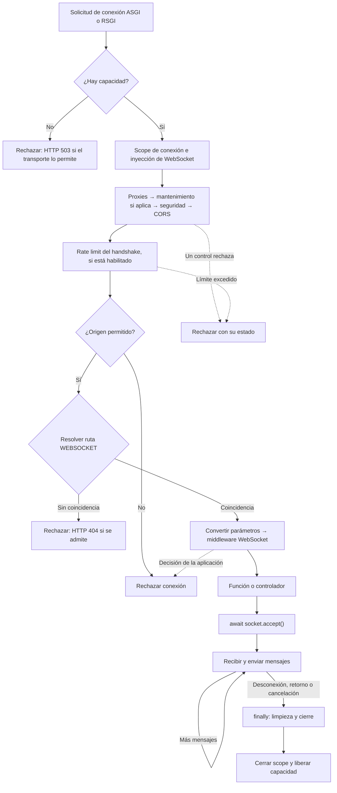

Un WebSocket mantiene una conexión abierta en la que cliente y servidor pueden enviar mensajes. En Orionis, `Route.websocket()` entrega esa conexión a una función o controlador, que decide cuándo aceptarla, qué mensajes procesar y cuándo terminar.

Esta API proporciona el transporte: texto, bytes y JSON. Si necesitas llamadas remotas con resultados correlacionados, eventos y difusión a grupos, utiliza [Realtime y sus hubs](/es/asynchronous/realtime). El [chat completo](/es/asynchronous/realtime/chat) muestra cómo comunicar varios clientes. Aquí construiremos un endpoint que confirma los mensajes **únicamente a la conexión que los envía**.

## Registrar el archivo y la ruta

Crea `routes/websocket.py` con `from orionis.support.facades import Route` si todavía no existe. En la llamada existente a `app.withRouting()` de `bootstrap/app.py`, incluye el argumento `websocket`:

```python
app.withRouting(
    api="routes/api.py",
    web="routes/web.py",
    websocket="routes/websocket.py",
    health="/up",
)
```

El ejemplo presupone que esos archivos API y WEB existen. Conserva también los argumentos `ai`, `console` y los demás archivos que ya utilice tu aplicación: modifica su llamada actual. Registra la configuración antes de `app.create()`.

El registro del archivo no añade un prefijo a las URLs. Debes escribir `/ws` si quieres utilizarlo. Las rutas HTTP y WebSocket se resuelven por separado; un `Route.get("/ws/chat", ...)` no sustituye a `Route.websocket("/ws/chat", ...)`.

### Generar un socket con el CLI

Desde la raíz del proyecto, ejecuta una de estas alternativas:

```bash
python -B reactor make:realtime-socket chat
```

```bash
orionis make:realtime-socket chat
```

`name` es el único argumento y es obligatorio: aquí vale `chat`. Con las rutas predeterminadas, el generador crea `app/realtime/sockets/chat_socket.py` con la clase `ChatSocket` y este contenido:

```python
from orionis.http import WebSocket, WebSocketDisconnected

class ChatSocket:
    """Handle a realtime WebSocket connection."""

    async def __call__(self, socket: WebSocket) -> None:
        """
        Accept the connection and echo incoming text messages.

        Parameters
        ----------
        socket : WebSocket
            Connection supplied by the WebSocket kernel.

        Returns
        -------
        None
            Complete the handler when the peer disconnects.
        """
        try:
            await socket.accept()
            while True:
                message = await socket.receiveText()
                await socket.sendText(message)
        except WebSocketDisconnected:
            return
        finally:
            await socket.close()
```

Es una clase invocable: `__call__` recibe el `WebSocket` inyectado, acepta la conexión y devuelve cada mensaje de texto al mismo cliente. Captura la desconexión y cierra en `finally`; los demás errores se propagan. No necesita heredar de `BaseController` ni devuelve una respuesta HTTP.

El generador crea los directorios que falten y conserva los archivos existentes: si el destino ya existe, informa un error sin sobrescribirlo. No dispone de `--force` ni otros flags propios; consulta `python -B reactor make:realtime-socket --help` o `orionis make:realtime-socket --help`. Los [nombres y subdirectorios de los generadores](/es/asynchronous/realtime/routing-and-lifecycle) se explican en el capítulo compartido.

### Asociar el socket a una ruta

La generación no modifica las rutas ni inicia el servidor. Añade el registro a `routes/websocket.py`:

```python
from app.realtime.sockets.chat_socket import ChatSocket
from orionis.support.facades import Route

Route.websocket("/ws/chat", ChatSocket)
```

`chat` es el nombre del componente generado; este eco no incorpora salas, historial ni difusión a otros clientes. El [chat con salas](/es/asynchronous/realtime/chat) construye esas operaciones mediante un hub.

Ejecuta desde la raíz del proyecto una de estas alternativas:

```bash
orionis serve
```

```bash
python -B reactor serve
```

Abre una página servida por esa aplicación y ejecuta en la consola de su navegador:

```javascript
const scheme = location.protocol === "https:" ? "wss:" : "ws:";
const echoSocket = new WebSocket(scheme + "//" + location.host + "/ws/chat");

echoSocket.addEventListener("open", () => echoSocket.send("Hola Orionis"));
echoSocket.addEventListener("message", (event) => console.log(event.data));
echoSocket.addEventListener("close", (event) => console.log("Cierre:", event.code));
echoSocket.addEventListener("error", () => console.error("Falló la conexión"));

// Al terminar la prueba: echoSocket.close();
```

El mensaje recibido será `Hola Orionis`. `location.host` utiliza el host y puerto de la página actual. Si pruebas desde otra aplicación, configura explícitamente la URL del servidor y permite ese origen; consulta la política de orígenes más abajo.

## Ciclo de vida de una conexión



La aceptación es explícita: antes de `accept()` puedes rechazar el handshake; después se utiliza el protocolo de cierre WebSocket. El manejador permanece activo durante la conexión y debe devolver `None`, sin devolver un `Response`, un diccionario ni un schema como respuesta HTTP.

El kernel cierra la conexión cuando el manejador finaliza y libera su capacidad incluso si falla. El scope dura toda la conexión; no se crea uno nuevo por cada mensaje del WebSocket básico.

## Parámetros, controladores y dependencias

La ruta admite los mismos cuatro convertidores nativos que las [rutas HTTP](/es/http/routing):

| Declaración | Valor recibido |
| --- | --- |
| `{name}` o `{name:str}` | `str`: segmento no vacío, sin `/`. |
| `{room:slug}` | `str`: letras minúsculas ASCII, dígitos y guiones. |
| `{room_id:int}` | `int`: dígitos sin signo; no admite negativos ni decimales. |
| `{connection_id:uuid}` | `uuid.UUID`: UUID hexadecimal con formato `8-4-4-4-12`. |

El nombre del argumento del manejador coincide con el del parámetro de ruta. Declara `socket: WebSocket` para recibir la conexión mediante inyección; el contenedor también resuelve las dependencias del constructor y de la acción.

Además de una función importable, se admiten `[Controller, "method"]` y una clase invocable con `__call__`. No pases una instancia, un método ya enlazado ni una lambda. Mantén las funciones y clases en el nivel del módulo para que puedan importarse durante el arranque.

### Inyección en el constructor y en la acción

Puedes recibir servicios tanto en `__init__` como en la acción que atiende la conexión. Crea `app/services/socket_dependencies.py` con dos servicios concretos:

```python
from time import perf_counter


class MessageFormatter:
    def format(self, room: str, text: str) -> str:
        return f"[{room}] {text.strip()}"


class ConnectionTimer:
    def __init__(self) -> None:
        self._started = perf_counter()

    def elapsedMs(self) -> float:
        return round((perf_counter() - self._started) * 1000, 2)
```

En `app/http/controllers/dependency_socket_controller.py`, el formateador se recibe por constructor y el temporizador por método:

```python
from app.services.socket_dependencies import ConnectionTimer, MessageFormatter
from orionis.http import WebSocket, WebSocketDisconnected


class DependencySocketController:
    def __init__(self, formatter: MessageFormatter) -> None:
        self._formatter = formatter

    async def __call__(
        self,
        socket: WebSocket,
        room: str,
        timer: ConnectionTimer,
    ) -> None:
        await socket.accept()
        try:
            while True:
                text = await socket.receiveText()
                await socket.sendJson({
                    "room": room,
                    "text": self._formatter.format(room, text),
                    "elapsed_ms": timer.elapsedMs(),
                })
        except WebSocketDisconnected:
            return
        finally:
            await socket.close()
```

Registra el controlador en `routes/websocket.py`:

```python
from app.http.controllers.dependency_socket_controller import DependencySocketController
from orionis.support.facades import Route

Route.websocket("/ws/dependencies/{room:slug}", DependencySocketController)
```

La forma explícita equivalente es `Route.websocket("/ws/dependencies/{room:slug}", [DependencySocketController, "__call__"])`. Si llamas `listen` a la acción en lugar de `__call__`, registra `[DependencySocketController, "listen"]`. El contenedor resuelve los parámetros de ese método de la misma manera; el registro mediante la clase sola requiere `__call__`.

Desde una página servida por la misma aplicación, puedes comprobar el intercambio con:

```javascript
const url = new URL("/ws/dependencies/general", window.location.href);
url.protocol = url.protocol === "https:" ? "wss:" : "ws:";
const socket = new WebSocket(url);

socket.addEventListener("open", () => socket.send("  Hola  "));
socket.addEventListener("message", (event) => {
  console.log(JSON.parse(event.data));
  // { room: "general", text: "[general] Hola", elapsed_ms: ... }
  socket.close(1000);
});
socket.addEventListener("error", () => console.error("No se pudo conectar"));
```

El framework construye el controlador al despachar la conexión y después invoca su acción mediante el contenedor. `MessageFormatter` y `ConnectionTimer` son clases concretas sin configuración externa: sus anotaciones permiten construirlas automáticamente sin registrar un provider. Los contratos abstractos o servicios que necesitan configuración deben tener su registro correspondiente en el [contenedor](/es/architecture/service-container).

`socket` procede del scope activo y `room` de los parámetros convertidos de la URL, por su nombre. Los parámetros de ruta se proporcionan a la acción, **no al constructor**. El método se invoca una sola vez por conexión; el temporizador conserva su valor inicial durante todo el bucle. Una clase autoconstruida no se convierte en un servicio compartido por anotarla: la reutilización depende del lifetime registrado en el contenedor.

### Inyección en una función

Una función de ruta también puede recibir servicios por sus parámetros. Por ejemplo, crea `app/realtime/socket_status.py`:

```python
from app.services.socket_dependencies import ConnectionTimer
from orionis.http import WebSocket


async def dependency_status(socket: WebSocket, timer: ConnectionTimer) -> None:
    await socket.accept()
    try:
        await socket.sendJson({"elapsed_ms": timer.elapsedMs()})
    finally:
        await socket.close()
```

Añádela a `routes/websocket.py`:

```python
from app.realtime.socket_status import dependency_status
from orionis.support.facades import Route

Route.websocket("/ws/dependency-status", dependency_status)
```

Al conectar a `/ws/dependency-status`, el cliente recibe un objeto JSON con `elapsed_ms` y la conexión termina. La función no tiene constructor; sus parámetros se resuelven cuando Orionis la invoca.

### Parámetros y validación de mensajes

El siguiente ejemplo utiliza un controlador invocable. Primero crea `app/http/schemas/socket_message.py`:

```python
from orionis.schemas import Schema
from orionis.schemas.constraints import MaxLength, MinLength
from orionis.schemas.fields import Field


class SocketMessage(Schema):
    text: Field[str, MinLength(1), MaxLength(500)]
```

En `app/http/controllers/message_socket_controller.py`:

```python
import msgspec

from app.http.schemas.socket_message import SocketMessage
from orionis.http import WebSocket, WebSocketDisconnected
from orionis.http.base import BaseController
from orionis.schemas.exceptions.validation import ValidationException
from orionis.schemas.validator import Schema as Validator


class MessageSocketController(BaseController):
    async def __call__(self, socket: WebSocket, room: str) -> None:
        await socket.accept()
        try:
            await socket.sendJson({"event": "ready", "room": room})

            while True:
                try:
                    raw = await socket.receiveJson()
                except msgspec.DecodeError:
                    await socket.sendJson({
                        "event": "error",
                        "code": "invalid_json",
                    })
                    continue

                try:
                    message = await Validator.validate(raw, SocketMessage)
                except ValidationException as error:
                    await socket.sendJson({
                        "event": "error",
                        "code": "validation_error",
                        "errors": error.errors,
                    })
                    continue

                await socket.sendJson({
                    "event": "received",
                    "room": room,
                    "text": message.text,
                })
        except WebSocketDisconnected:
            return
        finally:
            await socket.close()
```

Añade el registro a `routes/websocket.py`, junto a la ruta de eco:

```python
from app.http.controllers.message_socket_controller import MessageSocketController
from orionis.support.facades import Route

Route.websocket("/ws/rooms/{room:slug}", MessageSocketController)
```

`/ws/rooms/general` inyecta `room="general"`. La forma explícita equivalente para una acción sería `Route.websocket("/ws/rooms/{room:slug}", [MessageSocketController, "__call__"])`; elige una sola declaración para ese path.

El cliente envía `{"text": "Hola"}`. El servidor responde con `{"event": "received", "room": "general", "text": "Hola"}`. El nombre de sala identifica el endpoint, pero este ejemplo no guarda mensajes ni conecta a sus participantes entre sí. Para difundir a otros usuarios de una sala, continúa con [grupos y chat Realtime](/es/asynchronous/realtime/chat).

### Validar cada mensaje

`receiveJson()` decodifica JSON, pero no exige un objeto ni un formato de negocio. Por eso el ejemplo pasa explícitamente su resultado a `await Validator.validate(raw, SocketMessage)` y responde con su propio evento cuando hay errores.

`Schema` es la clase declarativa; `Validator` es aquí el alias de la utilidad asíncrona. No declares simplemente `payload: SocketMessage` como parámetro del manejador esperando que lea el siguiente frame: la inyección HTTP de schemas obtiene el cuerpo de `Request`, no mensajes de esta conexión. Consulta [schemas en HTTP, MCP y Realtime](/es/validation/integrations).

El formato `event`/`code` del ejemplo es una decisión de la aplicación. Un WebSocket básico no crea respuestas HTTP `422` por mensaje ni incorpora automáticamente el protocolo RPC de un hub.

## Cliente JavaScript con formulario

Crea `resources/views/socket-demo.html` con el HTML siguiente. Debajo de esos elementos, coloca el bloque JavaScript dentro de `<script type="module">...</script>`. El script conecta al controlador anterior y muestra texto con `textContent`:

```html
<form id="message-form">
    <label for="message-text">Mensaje</label>
    <input id="message-text" maxlength="500" required>
    <button id="message-send" type="submit" disabled>Enviar</button>
</form>
<p id="connection-status" role="status">Conectando…</p>
<ul id="message-log"></ul>
<button id="connection-close" type="button">Desconectar</button>
```

```javascript
const form = document.querySelector("#message-form");
const input = document.querySelector("#message-text");
const sendButton = document.querySelector("#message-send");
const status = document.querySelector("#connection-status");
const log = document.querySelector("#message-log");
const closeButton = document.querySelector("#connection-close");

const scheme = location.protocol === "https:" ? "wss:" : "ws:";
const room = "general";
const socket = new WebSocket(
    scheme + "//" + location.host + "/ws/rooms/" + encodeURIComponent(room)
);

function appendMessage(text) {
    const item = document.createElement("li");
    item.textContent = text;
    log.append(item);
}

socket.addEventListener("open", () => {
    status.textContent = "Conectado";
    sendButton.disabled = false;
});

socket.addEventListener("message", (event) => {
    const message = JSON.parse(event.data);

    if (message.event === "ready") {
        appendMessage("Sala: " + message.room);
    } else if (message.event === "received") {
        appendMessage("Confirmado: " + message.text);
    } else if (message.event === "error") {
        appendMessage("Error: " + message.code);
        if (message.errors) {
            appendMessage(JSON.stringify(message.errors));
        }
    }
});

form.addEventListener("submit", (event) => {
    event.preventDefault();
    if (socket.readyState !== WebSocket.OPEN) return;

    socket.send(JSON.stringify({ text: input.value }));
    input.value = "";
});

socket.addEventListener("close", (event) => {
    status.textContent = "Desconectado (" + event.code + ")";
    sendButton.disabled = true;
});

socket.addEventListener("error", () => {
    status.textContent = "No se pudo mantener la conexión";
});

closeButton.addEventListener("click", () => socket.close());
window.addEventListener("pagehide", () => socket.close());
```

Registra la página en el archivo WEB configurado, normalmente `routes/web.py`:

```python
from orionis.support.facades import Route

Route.view("/socket-demo", "socket-demo")
```

Con el servidor iniciado, abre `http://localhost:8000/socket-demo`, o la dirección y puerto indicados en tu consola. El navegador carga la interfaz por HTTP y abre por separado la conexión `/ws/rooms/general`.

Un mensaje vacío enviado por otro cliente produce `validation_error`; JSON incompleto produce `invalid_json`. El controlador conserva la conexión para recibir el siguiente mensaje. El límite del formulario ayuda a la interfaz, mientras que el schema valida los datos realmente recibidos.

Este cliente no se reconecta automáticamente ni reenvía mensajes. Si añades reconexión, debes crear un nuevo `WebSocket` y decidir qué operaciones se pueden repetir; una conexión nueva no recupera por sí sola los mensajes anteriores.

## Leer y enviar mensajes

| Método asíncrono | Comportamiento |
| --- | --- |
| `receive()` | Devuelve un `WebSocketMessage` de texto, bytes o desconexión. |
| `receiveText()` | Devuelve `str`; un mensaje binario produce `TypeError`. |
| `receiveBytes()` | Devuelve `bytes`; un mensaje de texto produce `TypeError`. |
| `receiveJson()` | Decodifica JSON desde texto o bytes; JSON inválido produce `msgspec.DecodeError`. |
| `send(data)` | Envía exclusivamente `str` o `bytes`. |
| `sendText(text)` | Envía exclusivamente `str`. |
| `sendBytes(data)` | Envía exclusivamente `bytes`. |
| `sendJson(value)` | Codifica con `msgspec` y envía un mensaje de texto JSON. |

`receive()` entrega la desconexión como mensaje una vez; los métodos de lectura especializados la convierten en `WebSocketDisconnected`. Una operación posterior sobre una conexión cerrada también produce esa excepción.

Para manejar varios tipos sin mezclar las lecturas, utiliza un solo consumidor:

```python
from orionis.http import WebSocket, WebSocketDisconnected


async def mixed_echo(socket: WebSocket) -> None:
    await socket.accept()
    try:
        async for message in socket:
            if message.isText():
                await socket.sendText(message.text)
            elif message.isBytes():
                await socket.sendBytes(message.bytes)
    except WebSocketDisconnected:
        return
    finally:
        await socket.close()
```

La iteración asíncrona termina al detectar la desconexión. Los mensajes son inmutables y también exponen `type`, `data`, `code` y `reason`. `message.text` y `message.bytes` exigen el tipo correcto.

Solo puede haber un `receive` activo; dos lecturas simultáneas producen `RuntimeError`. Los envíos se serializan y cada `await` espera la operación del transporte. Esta API no añade una cola de difusión, persistencia ni una garantía de que el cliente haya procesado el mensaje.

## Middleware de conexión y grupos

Un middleware WebSocket deriva de `WebSocketMiddleware` y devuelve `None`. Su continuación, `WebSocketNext`, se llama sin argumentos y como máximo una vez. El código anterior a `await call_next()` se ejecuta antes del manejador; el posterior retorna cuando este termina, normalmente al finalizar la conexión, no después de cada mensaje.

Los middleware también admiten **inyección por constructor**. El kernel los construye mediante el contenedor dentro del scope de conexión, pero llama a `handle(socket, call_next)` directamente: no añadas parámetros de servicios a `handle()`. Por ejemplo, crea `app/http/middleware/connection_duration_middleware.py` con el servicio anterior:

```python
import logging

from app.services.socket_dependencies import ConnectionTimer
from orionis.http import WebSocket, WebSocketMiddleware, WebSocketNext

logger = logging.getLogger(__name__)


class ConnectionDurationMiddleware(WebSocketMiddleware):
    def __init__(self, timer: ConnectionTimer) -> None:
        self._timer = timer

    async def handle(
        self,
        socket: WebSocket,
        call_next: WebSocketNext,
    ) -> None:
        try:
            await call_next()
        finally:
            logger.info("WebSocket duration: %s ms", self._timer.elapsedMs())
```

Para utilizarlo, sustituye el registro del ejemplo de dependencias por:

```python
from app.http.controllers.dependency_socket_controller import DependencySocketController
from app.http.middleware.connection_duration_middleware import ConnectionDurationMiddleware
from orionis.support.facades import Route

Route.websocket(
    "/ws/dependencies/{room:slug}",
    DependencySocketController,
).middleware(ConnectionDurationMiddleware)
```

El temporizador de este middleware se crea al construir la capa; el del método del controlador es otra resolución. Si necesitas compartir una misma instancia entre ambos, registra expresamente ese servicio con lifetime scoped en el contenedor. El bloque `finally` registra la duración aunque el siguiente componente termine con una excepción o cancelación.

Por ejemplo, crea `app/http/middleware/room_socket_middleware.py` para limitar la longitud de los nombres de sala antes de aceptar:

```python
from orionis.http import WebSocket, WebSocketMiddleware, WebSocketNext


class RoomSocketMiddleware(WebSocketMiddleware):
    __slots__ = ()

    async def handle(
        self,
        socket: WebSocket,
        call_next: WebSocketNext,
    ) -> None:
        room = socket.routeParams()["room"]
        if len(room) > 30:
            await socket.reject(status_code=400)
            return

        socket.state.room = room
        await call_next()
```

Para aplicarlo solo al endpoint existente, sustituye su registro por:

```python
from app.http.controllers.message_socket_controller import MessageSocketController
from app.http.middleware.room_socket_middleware import RoomSocketMiddleware
from orionis.support.facades import Route

Route.websocket(
    "/ws/rooms/{room:slug}",
    MessageSocketController,
).middleware(RoomSocketMiddleware)
```

También puedes utilizar grupos. Este registro sustituye al anterior; no los declares simultáneamente:

```python
from app.http.controllers.message_socket_controller import MessageSocketController
from app.http.middleware.room_socket_middleware import RoomSocketMiddleware
from orionis.support.facades import Route

Route.group(
    prefix="/ws",
    middleware=[RoomSocketMiddleware],
    routes=[
        Route.group(
            prefix="/rooms",
            routes=[
                Route.websocket("/{room:slug}", MessageSocketController),
            ],
        ),
    ],
)
```

El path final es `/ws/rooms/{room:slug}`. Los middleware de un grupo padre preceden a los del hijo y a los de la ruta; las clases repetidas se ejecutan una sola vez. `without_middleware` en grupos y `withOutMiddleware()` en rutas excluyen clases del stack final.

**El flujo WebSocket no ejecuta los middleware HTTP registrados con `app.withMiddleware()`, ni las capas automáticas de sesión, CSRF o identidad por token de las rutas WEB/API.** El compilador solo admite `WebSocketMiddleware` en estas rutas y los construye dentro del scope de conexión. Los controles compartidos del kernel del diagrama siguen aplicándose.

Un origen permitido no autentica a un usuario. Si un endpoint requiere identidad o autorización, compruébalas mediante tu lógica de conexión antes de `accept()` y, cuando corresponda, en cada operación. El navegador puede enviar cookies en el handshake, pero esta API no las transforma automáticamente en una sesión autenticada.

El [constructor WebSocket del navegador](https://websockets.spec.whatwg.org/#the-websocket-interface) recibe una URL y subprotocolos opcionales; no ofrece una opción para añadir encabezados arbitrarios como `Authorization`. Diseña la entrega y comprobación de credenciales de acuerdo con esa restricción del cliente.

## Metadatos, aceptación y cierre

| Acceso | Utilidad |
| --- | --- |
| `socket.path` | Path del handshake, sin query string. |
| `socket.headers` | Colección de encabezados del handshake. |
| `socket.routeParams()` | Diccionario de parámetros convertidos; también se utiliza para la inyección. |
| `socket.state` | Atributos mutables exclusivos de esta conexión. |
| `socket.connectionState` | `CONNECTING`, `CONNECTED`, `CLOSING` o `CLOSED`. |
| `socket.accepted` | Indica si se aceptó la conexión; conserva el dato tras cerrarse. |
| `socket.closed` | Indica el estado terminal. |
| `socket.supportsCloseDetails` | Indica si el transporte permite enviar código y razón de cierre personalizados. |

`await socket.accept(subprotocol=None, headers=None)` acepta una sola vez. Los datos no pueden enviarse ni recibirse antes de aceptar. `await socket.reject(status_code=403)` rechaza antes de aceptar y admite estados HTTP entre `400` y `599`. El código de estado visible depende del transporte.

`await socket.close()` es la forma portable de cerrar. Antes de aceptar rechaza el handshake; después de aceptar solicita cierre normal. Las llamadas repetidas una vez cerrado no hacen nada.

Si necesitas un cierre personalizado, respeta la capacidad del transporte:

```python
from orionis.http import WebSocket


async def close_for_policy(socket: WebSocket) -> None:
    if socket.supportsCloseDetails:
        await socket.close(code=1008, reason="Policy violation")
    else:
        await socket.close()
```

`close()` admite códigos de cierre estándar válidos o privados entre `3000` y `4999`. La razón no puede superar `123` bytes UTF-8. `1006` representa ausencia de un cierre normal observado; no se puede enviar como código de cierre.

## Configuración, orígenes y diferencias de transporte

`config/http.py` utiliza la entidad `HTTPWebSocket` para la propiedad `websocket`:

| Configuración | Variable utilizada en el bootstrap | Predeterminado |
| --- | --- | --- |
| `max_connections` | `WEBSOCKET_MAX_CONNECTIONS` | `128` por kernel/worker. |
| `max_message_size` | `WEBSOCKET_MAX_MESSAGE_SIZE` | `1048576` bytes: `1 MiB` por mensaje entrante completo. |
| `allow_origins` | `CORS_ALLOW_ORIGINS` | Colección vacía. |

Los límites deben ser enteros positivos. El tamaño de los mensajes de texto se mide en bytes UTF-8, no en caracteres. Un mensaje entrante demasiado grande cierra la conexión y produce `WebSocketDisconnected` con código lógico `1009`; el cierre que puede enviar el transporte varía. Este límite no establece el tamaño de los mensajes salientes.

El kernel admite un handshake sin `Origin`, uno de mismo origen o uno incluido en `allow_origins`; `"*"` admite cualquier origen. La comparación WebSocket convierte los orígenes a minúsculas y elimina la barra final. El mismo origen continúa permitido aunque añadas otros a la lista. Esta comprobación no utiliza `CORS_ALLOW_ORIGIN_REGEX`.

Para un frontend en `http://localhost:5173`, puedes configurar explícitamente la entidad en el campo `websocket` de tu configuración HTTP:

```python
from orionis.foundation.config.http import HTTPWebSocket

socket_settings = HTTPWebSocket(
    max_connections=128,
    max_message_size=1024 * 1024,
    allow_origins=("http://localhost:5173",),
)
```

El valor de `socket_settings` debe ser el que reciba `BootstrapHTTP.websocket`, sustituyendo su construcción actual. Crear una variable aislada no modifica la aplicación. Revisa los [archivos de rutas y ciclo de vida](/es/asynchronous/realtime/routing-and-lifecycle) para la integración compartida.

| Capacidad | ASGI | RSGI |
| --- | --- | --- |
| Texto, bytes y JSON | Admitidos. | Admitidos. |
| Subprotocolo en `accept()` | Debe estar entre los ofrecidos por el cliente. | No disponible; solicitarlo produce `NotImplementedError`. |
| Encabezados adicionales en `accept()` | Requieren especificación ASGI HTTP `2.1` o posterior. | No disponibles; solicitarlos produce `NotImplementedError`. |
| Rechazo con un estado HTTP elegido | Requiere la extensión `websocket.http.response`; sin ella el servidor utiliza el rechazo estándar. | El protocolo permite indicar el estado de rechazo. |
| Código/razón de cierre personalizado | Código admitido; envío de razón desde ASGI HTTP `2.3`. | Solo cierre normal sin razón; usa `close()`. |
| Detalles del cierre del cliente | Conserva los que entregue el servidor. | El adaptador informa `1006` cuando no dispone de esos detalles. |

Puedes seleccionar la interfaz de desarrollo con `orionis serve --interface asgi` o `python -B reactor serve --interface asgi`; utiliza `rsgi` para la otra alternativa. Comprueba las capacidades del servidor si dependes de opciones concretas del handshake.

## Errores y finalización

Una desconexión puede observarse al recibir o al enviar; maneja `WebSocketDisconnected` y libera tus recursos en `finally`. Cancela y espera las tareas que cree tu manejador: no dejes tareas leyendo una conexión que ya terminó.

Un error no controlado registra `WebSocket handler failed`, intenta cerrar una conexión aceptada con `1011` si se admite o con cierre normal en RSGI, y se propaga. Este flujo no genera la página HTML de [excepciones HTTP](/es/http/exceptions) ni convierte cualquier excepción en un evento JSON; define tus errores de aplicación como en el ejemplo.

Durante el apagado, el kernel cancela las tareas de conexiones activas y espera su limpieza durante un máximo de cinco segundos. Conserva la cancelación cooperativa: no interceptes `asyncio.CancelledError` para continuar el bucle.

Cada worker mantiene su propia capacidad y sus propias conexiones. Si necesitas enviar eventos entre varios workers o instancias, consulta [grupos y despliegue Realtime](/es/asynchronous/realtime/groups-and-deployment); el WebSocket de esta página no incorpora difusión distribuida ni historial.
