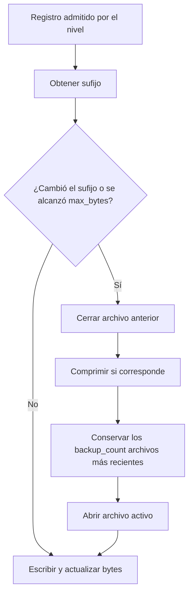

El canal seleccionado determina el archivo que recibe los registros y su política de rotación. Los seis canales escriben en el sistema de archivos local; `stack` representa un único archivo, no una combinación de canales. Configura sus campos en [Configuración de logs](/es/logging/configuration) y utiliza la [fachada o el servicio](/es/logging/writing-logs) para registrar mensajes.

<a id="log-files"></a>

## Dónde se escriben los archivos

Las rutas predeterminadas parten de la raíz del proyecto:

| Canal | Ruta predeterminada | Apertura inicial |
|---|---|---|
| `stack` | `storage/logs/stack.log` | Al inicializar el logger, aunque el primer mensaje se filtre. |
| `hourly` | `storage/logs/hourly_{suffix}.log` | Al emitir el primer registro que pasa el filtro. |
| `daily` | `storage/logs/daily_{suffix}.log` | Al emitir el primer registro que pasa el filtro. |
| `weekly` | `storage/logs/weekly_{suffix}.log` | Al emitir el primer registro que pasa el filtro. |
| `monthly` | `storage/logs/monthly_{suffix}.log` | Al emitir el primer registro que pasa el filtro. |
| `chunked` | `storage/logs/chunked_{suffix}.log` | Al emitir el primer registro que pasa el filtro. |

Se crean automáticamente los directorios padre y se escribe en UTF-8, agregando registros al archivo existente. El usuario del proceso necesita permisos para crear, escribir y, en canales rotativos, eliminar archivos en esa ubicación.

Las entidades de configuración exigen una cadena no vacía terminada en `.log`; los canales rotativos requieren además el marcador literal `{suffix}`. Colócalo en el **nombre del archivo**, como en los ejemplos: la limpieza examina únicamente el directorio del archivo que acaba de cerrarse. Separar los períodos en directorios mediante `{suffix}` no proporciona limpieza global de esos directorios.

Utiliza rutas relativas a la raíz, especialmente con `stack`: su inicialización predeterminada concatena la raíz y la ruta configurada, mientras que la factory usada al cambiar de canal resuelve rutas mediante `Path`. Una ruta absoluta de `stack` no tiene un comportamiento uniforme entre ambos caminos.

<a id="time-rotation"></a>

## Rotación por períodos

Cada registro consulta el sufijo actual. Si cambia respecto al del archivo abierto, el handler cierra el anterior, aplica la retención y abre el archivo del nuevo período. Sin registros nuevos no se crean archivos, no se comprueba el cambio de período y no se ejecuta la limpieza.

| Canal | Sufijo | Límite efectivo entre archivos |
|---|---|---|
| `hourly` | `YYYY-MM-DD_HH` | Cambio de hora en la zona configurada para la aplicación. |
| `daily` | `YYYY-MM-DD` | Cambio de fecha en esa zona. |
| `weekly` | `YYYY-weekWW` | Cambio de semana ISO: lunes, con año ISO. |
| `monthly` | `YYYY-MM` | Cambio de mes del calendario. |

Por ejemplo, el 29 de diciembre de 2025 pertenece a `2026-week01`. No se calcula la semana dividiendo el año en bloques de siete días. Los resolvers capturan la zona de `DateTime` al construirse; cuando reciben un `datetime` explícito, `getSuffix(dt)` formatea ese valor sin convertirlo a otra zona.

```dotenv
LOG_CHANNEL=daily
LOG_LEVEL=INFO
LOG_PATH=storage/logs/application_{suffix}.log
LOG_RETENTION=int:14
```

Con esa configuración, un registro del 23 de octubre escribe en `application_2026-10-23.log`. El primer registro del día siguiente abre `application_2026-10-24.log`. Cambiar `.env` requiere volver a cargar la configuración de la aplicación según la guía de [Entorno](/es/environment); una recarga del logger por sí sola no lo hace.

### Qué efecto tiene `daily.at`

`Daily.at` acepta `datetime.time` o una cadena compatible con `time.fromisoformat()`, como `"02:30:00"`. El resolver puede calcular una próxima hora mediante `getNextRotationTime()`, pero el handler integrado **no llama a ese método**: decide la rotación comparando sufijos. Por ello, `LOG_ROTATION_TIME=02:30:00` no desplaza el límite efectivo del archivo diario de medianoche a las 02:30 ni programa una tarea de limpieza.

<a id="size-rotation"></a>

## `chunked`: tamaño, sufijos y compresión

La configuración expone `mb_size` —entero de 1 a 1000, predeterminado 10— y `files` —entero positivo, predeterminado 5—. La factory convierte `mb_size` a bytes mediante `mb_size * 1024 * 1024`, por lo que la unidad efectiva es MiB. El handler contabiliza los bytes del texto codificado y su salto de línea.

Hay una consideración importante en la implementación actual: `ChunkedSuffixResolver.getSuffix()` produce un sufijo nuevo **en cada llamada**, con formato `YYYYMMDD_HHMMSS_contador`, y el handler lo consulta en cada emisión. Como un cambio de sufijo ya provoca rotación, **el canal integrado rota en cada registro emitido**, incluso cuando el archivo está muy por debajo de `mb_size`. El parámetro existe y llega al handler; no debe interpretarse como una garantía de que los registros se agrupen hasta alcanzar ese tamaño.

Por ejemplo, tres mensajes consecutivos generan normalmente dos archivos cerrados `.log.gz` y un archivo activo `.log`, cada uno con un registro. El contador comienza en `0001` por instancia del resolver; el timestamp y el contador no son un identificador global entre procesos.

```dotenv
LOG_CHANNEL=chunked
LOG_PATH=storage/logs/application_{suffix}.log
LOG_MB_SIZE=int:10
LOG_FILES=int:5
```

La compresión gzip se ejecuta al rotar, después de cerrar el archivo anterior. Si termina correctamente, se elimina el `.log` original. El archivo activo permanece sin comprimir; `close()` no lo comprime. Ante un `OSError` durante la compresión, se intenta eliminar el archivo comprimido incompleto.

En el handler, la comprobación de tamaño ocurre **antes** de escribir el siguiente registro y usa el tamaño ya acumulado. No anticipa el tamaño del nuevo mensaje: una entrada puede superar el umbral. Tampoco es un límite máximo de espacio en disco.

<a id="log-retention"></a>

## Qué conserva la retención

Los nombres `retention_hours`, `retention_days`, `retention_weeks` y `retention_months` expresan la periodicidad del canal, pero la factory los pasa directamente como `backup_count`. La limpieza conserva una **cantidad de archivos**, no compara la edad del registro con una duración.

| Canal | Campo | Predeterminado | Rango validado por la entidad |
|---|---|---|---|
| `stack` | Sin retención integrada | — | — |
| `hourly` | `retention_hours` | `24` | `1` a `168` |
| `daily` | `retention_days` | `7` | `1` a `90` |
| `weekly` | `retention_weeks` | `4` | `1` a `12` |
| `monthly` | `retention_months` | `4` | `1` a `12` |
| `chunked` | `files` | `5` | Entero mayor que `0` |

En cada rotación, la limpieza sigue este orden:

1. Busca archivos en el directorio del archivo que acaba de cerrarse.
2. Selecciona los nombres que coinciden con el template, incluyendo la variante `.gz`.
3. Los ordena por fecha de modificación (`mtime`), del más reciente al más antiguo.
4. Elimina los que exceden `backup_count` y, cuando corresponde, su variante comprimida.
5. El handler abre después el nuevo archivo activo.



Después de esa secuencia puede haber hasta **`backup_count + 1` archivos**: los conservados durante la limpieza y el nuevo activo. Con `daily.retention_days=7`, esto no significa borrar cada registro exactamente a los siete días. Los períodos sin tráfico no generan archivos, y modificar `mtime` o compartir el patrón con otro proceso altera qué archivos se consideran más recientes.

No se ejecuta limpieza al construir un handler sin archivo activo ni al cerrarlo. Los errores de inspección o borrado del sistema de archivos se suprimen; por tanto, la retención es un intento de limpieza y no una garantía estricta de espacio máximo. Las entidades rechazan retención cero; no la uses para desactivar la conservación.

<a id="logger-lifecycle"></a>

## Inicio, cambio de canal y cierre

El servicio obtiene `app.config("logging")` al construirse y prepara el logger nativo al primer uso que lo necesita. Inicializa un solo canal predeterminado. Los métodos que enumeran canales consultan la configuración o la caché de handlers y no fuerzan esa inicialización.

`switchChannel(name)` cierra y retira los handlers existentes antes de crear el reemplazo. Un canal inexistente devuelve `False` antes de retirarlos; un canal presente cuya creación falla puede devolver `False` con el logger ya sin handlers. Comprueba el resultado y `getActiveChannel()` cuando el cambio sea necesario para tu operación. El cambio no modifica `logging.default`.

`reloadConfiguration()` retira los handlers, vuelve a leer la configuración de la aplicación y reconstruye el canal predeterminado. No conserva un cambio de canal anterior ni recarga `.env` o los módulos Python de configuración. La inicialización y la recarga pueden levantar `RuntimeError`.

`close()` retira y cierra los handlers, limpia sus referencias y suprime errores comunes de cierre. Es idempotente; no inutiliza permanentemente el servicio: un registro posterior puede inicializarlo otra vez. El destructor también intenta cerrar los recursos. Para una fase de apagado explícita, usa el hook de la aplicación:

```python
# bootstrap/app.py: registrar antes de app.create().
from orionis.foundation.enums import Lifespan
from orionis.logging.contracts.logger import ILogger


def close_logs(logger: ILogger) -> None:
    logger.close()


app.on(Lifespan.SHUTDOWN, close_logs)
```

En ese ejemplo `app` es la instancia que ya configura el bootstrap. El callback recibe el servicio compartido mediante `ILogger`. Evita registrar nuevos mensajes después de cerrarlo si deseas que los archivos permanezcan cerrados. Consulta el [ciclo de vida de la aplicación](/es/application/lifecycle) para el orden de los hooks.

<a id="log-concurrency"></a>

## Workers, concurrencia y errores de escritura

El servicio utiliza locks de hilo para su inicialización, cambio, recarga y cierre; el handler rotativo protege la escritura y sus cambios de archivo con otro lock. Son mecanismos dentro del proceso: no hay un lock distribuido ni coordinación de rotación entre workers o servidores.

Cada proceso mantiene sus propios contadores y descriptores. Si varios procesos usan el mismo template en un directorio compartido, pueden comprimir o eliminar archivos que otro aún utiliza. Para separar sus archivos configura una ruta identificable por instancia en el despliegue, o adopta una infraestructura externa de recolección. La sección [Configuración](/es/logging/configuration) explica cómo construir la ruta desde valores de configuración.

Con el valor predeterminado `queue_capacity=0`, la escritura, la compresión gzip y el borrado son síncronos. Una [capacidad de cola](/es/logging/configuration#logging-queue-capacity) positiva mueve ese trabajo a un hilo listener con capacidad limitada. No añade un transport de red ni coordinación de rotación entre procesos.

El handler captura `OSError` durante la emisión y lo comunica mediante `handleError(record)`, el mecanismo estándar de logging. No ofrece una confirmación persistida al devolver `None`. Otros errores, como los de un formatter personalizado, no quedan cubiertos por esa captura de `OSError`.

<a id="handler-extension"></a>

## Integrar un handler propio

`getLogger()` entrega el `logging.Logger` subyacente. Puedes configurar un handler adicional con la API estándar; coordina su ciclo de vida, porque `switchChannel()`, `reloadConfiguration()` y `close()` retiran los handlers conectados a ese logger. El servicio usa un nombre nativo compartido, `__orionis__`, dentro del proceso: construir otro `Logger` manualmente no proporciona un destino aislado.

La factory reconoce únicamente los seis nombres integrados; no hay un registro `extend()` de canales en el servicio. La siguiente función crea un handler diario para una integración que gestione explícitamente su conexión y cierre:

```python
import logging
from orionis.foundation.contracts.application import IApplication
from orionis.logging.handlers.rotating_handler_factory import RotatingHandlerFactory


def create_audit_handler(app: IApplication) -> logging.Handler:
    handler = RotatingHandlerFactory.createHandler(
        channel_name="daily",
        channel_config={
            "path": "storage/logs/audit_{suffix}.log",
            "level": logging.WARNING,
            "retention_days": 14,
        },
        app_root=str(app.path("root")),
    )
    assert handler is not None
    handler.setFormatter(logging.Formatter("%(levelname)s %(message)s"))
    return handler
```

`createHandler(channel_name: str, channel_config: dict, app_root: str) -> Handler | None` devuelve `FileHandler` para `stack`, `AdvancedRotatingFileHandler` para los otros cinco, o `None` si el nombre no está soportado. Acepta un nivel numérico; la normalización de `Level` o cadenas la realiza `Logger` antes de llamar a la factory. La factory usa el `path` recibido o `storage/logs/default.log`, y un nivel predeterminado `20`; no sustituye las validaciones de las entidades de configuración. Su `stack` difiere del inicio predeterminado del servicio: abre el archivo de forma diferida.

<a id="suffix-resolvers"></a>

## Contrato de los resolvers de sufijos

`SuffixResolver` es un contrato abstracto con dos métodos. Todas las implementaciones integradas exponen:

```text
getSuffix(dt: datetime | None = None) -> str
getNextRotationTime(current_time: datetime) -> datetime
```

| Clase | Constructor | Resultado de `getNextRotationTime()` |
|---|---|---|
| `HourlySuffixResolver` | `()` | Comienzo de la hora siguiente, con la zona del resolver. |
| `DailySuffixResolver` | `(at_time: time | None = None)` | Próxima fecha/hora diaria configurada; si ya pasó, día siguiente. |
| `WeeklySuffixResolver` | `(at_time: time | None = None)` | Lunes de la semana siguiente a esa hora. |
| `MonthlySuffixResolver` | `(at_time: time | None = None)` | Primer día del mes siguiente a esa hora. |
| `ChunkedSuffixResolver` | `()` | `current_time + timedelta(hours=1)`, sin uso como disparador integrado. |

En los tres constructores con `at_time`, `None` equivale a medianoche. Son APIs de extensión: el handler integrado consume `getSuffix()` y no programa la hora calculada por `getNextRotationTime()`.

```python
from datetime import UTC, datetime, time
from orionis.logging.handlers.daily_suffix_resolver import DailySuffixResolver
from orionis.logging.handlers.weekly_suffix_resolver import WeeklySuffixResolver

moment = datetime(2026, 10, 23, 15, 30, tzinfo=UTC)
daily = DailySuffixResolver(time(2, 30))

assert daily.getSuffix(moment) == "2026-10-23"
assert WeeklySuffixResolver().getSuffix(moment) == "2026-week43"
```

<a id="handler-api"></a>

## Referencia de `AdvancedRotatingFileHandler`

```text
AdvancedRotatingFileHandler(
    path_template: str,
    suffix_resolver: SuffixResolver,
    max_bytes: int | None = None,
    backup_count: int = 5,
    encoding: str = "utf-8",
    *,
    delay: bool = True,
    compress_rotated: bool = False,
    app_root: str = ".",
) -> None

emit(record: LogRecord) -> None
close() -> None
```

`path_template` y `app_root` determinan la ruta; `suffix_resolver` genera sus sufijos. `max_bytes=None` desactiva la comprobación de tamaño. `backup_count` controla la cantidad conservada al rotar. `encoding` se usa tanto para escribir como para contar bytes. `delay=True` pospone la apertura hasta la primera emisión; `False` prepara el stream en el constructor. `compress_rotated=True` comprime los archivos cerrados durante una rotación.

`emit()` formatea, añade `\n`, asegura el archivo correcto, escribe y actualiza el contador. `close()` cierra el stream bajo lock y delega el cierre base, sin comprimir ni limpiar. Al volver a abrir un archivo existente se recupera su tamaño inicial; las escrituras externas posteriores no actualizan continuamente ese contador.

Los atributos de configuración anteriores son accesibles en el handler, al igual que `stream`, `current_path`, `current_suffix` y `file_size`. Estos últimos representan el estado del archivo activo, no una API para forzar rotaciones. El handler mantiene una caché interna de rutas y no expone un método público de limpieza manual o `rotate()`.

<a id="logging-async-close"></a>

## Vaciar el logging pendiente durante el apagado

`await logger.aclose()` está disponible en `ILogger` y `Logger` desde 1.1.0. Detiene la admisión a la cola, espera los registros aceptados, cierra sus handlers e informa los fallos del destino después de limpiar los recursos. `close()` sigue siendo síncrono; utiliza `aclose()` desde un event loop.

```python
from orionis.logging.contracts.logger import ILogger


async def close_owned_logger(logger: ILogger) -> None:
    await logger.aclose()
```

Este helper corresponde al propietario de un logger independiente, no a un handler que comparte el logger de la aplicación. Cuando se configura logging con cola, el apagado HTTP/CLI ejecuta esta limpieza después de los callbacks de ciclo de vida, incluso si alguno falla. La cola no garantiza entrega durable ante terminación abrupta del proceso y la cancelación no puede interrumpir de forma segura una escritura nativa en curso.

En modo con cola, el listener conserva los fallos de emisión de handlers estándar y los expone mediante `LoggingDeliveryError`; encolar correctamente no confirma persistencia. Gestiona la saturación o los errores del destino mediante la política de la aplicación, sin intentar registrar recursivamente el mismo fallo en la cola afectada.
