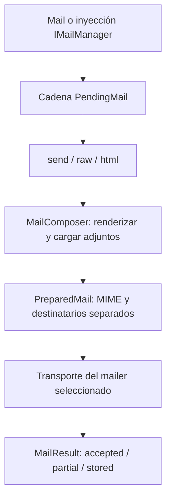

Envía notificaciones con `Mail`, mediante texto/HTML literal o clases `Mailable` reutilizables. Orionis compone mensajes MIME y los entrega por SMTP o los guarda como archivos `.eml` para desarrollo.

## Preparar e inspeccionar el primer mensaje

Empieza con el transporte de archivos para revisar el mensaje sin una cuenta SMTP. Añade estos valores al `.env` de tu aplicación antes del arranque:

```dotenv
MAIL_MAILER=file
MAIL_FROM_ADDRESS=notifications@example.com
MAIL_FROM_NAME="Example App"
MAIL_FILE_PATH=storage/mail
```

El directorio debe ser escribible y su sistema de archivos debe admitir enlaces duros. La aplicación estándar necesita los proveedores de correo, vistas y almacenamiento disponibles; importar `Mail` en un script externo no los inicia.

Guarda este controlador en `app/http/controllers/welcome_mail_controller.py`. Utiliza la fachada desde su módulo público y selecciona explícitamente el transporte de archivos:

```python
from orionis.http import JSONResponse
from orionis.support.facades import Mail


class WelcomeMailController:
    async def __call__(self) -> JSONResponse:
        result = await (
            Mail.mailer("file")
            .to("ana@example.com", "Ana")
            .subject("Welcome")
            .raw("Welcome, Ana.")
        )
        return JSONResponse({
            "message_id": result.message_id,
            "status": result.status.value,
        })
```

Asocia una ruta en el archivo API configurado:

```python
from app.http.controllers.welcome_mail_controller import WelcomeMailController
from orionis.support.facades import Route

Route.post("/mail-preview", WelcomeMailController)
```

El resultado tiene estado `stored` y `file_path` apunta al `.eml` completo. Ábrelo en un cliente de correo o inspecciona su contenido. Este transporte no entrega el mensaje al destinatario. El correo requiere un remitente y al menos un destinatario; configura el remitente global del ejemplo antes de arrancar.

Para entregar correo, configura el [transporte SMTP](/es/mail/transports-and-extensions) y cambia la cadena a `.mailer("smtp")`. También puedes quitar la selección explícita y utilizar `MAIL_MAILER=smtp` como predeterminado. Un resultado de aceptación indica que el servidor aceptó el mensaje; no confirma entrega en el buzón.

## Flujo de un envío



Las opciones fluidas son síncronas y devuelven una cadena nueva. Los terminales son asíncronos y preparan el contenido antes de crear el transporte. Los destinatarios Bcc se conservan en el sobre de transporte y no se escriben como encabezado MIME. La aceptación SMTP confirma la aceptación del servidor, no la recepción en el buzón.

El `MailProvider` nativo registra el manager y el composer como singletons y fija la fachada durante el arranque. El composer utiliza los servicios de vistas y Storage, incluso cuando una operación particular solo contiene texto. No necesitas registrar estos servicios nuevamente en una aplicación estándar.

## Recorrido por la documentación

- [Configuración](/es/mail/configuration): todas las propiedades, variables de entorno y validaciones.
- [Transportes y extensiones](/es/mail/transports-and-extensions): SMTP, archivos y drivers propios.
- [Clases Mailable](/es/mail/composing-mail): crear una clase, declarar sus datos y enviarla como instancia o clase.
- [Contenido y vistas](/es/mail/content-and-views): texto, HTML, alternativas y variables de plantillas.
- [Adjuntos desde Storage](/es/mail/attachments): rutas, discos, nombres visibles, MIME y lectura de archivos.
- [Envío y resultados](/es/mail/sending-and-results): API completa de las cadenas, callbacks y resultados.
- [Fachada e inyección](/es/mail/manager-and-injection): controladores, servicios y dependencias de una clase de correo.
- [Referencia técnica](/es/mail/api-reference): compositor, contratos, helpers y excepciones.

Si el trabajo debe sobrevivir al reinicio del proceso, envía un [job persistente](/es/queues) que reconstruya y envíe el mensaje. El correo y la confirmación de una transacción de base de datos son efectos separados.
