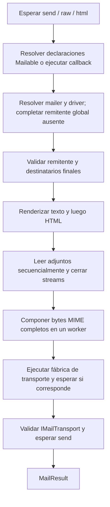

La fachada `Mail` inicia una declaración de mensaje independiente. Los métodos fluidos síncronos la configuran; los métodos asíncronos `send`, `raw` y `html` la preparan y entregan, devolviendo `MailResult`.

Los ejemplos se ejecutan en una aplicación Orionis inicializada. Seleccionan explícitamente el mailer `file` configurado, que publica un archivo `.eml` en lugar de contactar un servidor SMTP. Consulta la [configuración](/es/mail/configuration) antes de seleccionar el mailer destinado a una entrega real.

```python
from orionis.mail import MailResult
from orionis.support.facades import Mail


class NotificationService:

    async def publish(self, recipient: str) -> MailResult:
        manager = await Mail.resolve()
        return await (
            manager.mailer("file")
            .fromAddress("notifications@example.com", "Example App")
            .to(recipient)
            .subject("Account ready")
            .raw("Your account is ready.")
        )
```

## Fachada, manager y cadenas independientes

Importa `Mail` desde `orionis.support.facades`. `MailProvider` es un provider principal **eager**: registra `MailComposer` e `IMailManager` como singletons y fija la fachada durante el arranque normal de la aplicación. No abre conexiones SMTP ni valida todos los mailers configurados al arrancar.

`manager = await Mail.resolve()` obtiene explícitamente el manager y permite utilizar los ejemplos incluso cuando un arranque personalizado no ha fijado la fachada. Hazlo antes de depender de un primer builder síncrono de la fachada. Antes de fijarla, `Mail.to(...)` puede producir un dispatcher diferido en lugar de un `PendingMail` que admita encadenamiento.

`MailManager` hereda los once métodos públicos fluidos y terminales de `PendingMail` y añade `extend`. Una llamada fluida devuelve un **`PendingMail` nuevo** y conserva intactos el manager y la cadena anterior. Guarda el resultado o encadena la llamada. Ejecutar `base.to(...)` y descartar su resultado no añade destinatarios a `base`.

El `Message` que recibe un callback se comporta de otra forma: sus siete mutadores actualizan la configuración de esa operación y devuelven **el mismo `Message`**. No tiene métodos terminales de envío ni setters para el cuerpo.

Para inyectar `IMailManager` por constructor o método, consulta [manager e inyección](/es/mail/manager-and-injection).

## API fluida: encabezados, destinatarios y adjuntos

Las firmas omiten `self`. Cada operación es síncrona. La firma de `MailManager`/`PendingMail` devuelve `PendingMail`; cuando aparece, la firma correspondiente de `Message` devuelve `Self`. Esa diferencia cambia cómo conservar el resultado, no las reglas de validación de direcciones.

El alias de destinatarios es:

```text
Recipients = str | Address | list[str | Address] | tuple[str | Address, ...]
```

Utiliza una dirección como `"ana@example.com"`, un `Address("ana@example.com", "Ana")` o una lista/tupla de esos valores. Una cadena separada por comas, la sintaxis de nombre visible dentro de la dirección, un set o un generador no constituyen una colección válida. `name` se acepta únicamente con una dirección de tipo cadena; combinarlo con un `Address` o una colección genera `MailCompositionException`.

Las direcciones normalizan los dominios a IDNA en minúsculas y conservan las mayúsculas de la parte local. Las listas eliminan duplicados por dirección normalizada y conservan la primera declaración. La unión final de destinatarios del transporte contiene To, Cc y Bcc; excluye Reply-To. Una dirección no puede ser visible (To/Cc) y Bcc a la vez en el sobre final.

<a id="manager-mailer"></a>
<a id="pending-mailer"></a>

### `mailer`: seleccionar una entrada de configuración

```text
mailer(name: str) -> PendingMail
```

`name` es obligatorio. Selecciona una clave de `mail.mailers`, no necesariamente el nombre de un driver. Por ejemplo, un mailer `archive` configurado puede utilizar el driver `file`. La última selección en una cadena derivada prevalece; una cadena sin selección utiliza `mail.default` al enviarse.

Un nombre que no sea cadena o esté en blanco genera `MailConfigurationException` inmediatamente. Un nombre no vacío se conserva exactamente, sin recortar espacios ni normalizar mayúsculas; una entrada inexistente falla al esperar el método terminal.

<a id="manager-fromaddress"></a>
<a id="pending-fromaddress"></a>
<a id="message-fromaddress"></a>

### `fromAddress`: reemplazar el remitente

```text
fromAddress(address: str | Address, name: str | None = None) -> PendingMail
Message.fromAddress(address: str | Address, name: str | None = None) -> Self
```

`address` es obligatorio; `name` vale `None` de forma predeterminada. Define tanto el encabezado From como el remitente del transporte. El último remitente explícito reemplaza el anterior. El global `mail.from_address` se utiliza únicamente cuando el sobre final no tiene remitente.

Las direcciones inválidas o los nombres ambiguos generan `MailCompositionException`. El framework necesita un remitente final antes de preparar el mensaje.

<a id="manager-to"></a>
<a id="pending-to"></a>
<a id="message-to"></a>

### `to`: añadir destinatarios principales

```text
to(addresses: Recipients, name: str | None = None) -> PendingMail
Message.to(addresses: Recipients, name: str | None = None) -> Self
```

Añade los `addresses` obligatorios sin reemplazar los destinatarios To anteriores. `name=None` sigue la regla de una sola cadena descrita arriba. Puedes llamar `to` varias veces o proporcionar una lista/tupla. Los errores de validación de direcciones generan `MailCompositionException`.

<a id="manager-cc"></a>
<a id="pending-cc"></a>
<a id="message-cc"></a>

### `cc`: añadir copias visibles

```text
cc(addresses: Recipients, name: str | None = None) -> PendingMail
Message.cc(addresses: Recipients, name: str | None = None) -> Self
```

Añade destinatarios Cc con las mismas entradas admitidas y validación que `to`. Aparecen en el encabezado MIME Cc y forman parte de la unión de destinatarios del transporte.

<a id="manager-bcc"></a>
<a id="pending-bcc"></a>
<a id="message-bcc"></a>

### `bcc`: añadir destinatarios ocultos

```text
bcc(addresses: Recipients, name: str | None = None) -> PendingMail
Message.bcc(addresses: Recipients, name: str | None = None) -> Self
```

Añade destinatarios ocultos del transporte. El composer no escribe un encabezado Bcc en los bytes MIME. Un mensaje que solo tiene Bcc es válido: To no es obligatorio si Cc o Bcc proporcionan destinatarios.

Una coincidencia visible/Bcc en el sobre combinado genera `MailCompositionException` al enviarse. Evita exponer indiscriminadamente `MailResult.recipients`: incluye destinatarios ocultos.

<a id="manager-replyto"></a>
<a id="pending-replyto"></a>
<a id="message-replyto"></a>

### `replyTo`: añadir destinos de respuesta

```text
replyTo(addresses: Recipients, name: str | None = None) -> PendingMail
Message.replyTo(addresses: Recipients, name: str | None = None) -> Self
```

Añade direcciones al encabezado Reply-To. Estas direcciones no reciben el mensaje original salvo que también se declaren en To, Cc o Bcc. Las entradas admitidas, `name=None` y la validación son las mismas de `to`.

<a id="manager-subject"></a>
<a id="pending-subject"></a>
<a id="message-subject"></a>

### `subject`: reemplazar el asunto

```text
subject(value: str) -> PendingMail
Message.subject(value: str) -> Self
```

`value` es obligatorio. Prevalece el último valor, incluida una cadena vacía intencional. El asunto es texto literal, no una plantilla. Los valores que no sean cadenas o contengan caracteres de control, incluidos CR/LF, generan `MailCompositionException`.

<a id="manager-attach"></a>
<a id="pending-attach"></a>
<a id="message-attach"></a>

### `attach`: añadir un adjunto diferido de Storage

```text
attach(attachment: Attachment) -> PendingMail
Message.attach(attachment: Attachment) -> Self
```

`attachment` debe ser una declaración `Attachment`; pasar solamente una cadena de ruta genera `MailCompositionException`. Las llamadas repetidas añaden adjuntos en orden. La declaración valida las rutas lógicas y los metadatos sin abrir archivos. La lectura ocurre durante el terminal esperado; un adjunto ilegible produce `MailAttachmentException` antes del transporte.

Este servicio completo muestra los ocho métodos fluidos, incluido un archivo creado mediante `Storage`:

```python
from orionis.mail import Address, Attachment, Content, MailResult
from orionis.support.facades import Mail, Storage


class MonthlyReportService:

    async def publish(self) -> MailResult:
        storage = await Storage.resolve()
        await storage.disk("local").file("reports/monthly.txt").write(
            "Monthly total: 42\n",
        )
        manager = await Mail.resolve()
        return await (
            manager.mailer("file")
            .fromAddress(Address("reports@example.com", "Example Reports"))
            .to(["ana@example.com", Address("luis@example.com", "Luis")])
            .cc("audit@example.com")
            .bcc("archive@example.com")
            .replyTo("support@example.com", "Support")
            .subject("Monthly report")
            .attach(
                Attachment.fromStorage(
                    "reports/monthly.txt",
                    disk="local",
                    name="monthly-report.txt",
                    mime_type="text/plain",
                ),
            )
            .send(
                Content(
                    text="Your report is attached.",
                    html="<p>Your report is attached.</p>",
                ),
            )
        )
```

El disco `local` debe estar configurado. Su ruta lógica no es una ruta del sistema de archivos relativa al proceso. Para selección de disco, nombres, prioridad del MIME y streams, consulta [adjuntos](/es/mail/attachments).

## Métodos terminales

Estos métodos son asíncronos y devuelven `MailResult`. Construir una cadena no renderiza vistas, lee adjuntos ni realiza I/O de transporte. Esperar un terminal inicia ese trabajo; cada llamada terminal es un envío distinto, incluso si reutilizas la misma cadena o Mailable.

<a id="manager-send"></a>
<a id="pending-send"></a>

### `send`: Mailable, vista o Content

Las tres sobrecargas admitidas son:

```text
async send(mailable: Mailable | type[Mailable], /) -> MailResult
async send(
    view: str, /,
    data: Mapping[str, object] | None = None,
    callback: MessageCallback | None = None,
) -> MailResult
async send(
    content: Content, /, *,
    callback: MessageCallback | None = None,
) -> MailResult
```

El primer argumento es exclusivamente posicional. La implementación distingue los argumentos opcionales omitidos mediante `MISSING`:

```text
async send(
    value: Mailable | type[Mailable] | str | Content, /,
    data: object = MISSING,
    callback: object = MISSING,
) -> MailResult
```

| Primer argumento | Contexto | Callback |
| --- | --- | --- |
| Instancia Mailable | Pertenece a `content()`; se rechaza `data` adicional. | Se rechaza, incluso `callback=None`. |
| Clase Mailable | Se construye por envío mediante el contenedor de la aplicación. | Se rechaza, incluso `callback=None`. |
| Nombre de vista como cadena | Mapping opcional con claves de cadena; `None` representa un contexto vacío. | Configurador sync/async opcional. |
| `Content` | Ya pertenece al objeto; se rechaza `data` adicional, incluso `None`. | Pásalo con `callback=...`. |

Los tipos o combinaciones de argumentos inválidos generan `MailCompositionException`. No pases `data=None` con un Mailable o Content solo para completar una posición.

#### Enviar una declaración reutilizable o su clase

```python
from orionis.mail import Content, Envelope, MailResult, Mailable
from orionis.support.facades import Mail


class StatusMail(Mailable):

    def envelope(self) -> Envelope:
        return Envelope(
            from_address="status@example.com",
            subject="Service status",
        )

    def content(self) -> Content:
        return Content(text="All systems operational.")


class StatusNotificationService:

    async def from_instance(self, recipient: str) -> MailResult:
        manager = await Mail.resolve()
        return await manager.mailer("file").to(recipient).send(StatusMail())

    async def from_container(self, recipient: str) -> MailResult:
        manager = await Mail.resolve()
        return await manager.mailer("file").to(recipient).send(StatusMail)
```

Una instancia se utiliza tal como fue proporcionada. Al pasar una clase, `app.build` construye un Mailable nuevo y permite inyectar dependencias por constructor; los fallos de construcción se envuelven en `MailCompositionException` conservando su causa. Un `PendingMail` independiente sin builder de Mailable no puede resolver una clase.

`envelope()`, `content()` y `attachments()` son declaraciones síncronas que devuelven `Envelope`, `Content` y `Sequence[Attachment]`, respectivamente. Una declaración async se rechaza. Prepara los datos de negocio antes de crear una instancia cuando su constructor necesite valores como un número de pedido. Consulta [composición reutilizable](/es/mail/composing-mail).

#### Enviar una vista HTML

Con la ruta de vistas predeterminada, crea `resources/views/emails/welcome.html`:

```html
<p>Hello, {{ name }}.</p>
```

Después envía el identificador y el contexto explícito:

```python
from orionis.mail import MailResult
from orionis.support.facades import Mail


class WelcomeNotificationService:

    async def publish(self, recipient: str, name: str) -> MailResult:
        manager = await Mail.resolve()
        return await (
            manager.mailer("file")
            .fromAddress("welcome@example.com")
            .to(recipient)
            .subject("Welcome")
            .send("emails.welcome", {"name": name})
        )
```

Una cadena pasada a `send` identifica una vista HTML, no un cuerpo literal. El composer llama al motor de vistas configurado sin construir una respuesta HTTP. Una plantilla inexistente o un fallo de renderizado se convierte en `MailCompositionException`. Consulta [contenido y vistas](/es/mail/content-and-views) para plantillas de texto, snapshots del contexto y alternativas.

#### Enviar Content explícito

```python
from orionis.mail import Content, MailResult
from orionis.support.facades import Mail


class AccountNotificationService:

    async def publish(self, recipient: str) -> MailResult:
        manager = await Mail.resolve()
        return await (
            manager.mailer("file")
            .fromAddress("accounts@example.com")
            .to(recipient)
            .subject("Account ready")
            .send(
                Content(
                    text="Your account is ready.",
                    html="<p>Your account is ready.</p>",
                ),
            )
        )
```

`Content` permite como máximo una declaración por tipo de cuerpo: HTML es `view` o `html`; texto plano es `text_view` o `text`. Se requiere al menos un cuerpo, pero una cadena literal vacía es válida. Proporcionar texto y HTML crea alternativas MIME.

<a id="manager-raw"></a>
<a id="pending-raw"></a>

### `raw`: texto plano literal

```text
async raw(text: str, callback: MessageCallback | None = None) -> MailResult
```

`text` es obligatorio; `callback=None` es opcional. El texto nunca se interpreta como plantilla, ni siquiera cuando contiene `{{ ... }}`. Sigue el mismo flujo de configuración, preparación, callback y transporte que `send(Content(text=...))`. Un cuerpo o callback inválido genera `MailCompositionException`.

<a id="manager-html"></a>
<a id="pending-html"></a>

### `html`: HTML literal

```text
async html(html: str, callback: MessageCallback | None = None) -> MailResult
```

`html` es obligatorio; `callback=None` es opcional. Envía HTML literal sin renderizado de plantilla ni creación automática de una alternativa en texto plano. Para variables no confiables, utiliza una vista con la política de escape configurada.

```python
from orionis.mail import MailResult
from orionis.support.facades import Mail


class LiteralNotificationService:

    async def plain(self, recipient: str) -> MailResult:
        manager = await Mail.resolve()
        return await (
            manager.mailer("file")
            .fromAddress("notices@example.com")
            .to(recipient)
            .raw("Literal template syntax: {{ name }}")
        )

    async def rich(self, recipient: str) -> MailResult:
        manager = await Mail.resolve()
        return await (
            manager.mailer("file")
            .fromAddress("notices@example.com")
            .to(recipient)
            .html("<p>Your export is ready.</p>")
        )
```

## Callbacks y el configurador Message

Un callback de envío directo recibe exactamente un `Message` exclusivo de esa operación e inicializado con su cadena pendiente. Se ejecuta una vez antes de resolver el mailer, renderizar o acceder al transporte. Un callback síncrono puede devolver `None` o ese mismo `Message`. Si el resultado es awaitable, Orionis lo espera y aplica la misma regla de retorno.

```text
MessageCallback = Callable[
    [Message],
    Message | Awaitable[Message | None] | None,
]
```

Devolver `False` no cancela el envío: produce `MailCompositionException`. Devolver otro `Message` o cualquier otro valor también falla. Un `MailCompositionException` existente se propaga sin cambios; otras excepciones ordinarias se envuelven en `MailCompositionException` con su causa. La cancelación se propaga sin convertirse.

Este callback utiliza todos los mutadores de `Message`; cada uno devuelve el mismo configurador:

```python
from orionis.mail import Attachment, MailResult, Message
from orionis.support.facades import Mail, Storage


class CallbackNotificationService:

    async def publish(self, recipient: str) -> MailResult:
        storage = await Storage.resolve()
        await storage.disk("local").file("reports/summary.txt").write(
            "Summary total: 42\n",
        )

        def configure(message: Message) -> Message:
            return (
                message.fromAddress("reports@example.com", "Reports")
                .to(recipient)
                .cc("audit@example.com")
                .bcc("archive@example.com")
                .replyTo("support@example.com")
                .subject("Summary")
                .attach(
                    Attachment.fromStorage("reports/summary.txt", disk="local"),
                )
            )

        manager = await Mail.resolve()
        return await manager.mailer("file").raw("Summary attached.", configure)
```

Un callback asíncrono puede consultar metadatos de la operación antes de completar el mensaje:

```python
from collections.abc import Awaitable, Callable

from orionis.mail import MailResult, Message
from orionis.support.facades import Mail


class AsyncCallbackNotificationService:

    async def publish(
        self,
        recipient: str,
        load_subject: Callable[[], Awaitable[str]],
    ) -> MailResult:
        async def configure(message: Message) -> None:
            message.to(recipient).subject(await load_subject())

        manager = await Mail.resolve()
        return await (
            manager.mailer("file")
            .fromAddress("notices@example.com")
            .raw("Your notification is ready.", callback=configure)
        )
```

El callback puede ser una función, un método ligado o un objeto invocable. No se resuelve automáticamente mediante el contenedor: captura sus dependencias o utiliza un método ligado de un servicio inyectado. No compartas el `Message` mutable entre operaciones. Se obtiene un snapshot separado antes de preparar el mensaje, por lo que las mutaciones posteriores no alteran el sobre enviado.

## Reglas de combinación y precedencia

| Campo | Llamadas fluidas repetidas | Callback de envío directo | Mailable más cadena pendiente |
| --- | --- | --- | --- |
| Mailer | Prevalece la última selección. | `Message` no tiene setter de mailer. | Lo selecciona la cadena; si falta, aplica el predeterminado global. |
| Remitente | Prevalece el último explícito. | Reemplaza el de la cadena. | El explícito de la cadena reemplaza `envelope()`. El global solo completa una ausencia restante. |
| Asunto | Prevalece el último, incluido `""`. | Reemplaza el de la cadena. | El explícito de la cadena reemplaza `envelope()`, incluido `""`. |
| To/Cc/Bcc/Reply-To | Añaden a su colección. | Añaden después de las entradas de la cadena. | Primero los declarados, después los de la cadena. |
| Adjuntos | Añaden en orden. | Añaden después de los de la cadena. | Primero los del Mailable, después los de la cadena. |
| Cuerpos/contexto | Los proporciona el terminal. | No tiene setters para ellos. | El Mailable posee `content()`; no acepta datos ni callback adicionales. |

No hay un método fluido para vaciar una colección de destinatarios. Inicia otra cadena cuando necesite destinatarios base diferentes. La combinación reconstruye un `Envelope`, por lo que no permite omitir la validación de conflictos visible/Bcc.

## Qué ocurre al esperar un terminal



La preparación termina antes de resolver una instancia de transporte. Las declaraciones inválidas, las vistas que fallan o los adjuntos ilegibles no abren conexiones SMTP ni publican archivos de correo. El nombre y el driver seleccionados se comprueban antes de preparar; la configuración específica del transporte se valida cuando se invoca su fábrica.

Los transportes nativos ejecutan SMTP o publicación de archivos bloqueantes en workers. Una fábrica compartida puede devolver un transporte personalizado compartido, pero su implementación debe aislar el estado de cada operación. El manager no conserva sobres, contenido ni bytes de adjuntos por envío.

<a id="mail-result"></a>

## MailResult: interpretar el resultado real

Todos los terminales devuelven el mismo resultado inmutable y con slots. Su constructor recibe argumentos exclusivamente por nombre:

```text
MailResult(
    *,
    message_id: str,
    mailer: str,
    driver: str,
    status: MailStatus,
    recipients: tuple[str, ...],
    accepted_recipients: tuple[str, ...] = (),
    rejected_recipients: Mapping[str, tuple[int, str]] = <factory>,
    file_path: Path | None = None,
) -> None
```

| Campo | Significado |
| --- | --- |
| `message_id` | Message-ID generado al componer el MIME de ese envío. |
| `mailer` | Nombre de la entrada de configuración elegida. |
| `driver` | Nombre de la implementación del transporte. |
| `status` | Resultado nativo confirmado, descrito abajo. |
| `recipients` | Destinatarios previstos del transporte, sin duplicados e incluidos los Bcc. |
| `accepted_recipients` | Destinatarios confirmados por SMTP; tupla vacía para publicación file. |
| `rejected_recipients` | Mapping de solo lectura `dirección -> (código SMTP, motivo)`; vacío para file. |
| `file_path` | `Path` publicado para resultados file; `None` para SMTP. |

Las colecciones de destinatarios se copian a tuplas. Los rechazos se copian a un mapping de solo lectura; los motivos se reducen a una línea de hasta 512 caracteres. El transporte SMTP nativo oculta credenciales conocidas antes de construir el resultado. Los transportes personalizados también deben ocultar sus secretos; el constructor del resultado no conoce sus credenciales.

| Estado | Evidencia confirmada | Límite |
| --- | --- | --- |
| `MailStatus.ACCEPTED` / `"accepted"` | SMTP aceptó todos los destinatarios previstos. | No confirma entrega final al buzón ni lectura. |
| `MailStatus.PARTIAL` / `"partial"` | SMTP aceptó algunos destinatarios y rechazó otros. | Reintentar a todos puede duplicar correo ya aceptado. |
| `MailStatus.STORED` / `"stored"` | El transporte file publicó un `.eml` completo. | No afirma aceptación SMTP. |

Si SMTP rechaza a todos, el transporte nativo genera `MailTransportException` en lugar de devolver un cuarto estado. No existe estado de resultado `failed` ni helper nativo `success()`.

Procesa el resultado devuelto desde la aplicación sin inventar un desenlace:

```python
from orionis.mail import MailResult, MailStatus


class DeliverySummaryService:

    async def summarize(self, result: MailResult) -> dict:
        return {
            "message_id": result.message_id,
            "mailer": result.mailer,
            "driver": result.driver,
            "status": result.status.value,
            "accepted_count": len(result.accepted_recipients),
            "rejected_count": len(result.rejected_recipients),
            "needs_recipient_review": result.status is MailStatus.PARTIAL,
            "stored_path": str(result.file_path) if result.file_path else None,
        }
```

Conserva detalles de destinatarios y diagnósticos de rechazo en registros de la aplicación con acceso apropiado, en lugar de exponerlos en una respuesta pública.

## Errores y cancelación

| Excepción | Etapa habitual |
| --- | --- |
| `MailConfigurationException` | Mailer inválido/desconocido, driver no registrado, configuración nativa inválida, extensión duplicada o fábrica que no devuelve `IMailTransport`. |
| `MailCompositionException` | Direcciones/encabezados/contenido inválidos, argumentos `send` incompatibles, declaraciones Mailable inválidas, callback, vistas o codificación MIME que fallan. |
| `MailAttachmentException` | Declaración de adjunto inválida o fallo al abrir, inspeccionar, leer o cerrar el stream. Subclase de `MailCompositionException`. |
| `MailTransportException` | Fallo SMTP nativo, rechazo total de destinatarios o fallo de publicación del archivo. |
| `asyncio.CancelledError` | La cancelación se conserva; no se transforma en un resultado de correo fallido. |

Las excepciones de correo heredan de `MailException`. Los callbacks, fábricas y transportes personalizados pueden ejecutar código de la aplicación; el manager no normaliza universalmente las excepciones de fábricas o transportes personalizados.

Cancelar durante un callback detiene el flujo antes del transporte. Durante la lectura de un adjunto, el composer protege su tarea de Storage y espera la limpieza del stream antes de propagar la cancelación; por eso la cancelación puede tardar.

Una vez iniciado un worker SMTP/file nativo, cancelar la corrutina que espera no detiene ese worker síncrono. El archivo todavía puede publicarse o SMTP puede haber aceptado el mensaje. Una desconexión tampoco prueba que no se haya entregado. No existen reintentos automáticos, registros de envío durables, claves de idempotencia ni métodos terminales `Mail.queue` o de lotes. Define desde la aplicación la política de reintentos y deduplicación; conserva la evidencia de aceptados/rechazados en un resultado parcial.

## Envíos concurrentes

Deriva ramas de una cadena reutilizable en lugar de modificar estado compartido de operación:

```python
import asyncio

from orionis.mail import MailResult
from orionis.support.facades import Mail


class IndependentNotificationsService:

    async def publish(self) -> list[MailResult]:
        manager = await Mail.resolve()
        base = (
            manager.mailer("file")
            .fromAddress("notices@example.com")
            .subject("Notice")
        )
        first = base.to("ana@example.com")
        second = base.to("luis@example.com")
        return await asyncio.gather(
            first.raw("Hello, Ana."),
            second.raw("Hello, Luis."),
        )
```

Las dos derivaciones conservan sus propios destinatarios. Cada envío esperado invoca la fábrica del transporte; SMTP nativo utiliza una conexión por mensaje y la publicación file nativa utiliza archivos únicos. No existe un pool compartido de conexiones SMTP ni paralelización automática dentro de una preparación.

El framework no modifica un Mailable reutilizado. Sus métodos de declaración y los objetos de usuario capturados en el contexto deben ser seguros para acceso concurrente: los contenedores propios se copian a snapshots, pero los objetos arbitrarios conservan su identidad.

<a id="manager-extend"></a>

## extend: registrar una fábrica de transporte

```text
extend(driver: str, factory: TransportFactory) -> None

TransportFactory = Callable[
    [IApplication, Mapping[str, object]],
    IMailTransport | Awaitable[IMailTransport],
]
```

Registra durante el arranque de providers, antes de los envíos concurrentes. `driver` es una cadena obligatoria no vacía y se conserva exactamente. `factory` es obligatorio e invocable. Los nombres nativos `smtp`/`file` y los ya registrados no se pueden reemplazar; un registro inválido/duplicado genera `MailConfigurationException`.

El registro no realiza I/O ni invoca la fábrica. Al enviarse, recibe la aplicación y un snapshot inmutable de la configuración del mailer seleccionado, incluido `driver`. Su resultado se espera cuando corresponde y debe implementar `IMailTransport`. La fábrica se ejecuta por envío; solo se conserva su registro.

Un componente de arranque puede recibir su fábrica concreta y registrarla mediante el manager resuelto:

```python
from orionis.mail.types import TransportFactory
from orionis.support.facades import Mail


class MailDriverRegistration:

    async def register(self, driver: str, factory: TransportFactory) -> None:
        manager = await Mail.resolve()
        manager.extend(driver, factory)
```

Un mailer configurado debe seleccionar ese driver. El stub de la fachada para consumidores se enfoca deliberadamente en composición y métodos terminales; utiliza el manager resuelto o `IMailManager` inyectado para `extend`. Consulta [transportes y extensiones](/es/mail/transports-and-extensions) para implementaciones completas.

## Snapshots de operación y construcción avanzada

La aplicación normalmente obtiene el manager mediante la fachada o por inyección. Estos constructores describen los componentes públicos del flujo; no arrancan una aplicación ni configuran un transporte.

<a id="manager-construction"></a>

### MailManager

```text
MailManager(app: IApplication, composer: MailComposer) -> None
```

Conserva la configuración/contenedor de la aplicación y el composer compartido, inicia una cadena pendiente vacía y difiere las fábricas de transporte. El composer necesita motores de vistas y Storage configurados incluso para enviar texto literal sin adjuntos.

<a id="pending-construction"></a>

### PendingMail

```text
PendingMail(
    delivery: Delivery,
    options: MailOptions | None = None,
    mailable_builder: Callable[[type[Mailable]], Awaitable[Mailable]] | None = None,
) -> None

Delivery = Callable[
    [str | None, Envelope, Content, tuple[Attachment, ...]],
    Awaitable[MailResult],
]
```

`delivery` es obligatorio y controla la preparación y el transporte real. `options=None` crea `MailOptions` vacías. `mailable_builder=None` permite enviar una instancia Mailable, pero no resolver su clase. La construcción no realiza I/O ni valida toda una implementación de entrega.

<a id="message-construction"></a>

### Message

```text
Message(options: MailOptions | None = None) -> None
```

`options=None` inicia un configurador vacío. PendingMail crea uno nuevo por envío directo con el snapshot de la cadena. Sus métodos públicos son los siete mutadores documentados arriba; la extracción del snapshot es interna al flujo.

<a id="delivery-options"></a>

### MailOptions

`MailOptions` se exporta desde `orionis.mail.entities`. Es un snapshot inmutable y con slots, cuyos campos de constructor son:

```text
MailOptions(
    mailer: str | None = None,
    from_address: Address | None = None,
    subject: str | None = None,
    to: tuple[Address, ...] = (),
    cc: tuple[Address, ...] = (),
    bcc: tuple[Address, ...] = (),
    reply_to: tuple[Address, ...] = (),
    attachments: tuple[Attachment, ...] = (),
) -> None
```


| Campo | Tipo | Predeterminado |
| --- | --- | --- |
| `mailer` | `str \| None` | `None` |
| `from_address` | `Address \| None` | `None` |
| `subject` | `str \| None` | `None` |
| `to` | `tuple[Address, ...]` | `()` |
| `cc` | `tuple[Address, ...]` | `()` |
| `bcc` | `tuple[Address, ...]` | `()` |
| `reply_to` | `tuple[Address, ...]` | `()` |
| `attachments` | `tuple[Attachment, ...]` | `()` |

`envelope(base: Envelope | None = None) -> Envelope` construye un sobre nuevo validado. Los escalares `None` conservan la declaración base; los valores explícitos de asunto/remitente la reemplazan y las tuplas de destinatarios se añaden. `base=None` inicia desde un `Envelope` vacío. Un conflicto visible/Bcc genera `MailCompositionException`.

```python
from orionis.mail import Address, Envelope
from orionis.mail.entities import MailOptions


class DeliveryOptionsService:

    async def envelope_for(self, recipient: str) -> Envelope:
        options = MailOptions(
            subject="",
            to=(Address(recipient),),
        )
        return options.envelope(
            Envelope(
                from_address="notices@example.com",
                subject="Original subject",
            ),
        )
```

El sobre resultante tiene intencionalmente asunto vacío y el destinatario nuevo. El `mailer` y los `attachments` del snapshot se consumen por separado desde PendingMail; `envelope()` no envía nada.

<a id="prepared-mail"></a>

### PreparedMail

`PreparedMail`, exportado desde `orionis.mail.entities`, es el valor inmutable y con slots que recibe un transporte:

```text
PreparedMail(
    *,
    message_id: str,
    sender: str,
    recipients: tuple[str, ...],
    mime: bytes,
    smtp_utf8: bool,
) -> None
```

Los cinco campos son obligatorios y exclusivamente por nombre. `sender` es la dirección del transporte; `recipients` es la unión To/Cc/Bcc sin duplicados. `mime` contiene los bytes MIME completos sin encabezado Bcc. `smtp_utf8` indica requisitos de direcciones internacionales; un nombre visible Unicode no exige por sí solo SMTPUTF8. Los transportes no reciben plantillas, rutas lógicas de adjuntos ni un `EmailMessage` mutable.

Consulta la [referencia de API](/es/mail/api-reference) para el inventario de componentes y [contenido y vistas](/es/mail/content-and-views) para continuar con la declaración de cuerpos.
