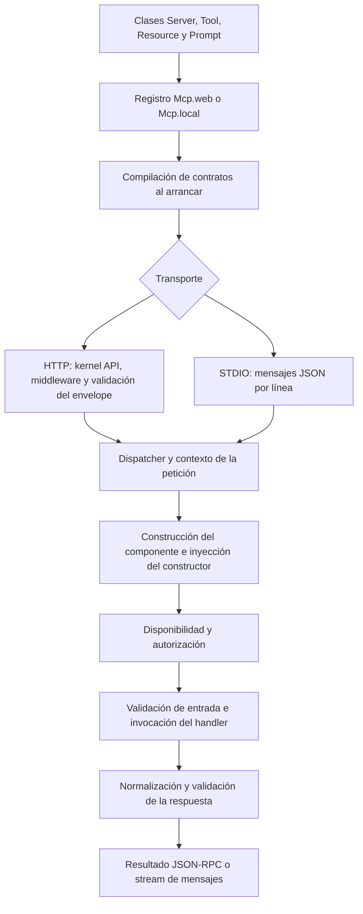

**MCP (Model Context Protocol)** permite que un cliente descubra capacidades de una aplicación y las utilice mediante mensajes JSON-RPC. Orionis implementa el servidor: expone tus servicios de negocio como herramientas, recursos y prompts, valida sus contratos y ejecuta sus componentes mediante el contenedor de dependencias.

Declaras las clases, las reúnes en un `Server` y registras sus transportes. Orionis se encarga del protocolo; no necesitas escribir un parser JSON-RPC, un controlador HTTP para cada herramienta ni un bucle STDIO.

:::tip[Inspecciona tu servidor desde el navegador]
Abre [Orionis MCP Inspector](https://inspector.orionis-framework.com/es/) para descubrir herramientas, recursos y prompts, validar schemas, inspeccionar peticiones JSON-RPC y exportar informes de diagnóstico. Se conecta directamente a servidores HTTP con MCP `2026-07-28` stateless; tu endpoint debe permitir el origen del inspector mediante CORS. Consulta el flujo de [pruebas en el navegador](/es/mcp/testing#inspeccionar-un-servidor-http-desde-el-navegador).
:::

## Qué componente necesitas

| Componente | Responsabilidad | Ejemplo |
| --- | --- | --- |
| `Server` | Reúne las capacidades que publica un servidor. | Un servidor de operaciones y otro de soporte, cada uno con su endpoint. |
| `Tool` | Ejecuta una operación con entrada y salida declaradas. | Consultar un pedido o crear una incidencia. |
| `Resource` | Entrega contenido identificado por una URI fija o una plantilla. | Leer `orders://reports/daily` o `orders://items/{order_id}`. |
| `Prompt` | Construye mensajes reutilizables para el cliente. | Preparar instrucciones para resumir un pedido. |

Una herramienta puede modificar datos si implementas esa operación. Un recurso proporciona contenido y un prompt devuelve mensajes: Orionis no llama automáticamente a un modelo de IA para resolverlos. Las clases deben formar parte de un servidor registrado; existir en un directorio no las publica.

## Revisión del protocolo admitida

Orionis admite **exclusivamente MCP `2026-07-28`**: es el valor de `MCP_PROTOCOL_VERSION` y el único elemento de `SUPPORTED_VERSIONS` en `orionis/mcp/protocol/constants.py`. Es la [revisión actual publicada por MCP](https://modelcontextprotocol.io/docs/2026-07-28/learn/versioning).

Las peticiones son autocontenidas: incluyen la revisión y las capacidades del cliente en `params._meta`. El cliente puede consultar `server/discover` para conocer el servidor; no hay un paso previo `initialize` ni una sesión MCP que conservar. Las revisiones anteriores, `initialize` y `ping` no están implementados como métodos del núcleo. Un cliente limitado al handshake de revisiones anteriores necesita soporte para este protocolo antes de conectarse.

La revisión del **protocolo** es distinta de `Server.version`, que identifica tu propio servidor. Cambiar `Server.version` no selecciona una revisión MCP. El contrato de cabeceras y peticiones está en [HTTP y clientes](/es/mcp/http-and-clients).

## Recorrido de inicio

1. [Crea un servidor y registra sus rutas](/es/mcp/servers-and-routes): incluye un saludo completo y varios servidores independientes.
2. Crea [herramientas](/es/mcp/tools), [recursos](/es/mcp/resources) y [prompts](/es/mcp/prompts) con sus generadores CLI y contratos.
3. Elige las [respuestas y bloques de contenido](/es/mcp/responses-and-content) apropiados.
4. [Consulta el servidor por HTTP y configura Hermes u otro cliente](/es/mcp/http-and-clients), o utiliza [STDIO y su configuración](/es/mcp/stdio-and-configuration) para un proceso local.
5. Incorpora [progreso, continuación, suscripciones y extensiones](/es/mcp/advanced-workflows) cuando lo necesites.
6. [Prueba las capacidades dentro del proceso](/es/mcp/testing) antes de integrarlas en un agente.

Los ejemplos se añaden a una aplicación Orionis ya [instalada](/es/getting-started/installation). MCP utiliza los schemas nativos y el contenedor de la aplicación; sus handlers no necesitan otro contenedor ni otro event loop.

## Flujo de ejecución

En el arranque se cargan los registros de `routes/ai.py` y se compilan las declaraciones, schemas y planes de invocación. El mismo servidor compilado se puede publicar por HTTP y STDIO.

El diagrama muestra la ejecución de una primitiva; las operaciones de descubrimiento y listado consultan el catálogo compilado. Los servicios se pueden inyectar en constructores y métodos de `Tool`, `Resource` y `Prompt`, separados del payload del cliente. Consulta los [ejemplos de inyección](/es/mcp/tools#servicios-en-el-constructor-y-en-el-método) y el [contenedor](/es/application/container/bindings-and-invocation).

## Acceso y aislamiento

Cada petición tiene un contexto independiente. Una ruta MCP API no exige por sí sola credenciales: añade middleware de autenticación si debe ser privada y usa los hooks de autorización para controlar las operaciones. Una anotación como `readOnlyHint` describe la herramienta; no concede ni restringe permisos.

Los endpoints HTTP MCP utilizan la política de errores del protocolo: devuelven fallos JSON-RPC en lugar de páginas HTML de excepción. Ambos transportes comparten contratos y ejecución, pero solo HTTP dispone de una petición HTTP nativa. Las guías de componentes explican qué contexto está disponible.
