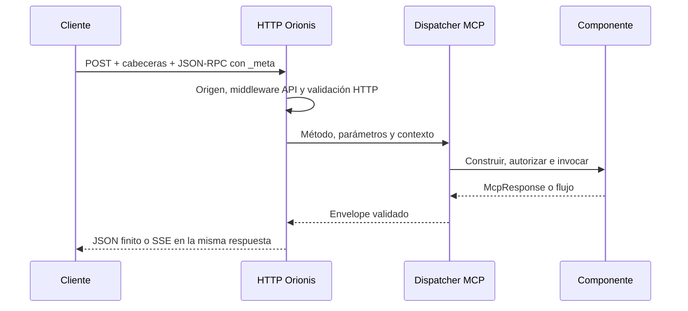

Esta guía utiliza `DemoServer` y el endpoint `/mcp/demo` de [Servidores y rutas](/es/mcp/servers-and-routes). Registra ese servidor y arranca Orionis con `orionis serve` o `python -B reactor serve`. Los ejemplos usan `http://localhost:8000`; adapta el host y el puerto a la consola de tu aplicación.

## Un endpoint, varios métodos MCP

Todas las operaciones se envían mediante **POST al mismo endpoint**. Para listar herramientas no creas `/mcp/demo/tools` ni utilizas GET: envías `method: "tools/list"` en el cuerpo JSON-RPC.

| Operación | Método MCP | Parámetros además de `_meta` |
| --- | --- | --- |
| Descubrir el servidor | `server/discover` | Ninguno. |
| Listar herramientas | `tools/list` | `cursor` opcional. |
| Ejecutar una herramienta | `tools/call` | `name` y `arguments`. |
| Listar recursos fijos | `resources/list` | `cursor` opcional. |
| Listar plantillas URI | `resources/templates/list` | `cursor` opcional. |
| Leer un recurso | `resources/read` | `uri`. |
| Listar prompts | `prompts/list` | `cursor` opcional. |
| Obtener un prompt | `prompts/get` | `name` y `arguments`, con valores string. |
| Autocompletar un argumento | `completion/complete` | `ref`, `argument` y `context` opcional; consulta [recursos](/es/mcp/resources) y [prompts](/es/mcp/prompts). |
| Escuchar cambios | `subscriptions/listen` | `notifications`; consulta [suscripciones](/es/mcp/advanced-workflows). |

`server/discover` permite inspeccionar las capacidades, pero no inicializa una sesión ni es un requisito previo para cada operación. Orionis implementa únicamente [MCP `2026-07-28`](/es/mcp#revisión-del-protocolo-admitida).

## Cabeceras y metadatos obligatorios

| Elemento | Valor y finalidad |
| --- | --- |
| `Content-Type` | Una única cabecera `application/json`; se admite su parámetro de charset. |
| `Accept` | Debe incluir explícitamente `application/json, text/event-stream` con calidad positiva para ambos. `*/*` no los sustituye. |
| `MCP-Protocol-Version` | `2026-07-28`, idéntico al valor de versión en `params._meta`. |
| `MCP-Method` | El mismo string que `method` en el envelope. |
| `MCP-Name` | En `tools/call` y `prompts/get`, el `name`; en `resources/read`, la `uri` completa. No se necesita para los listados. |
| `params._meta` | Incluye `io.modelcontextprotocol/protocolVersion` y `io.modelcontextprotocol/clientCapabilities` en cada petición. |

Las herramientas cuyo schema declare `x-mcp-header` requieren además reflejar esos argumentos en sus cabeceras declaradas. El transporte comprueba los valores antes de ejecutar el handler. No envíes una cabecera de sesión MCP: cada petición se procesa de forma independiente.

### Primera consulta con curl

Guarda este cuerpo UTF-8 en `discover.json`:

```json
{
  "jsonrpc": "2.0",
  "id": "discover-1",
  "method": "server/discover",
  "params": {
    "_meta": {
      "io.modelcontextprotocol/protocolVersion": "2026-07-28",
      "io.modelcontextprotocol/clientCapabilities": {}
    }
  }
}
```

Ejecuta desde el directorio que contiene el archivo. En Windows utiliza el ejecutable `curl.exe`; en otros sistemas cambia su nombre por `curl`:

```shell
curl.exe --request POST http://localhost:8000/mcp/demo --header "Content-Type: application/json" --header "Accept: application/json, text/event-stream" --header "MCP-Protocol-Version: 2026-07-28" --header "MCP-Method: server/discover" --data-binary "@discover.json"
```

El resultado conserva `id: "discover-1"` y contiene `result.supportedVersions`, `result.capabilities` y la identidad del servidor en `result._meta["io.modelcontextprotocol/serverInfo"]`. Las respuestas completadas incluyen `resultType: "complete"`; las operaciones cacheables incluyen también `ttlMs` y `cacheScope`.

Envía un `id` string o entero en las solicitudes de las que esperas resultado. Una notificación sin `id` recibe HTTP `202` sin cuerpo; no se usa como sustituto de una llamada `tools/call` que deba ejecutarse y responder.

## Consultas completas con JavaScript

Para probar operaciones finitas desde Node.js con `fetch` disponible, crea `mcp-http.mjs` y copia esta función. Añade los bloques de consultas en el mismo archivo y ejecútalo con `node mcp-http.mjs`:

```javascript
const endpoint = process.env.MCP_URL || "http://localhost:8000/mcp/demo";
let nextId = 1;

async function rpc(method, params = {}) {
    const id = nextId++;
    const headers = {
        "Content-Type": "application/json",
        "Accept": "application/json, text/event-stream",
        "MCP-Protocol-Version": "2026-07-28",
        "MCP-Method": method,
    };
    if (["tools/call", "prompts/get", "resources/read"].includes(method)) {
        headers["MCP-Name"] = method === "resources/read" ? params.uri : params.name;
    }

    const response = await fetch(endpoint, {
        method: "POST",
        headers,
        signal: AbortSignal.timeout(15000),
        body: JSON.stringify({
            jsonrpc: "2.0",
            id,
            method,
            params: {
                ...params,
                _meta: {
                    "io.modelcontextprotocol/protocolVersion": "2026-07-28",
                    "io.modelcontextprotocol/clientCapabilities": {},
                },
            },
        }),
    });

    if (!response.headers.get("content-type")?.startsWith("application/json")) {
        await response.body?.cancel();
        throw new Error("Expected a finite JSON response");
    }
    const envelope = await response.json();
    if (!response.ok || envelope.error) {
        throw new Error(JSON.stringify({ status: response.status, error: envelope.error }));
    }
    if (envelope.id !== id) {
        throw new Error("Unexpected response ID");
    }
    return envelope.result;
}
```

La función refleja las cabeceras del método y del nombre/URI, añade metadata y comprueba HTTP, JSON-RPC e identidad de respuesta. Usa los identificadores ASCII del ejemplo y procesa respuestas JSON finitas. Para herramientas con cabeceras propias o flujos SSE, adapta el transporte según su contrato.

### Descubrir capacidades e identidad

```javascript
const server = await rpc("server/discover");
console.log(server.supportedVersions); // ["2026-07-28"]
console.log(server.capabilities);
console.log(server._meta["io.modelcontextprotocol/serverInfo"]);
```

La metadata describe las capacidades del cliente en cada llamada. El objeto vacío declara que no ofrece capacidades adicionales; no habilita elicitation ni suscripciones por sí solo.

### Listar e invocar herramientas

```javascript
const tools = await rpc("tools/list");
console.log(tools.tools);

const greeting = await rpc("tools/call", {
    name: "greet",
    arguments: { name: "Ada" },
});
console.log(greeting.structuredContent); // Hello, Ada!
console.log(greeting.isError === true);
```

`tools/list` devuelve descripciones y schemas; no ejecuta herramientas. `tools/call` ejecuta `greet` con su payload validado. Un resultado de negocio con `isError: true` es distinto de `envelope.error`: revisa ambos según la operación. Consulta [Herramientas](/es/mcp/tools).

### Listar y leer recursos

```javascript
const resources = await rpc("resources/list");
console.log(resources.resources);

const templates = await rpc("resources/templates/list");
console.log(templates.resourceTemplates);

const content = await rpc("resources/read", {
    uri: "demo://greetings/Ada",
});
console.log(content.contents);
```

En el ejemplo básico, `GreetingResource` declara una plantilla: aparece en `resourceTemplates` y la lista de recursos fijos puede estar vacía. `resources/read` recibe la URI concreta, no `demo://greetings/{name}`. Un recurso no es una URL HTTP que debas abrir en el navegador ni concede acceso al filesystem. Consulta [Recursos](/es/mcp/resources).

### Listar y obtener prompts

```javascript
const prompts = await rpc("prompts/list");
console.log(prompts.prompts);

const prompt = await rpc("prompts/get", {
    name: "greeting",
    arguments: { name: "Ada" },
});
console.log(prompt.messages);
```

`prompts/list` describe nombres y argumentos; `prompts/get` devuelve mensajes con sus roles y bloques de contenido. Obtener un prompt no ejecuta un modelo. Sus argumentos tienen valores string aunque su texto represente un número. Consulta [Prompts](/es/mcp/prompts).

### Recorrer todas las páginas

Añade este helper si el catálogo contiene más entradas de las que caben en una página:

```javascript
async function listAll(method, field) {
    const entries = [];
    let cursor;
    do {
        const page = await rpc(method, cursor === undefined ? {} : { cursor });
        entries.push(...page[field]);
        cursor = page.nextCursor;
    } while (cursor !== undefined);
    return entries;
}

console.log(await listAll("tools/list", "tools"));
```

`nextCursor` es opaco: devuélvelo sin modificar al mismo servidor y método, conservando las credenciales. El tamaño de página procede de `default_page_size`; las peticiones no ofrecen `limit` ni `page_size`. Si el catálogo o el acceso cambian y un cursor deja de ser válido, reinicia el listado.

## JSON, SSE y ciclo de vida HTTP

Una operación finita devuelve JSON. El progreso de una herramienta o una suscripción puede mantener la **misma respuesta POST** abierta y emitir mensajes JSON-RPC por SSE. Selecciona el lector a partir del `Content-Type` real; el helper anterior está destinado a resultados finitos.

`GET` no abre un canal SSE MCP independiente y `EventSource` no sirve para realizar estas llamadas POST. No hay sesión identificada mediante `Mcp-Session-Id` ni un endpoint DELETE para cerrarla. `OPTIONS` lo atiende el kernel como introspección HTTP, no como método MCP. Consulta [Flujos avanzados](/es/mcp/advanced-workflows) para progreso y cancelación.



## Configurar Hermes Agent y otros clientes

Los endpoints `/mcp/demo` y `/mcp/support` se registran en el ejemplo de [varios servidores](/es/mcp/servers-and-routes). Cada cliente debe apuntar a la URL completa de su servidor.

En un cliente o importador que utilice el formato JSON `mcpServers`, la configuración es:

```json
{
  "mcpServers": {
    "DEMO_MCP": {
      "url": "http://localhost:8000/mcp/demo",
      "protocol": "stateless",
      "supports_parallel_tool_calls": true
    },
    "SUPPORT_MCP": {
      "url": "http://localhost:8000/mcp/support",
      "protocol": "stateless",
      "supports_parallel_tool_calls": true
    }
  }
}
```

Sustituye `localhost:8000` por el host accesible desde el proceso del agente. `DEMO_MCP` y `SUPPORT_MCP` son etiquetas del cliente: no son handles STDIO, nombres de rutas ni valores obligatorios de `Server.name`.

En **Hermes Agent**, el formato nativo es `mcp_servers` en `~/.hermes/config.yaml`. El equivalente es:

```yaml
mcp_servers:
  DEMO_MCP:
    url: "http://localhost:8000/mcp/demo"
    protocol: stateless
    supports_parallel_tool_calls: true
  "SUPPORT_MCP":
    url: "http://localhost:8000/mcp/support"
    protocol: stateless
    supports_parallel_tool_calls: true
```

`protocol: stateless` indica a Hermes que comience con `server/discover`, adecuado para esta revisión; `supports_parallel_tool_calls: true` permite al cliente solapar llamadas. No configura los límites de Orionis ni convierte una herramienta en una operación segura para concurrencia. Estas opciones están documentadas en la [referencia oficial de Hermes](https://github.com/NousResearch/hermes-agent/blob/main/website/docs/reference/mcp-config-reference.md); la [guía oficial](https://github.com/NousResearch/hermes-agent/blob/main/website/docs/user-guide/features/mcp.md) explica la correspondencia entre las claves raíz.

Tras cambiar la configuración, utiliza `/reload-mcp` dentro de Hermes para recargar los servidores. El cliente debe admitir MCP `2026-07-28`; seleccionar `stateless` no garantiza que admita todas las capacidades avanzadas.

### Endpoints privados

Si el registro utiliza middleware de autenticación por token, añade la credencial a las cabeceras del cliente. Este es el contenido de una entrada de servidor:

```json
{
  "url": "https://api.example.com/mcp/demo",
  "protocol": "stateless",
  "supports_parallel_tool_calls": true,
  "headers": {
    "Authorization": "Bearer YOUR_TOKEN"
  }
}
```

Usa un token válido emitido por tu aplicación. La autenticación del endpoint y la autorización de la herramienta son controles distintos; la segunda puede rechazar una operación aunque el token sea válido. El [registro de servidores](/es/mcp/servers-and-routes) muestra cómo proteger el endpoint.

## Diagnosticar una consulta

| Síntoma | Comprobación |
| --- | --- |
| HTTP `405` | Utiliza POST al endpoint registrado; GET y DELETE no ejecutan operaciones MCP. |
| HTTP `406` | Incluye ambos tipos explícitos en `Accept` y no les asignes `q=0`. |
| HTTP `415` | Envía un único `Content-Type: application/json` y un cuerpo JSON. |
| HTTP `403` por origen | Un `Origin` presente debe coincidir exactamente con `allowed_origins`. Uno ausente se admite; la lista vacía no autoriza automáticamente el mismo origen. |
| Error `-32020` | Falta una cabecera reflejada, está repetida o difiere del cuerpo. Revisa versión, método y nombre/URI. |
| Error `-32022` | Revisión no soportada: consulta `error.data.supported`. |
| Error `-32601` | Método inexistente, como `initialize` o `ping`. |
| Error `-32602` | Parámetros, cursor o primitiva inválidos; la autorización denegada también puede usarlo con HTTP `403`. |
| HTTP `413` o `503` | Tamaño de petición o capacidad activa excedidos. Un stream abierto conserva su plaza hasta cerrarse. |
| `resources/list` vacío | Comprueba las plantillas en `resources/templates/list` y los hooks de visibilidad. |

Para límites y orígenes, consulta [STDIO y configuración](/es/mcp/stdio-and-configuration). Para errores de negocio y resultados, consulta [Respuestas MCP](/es/mcp/responses-and-content).
