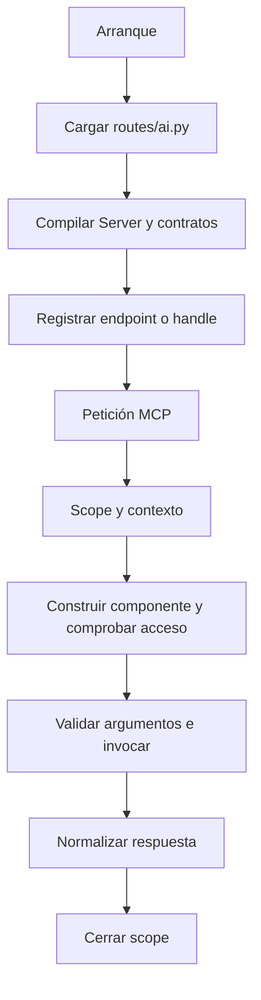

Un servidor MCP es una declaración de las herramientas, recursos y prompts que tu aplicación ofrece a un cliente. Orionis compila esa declaración y la publica mediante HTTP o STDIO. El servidor no ejecuta un modelo de lenguaje: el cliente descubre sus capacidades y decide qué operaciones solicitar.

## Crear la declaración del servidor

Desde la raíz del proyecto, utiliza cualquiera de estas alternativas:

```bash
orionis make:mcp-server demo
python -B reactor make:mcp-server demo
```

Son dos formas de ejecutar el mismo generador; ejecuta una. Crea `app/mcp/servers/demo_server.py` con la clase `DemoServer`. Este es el contenido real de la plantilla:

```python
from orionis.mcp import Server

class DemoServer(Server):
    """Expose application tools, resources and prompts through MCP."""

    name = "DemoServer"
    version = "1.0.0"
    instructions = "Describe the capabilities of this server."
    tools = ()
    resources = ()
    prompts = ()
```

`name` identifica la implementación ante el cliente; `version` es la versión de **tu servidor**, no la revisión del protocolo MCP. `instructions` explica cómo utilizar sus capacidades. Las tuplas reciben clases de componentes, no instancias ni rutas de importación en strings. Generar el archivo no lo registra automáticamente.

El argumento `name` es obligatorio. No hay flags propios de este generador para transportes, autenticación o sobrescritura; `-h`/`--help` muestra su ayuda. Los otros generadores comparten estas reglas:

| Comando | Destino predeterminado | Sufijo de clase y archivo |
| --- | --- | --- |
| `make:mcp-server demo` | `app/mcp/servers/demo_server.py` | `DemoServer` / `_server.py` |
| `make:mcp-tool greet` | `app/mcp/tools/greet_tool.py` | `GreetTool` / `_tool.py` |
| `make:mcp-resource greeting` | `app/mcp/resources/greeting_resource.py` | `GreetingResource` / `_resource.py` |
| `make:mcp-prompt greeting` | `app/mcp/prompts/greeting_prompt.py` | `GreetingPrompt` / `_prompt.py` |

Los destinos corresponden a las rutas de aplicación configuradas para MCP. Para subdirectorios se acepta, por ejemplo, `make:mcp-tool support/find_ticket`: crea `app/mcp/tools/support/find_ticket_tool.py` y `FindTicketTool`. Los directorios se crean automáticamente. El archivo se escribe en minúsculas y la clase se forma a partir de las palabras separadas por `_`; un nombre CamelCase no se convierte automáticamente a snake_case. Si el nombre ya termina con el sufijo correspondiente, no se añade dos veces. No se aceptan rutas absolutas, segmentos vacíos, `.` ni `..`, ni componentes incompatibles con un nombre de módulo. Un archivo existente produce un error y se conserva; no existe `--force`.

## Primera aplicación MCP completa

Para comprobar todo el flujo con un solo archivo, reemplaza `app/mcp/servers/demo_server.py` por este ejemplo. Después puedes distribuir las clases entre los directorios de componentes:

```python
from orionis.mcp import McpResponse, Prompt, PromptArgument, Resource, Server, Tool
from orionis.schemas import Schema


class GreetInput(Schema):
    name: str


class GreetTool(Tool[GreetInput, str]):
    name = "greet"
    description = "Return a greeting."

    async def handle(self, payload: GreetInput) -> McpResponse:
        return McpResponse.structured(f"Hello, {payload.name}!")


class GreetingResource(Resource):
    name = "greeting"
    uri_template = "demo://greetings/{name}"
    mime_type = "text/plain"

    async def handle(self, name: str) -> McpResponse:
        return McpResponse.text(f"Hello, {name}!")


class GreetingPrompt(Prompt):
    name = "greeting"
    arguments = (PromptArgument(name="name", required=True),)

    async def handle(self, name: str) -> McpResponse:
        return McpResponse.text(f"Greet {name} in a friendly way.").asUser()


class DemoServer(Server):
    name = "Demo"
    instructions = "Use the greeting components to welcome a user."
    tools = (GreetTool,)
    resources = (GreetingResource,)
    prompts = (GreetingPrompt,)
```

La herramienta `greet` recibe `{"name": "Ada"}` y devuelve el valor JSON `"Hello, Ada!"`. El recurso se lee mediante `demo://greetings/Ada`. El prompt `greeting` produce un mensaje de usuario que pide saludar a Ada. Los nombres de herramientas, recursos y prompts pertenecen a catálogos distintos.

### Registrar el servidor

En `routes/ai.py`:

```python
from app.mcp.servers.demo_server import DemoServer
from orionis.support.facades import Mcp

Mcp.web("/mcp/demo", DemoServer)
Mcp.local("demo", DemoServer)
```

En la configuración existente de `bootstrap/app.py`, asegúrate de incluir `ai="routes/ai.py"` en `app.withRouting(...)`, antes de `app.create()`. Por ejemplo, si ya utilizas esa llamada, incorpora el argumento conservando tus otros archivos de rutas:

```python
app.withRouting(
    ai="routes/ai.py",
    api="routes/api.py",
    web="routes/web.py",
    console="routes/console.py",
)
```

`Mcp.web()` crea una ruta **POST** con semántica API y devuelve una ruta fluida. `Mcp.local()` registra un handle STDIO y no crea una URL. Importa siempre `Mcp` desde `orionis.support.facades`. El mecanismo de registro MCP es `Mcp.web()`, no un método `Route.mcp()`.

Para HTTP, inicia el servidor de desarrollo con `orionis serve` o `python -B reactor serve`; el endpoint será `http://localhost:8000/mcp/demo` si utilizas la dirección predeterminada. La página [HTTP y clientes](/es/mcp/http-and-clients) explica los encabezados y el JSON-RPC necesario: abrir esa URL con un GET en el navegador no lista herramientas.

Para STDIO, utiliza `orionis mcp:start demo` o `python -B reactor mcp:start demo`. El cliente debe lanzar el proceso y comunicarse por su entrada y salida estándar; consulta [STDIO y configuración](/es/mcp/stdio-and-configuration).

## Varios servidores en la misma aplicación

Cada endpoint o handle se vincula explícitamente a una clase `Server`. Para añadir otro catálogo, crea `app/mcp/servers/support_server.py`:

```python
from app.mcp.servers.demo_server import GreetTool
from orionis.mcp import Server


class SupportServer(Server):
    name = "Support"
    instructions = "Welcome users contacting support."
    tools = (GreetTool,)
```

En `routes/ai.py`, reemplaza los registros anteriores por:

```python
from app.mcp.servers.demo_server import DemoServer
from app.mcp.servers.support_server import SupportServer
from orionis.support.facades import Mcp

Mcp.web("/mcp/demo", DemoServer).name("mcp.demo")
Mcp.web("/mcp/support", SupportServer).name("mcp.support")

Mcp.local("demo", DemoServer)
Mcp.local("support", SupportServer)
```

`/mcp/demo` publica los tres componentes del ejemplo y `/mcp/support` solo la herramienta. Las etiquetas `DEMO_MCP` y `SUPPORT_MCP` de un cliente no tienen que coincidir con `Server.name` ni con un handle STDIO. Reutilizar una clase de herramienta en servidores distintos está permitido; cada servidor conserva su catálogo y contexto. `demo` y `support` son handles locales independientes de las URLs HTTP.

Los endpoints deben ser rutas fijas: no admiten parámetros `{...}`, query strings ni fragmentos. Para separar servidores utiliza `/mcp/demo` y `/mcp/support`, por ejemplo, en lugar de un endpoint parametrizado `/mcp/{server}`. Una dirección HTTP duplicada o un handle STDIO repetido falla al registrar. Los handles tienen entre 1 y 128 caracteres, comienzan con letra o dígito y solo admiten letras, dígitos, puntos, `_` y `-`.

Si necesitas separar los registros por dominio, crea los archivos y configura una lista en lugar de `ai="routes/ai.py"`:

```python
app.withRouting(
    ai=["routes/mcp/demo.py", "routes/mcp/support.py"],
)
```

Cada archivo debe importar sus clases y registrar sus propios servidores. Crear el directorio no registra su contenido por descubrimiento automático: la lista de `withRouting()` determina qué módulos se cargan.

## Comprobar el registro y organizar componentes

```bash
orionis mcp:list
python -B reactor mcp:list

orionis route:list
python -B reactor route:list
```

`mcp:list` muestra transporte, endpoint o handle y clase del servidor; no inicia transportes ni lista las herramientas internas. `route:list` permite revisar las rutas HTTP, incluidos los POST MCP. Los handles STDIO solo aparecen en el inventario MCP. También puedes consultar `--help` en cada comando.

Cuando separes el ejemplo, coloca cada clase en el archivo del componente indicado por su generador y actualiza la declaración:

```python
from app.mcp.prompts.greeting_prompt import GreetingPrompt
from app.mcp.resources.greeting_resource import GreetingResource
from app.mcp.tools.greet_tool import GreetTool
from orionis.mcp import Server


class DemoServer(Server):
    name = "Demo"
    instructions = "Use the greeting components to welcome a user."
    tools = (GreetTool,)
    resources = (GreetingResource,)
    prompts = (GreetingPrompt,)
```

`GreetInput` puede permanecer junto a `GreetTool`. Las guías de [Tools](/es/mcp/tools), [Resources](/es/mcp/resources) y [Prompts](/es/mcp/prompts) desarrollan esos archivos, sus hooks y sus contratos. No dupliques las declaraciones del ejemplo de un solo archivo y la organización separada en el mismo servidor.

## Ciclo de vida del servidor y de cada llamada



El manager compila una vez por clase de servidor. Valida nombres, URIs, contratos y metadata, y conserva catálogos inmutables; no mantiene una instancia mutable de cada herramienta entre llamadas. Cada operación se ejecuta en un scope: el kernel HTTP, el transporte STDIO o el cliente de pruebas lo abre antes del dispatch. El dispatcher construye el componente mediante el contenedor, evalúa `shouldRegister()` y `authorize()` cuando existen, valida los argumentos e invoca el handler. Una llamada con stream mantiene su scope hasta terminar o cancelarse.

También se construyen componentes al evaluar su visibilidad en los listados. Por ello, los constructores deben preparar colaboradores y evitar efectos de negocio como enviar correos o escribir registros de dominio.

### Servicios en el constructor y en el método

La inyección corresponde a las clases `Tool`, `Resource` y `Prompt`, tanto en `handle()` como en sus hooks tipados. `Server` es la declaración estática que los agrupa. Consulta el [ejemplo completo de inyección](/es/mcp/tools#servicios-en-el-constructor-y-en-el-método); también muestra la variante para recursos y prompts. `McpRequest` representa la llamada MCP; una dependencia HTTP `Request` solo está disponible en el transporte HTTP.

## Metadata y capacidades del servidor

| Atributo | Propósito |
| --- | --- |
| `name`, `version` | Nombre y versión de la implementación; ambos deben ser no vacíos. |
| `title`, `description`, `website_url`, `icons` | Presentación del servidor. Los iconos son declaraciones `Icon`; sus fuentes admiten HTTPS o URI `data:`. |
| `instructions` | Instrucciones de uso entregadas durante el descubrimiento. |
| `tools`, `resources`, `prompts` | Tuplas de clases que forman los catálogos. |
| `list_changed = False` | Habilita el anuncio de cambios de los catálogos presentes cuando se cambia a `True`. No detecta cambios de datos automáticamente. |
| `resource_subscriptions = False` | Habilita suscripciones a recursos cuando se cambia a `True`. Requiere publicar las notificaciones correspondientes. |
| `cache` | `CacheHint()` predeterminado: TTL cero y ámbito privado. Declara frescura al cliente; no implementa una caché de resultados en el servidor. |
| `extensions` | Declaraciones explícitas `McpExtension`; no se habilitan extensiones arbitrarias por recibir sus nombres del cliente. |

Solo se anuncian capacidades respaldadas por los componentes registrados. Un método `complete()` en un recurso o prompt habilita completions. Las notificaciones, extensiones y catálogos agrupados se explican en [flujos avanzados](/es/mcp/advanced-workflows).
