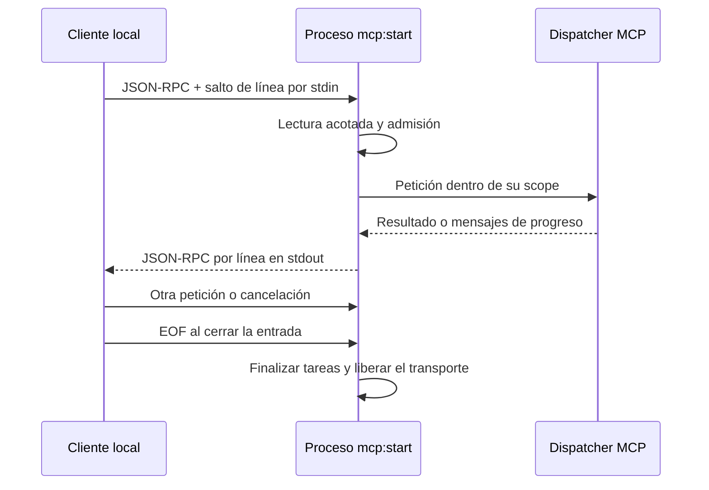

STDIO conecta un cliente con un proceso local de Orionis: el cliente escribe peticiones en stdin y lee las respuestas en stdout. Utiliza el mismo servidor compilado, schemas, hooks y contenedor que [HTTP](/es/mcp/http-and-clients), sin abrir un puerto HTTP.

## Registrar un servidor local

En el archivo AI configurado de tu aplicación, normalmente `routes/ai.py`, registra un handle explícito:

```python
from app.mcp.servers.demo_server import DemoServer
from orionis.support.facades import Mcp

Mcp.local("demo", DemoServer)
```

Si ya añadiste este registro en [Servidores y rutas](/es/mcp/servers-and-routes), consérvalo una sola vez. El archivo se carga con `ai="routes/ai.py"` en la llamada existente `app.withRouting(...)` de `bootstrap/app.py`, antes de `app.create()`; conserva sus demás argumentos.

`Mcp.local()` recibe el handle y una **clase** que hereda `Server`. No acepta una instancia ni una ruta de módulo recibida desde el cliente. El handle debe ser único y cumplir `[A-Za-z0-9][A-Za-z0-9_.-]{0,127}`: entre 1 y 128 caracteres, primero letra o dígito. `demo` y `support.internal` son válidos; un nombre con espacios no lo es.

El handle local es independiente de `Server.name` y de la dirección HTTP. Puedes registrar la misma clase con `Mcp.web("/mcp/demo", DemoServer)` y `Mcp.local("demo", DemoServer)`. Cada registro publica su propio transporte; crear uno no crea automáticamente el otro.

## Inventario y ejecución

Desde la raíz del proyecto, cualquiera de estas alternativas lista los servidores HTTP y STDIO registrados:

```shell
orionis mcp:list
python -B reactor mcp:list
```

La tabla muestra transporte, endpoint o handle y clase del servidor. No abre puertos ni inicia el transporte. Para ejecutar el servidor local, utiliza **una** de estas alternativas:

```shell
orionis mcp:start demo
```

```shell
python -B reactor mcp:start demo
```

| Comando | Argumentos propios | Resultado |
| --- | --- | --- |
| `mcp:list` | Ninguno. | Muestra el inventario registrado. |
| `mcp:start name` | `name` obligatorio: handle local. | Ejecuta STDIO hasta que se cierre la entrada o finalice el transporte. |
| `mcp:start --help` | `--help`. | Describe el argumento local; no inicia un servidor. |

Un handle desconocido escribe el diagnóstico en stderr y termina con código 1. `mcp:start` no descubre clases a partir de nombres arbitrarios. Los [generadores de componentes](/es/mcp/servers-and-routes) crean archivos; no sustituyen el registro `Mcp.local()`.

## Contrato de los mensajes STDIO

Cada mensaje es **un objeto JSON-RPC UTF-8 en una sola línea**, terminado con un salto de línea. No envíes un documento JSON con formato en varias líneas ni un array de llamadas. Este mensaje consulta el servidor:

```json
{"jsonrpc":"2.0","id":"discover-1","method":"server/discover","params":{"_meta":{"io.modelcontextprotocol/protocolVersion":"2026-07-28","io.modelcontextprotocol/clientCapabilities":{}}}}
```

La respuesta usa el mismo `id` y devuelve el mismo contrato de `server/discover` que HTTP. No se envían cabeceras HTTP por stdin: la versión y las capacidades están en `params._meta`. Tampoco necesitas `initialize`; se admite exclusivamente [MCP `2026-07-28`](/es/mcp#revisión-del-protocolo-admitida).

El lector continúa atendiendo entrada mientras se ejecutan solicitudes dentro del presupuesto configurado. Cada solicitud tiene su scope; las respuestas concurrentes se correlacionan mediante `id` y no debes depender de su orden. Una notificación `notifications/cancelled` con `params.requestId` permite cancelar una solicitud STDIO activa. Al recibir EOF o fallar la E/S del transporte, se cancelan las solicitudes activas y se espera su limpieza; no se garantiza la entrega de respuestas pendientes. Un error JSON-RPC ordinario devuelve su error sin terminar las demás solicitudes.

**stdout está reservado para mensajes del protocolo.** Orionis separa su salida de consola del canal MCP, pero tus componentes también deben evitar escribir diagnósticos o datos ajenos a JSON-RPC allí. Utiliza logging o stderr para diagnósticos. Esto es especialmente relevante al convertir un ejemplo que utiliza `print()` en una herramienta MCP.



## Contexto y acceso

Usa `McpRequest` para consultar método, argumentos y metadata de la llamada. Los servicios se inyectan en constructores y métodos como en los [ejemplos de herramientas](/es/mcp/tools#servicios-en-el-constructor-y-en-el-método). Un objeto HTTP `Request` solo existe en el transporte HTTP; no lo solicites para una herramienta que también deba funcionar por STDIO.

Los middleware HTTP y una cabecera `Authorization` no se ejecutan por stdin. Los hooks `shouldRegister` y `authorize` de las primitivas siguen aplicándose. Define la política de confianza del proceso local y no interpretes la metadata enviada por el cliente como una identidad autenticada.

## Configuración en la aplicación

La entidad `McpConfig` valida las opciones. Puedes configurarlas desde `bootstrap/app.py` con la instancia `app` existente, **antes de `app.create()`**:

```python
app.withConfigMcp(
    max_request_size=1024 * 1024,
    max_concurrent_requests=32,
    default_page_size=50,
    max_page_size=100,
    allowed_origins=["https://agent.example.com"],
)
```

Solo necesitas especificar las opciones que cambies. Los campos restantes utilizan los valores predeterminados de la entidad y sus variables de entorno. Si ya tienes configuración MCP del proyecto, integra los valores allí en lugar de mantener dos fuentes distintas. Si utilizas bootstrap compilado, sigue el procedimiento de [caché y reinicio](/es/application/paths-and-caching) al cambiarlo.

### Peticiones, respuestas y paginación

| Campo | Variable de entorno | Predeterminado |
| --- | --- | --- |
| `max_request_size` | `MCP_MAX_REQUEST_SIZE` | `HTTP_MAX_BODY_SIZE` o 1 MiB; bytes máximos de entrada. |
| `max_concurrent_requests` | `MCP_MAX_CONCURRENT_REQUESTS` | `HTTP_MAX_CONCURRENT_REQUESTS` o 32 solicitudes activas. |
| `max_response_size` | `MCP_MAX_RESPONSE_SIZE` | 4 MiB; presupuesto de respuesta serializada. |
| `max_metadata_size` | `MCP_MAX_METADATA_SIZE` | 64 KiB de metadata serializada. |
| `default_page_size` | `MCP_DEFAULT_PAGE_SIZE` | 50 entradas por página. |
| `max_page_size` | `MCP_MAX_PAGE_SIZE` | 100; límite de validación de `default_page_size`. |

La paginación MCP acepta un cursor opaco, no un tamaño de página proporcionado por el cliente. `max_page_size` no habilita un argumento RPC `limit`. El límite de concurrencia se aplica a cada instancia de transporte; cada endpoint HTTP tiene la suya. El kernel HTTP puede imponer además su propio límite de peticiones.

### Suscripciones y catálogos de herramientas

| Campo | Variable de entorno | Predeterminado |
| --- | --- | --- |
| `subscription_buffer_size` | `MCP_SUBSCRIPTION_BUFFER_SIZE` | 64 eventos en el buffer de cada suscripción. |
| `max_subscriptions` | `MCP_MAX_SUBSCRIPTIONS` | 1024 listeners en el bus de eventos. |
| `max_resource_subscriptions` | `MCP_MAX_RESOURCE_SUBSCRIPTIONS` | 64 URI de recurso por escucha. |
| `subscription_keepalive` | `MCP_SUBSCRIPTION_KEEPALIVE` | 15 segundos entre keepalives. |
| `tool_search_max_results` | `MCP_TOOL_SEARCH_MAX_RESULTS` | 20 resultados por búsqueda de catálogo. |
| `tool_search_max_calls` | `MCP_TOOL_SEARCH_MAX_CALLS` | 5 llamadas por ejecución de catálogo. |
| `tool_search_max_output_bytes` | `MCP_TOOL_SEARCH_MAX_OUTPUT_BYTES` | 256 KiB de salida de catálogo. |

Los streams abiertos conservan una plaza de admisión hasta terminar. Los límites y el bus en memoria pertenecen al proceso, no son una cuota distribuida entre workers. Consulta [Flujos avanzados](/es/mcp/advanced-workflows) para suscripciones, herramientas agrupadas y sus requisitos.

### Orígenes HTTP permitidos

| Campo | Variable de entorno | Predeterminado |
| --- | --- | --- |
| `allowed_origins` | `CORS_ALLOW_ORIGINS` | En el archivo editable `config/mcp.py` desde 1.0.16: `["https://inspector.orionis-framework.com"]`. Núcleo `McpConfig`: `[]`. |

Desde **1.0.16**, `allowed_origins` es una `list[str]`, copiada de forma independiente para cada instancia de configuración. Se siguen aceptando tuplas de entrada, que se convierten en listas. El inspector es un valor predeterminado únicamente de la configuración editable `BootstrapMcp`; crear `McpConfig` directamente no añade ese origen.

Para adoptar este valor en el `config/mcp.py` de una aplicación existente, importa `field` desde `dataclasses` y `Env` desde `orionis.environment`, y actualiza el campo dentro de `BootstrapMcp`, conservando sus demás opciones:

```python
    allowed_origins: list[str] = field(
        default_factory=lambda: Env.get(
            "CORS_ALLOW_ORIGINS", ["https://inspector.orionis-framework.com"],
        ),
    )
```

Actualizar el paquete no reemplaza tu configuración editable. Si defines `CORS_ALLOW_ORIGINS`, su valor sustituye este predeterminado en lugar de ampliarlo, incluso cuando es `[]`. Para permitir el inspector y otro cliente web, incluye ambos explícitamente:

```dotenv
CORS_ALLOW_ORIGINS=["https://inspector.orionis-framework.com","https://agent.example.com"]
```

Esta comprobación permite una petición **sin `Origin`**. Si la cabecera está presente, su valor debe coincidir exactamente con un origen HTTP(S) configurado; de lo contrario, MCP responde `403`. Cada entrada contiene solo esquema, host y puerto opcional, sin ruta ni barra final. Las páginas en inglés y español del inspector comparten el origen `https://inspector.orionis-framework.com`; no añadas `/` ni `/es/`. No se aceptan comodines ni una excepción implícita para el mismo origen. Una lista vacía explícita rechaza cualquier `Origin` presente.

Esta opción valida el origen para MCP; las conexiones desde el navegador también necesitan [CORS HTTP](/es/http/middleware#cors-http) para las cabeceras de respuesta y el preflight. Aunque ambos leen `CORS_ALLOW_ORIGINS`, MCP rechaza `["*"]` al validar la configuración. Usa orígenes explícitos en la variable compartida o configura HTTP y MCP por separado en sus archivos editables. Un agente que se ejecuta como proceso remoto no es necesariamente un navegador ni tiene por qué enviar `Origin`. Reinicia la aplicación después de cambiar los orígenes: los transportes existentes conservan la lista capturada al arrancar.

Los presupuestos enteros deben ser positivos; `subscription_keepalive` debe ser finito y mayor que cero, y `default_page_size` no puede superar `max_page_size`. La configuración incorrecta se rechaza al crear la entidad, antes de servir las peticiones.
