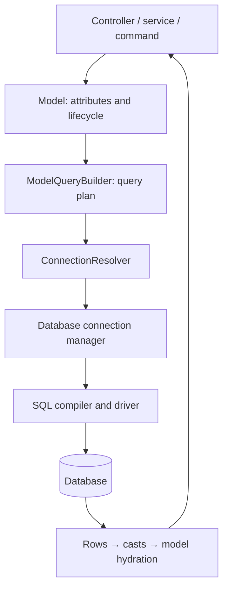

El ORM implementa Active Record: una clase describe una tabla y una instancia representa una fila. Reúne atributos, casts, consultas, relaciones y eventos. [Database](/es/database) administra las conexiones, los drivers, SQL y las transacciones; el ORM construye planes sobre esa misma infraestructura.

## Arquitectura y ciclo de vida

Al declarar una clase, `ModelMeta` recoge columnas, resuelve tabla y clave primaria y prepara casts, accessors, scopes y listeners. **Declarar un modelo no crea ni modifica tablas**: eso corresponde a las [migraciones](/es/database/migrations).

1. `Article({...})` construye una instancia nueva en memoria y aplica la política de asignación masiva.
2. `await article.save()` genera un INSERT, mantiene los timestamps declarados, recupera la identidad generada y sincroniza el estado original.
3. `await Article.find(id)` recupera una fila, aplica casts y crea una instancia persistida. Si no existe, devuelve `None`.
4. Cambiar atributos marca diferencias respecto al original. Otro `save()` escribe esas diferencias mediante UPDATE.
5. `delete()` elimina la fila o estampa su marca de [borrado lógico](/es/orm/soft-deletes).

Las declaraciones y los builders son síncronos; los terminales que acceden a datos son asíncronos. Utiliza estos ejemplos desde un controlador, servicio, comando o tarea después del arranque. El provider de Database instala `ConnectionResolver`; sin ese arranque las consultas lanzan `OrmConfigurationException`.

## Elegir el nivel adecuado

| Necesidad | API |
| --- | --- |
| Fila con política de atributos, estado y eventos | Instancia de `Model` |
| Consulta de entidades y relaciones | `Article.query()` o un acceso delegado como `Article.where(...)` |
| Filas de tablas, agregados y escrituras sin ciclo de entidad | `DB.table(...)` |
| Conexiones, SQL y transacciones | Database y `DB` |

`DB.table()` no ejecuta casts, accessors, eventos ni scopes de un modelo. Un builder de modelo sí hidrata entidades, pero sus escrituras masivas tampoco ejecutan el ciclo de cada instancia. Elige conscientemente cuando una regla depende de eventos.

## Recorrido de aprendizaje

- [Definir modelos y atributos](/es/orm/models-and-attributes): generador, columnas, opciones y serialización.
- [Persistencia y estado](/es/orm/model-api): API completa de clase e instancia.
- [Consultas](/es/orm/querying): lenguaje fluido, agregados y operaciones masivas.
- [Relaciones](/es/orm/relationships), [operaciones](/es/orm/relationship-operations) y [N+1](/es/orm/eager-loading).
- [Scopes](/es/orm/scopes), [eventos](/es/orm/events) y [soft deletes](/es/orm/soft-deletes).
- [Colecciones y paginación](/es/orm/collections-and-pagination).
- [Factories y pruebas](/es/orm/factories) y [tipos de esquema](/es/orm/schema-and-type-reference).

El ORM utiliza la configuración `database`; no tiene un archivo de conexión independiente. Una operación de modelo no abre una transacción de varias acciones por sí sola: delimita la unidad con [transacciones](/es/database/transactions). El estado de Python no se revierte automáticamente si una transacción SQL termina en rollback; recupera una instancia nueva después de revertir.

Un scope limita una consulta, un evento envuelve una operación de instancia y soft deletes cambia la escritura y visibilidad de los borrados. Estos mecanismos no reemplazan la autorización ni las restricciones SQL. Verifica sus interacciones con las [pruebas del ORM](/es/orm/testing).
