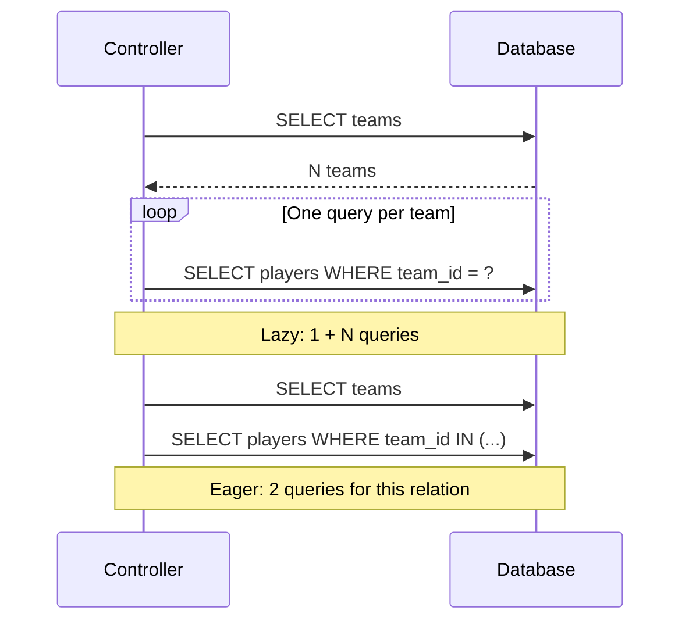

El problema N+1 aparece al consultar una lista y luego una relación por cada fila. Con N equipos, el siguiente código produce 1 SELECT de equipos y N SELECT de jugadores. La latencia crece aunque cada consulta aislada parezca barata. Usa los modelos de [relaciones](/es/orm/relationships).

## Reconocer el patrón

```python
async def roster_with_extra_queries():
    teams = await Team.orderBy("id").get()
    result = []
    for team in teams:
        players = await team.players().get()
        result.append({"team": team.name, "players": players.serialize()})
    return result
```



## Cargar por lote y reutilizarlo

```python
async def roster_batched():
    teams = await Team.withRelations("players", "profile", "tags").orderBy("id").get()
    return [
        {
            "team": team.toDict(),
            "players": team.getRelation("players").serialize(),
            "profile": (
                team.getRelation("profile").toDict()
                if team.getRelation("profile") is not None else None
            ),
            "tags": team.getRelation("tags").serialize(),
        }
        for team in teams
    ]
```

En un lote no vacío con las claves necesarias, este ejemplo realiza 1 consulta de equipos + 1 de jugadores + 1 de perfiles + 2 de etiquetas (pivot y relacionados): **5**, independientemente del número de equipos. Sin ids pivot no consulta etiquetas; un lote sin claves no ejecuta la consulta relacionada. Las relaciones se cargan en el orden declarado, no con `gather`.

`getRelation` lee el resultado almacenado; llamar otra vez a `team.players()` crea otro builder y puede reintroducir N+1. `relationLoaded("profile")` distingue relación no cargada de una relación cargada sin coincidencia (`None`). No hay carga automática por acceso a una propiedad.

## API


<a id="modelquerybuilder-withrelations"></a>

### `withRelations`

```text
def withRelations(self, *names: str) -> Self
```

Registra nombres de métodos de relación sin duplicarlos, conservando orden. Devuelve el mismo builder, sin SQL. Después de hidratar, cada nombre construye una relación sin filtro individual, recoge claves del lote, consulta y asigna con `setRelation`. Nombre ausente o método que no devuelve `Relation`: `RelationNotFoundException` cuando hay resultados; una consulta vacía no valida los nombres.

```python
async def teams_with_players():
    return await Team.withRelations("players").get()
```

<a id="modelquerybuilder-load"></a>

### `load`

```text
def load(self, *names: str) -> Self
```

Alias síncrono y fluido de `withRelations`. Pertenece al builder, no a una instancia ya recuperada: `await team.load(...)` no es una API disponible. Acepta nombres directos como argumentos separados.

```python
async def teams_with_profiles():
    return await Team.query().load("profile").get()
```

## Proyecciones, filtros y más de un nivel

- Conserva en SELECT las claves locales/foráneas usadas para agrupar. `Team.select("name").withRelations("players")` omite `id` y no puede vincular correctamente sus jugadores.
- No se interpretan rutas punteadas como `"players.team"`, ni mappings/callbacks como argumento de `withRelations`. Declara métodos directos para variantes de lectura o consulta los niveles explícitamente.
- Un filtro declarado dentro del método de relación se aplica al lote. Un `limit` en ese método limita la consulta total del lote; no significa “N filas por padre”.
- Los scopes y soft deletes del modelo relacionado siguen aplicándose. El caché se queda en cada instancia y puede volverse obsoleto tras escrituras; vuelve a consultar para un resultado actualizado.
- Para confirmar el patrón, cuenta las invocaciones SELECT mediante un wrapper de conexión en tus pruebas o revisa el SQL observado por tu infraestructura. Compara la consulta con varios padres, no solo uno. Orionis no expone aquí un detector automático de N+1.

Consulta [colecciones y paginación](/es/orm/collections-and-pagination) para cargar solo la página necesaria y [pruebas](/es/orm/factories) para verificar resultados y número de operaciones.
