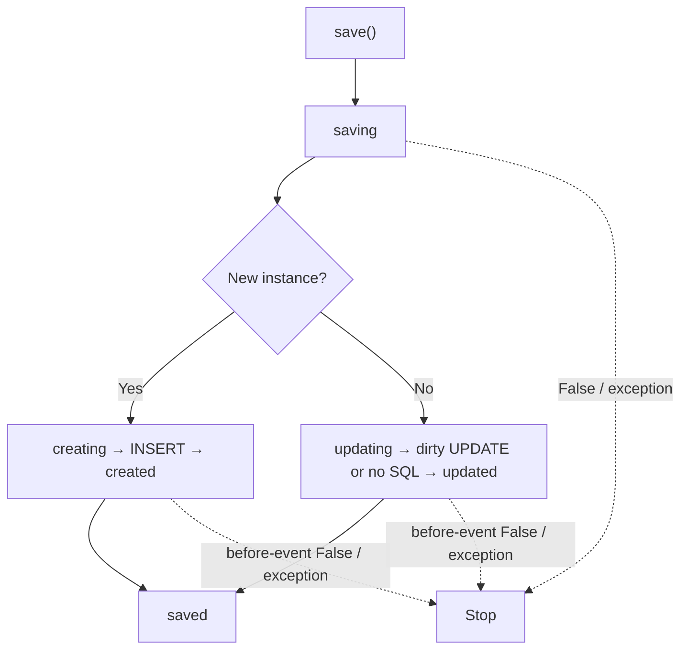

Los eventos permiten normalizar atributos, rechazar operaciones o reaccionar al ciclo de una entidad. Se registran por clase, con callbacks síncronos o asíncronos. Esta guía usa `Document` de [scopes](/es/orm/scopes) y su tabla migrada.

## Todos los eventos y su orden

El catálogo público `MODEL_EVENTS: tuple[str, ...]`, definido en `orionis.orm.metaclass`, contiene los once nombres de la tabla. Es el conjunto de eventos reconocidos; no implica que todos se emitan en una sola operación ni sustituye los flujos de creación, actualización, borrado y restauración.

| Evento | Momento | ¿Permite veto? |
| --- | --- | --- |
| `retrieved` | Tras hidratar cada fila, antes de cargar relaciones eager | No |
| `saving` | Antes de distinguir INSERT/UPDATE | Sí |
| `creating` | Antes del INSERT | Sí |
| `created` | Después del INSERT y sincronización del estado | No |
| `updating` | Antes de evaluar/escribir diferencias del modelo existente | Sí |
| `updated` | Después del intento UPDATE o camino sin cambios | No |
| `saved` | Después de `created`/`updated` | No |
| `deleting` | Antes de borrar físicamente o estampar borrado lógico | Sí |
| `deleted` | Después del intento de borrado | No |
| `restoring` | Antes de limpiar marca de borrado | Sí |
| `restored` | Después del intento de restauración | No |



El veto requiere **exactamente `False`**; `None`, `0` y una cadena vacía no son veto por identidad. Un veto previo evita SQL y los eventos posteriores. `save`, `delete` y `restore` devuelven `False`; `create` conserva su retorno de modelo incluso si no se insertó.

## Registro, observers y despacho


<a id="eventsmixin-registerevent"></a>

### `registerEvent`

```text
def registerEvent(cls, event: str, listener: Callable[..., Any]) -> type
```

Registra listener al final del evento, devuelve la clase y acepta función sync o async que recibe el modelo. Un evento desconocido produce `OrmException`. Registrar dos veces el mismo callable crea dos registros: no deduplica.

```python
def require_title(document: Document):
    return bool((document.title or "").strip())


Document.registerEvent("saving", require_title)
```

<a id="eventsmixin-observe"></a>

### `observe`

```text
def observe(cls, observer: Any) -> type
```

Registra los métodos nombrados como eventos del objeto observer y devuelve la clase. Si pasas una clase, la instancia sin argumentos: no usa DI para construirla. Para dependencias, crea/resuelve el objeto tú y pasa la instancia. Métodos ausentes se omiten.

```python
class DocumentObserver:
    async def saving(self, document: Document):
        document.title = (document.title or "").strip()

    def deleting(self, document: Document):
        return document.status != "locked"


Document.observe(DocumentObserver())
```

<a id="eventsmixin-flushevents"></a>

### `flushEvents`

```text
def flushEvents(cls, event: str | None=None) -> None
```

Elimina los listeners de `event` o todos si `None`; retorna `None`. Un nombre ausente no falla. Úsalo al aislar tests; cambia el registro de toda esa clase.

```python
Document.flushEvents("saving")
Document.flushEvents()
```

<a id="eventsmixin-fireevent"></a>

### `fireEvent`

```text
async def fireEvent(self, event: str) -> bool
```

Despacha secuencialmente listeners en orden de registro, esperando resultados awaitable. Devuelve `False` al primer veto exacto `False` de un evento cancelable; en los demás casos `True`. No realiza SQL ni convierte un nombre desconocido en error: sin registro retorna `True`. Las excepciones se propagan y detienen el resto.

```python
async def check_registered_policy(document: Document) -> bool:
    return await document.fireEvent("saving")
```

Registra listeners una vez al arrancar, por ejemplo en el `boot()` de un provider. No vuelvas a registrarlos en cada acción HTTP. Las subclases copian listeners al crearse; los cambios posteriores del padre no reconstruyen el registro del hijo. Las identidades de registro evitan duplicación heredada por diamantes, pero dos registros explícitos del mismo callback se ejecutan dos veces.

## Persistencia, errores y transacciones

Un `save` de una instancia existente sin cambios dispara `saving → updating → updated → saved` sin UPDATE. Un UPDATE que afecte cero filas devuelve `False`, pero los eventos `updated` y `saved` igualmente se emiten. Lo mismo ocurre con los eventos posteriores de borrado/restauración tras el intento. No interpretes un evento posterior como prueba independiente de filas afectadas.

Los listeners se ejecutan dentro de la llamada, sin colas automáticas ni fase `afterCommit`. `created` ocurre tras INSERT, **antes del commit** de una transacción exterior. Si un listener posterior falla fuera de una transacción, la escritura puede haber quedado persistida aunque la acción lance excepción. Dentro de una transacción, propaga la excepción para que el contexto pueda revertir; el objeto en memoria no se revierte.

Para correos, notificaciones u otros efectos externos, decide cuándo publicarlos después del commit y cómo reintentarlos. Las escrituras masivas (`query().update/delete/restore/forceDelete`, `destroy`) y las operaciones pivot no ejecutan eventos por entidad. Los métodos `hasOne/hasMany.create` sí llegan al `create` de modelo. No se implementa aquí una API separada de observers transaccionales.

Prueba por separado éxito, veto, excepción de listener, y rollback; consulta [pruebas de ORM](/es/orm/factories).
