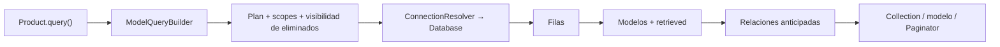

## De la consulta al modelo

`Product.query()` crea un `ModelQueryBuilder[Product]`. Las cláusulas se agregan sin I/O; los terminales asíncronos ejecutan el plan, reciben filas de Database y construyen instancias de `Product`. La hidratación aplica el estado original y despacha `retrieved`; la carga anticipada se realiza después.



Este ejemplo usa el [modelo Product completo](/es/orm/factories#modelo-y-factory-completos) y su tabla creada. En una aplicación inicializada, registra las acciones del controlador mediante el [router](/es/http/routing):

```python
from app.models.product import Product
from orionis.http import JSONResponse


class ProductController:
    async def index(self) -> JSONResponse:
        products = await (
            Product.query()
            .where("active", True)
            .where("stock", ">", 0)
            .orderBy("id")
            .get()
        )
        return JSONResponse([product.toDict() for product in products])

    async def show(self, product_id: int) -> JSONResponse:
        product = await Product.findOrFail(product_id)
        return JSONResponse(product.toDict())
```

El controlador serializa cada modelo explícitamente. `get()` devuelve `Collection`, no una lista JSON; `first()` y `find()` pueden devolver `None`. Los métodos `firstOrFail()` y `findOrFail()` lanzan `ModelNotFoundException`; el [manejador de excepciones HTTP](/es/http/exceptions) determina la respuesta del endpoint.

## Consultas al estilo de Eloquent

Si vienes de [Eloquent](https://laravel.com/docs/12.x/eloquent), puedes comenzar directamente desde el modelo con `Product.where(...)`. En Orionis, escribe la cadena con puntos y espera el resultado dentro de una función `async`:

```python
from app.models.product import Product


async def find_available_products():
    return await (
        Product.where("active", True)
        .where("stock", ">", 0)
        .orderBy("id")
        .get()
    )


async def find_product(product_id: int):
    return await Product.find(product_id)
```

La primera función devuelve una colección de modelos `Product`; la segunda devuelve un modelo o `None`. Usa `findOrFail()` si la ausencia debe producir una excepción. Para una tabla como `sales.products`, configura el [esquema en el modelo](/es/orm/models-and-attributes#schema-table); la cadena de filtros sigue siendo la misma.

El parecido de los nombres no implica que todos los métodos o argumentos de Laravel existan en Orionis. Selecciona columnas con `Product.select("id", "name").get()`, pagina con `paginate(page=1, per_page=20)` y carga relaciones con `withRelations("category")`. Usa callbacks Python síncronos para grupos, por ejemplo `.where(lambda q: q.where("stock", ">", 0).orWhere("reserved", 0))`. Consulta las firmas de esta documentación antes de trasladar una llamada.

## Métodos de clase, builder e instancia

| Forma | Qué representa |
| --- | --- |
| `Product.query()` | Método de clase que crea un builder nuevo. |
| `Product.where(...)`, `Product.orderBy(...)`, `Product.paginate(...)` | Atajos de la metaclase a métodos admitidos de un builder nuevo. No son un builder global compartido. |
| `query.where(...)`, `query.select(...)` | Configuración síncrona del mismo builder mutable. |
| `await query.get()` / `await query.update(...)` | Ejecución sobre los registros que coinciden con ese plan. |
| `await product.save()` / `await product.update(...)` | Persistencia de una instancia con seguimiento de atributos y eventos. |

La [API de modelos](/es/orm/model-api) documenta las firmas y diferencias entre métodos de clase e instancia; las operaciones específicas de `ModelQueryBuilder` están en [recuperación y paginación](/es/orm/collections-and-pagination), [scopes](/es/orm/scopes), [relaciones](/es/orm/relationship-operations) y [eliminación lógica](/es/orm/soft-deletes).

No todos los nombres del builder son atajos de clase. Por ejemplo, para adoptar un plan utiliza `Product.query().adoptPlan(plan)`. No existe `Product.factory()`.

## Lenguaje de consultas compartido

| Tema | Referencia completa |
| --- | --- |
| `select`, `addSelect`, `selectRaw`, `selectSub`, `distinct` | [Selección y resultados](/es/database/query-builder). |
| `where` y variantes, NULL, rangos, LIKE, regex, columnas, SQL y EXISTS | [Filtros y condiciones](/es/database/query-filters). |
| JOIN, subconsultas y UNION | [Joins y subconsultas](/es/database/joins-and-subqueries). |
| Orden, agrupación, HAVING, límites, agregados y terminales | [Referencia del Query Builder](/es/database/query-builder). |
| `insert`, `update`, `delete`, `lockForUpdate`, `sharedLock` | [Escrituras y bloqueos](/es/database/query-writes). |
| `toPlan`, `clone`, `adoptPlan`, `adoptConnection` y estructuras | [Planes y expresiones](/es/database/query-plans). |

Las mismas cláusulas sirven en `DB.table()` y `Model.query()`, con una representación distinta del resultado. `DB.table()` devuelve diccionarios y no aplica la configuración del modelo. Las tablas y columnas de joins deben calificarse; conserva la clave primaria y las claves de relaciones si después guardarás el modelo o cargarás asociaciones. Una selección parcial no hidrata las columnas omitidas por arte de magia.

Los valores se enlazan como parámetros. Los identificadores, operadores y fragmentos SQL son responsabilidad de la aplicación. Las condiciones se combinan de izquierda a derecha: agrupa explícitamente las alternativas para controlar el significado lógico.

## Reutilizar una consulta

```python
from app.models.product import Product


async def product_reports():
    base = Product.where("active", True)
    available = await base.clone().where("stock", ">", 0).orderBy("id").get()
    sold_out = await base.clone().where("stock", 0).orderBy("id").get()
    return available, sold_out
```

`clone()` copia las listas del plan; refinarlas con nuevas cláusulas no modifica las listas de `base`. Los objetos de cláusulas ya existentes y los planes anidados siguen compartidos: no los modifiques esperando una copia profunda. No compartas un builder mutable entre peticiones o tareas.

Los scopes y el filtro de eliminación lógica se incorporan antes de ejecutar y se marcan como aplicados. Configura `withoutGlobalScope`, `withTrashed` y demás opciones **antes del primer terminal**; para consultas con otra política crea otro builder.

## Resultados, escalares y paginación

`get()` devuelve modelos; `value(column)` devuelve el atributo de la primera instancia o `None`; `pluck(column)` devuelve una `Collection` de atributos. Estos últimos pasan por hidratación y lectura de atributos, por lo que pueden aplicar casts/accessors. Los agregados (`count`, `sum`, `avg`, `min`, `max`) son cálculos SQL y no requieren hidratar cada fila.

```python
from app.models.product import Product
from orionis.http import JSONResponse


class ProductPageController:
    async def index(self) -> JSONResponse:
        page = await Product.where("active", True).orderBy("id").paginate(
            page=1,
            per_page=20,
        )
        return JSONResponse(page.toDict())
```

`paginate(page=1, per_page=15)` realiza un recuento y una lectura. El builder de modelos los ejecuta concurrentemente fuera de transacciones y secuencialmente dentro de una transacción activa. Esto difiere del builder crudo, que los ejecuta secuencialmente. Sin un aislamiento adecuado, las dos lecturas pueden observar cambios distintos. Ordena por una clave única para páginas estables. [Paginator y Collection](/es/orm/collections-and-pagination) detallan todos sus métodos y campos.

## Persistencia individual frente a escritura masiva

```python
from app.models.product import Product
from orionis.support.facades import DB


async def change_price(product_id: int, price: int) -> bool:
    async with DB.transaction():
        product = await Product.findOrFail(product_id)
        return await product.update({"price": price})


async def archive_out_of_stock() -> int:
    return await Product.where("stock", 0).update({"active": False})
```

La primera función utiliza `fillable`, mutadores, estado y eventos de una instancia. Un listener puede vetar la operación y producir `False`. La segunda actualiza un conjunto en SQL y devuelve un recuento: serializa dict/list/UUID para almacenamiento según el tipo de columna y añade el timestamp de actualización cuando corresponde, pero no ejecuta los casts de asignación de `Model.casts`, `fillable`, mutadores ni eventos por instancia.

`insert()` devuelve `InsertResult`, no modelos ni una lista de IDs; no añade automáticamente los timestamps de creación. `update()` y `delete()` ignoran JOIN, orden, límite y offset de lectura: restringe con `where` y claves explícitas. Las operaciones individuales abren su ciclo de ejecución normal; para un conjunto atómico utiliza [transacciones](/es/database/transactions).

## Carga, errores y siguientes pasos

`withRelations()`/`load()` del builder permiten [evitar N+1](/es/orm/eager-loading). No añadas nombres de relaciones como columnas de `select`: son mecanismos separados. El modelo no incluye automáticamente sus relaciones en `toDict()`.

Los errores de composición producen `InvalidQueryException`; una relación inexistente, `RelationNotFoundException`; un scope explícito no encontrado, `ScopeNotFoundException`; los fallos de SQL se propagan desde Database. Los tipos y reglas de cada operación están enlazados en las referencias anteriores. El [módulo de pruebas](/es/orm/testing) reúne fixtures y verificaciones de consultas, persistencia y relaciones.

Para resultados grandes en 1.1.0, utiliza [`chunks()` de consultas](/es/orm/collections-and-pagination#query-chunks) con un `orderBy()` explícito y determinista. Entrega colecciones limitadas por lote sin cambiar `get()` ni dividir una colección ya materializada.
