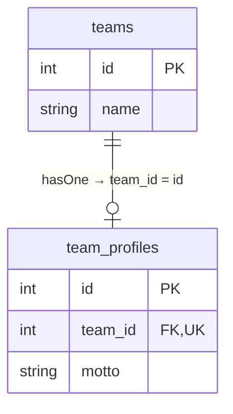
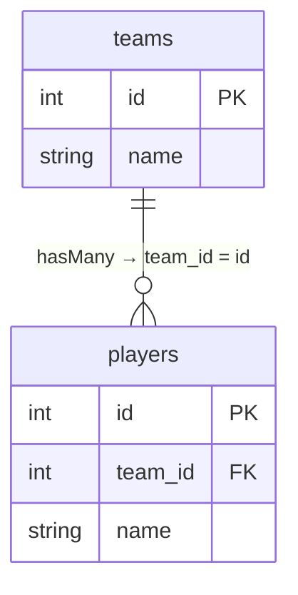
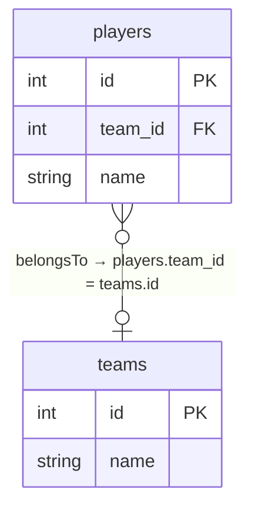
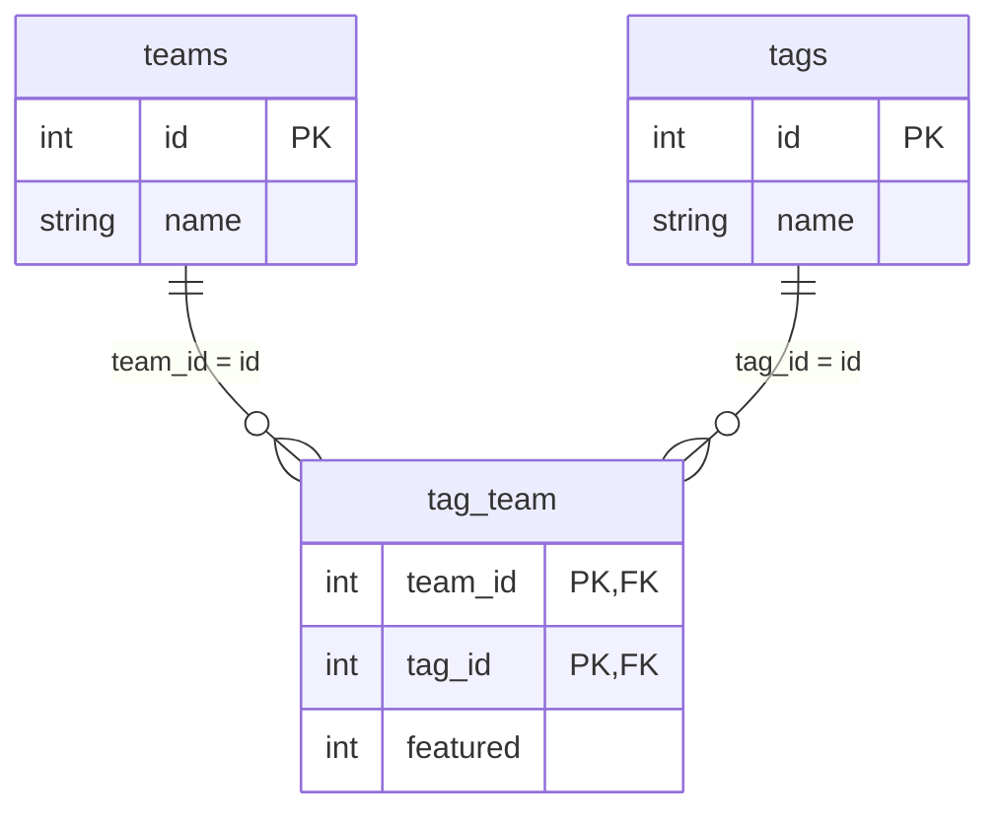

Una relación es un **método de instancia síncrono que devuelve un builder especializado**. Invocarlo no carga datos; `await` ejecuta la consulta. Orionis ofrece exactamente cuatro relaciones: `hasOne`, `hasMany`, `belongsTo` y `belongsToMany`. No hay relaciones polimórficas ni `hasManyThrough`/`hasOneThrough` implementadas.

## Modelos completos del ejemplo

```python
from typing import ClassVar
from orionis.orm import Integer, Model, String


class Team(Model):
    id = Integer().primary().autoIncrement()
    name = String(120)
    timestamps = False
    fillable: ClassVar[list[str]] = ["name"]

    def profile(self):
        return self.hasOne(TeamProfile, foreign_key="team_id")

    def players(self):
        return self.hasMany(Player)

    def tags(self):
        return self.belongsToMany(Tag)


class TeamProfile(Model):
    id = Integer().primary().autoIncrement()
    team_id = Integer().foreign("teams.id").unique()
    motto = String(180)
    timestamps = False
    fillable: ClassVar[list[str]] = ["team_id", "motto"]

    def team(self):
        return self.belongsTo(Team)


class Player(Model):
    id = Integer().primary().autoIncrement()
    team_id = Integer().foreign("teams.id").nullable()
    name = String(120)
    timestamps = False
    fillable: ClassVar[list[str]] = ["team_id", "name"]

    def team(self):
        return self.belongsTo(Team)


class Tag(Model):
    id = Integer().primary().autoIncrement()
    name = String(80)
    timestamps = False
    fillable: ClassVar[list[str]] = ["name"]

    def teams(self):
        return self.belongsToMany(Team)
```

Guárdalos en módulos de aplicación e importa las clases necesarias en tus controladores. Las referencias entre clases se resuelven cuando se llama al método, por eso funcionan aunque una clase se declare después. No declares `players = hasMany(Player)` en el cuerpo de la clase.

Migra `teams`, `team_profiles`, `players`, `tags` y la pivot `tag_team` antes de consultar. En `tag_team` declara `team_id`, `tag_id`, `featured` (entero con default `0`), FK a sus tablas y PK/UNIQUE compuesta `(team_id, tag_id)`. La definición de relación no crea esas restricciones ni tablas. El diagrama muestra esa unicidad de pivot, no una identidad compuesta de `Model`.

## Uno a uno: perfil del equipo



<a id="relationsmixin-hasone"></a>

### `hasOne`

```text
def hasOne[TRelated: 'Model'](self, related: type[TRelated], foreign_key: str | None=None, local_key: str | None=None) -> HasOneRelation[TRelated]
```

Relación uno a uno: `related` es la clase relacionada; `foreign_key=None` deriva de snake case de la clase padre + `_id` y `local_key=None` usa su PK. Devuelve `HasOneRelation`; `await relation`/`getResults` devuelve un modelo o `None`. La FK vive en la tabla relacionada. Necesita UNIQUE en SQL para garantizar uno a uno.

```python
async def show_profile(team_id: int):
    team = await Team.findOrFail(team_id)
    profile = await team.profile()
    return profile.toDict() if profile is not None else None
```

`hasOne` recupera la primera coincidencia; la columna única del perfil garantiza que solo pueda existir una. Para escribir utiliza `await team.profile().create({"motto": "Build together"})`; la relación rellena `team_id` y no reemplaza un perfil previo automáticamente.

## Uno a muchos: jugadores



<a id="relationsmixin-hasmany"></a>

### `hasMany`

```text
def hasMany[TRelated: 'Model'](self, related: type[TRelated], foreign_key: str | None=None, local_key: str | None=None) -> HasManyRelation[TRelated]
```

Relación uno a muchos con la FK en la tabla relacionada. Los defaults de claves son los mismos de `hasOne`. Devuelve `HasManyRelation`; `await relation`/`getResults` devuelve `Collection`, vacía para un padre sin clave.

```python
async def list_players(team_id: int):
    team = await Team.findOrFail(team_id)
    return (await team.players().orderBy("id").get()).serialize()
```

Recuperar un equipo y después sus jugadores ejecuta una consulta por cada operación. No accedas a una relación de cada equipo en un bucle grande: utiliza [carga anticipada](/es/orm/eager-loading). `await team.players().create({"name": "Ada"})` rellena su FK; las demás condiciones de lectura de la relación no se copian al nuevo registro.

## Relación inversa: equipo del jugador



<a id="relationsmixin-belongsto"></a>

### `belongsTo`

```text
def belongsTo[TRelated: 'Model'](self, related: type[TRelated], foreign_key: str | None=None, owner_key: str | None=None) -> BelongsToRelation[TRelated]
```

Inversa: la instancia actual contiene `foreign_key`, por defecto snake case de **la clase relacionada** + `_id`. `owner_key=None` usa la PK relacionada. Devuelve `BelongsToRelation`; resultado modelo o `None`. Con FK nula, `getResults` evita SQL.

```python
async def show_team(player_id: int):
    player = await Player.findOrFail(player_id)
    team = await player.team().getResults()
    return team.toDict() if team is not None else None
```

Para asociar/reasociar un jugador, asigna `player.team_id = team.id` y ejecuta `await player.save()`. Para desvincular, usa `None` y guarda; por eso el ejemplo declara FK anulable. No existe `associate()`/`dissociate()` en esta relación. Eliminar el equipo no modifica automáticamente todos los jugadores: eso depende de las restricciones SQL o de tu lógica transaccional.

## Muchos a muchos: etiquetas



<a id="relationsmixin-belongstomany"></a>

### `belongsToMany`

```text
def belongsToMany[TRelated: 'Model'](self, related: type[TRelated], table: str | None=None, foreign_pivot_key: str | None=None, related_pivot_key: str | None=None, parent_key: str | None=None, related_key: str | None=None) -> BelongsToManyRelation[TRelated]
```

Muchos a muchos mediante pivot. `table=None` ordena alfabéticamente los nombres snake case de ambas clases, sin pluralizarlos. `foreign_pivot_key` y `related_pivot_key` derivan de las clases padre/relacionada + `_id`; `parent_key`/`related_key` usan sus PK. Todos esos argumentos admiten `None` para la convención. Devuelve `BelongsToManyRelation`. Solo claves de una columna; pivot y tabla relacionada se consultan por separado.

```python
async def list_tags(team_id: int):
    team = await Team.findOrFail(team_id)
    return (await team.tags().orderBy("name").get()).serialize()
```

La lectura resuelve primero ids en `tag_team` y después consulta `tags`. Devuelve modelos `Tag`, sin un objeto `pivot` ni atributos extra hidratados. Los datos como `featured` sirven para [filtrar o escribir pivot](/es/orm/relationship-operations). Si necesitas leerlos, consulta explícitamente `DB.table("tag_team")`.

## Personalizar claves

```python
def players_by_owner(self):
    return self.hasMany(Player, foreign_key="team_id", local_key="id")


def team_by_owner(self):
    return self.belongsTo(Team, foreign_key="team_id", owner_key="id")


def tags_by_owner(self):
    return self.belongsToMany(
        Tag,
        table="tag_team",
        foreign_pivot_key="team_id",
        related_pivot_key="tag_id",
        parent_key="id",
        related_key="id",
    )
```

Son métodos alternativos para añadir a las clases del ejemplo, respectivamente Team, Player y Team. Las claves referenciadas deben existir, estar cargadas y tener tipos compatibles. Cada relación utiliza la conexión del **modelo relacionado**; las operaciones pivot usan esa misma conexión. Diseña las tablas involucradas en una conexión coherente; esto no ofrece una transacción distribuida entre bases.

Continúa con [consultas y modificaciones](/es/orm/relationship-operations) y [carga anticipada](/es/orm/eager-loading).
