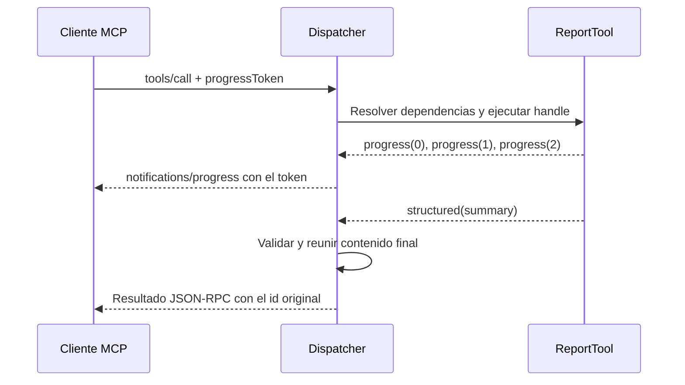

Una llamada MCP puede informar progreso, solicitar datos adicionales o mantener una suscripción a cambios. Estos flujos conservan el modelo sin estado: las capacidades y los datos de cada operación viajan en esa petición. Una suscripción sí mantiene un stream abierto, pero no crea una sesión de negocio compartida por llamadas posteriores.

Antes de utilizar estos ejemplos, registra cada `Server` en una ruta MCP siguiendo [servidores y rutas](/es/protocols/mcp/servers-and-tools). Las solicitudes JSON de esta página se envían por `POST` a la URL de ese servidor, con `Content-Type: application/json` y `Accept: application/json, text/event-stream`. Incluyen la versión de protocolo y las capacidades del cliente en `params._meta`; consulta el intercambio completo en [HTTP y clientes](/es/protocols/mcp/http-and-clients).

## Progreso y resultado final

Una herramienta puede implementar `handle()` como generador asíncrono. Cada `yield McpResponse.progress(...)` comunica avance; los demás valores se reúnen en la respuesta final.

```python
from collections.abc import AsyncIterator

from orionis.mcp import McpResponse, Server, Tool


class ReportSource:
    async def collect(self) -> list[dict[str, object]]:
        return [{"order_id": 42, "status": "ready"}]


class ReportTool(Tool):
    name = "build-report"
    description = "Collect report rows and return a summary."

    def __init__(self, source: ReportSource) -> None:
        self.source = source

    async def handle(self) -> AsyncIterator[McpResponse]:
        yield McpResponse.progress(0, total=2, message="Collecting orders")
        rows = await self.source.collect()
        yield McpResponse.progress(1, total=2, message="Preparing summary")
        summary = {"count": len(rows), "rows": rows}
        yield McpResponse.progress(2, total=2, message="Completed")
        yield McpResponse.structured(summary)


class ReportsServer(Server):
    name = "reports"
    tools = (ReportTool,)
```

`ReportSource` es una dependencia del constructor resuelta por el contenedor. Sus filas de ejemplo pueden sustituirse por una consulta asíncrona real. Para recibir progreso, el cliente proporciona un token identificador de esta llamada:

```json
{
  "jsonrpc": "2.0",
  "id": "report-42",
  "method": "tools/call",
  "params": {
    "name": "build-report",
    "arguments": {},
    "_meta": {
      "io.modelcontextprotocol/protocolVersion": "2026-07-28",
      "io.modelcontextprotocol/clientCapabilities": {},
      "progressToken": "report-42-progress"
    }
  }
}
```

El transporte HTTP devuelve SSE para este generador. Las notificaciones `notifications/progress` contienen `progressToken`, `progress` y los campos `total`/`message` que hayas indicado. Al terminar llega el resultado JSON-RPC con `id="report-42"`.



Ten en cuenta estas reglas:

- Sin `progressToken` las actualizaciones de progreso se omiten; la herramienta sigue ejecutándose y entrega su resultado final.
- El avance debe aumentar estrictamente y los números deben ser finitos. No repitas un mismo valor para cambiar únicamente el mensaje.
- Los bloques de contenido ordinarios no se envían como resultados parciales independientes: se acumulan hasta normalizar el resultado final. Solo puede existir un valor estructurado.
- El contenido acumulado y la respuesta final están sujetos a `MCP_MAX_RESPONSE_SIZE`.
- La desconexión o cancelación cierra el generador. Libera recursos con `try/finally` y permite que la cancelación se propague.

## Solicitar información y continuar la operación

Una herramienta, recurso o prompt puede devolver `InputRequiredResult` en lugar del resultado final. Contiene `inputRequests` y/o `requestState` y se identifica mediante `resultType="input_required"`.

El cliente atiende los inputs y repite el método original con `inputResponses` y el `requestState` recibido. Esta es una **nueva petición**: Orionis vuelve a construir el componente y a ejecutar el handler; no deja un controlador suspendido esperando en memoria.

### Ejemplo: confirmar la preparación de una exportación

Este ejemplo solicita una confirmación antes de devolver una preparación de exportación. No realiza escrituras ni exporta datos: la salida describe la selección validada. En una operación real, aplica además tus políticas de acceso y la idempotencia del trabajo antes de ejecutar efectos.

`McpState` requiere una clave de aplicación válida y `app.cipher` configurado como `AES-128-GCM` o `AES-256-GCM`. Por ejemplo, `APP_CIPHER=AES-256-GCM` requiere un `APP_KEY` estable de 32 bytes normalizados. Todos los workers que atiendan continuaciones deben utilizar la misma clave y cipher. Consulta [cifrado y gestión de claves](/es/security/encryption/encrypting-values) antes de habilitar este ejemplo, especialmente si la aplicación ya conserva datos cifrados.

```python
from collections.abc import Mapping

from orionis.mcp import (
    InputRequiredResult,
    McpRequest,
    McpResponse,
    McpState,
    Server,
    Tool,
)
from orionis.schemas import Schema


class ConfirmExportInput(Schema):
    report_id: int


class ConfirmExportTool(Tool[ConfirmExportInput]):
    name = "confirm-export"
    description = "Confirm an export preparation without exporting data."

    async def handle(
        self,
        payload: ConfirmExportInput,
        request: McpRequest,
        state: McpState,
    ) -> McpResponse | InputRequiredResult:
        if not request.input_responses:
            return InputRequiredResult(
                inputRequests={
                    "confirmation": {
                        "method": "elicitation/create",
                        "params": {
                            "mode": "form",
                            "message": f"Prepare export for report {payload.report_id}?",
                            "requestedSchema": {
                                "type": "object",
                                "properties": {
                                    "approved": {"type": "boolean"},
                                },
                                "required": ["approved"],
                            },
                        },
                    },
                },
                requestState=state.seal(
                    request, {"report_id": payload.report_id}, ttl=300,
                ),
            )

        saved = state.open(request)
        answer = request.input_responses.get("confirmation")
        if not isinstance(answer, Mapping):
            return McpResponse.error("The confirmation response is missing.")
        if answer.get("action") != "accept":
            return McpResponse.text("Export preparation cancelled.")

        content = answer.get("content")
        if not isinstance(content, Mapping) or content.get("approved") is not True:
            return McpResponse.error("Explicit approval is required.")
        if not isinstance(saved, dict) or saved.get("report_id") != payload.report_id:
            return McpResponse.error("The export context is invalid.")

        return McpResponse.structured({
            "report_id": saved["report_id"],
            "approved": True,
        })


class ExportServer(Server):
    name = "exports"
    tools = (ConfirmExportTool,)
```

`payload` contiene los argumentos validados. `request` y `state` son dependencias del método, resueltas por Orionis; el cliente no las envía dentro de `arguments`. Los mapas de `McpRequest` son snapshots de solo lectura, por eso se comprueban con `Mapping`.

Primera llamada, declarando soporte de formularios:

```json
{
  "jsonrpc": "2.0",
  "id": 1,
  "method": "tools/call",
  "params": {
    "name": "confirm-export",
    "arguments": {"report_id": 42},
    "_meta": {
      "io.modelcontextprotocol/protocolVersion": "2026-07-28",
      "io.modelcontextprotocol/clientCapabilities": {
        "elicitation": {"form": {}}
      }
    }
  }
}
```

El cliente debe conservar `result.requestState` exactamente como llegó. Tras obtener una respuesta del usuario, envía una segunda petición; sustituye el marcador por ese valor opaco:

```json
{
  "jsonrpc": "2.0",
  "id": 2,
  "method": "tools/call",
  "params": {
    "name": "confirm-export",
    "arguments": {"report_id": 42},
    "requestState": "<requestState recibido en la primera respuesta>",
    "inputResponses": {
      "confirmation": {
        "action": "accept",
        "content": {"approved": true}
      }
    },
    "_meta": {
      "io.modelcontextprotocol/protocolVersion": "2026-07-28",
      "io.modelcontextprotocol/clientCapabilities": {
        "elicitation": {"form": {}}
      }
    }
  }
}
```

`inputResponses` contiene resultados de input, sin sobres JSON-RPC adicionales. Para rechazar o cancelar, utiliza `{"action": "decline"}` o `{"action": "cancel"}` sin `content`. Una aceptación no equivale a autorización del servidor: verifica también la identidad y las reglas del dominio.

### Qué valida el estado

`state.seal(request, value, ttl=300)` cifra y autentica el valor. Vincula el token al servidor registrado, método, argumentos, URI, identidad, guard y credencial, además de su expiración. El TTL debe ser un entero positivo.

`state.open(request)` verifica esos datos antes de exponer el valor y rechaza un estado ausente, alterado, vencido o de otro contexto. Modificar el `id` JSON-RPC no cambia la operación vinculada. Las variables de instancia del handler no sustituyen este estado: la continuación puede ejecutarse en otro worker.

Este mecanismo no proporciona prevención general de replay de efectos. Si una exportación o compra debe ejecutarse una sola vez, registra y comprueba una clave de idempotencia en tu almacenamiento de dominio.

### Inputs admitidos y capacidades

| Método dentro de `inputRequests` | Capacidad que declara el cliente | Uso |
| --- | --- | --- |
| `elicitation/create` con `mode="form"` | `{"elicitation": {"form": {}}}` | Solicitar campos de un formulario. |
| `elicitation/create` con `mode="url"` | `{"elicitation": {"url": {}}}` | Derivar al usuario a una URL declarada por la aplicación. |
| `sampling/createMessage` | `{"sampling": {}}`; `context`/`tools` si se usan | Solicitud de generación al cliente mediante el formato de input soportado. |
| `roots/list` | `{"roots": {}}` | Solicitar raíces declaradas por el cliente, con URI `file://`. |

El código conserva los formatos de sampling y roots identificados como deprecated en sus tipos internos; su soporte de wire no implica una API de acceso automático a modelos o archivos. Los inputs se envían en el resultado intermedio, no como llamadas JSON-RPC espontáneas del servidor al cliente.

Los formularios admiten objetos planos con campos string, number, integer, boolean y selecciones de strings mediante array/enum. No admiten objetos anidados arbitrarios. Orionis verifica la estructura de `inputResponses`, pero tu handler debe comprobar que responde a la clave solicitada y que el contenido satisface las condiciones de la operación. Si falta una capacidad necesaria, se devuelve el error `-32021` con `requiredCapabilities`.

## Suscripciones a cambios

Las suscripciones avisan de cambios; el cliente realiza después un nuevo listado o lectura. No transmiten automáticamente el recurso completo.

Guarda esta declaración, por ejemplo, en `app/mcp/servers/status_server.py` y regístrala en una ruta MCP:

```python
from orionis.mcp import McpResponse, Resource, Server


class ReportStatusResource(Resource):
    name = "report-status"
    uri = "reports://status"
    mime_type = "application/json"

    async def handle(self) -> McpResponse:
        return McpResponse.structured({"status": "ready"})


class StatusServer(Server):
    name = "report-status"
    resources = (ReportStatusResource,)
    list_changed = True
    resource_subscriptions = True
```

`list_changed=True` anuncia notificaciones de cambio en los catálogos presentes del servidor. `resource_subscriptions=True` permite suscribirse a recursos concretos. El cliente abre un `POST` de larga duración:

```json
{
  "jsonrpc": "2.0",
  "id": "status-listener",
  "method": "subscriptions/listen",
  "params": {
    "notifications": {
      "resourcesListChanged": true,
      "resourceSubscriptions": ["reports://status"]
    },
    "_meta": {
      "io.modelcontextprotocol/protocolVersion": "2026-07-28",
      "io.modelcontextprotocol/clientCapabilities": {}
    }
  }
}
```

El primer evento es `notifications/subscriptions/acknowledged`. Su campo `notifications` refleja los filtros realmente admitidos y `params._meta["io.modelcontextprotocol/subscriptionId"]` contiene `"status-listener"`. Una capacidad no anunciada por el servidor no se activa solo por solicitarla.

Después de confirmar un cambio real en tu almacenamiento, notifícalo desde el código de tu aplicación:

```python
from app.mcp.servers.status_server import StatusServer
from orionis.support.facades import Mcp


async def notifyReportStatusChanged() -> None:
    await Mcp.resourceUpdated(StatusServer, "reports://status")
```

La clase debe estar registrada en el manager de la aplicación. La notificación `notifications/resources/updated` incluye la URI; el cliente usa `resources/read` para recuperar su contenido actual. Publicar el evento no modifica ni vuelve a compilar el recurso.

| Operación de aplicación | Filtro del listener | Notificación |
| --- | --- | --- |
| `await Mcp.toolsChanged(ServerClass)` | `toolsListChanged` | `notifications/tools/list_changed` |
| `await Mcp.promptsChanged(ServerClass)` | `promptsListChanged` | `notifications/prompts/list_changed` |
| `await Mcp.resourcesChanged(ServerClass)` | `resourcesListChanged` | `notifications/resources/list_changed` |
| `await Mcp.resourceUpdated(ServerClass, uri)` | `resourceSubscriptions` con esa URI | `notifications/resources/updated` |

El acceso al recurso se comprueba al admitir su suscripción. El stream filtra eventos por servidor y URI; no vuelve a ejecutar la autorización en cada evento. Si los permisos cambian, diseña cómo cerrar o renovar las suscripciones correspondientes. Las nuevas lecturas sí siguen el flujo de acceso normal.

El bus predeterminado es local al proceso. Mantiene un buffer acotado por listener y agrupa notificaciones idénticas pendientes. Al desbordarse el buffer, cierra el listener para no acumular memoria sin límite. No ofrece entrega entre workers, almacenamiento durable ni replay. Un despliegue con varios workers necesita un bus compartido compatible con `IMcpEventBus` para repartir eventos entre procesos.

En HTTP, el stream envía comentarios SSE de keepalive durante periodos sin eventos. La desconexión libera el listener; no se utiliza una llamada separada `resources/unsubscribe` en este flujo. En pruebas, usa `McpTestClient.stream()` y ciérralo en `finally`; `request()` espera un intercambio finito. Consulta [pruebas MCP](/es/testing/mcp-testing).

## Catálogos grandes de herramientas

`ToolCatalog` evita publicar todos los schemas en cada `tools/list`. En su lugar expone dos herramientas: `search_tools` para descubrir herramientas y `execute_tools` para ejecutarlas.

```python
from orionis.mcp import McpResponse, Server, Tool, ToolCatalog
from orionis.schemas import Schema


class ProductSearchInput(Schema):
    query: str


class SearchProductsTool(Tool[ProductSearchInput]):
    name = "search-products"
    description = "Search the product catalog."

    async def handle(self, payload: ProductSearchInput) -> McpResponse:
        return McpResponse.structured({
            "query": payload.query,
            "products": [{"id": 42, "name": "Notebook"}],
        })


class CatalogServer(Server):
    name = "catalog"
    tools = (ToolCatalog(SearchProductsTool),)
```

Envía esta búsqueda al servidor del catálogo:

```json
{
  "jsonrpc": "2.0",
  "id": 1,
  "method": "tools/call",
  "params": {
    "name": "search_tools",
    "arguments": {"query": "products", "limit": 5},
    "_meta": {
      "io.modelcontextprotocol/protocolVersion": "2026-07-28",
      "io.modelcontextprotocol/clientCapabilities": {}
    }
  }
}
```

`result.structuredContent.tools` contiene metadata y schemas de las coincidencias accesibles. La búsqueda es léxica sobre el índice de metadata compilada, incluidos nombres, títulos y descripciones; no realiza búsquedas semánticas con un modelo.

Para ejecutar una herramienta encontrada:

```json
{
  "jsonrpc": "2.0",
  "id": 2,
  "method": "tools/call",
  "params": {
    "name": "execute_tools",
    "arguments": {
      "calls": [
        {"name": "search-products", "arguments": {"query": "notebook"}}
      ]
    },
    "_meta": {
      "io.modelcontextprotocol/protocolVersion": "2026-07-28",
      "io.modelcontextprotocol/clientCapabilities": {}
    }
  }
}
```

El resultado reúne las ejecuciones en `structuredContent.results`, con `name` y `result` por herramienta. Se vuelven a aplicar validación, disponibilidad y autorización en cada ejecución.

Puedes cambiar los nombres con `ToolCatalog(ToolA, ToolB, search_name="find_operations", execute_name="run_operations")`. Los nombres visibles, los internos del catálogo y los sintéticos no pueden colisionar. Las herramientas del catálogo se omiten del listado general, pero una vez conocido su nombre también pueden invocarse directamente con `tools/call`, conservando sus validaciones y políticas.

Las llamadas de un lote se ejecutan **secuencialmente** y se detienen ante un resultado `isError`; no constituyen una transacción. Si una necesita input adicional, utiliza una llamada directa individual o `execute_tools` con una sola entrada. Un lote de varias entradas que encuentre esa condición puede haber completado efectos anteriores; no lo repitas íntegramente. El dispatcher limita coincidencias, número de llamadas y bytes de salida mediante `MCP_TOOL_SEARCH_MAX_RESULTS`, `MCP_TOOL_SEARCH_MAX_CALLS` y `MCP_TOOL_SEARCH_MAX_OUTPUT_BYTES`.

## Extensiones del protocolo

`McpExtension` permite añadir métodos con parámetros tipados sin sustituir los métodos estándar. Cada método necesita un decoder explícito y un identificador de extensión con namespace.

```python
import msgspec

from orionis.mcp import McpExtension, McpRequest, Server
from orionis.mcp.protocol.requests import RequestParams
from orionis.mcp.protocol.results import CompleteResult


class EchoParams(RequestParams, frozen=True):
    value: str


class EchoResult(CompleteResult, frozen=True):
    value: str


async def echo(request: McpRequest, params: EchoParams) -> EchoResult:
    return EchoResult(value=params.value)


class ExtendedServer(Server):
    name = "extended"
    extensions = (
        McpExtension(
            identifier="example.org/echo",
            capabilities={"echo": {}},
            methods={"example.org/echo": echo},
            decoders={"example.org/echo": msgspec.json.Decoder(EchoParams)},
        ),
    )
```

`RequestParams` conserva `_meta` y `CompleteResult` aporta `resultType="complete"` y metadata de resultado. Estos tipos pertenecen a sus módulos de protocolo; las clases habituales se importan desde `orionis.mcp`.

El cliente declara la extensión en **esta** petición:

```json
{
  "jsonrpc": "2.0",
  "id": 1,
  "method": "example.org/echo",
  "params": {
    "value": "Hello",
    "_meta": {
      "io.modelcontextprotocol/protocolVersion": "2026-07-28",
      "io.modelcontextprotocol/clientCapabilities": {
        "extensions": {"example.org/echo": {}}
      }
    }
  }
}
```

La respuesta contiene `result.value="Hello"`. Sin esa negociación se obtiene `-32021`. Los handlers de extensión se llaman directamente con `(request, params)`; no admiten parámetros adicionales por inyección automática como los métodos `handle()` de Tools, Resources y Prompts.

`schema_hook(metadata)` es opcional y se ejecuta al compilar la metadata de los componentes. Puede adjuntar metadata de extensión, pero no cambiar nombres, títulos, descripciones, iconos, anotaciones, schemas, URI, MIME, tamaño o argumentos estándar ya compilados. Tampoco puede sobrescribir claves reservadas del protocolo. Los nombres de extensión deben ser únicos, sus métodos no pueden colisionar con otros ni con el núcleo y las claves de `decoders` deben coincidir exactamente con las de `methods`.

## Elegir el mecanismo y sus límites

| Necesidad | Mecanismo |
| --- | --- |
| Mostrar avance de una llamada | Generador con `McpResponse.progress()` y `progressToken`. |
| Pedir datos al cliente y continuar después | `InputRequiredResult`, capacidades por petición y estado validado. |
| Avisar de cambios futuros | `subscriptions/listen` y publicación de eventos. |
| Reducir el catálogo inicial de herramientas | `ToolCatalog` y sus herramientas de búsqueda/ejecución. |
| Añadir un método propio con negociación explícita | `McpExtension` con decoder y resultado tipado. |

El transporte no añade transacciones de negocio, persistencia de suscripciones ni idempotencia de efectos. Dimensiona los límites y el bus según tu despliegue, y verifica el intercambio completo con [HTTP y clientes](/es/protocols/mcp/http-and-clients) y [pruebas MCP](/es/testing/mcp-testing).
