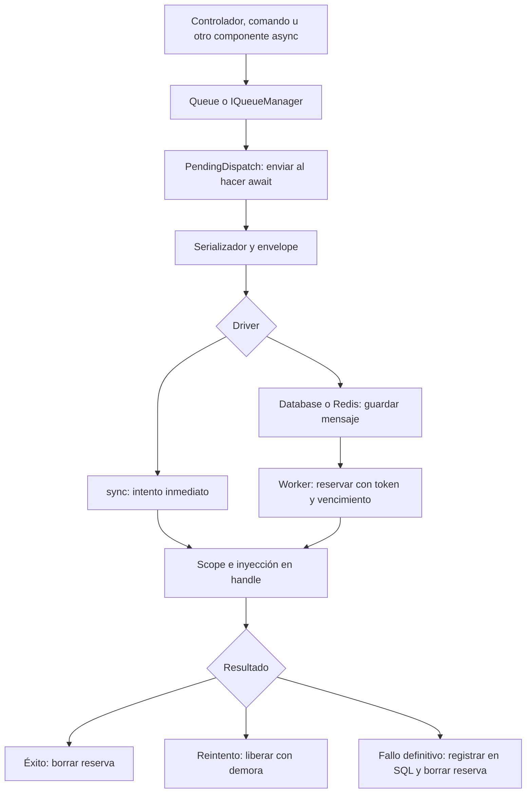

Un **job** representa una tarea con datos serializables y un método async `handle()`. La **cola** conserva los mensajes pendientes y permite que un worker los reserve y ejecute. Úsalos para preparar archivos, procesar registros o integrar servicios sin mantener abierta la petición que solicitó el trabajo.

Orionis ofrece tres drivers: `sync`, `database` y `redis`. El predeterminado, `sync`, ejecuta dentro del mismo `await` del productor. Database y Redis permiten separar el envío de la ejecución. La fachada `Queue` y la inyección de `IQueueManager` acceden al mismo servicio.



## 1. Seleccionar persistencia

Para procesar en otra terminal, configura `.env` antes del arranque de la aplicación:

```dotenv
QUEUE_CONNECTION=database
DB_CONNECTION=sqlite
```

Comprueba la ubicación y permisos de SQLite en `config/database.py`. El driver crea la tabla de mensajes cuando la necesita; el repositorio SQL de fallos crea la suya al utilizarlo. Ambas ubicaciones requieren permisos para crear tablas. Puedes elegir otra conexión SQL o usar Redis para los mensajes; los fallos definitivos siguen utilizando SQL. Consulta [drivers](/es/queues/drivers-and-configuration) y [configuración](/es/queues/configuration).

Las bibliotecas de colas, SQLite y Redis están incluidas en las dependencias normales del framework. Un servidor Redis accesible solo es necesario cuando seleccionas ese driver. No necesitas instalar un extra de colas mediante `packages`.

Desde 1.0.10 puedes preparar las tablas antes de enviar jobs o iniciar workers. Desde la raíz del proyecto, ejecuta una de estas alternativas:

```shell
orionis queue:migrate
python reactor queue:migrate
```

El comando crea las tablas faltantes de todas las conexiones de colas con driver `database` y el almacenamiento SQL de fallos, respetando los nombres y conexiones configurados. Conserva los datos existentes. Consulta [preparación de tablas](/es/queues/drivers-and-configuration#command-migrate) para su alcance y códigos de salida.

## 2. Generar y completar un job

Desde la raíz del proyecto, utiliza una de estas alternativas:

```shell
orionis make:job process_record
```

```shell
python -B reactor make:job process_record
```

Completa `app/jobs/process_record_job.py` con este ejemplo. Recibe un ID y genera un pequeño archivo mediante el servicio Storage:

```python
from orionis.queues import BaseJob
from orionis.storage.contracts.manager import IStorageManager


class ProcessRecordJob(BaseJob):
    __slots__ = ("record_id",)
    record_id: int
    tries = 3
    timeout = 30.0
    backoff = (1.0, 5.0)

    def __init__(self, record_id: int) -> None:
        self.record_id = record_id

    async def handle(self, storage: IStorageManager) -> None:
        await storage.disk("local").put(
            f"records/{self.record_id}.txt",
            f"Processed record {self.record_id}\n",
            visibility="private",
        )
```

Mantén la clase a nivel de módulo, importable por productor y consumidor. El job conserva únicamente `record_id`; el contenedor proporciona Storage en `handle()`. La reconstrucción del job no ejecuta `__init__` ni inyecta servicios en él.

Repetir este ejemplo reemplaza el mismo archivo con el mismo contenido. Este diseño permite repetir un intento sin crear otro archivo por accidente. Para operaciones de negocio con otros efectos, define su propia estrategia de idempotencia. La guía de [jobs](/es/queues/jobs-and-dispatch) explica la plantilla, los tipos permitidos y las políticas.

## 3. Enviar desde un controlador

Guarda esta clase en `app/http/controllers/record_controller.py`:

```python
from app.jobs.process_record_job import ProcessRecordJob
from orionis.http import JSONResponse
from orionis.support.facades import Queue


class RecordController:
    async def store(self, record_id: int) -> JSONResponse:
        job_id = await Queue.dispatch(ProcessRecordJob(record_id))
        return JSONResponse({"job_id": job_id}, status_code=202)
```

Registra la acción en `routes/api.py`:

```python
from app.http.controllers.record_controller import RecordController
from orionis.support.facades import Route

Route.post("/records/{record_id:int}/process", [RecordController, "store"])
```

`await` es obligatorio: crear y descartar `PendingDispatch` no envía nada. Con Database, el ID confirma el envío; el archivo todavía puede estar pendiente. Con `sync`, la acción espera la ejecución completa. Si deseas seleccionar canal o demorar el trabajo, utiliza [las opciones del envío](/es/queues/jobs-and-dispatch#pending-construction).

## 4. Ejecutar el consumidor

En otra terminal, con el mismo código y configuración, utiliza una alternativa:

```shell
orionis queue:work database --queue default
```

```shell
python -B reactor queue:work database --queue default
```

Cuando se invoque la ruta, el worker ejecutará el job y Storage escribirá `records/<record_id>.txt` en el disco `local`, con visibilidad privada. Deja el proceso activo para recibir nuevos mensajes. Consulta [workers y señales](/es/queues/workers) para detenerlo, limitar el procesamiento o configurar concurrencia.

Un worker reserva mensajes por un plazo; una interrupción puede permitir su recuperación por otro consumidor. La persistencia no garantiza que un efecto externo ocurra exactamente una vez. Los [reintentos y fallos](/es/queues/failures-and-retries) explican qué sucede con excepciones, timeouts y reservas vencidas.

## Recorrido de la documentación

| Necesidad | Guía |
| --- | --- |
| Comparar almacenamiento y requisitos | [Drivers y persistencia](/es/queues/drivers-and-configuration) |
| Configurar conexiones, canales y políticas | [Configuración de colas](/es/queues/configuration) |
| Crear clases y preparar payloads | [Escribir y enviar jobs](/es/queues/jobs-and-dispatch) |
| Elegir ejecución inmediata o consumidores | [Formas de ejecución](/es/queues/execution-modes) |
| Ejecutar procesos y administrar reservas | [Workers](/es/queues/workers) |
| Recuperar errores y reencolar fallos | [Reintentos y excepciones](/es/queues/failures-and-retries) |
| Usar todos los métodos del administrador y DI | [Fachada e inyección](/es/queues/manager-and-injection) |
| Consultar contratos, drivers y utilidades | [Referencia técnica](/es/queues/api-reference) |

Las [tareas tras responder](/es/queues/background-tasks) y la [programación de tareas](/es/console/task-scheduling) tienen ciclos de ejecución diferentes; pueden enviar jobs, pero no sustituyen a un consumidor de colas persistentes.
