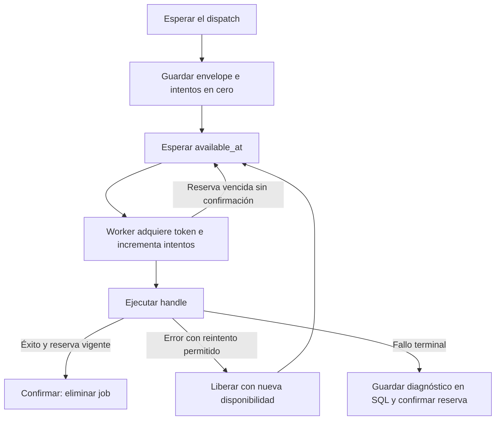

Orionis incluye tres drivers de colas: `sync`, `database` y `redis`. Una **conexión de colas** selecciona un driver y sus ajustes; una **cola** es un canal lógico dentro de esa conexión, por ejemplo `reports` o `notifications`. Distintas colas pueden compartir el mismo backend.

La conexión predeterminada es `sync`: esperar un dispatch ejecuta el job en ese mismo proceso. Para enviar trabajo a un consumidor independiente, utiliza `database` o `redis` y ejecuta un [worker](/es/queues/workers).

## Comparar los drivers

| Driver | Almacenamiento | Cuándo se ejecuta | Uso y consideraciones |
|---|---|---|---|
| `sync` | Ninguno para los jobs pendientes. | Durante el `await` del dispatch. | Útil cuando necesitas el resultado de la ejecución antes de continuar o quieres verificar el flujo sin un consumidor. El productor asume su tiempo de ejecución; no admite delay ni reintentos persistentes. |
| `database` | Una tabla de una conexión de [Database](/es/database). | Cuando un worker reserva el registro disponible. | Reutiliza infraestructura SQL y puede insertar el job en la misma transacción que tus datos. Las consultas, escrituras y reservas añaden carga a esa base de datos. |
| `redis` | Conjuntos ordenados y hashes en Redis. | Cuando un worker reserva el job disponible. | Permite transiciones atómicas mediante Lua y separa el transporte de la base de datos de negocio. Necesita un servidor Redis y una política de persistencia adecuada a tus necesidades. |

La [configuración](/es/queues/configuration) explica cada campo, las variables de entorno y las conexiones con nombre.

## Dependencias incluidas

Orionis ya incluye los clientes Python necesarios para estos drivers: `redis[hiredis]`, `msgspec`, `sqlalchemy[asyncio]` y `aiosqlite` forman parte de sus dependencias principales. No necesitas instalar un extra de colas para Redis ni para SQLite.

Debes disponer de un **servidor Redis accesible** para utilizar `redis`. Para `database`, configura una conexión SQL del proyecto; si el motor requiere un driver opcional, sigue la guía de [drivers de Database](/es/database/drivers). El cliente de Redis incluido no instala ni inicia un servidor Redis.

Los fallos terminales se guardan en SQL mediante `failed`, incluso si los jobs se procesan con `sync` o `redis`. Esa conexión se resuelve cuando se necesita el repositorio de fallos; consulta [fallos y reintentos](/es/queues/failures-and-retries).

<a id="driver-sync"></a>

## `sync`: ejecución inmediata

`SyncQueueDriver.push()` serializa el envelope, construye una reserva con `attempts=1` y utiliza el mismo pipeline de ejecución que los workers. El productor espera a que termine `handle()`; el identificador se devuelve después de una ejecución correcta. Si el job falla, el dispatch propaga su excepción original tras el tratamiento del fallo.

```dotenv
QUEUE_CONNECTION=sync
QUEUE_SYNC_QUEUE=default
QUEUE_SYNC_RETRY_AFTER=90.0
QUEUE_WORKER_TIMEOUT=60.0
```

Este backend tiene las siguientes particularidades:

- `delay` debe ser cero; otro valor produce `QueueDispatchError`.
- Se realiza un único intento inmediato, aunque el job declare varios intentos. No existe almacenamiento del que otro worker pueda recuperar un reintento.
- `reserve()` devuelve `None`; `size()` y `clear()` devuelven `0`.
- `release()` siempre lanza `QueueDispatchError`; `delete()` confirma la ejecución devolviendo `True`.
- `close()` solicita la parada de su worker interno; no cierra los servicios de la aplicación ni espera a que termine un job en curso.

No se debe crear un worker para una conexión `sync`: `Queue.worker()` rechaza esa combinación con `QueueConfigurationError`.

<a id="driver-database"></a>

## `database`: persistencia SQL

El driver utiliza una conexión del servicio Database. `QUEUE_DB_CONNECTION` es el nombre de esa **conexión SQL**, mientras que `database` es, por defecto, el nombre de la **conexión de colas**.

```dotenv
QUEUE_CONNECTION=database
QUEUE_TABLE=jobs
QUEUE_DB_QUEUE=default
QUEUE_DB_RETRY_AFTER=90.0
QUEUE_WORKER_TIMEOUT=60.0
```

Si omites `QUEUE_DB_CONNECTION`, se utiliza la conexión SQL predeterminada. Configura la conexión de Database antes de enviar o consumir trabajo.

### Creación de la tabla y compatibilidad

La tabla se crea de forma perezosa, en la primera operación que necesita el esquema (`push`, `reserve`, `size` o `clear`). Su nombre lógico recibe el prefijo de la conexión SQL, cuando está configurado. No necesitas generar una migración de colas para obtener el esquema incluido; el usuario SQL necesita permisos para crearlo.

Si otro proceso crea la tabla a la vez, el driver comprueba que sus columnas sean consultables. Esta comprobación no migra ni actualiza una tabla antigua incompatible. Si la creación ocurre dentro de una transacción, el driver no considera definitivo el esquema hasta que deje de estar en esa transacción.

La conexión debe imponer restricciones únicas: `DatabaseQueueDriver` rechaza una conexión cuyo `supportsUniqueConstraints()` devuelve `False`, como Redshift. Los planes y los esquemas incluidos tienen pruebas de compilación para SQLite, MySQL, PostgreSQL, Oracle y SQL Server; esto no sustituye la configuración y los requisitos del motor elegido.

<a id="schema-jobs"></a>

### Qué se guarda

`build_jobs_table(table)` construye este esquema:

| Columna | Definición | Propósito |
|---|---|---|
| `id` | `String(36)`, clave primaria. | Identificador del dispatch. |
| `queue` | `String(255)`. | Canal lógico. |
| `payload` | `LargeBinary()`. | Envelope JSON codificado como bytes, incluyendo el estado serializado del job y sus opciones de ejecución. |
| `attempts` | `Integer()`. | Reservas realizadas; se inserta en `0`. |
| `available_at` | `Double()`. | Instante a partir del cual puede reservarse, en segundos de época. |
| `reserved_until` | `Double().nullable()`. | Vencimiento de la reserva actual. |
| `reservation_token` | `String(32).nullable()`. | Token que identifica al propietario de la reserva. |
| `created_at` | `Double()`. | Instante de inserción. |

Un índice compuesto sobre `queue`, `available_at` y `reserved_until` acompaña a la clave primaria. Los tiempos conservan fracciones de segundo.

### Reserva, confirmación y transacciones

El driver busca primero en la cola de mayor prioridad indicada al worker. Dentro de una cola ordena candidatos por `available_at`, `created_at` e `id`. Solo considera registros disponibles cuya reserva no exista o haya vencido.

La búsqueda inicial no bloquea la fila mediante `FOR UPDATE`. La propiedad se obtiene con un `UPDATE` condicional que comprueba el identificador, el contador de intentos observado y la elegibilidad vigente. Un único ganador incrementa `attempts`, genera un token y fija el vencimiento; si pierde la carrera, el driver vuelve a buscar, con un límite de 100 rondas por cola en esa llamada.

`delete()` y `release()` solo tienen efecto si coinciden el identificador y el token y la reserva sigue vigente. Devuelven `False` cuando el consumidor perdió la propiedad. `release()` conserva los intentos y establece una nueva disponibilidad; `delete()` elimina el registro confirmado.

Una inserción utiliza la [transacción SQL de la tarea](/es/database/transactions) cuando comparte la misma conexión: un rollback también revierte el job y otros consumidores lo ven después del commit. No hay una opción general `afterCommit`. Redis y otras conexiones quedan fuera de esa unidad de trabajo.

**Reservar dentro de una transacción activa no está permitido**: produce `QueueStorageError`, porque el worker necesita una reserva confirmada antes de ejecutar el job. Cerrar el driver no desconecta la conexión SQL compartida; solo reinicia su comprobación del esquema.

<a id="driver-redis"></a>

## `redis`: persistencia y transiciones atómicas

```dotenv
QUEUE_CONNECTION=redis
REDIS_HOST=127.0.0.1
REDIS_PORT=6379
REDIS_DB=0
QUEUE_REDIS_PREFIX=example:queues
QUEUE_REDIS_QUEUE=default
QUEUE_REDIS_RETRY_AFTER=90.0
QUEUE_WORKER_TIMEOUT=60.0
```

Añade `REDIS_PASSWORD` cuando el servidor la requiera. La configuración utiliza campos separados; no existe un campo `url` en la entidad Redis de colas. El driver construye un cliente asíncrono con `protocol=2` y establece la conexión de red al utilizarlo, no al construir el manager.

Para el prefijo `example:queues` y la cola `reports`, se utilizan estas claves:

| Clave | Tipo Redis | Contenido |
|---|---|---|
| `example:queues:{reports}:ready` | Sorted set. | Identificadores ordenados por disponibilidad, incluidos los jobs retrasados. |
| `example:queues:{reports}:reserved` | Sorted set. | Identificadores ordenados por vencimiento de reserva. |
| `example:queues:{reports}:payloads` | Hash. | Envelope serializado de cada job. |
| `example:queues:{reports}:attempts` | Hash. | Contador de reservas de cada job. |
| `example:queues:{reports}:tokens` | Hash. | Propietario de cada reserva vigente. |

El hash tag `{reports}` coloca juntas las claves que necesita cada transición. El prefijo no puede contener `{` ni `}`; el constructor del driver lo rechaza con `QueueStorageError`. Este formato de claves no implica que el manager configure un cliente Redis Cluster.

`push`, `reserve`, `release` y `delete` usan scripts Lua mediante `EVAL`. Comprueban los tipos de las cinco claves antes de modificar el estado. El servidor y sus permisos deben permitir las operaciones utilizadas por esos scripts. Los errores de transporte o de script se presentan como `QueueStorageError`, conservando la excepción Redis como causa.

Al reservar, el script recupera hasta 100 reservas vencidas y las devuelve al conjunto de disponibles. En esa operación prefiere un job ya disponible frente a uno de los vencidos que está recuperando. Después incrementa el contador, asigna un token nuevo y fija la reserva de un job. La selección entre colas respeta el orden de prioridad configurado; no hay una promesa de orden global entre colas.

Un `release()` o `delete()` atrasado devuelve `False` si su token ya no es propietario o la reserva venció. Enviar de nuevo un identificador que ya existe en esa cola produce `QueueStorageError`.

Los jobs permanecen en Redis hasta confirmarlos o limpiarlos; no se asigna un TTL al envelope. Su supervivencia a un reinicio del **servidor** depende de la persistencia y la política de memoria que configures en Redis. El driver no habilita AOF, RDB ni una política de evicción.

`close()` cierra el cliente creado por el propio driver. Si construyes un `RedisQueueDriver` con `client=...` para una integración explícita o una prueba, ese cliente conserva un ciclo de vida bajo tu responsabilidad.

## Ciclo de un job persistente



La reserva protege las transiciones del transporte; no hace transaccionales los efectos externos de `handle()`. Si el proceso cae después de realizar una acción y antes de confirmar el job, otro consumidor puede repetirla al vencer la reserva. Diseña esas acciones para tolerar una repetición y mantén el timeout del job estrictamente por debajo de `retry_after`. El framework no renueva la reserva mediante un heartbeat.

## Consultar y limpiar una cola

Estos métodos están en el **driver** devuelto por `Queue.connection()`. No existen `Queue.size()` ni `Queue.clear()` en el manager incluido.

```python
from orionis.support.facades import Queue


class QueueMonitor:

    async def pending_reports(self) -> int:
        driver = await Queue.connection("database")
        return await driver.size("reports")
```

`size(queue)` cuenta todos los jobs persistidos de ese canal: disponibles, retrasados y reservados. `clear(queue)` devuelve cuántos eliminó y también elimina las reservas activas. No detiene el código de un job que ya está ejecutándose; su confirmación posterior deja de tener una reserva válida. Úsalo cuando quieras descartar deliberadamente el contenido completo de ese canal.

<a id="schema-failed"></a>

## Esquema de fallos y API de infraestructura

`build_failed_jobs_table(table)` define `id` como clave primaria, `job_id`, `connection`, `queue`, `payload`, `attempts`, `exception_type`, `exception_message`, `traceback` y `failed_at`, además de un índice por `failed_at`. Los identificadores usan `String(36)`, conexión/cola/tipo de excepción `String(255)`, payload `LargeBinary`, mensajes y traceback `Text`, intentos `Integer` y fecha `Double`.

La tabla se crea de forma perezosa por el repositorio de fallos y debe ser distinta de la tabla de jobs de la misma conexión. Cada conexión de colas comparte el repositorio `failed` de la aplicación; no existe un repositorio nativo de fallos en Redis.

Consulta la [referencia de API](/es/queues/api-reference) para las firmas de `IQueueDriver`, `SyncQueueDriver`, `DatabaseQueueDriver` y `RedisQueueDriver`. Cada uno expone `push`, `reserve`, `release`, `delete`, `size`, `clear` y `close` asíncronos. Implementar `IQueueDriver` por sí solo no añade un driver a la resolución del manager incluido.

<a id="schema-functions"></a>

### Funciones de esquema

| Función | Resultado | Validación |
|---|---|---|
| `validate_table_name(table: str) -> str` | Devuelve el nombre lógico sin modificarlo. | Solo acepta un identificador SQL ASCII sin calificación, como `jobs` o `report_jobs`; otro valor produce `QueueConfigurationError`. |
| `build_jobs_table(table: str) -> TableDefinition` | Definición completa de jobs, con clave e índice. | Llama a `validate_table_name()`. No ejecuta DDL por sí misma. |
| `build_failed_jobs_table(table: str) -> TableDefinition` | Definición completa de fallos, con clave e índice. | Llama a `validate_table_name()`. No ejecuta DDL por sí misma. |

Se importan desde `orionis.queues.schema`. Son herramientas de infraestructura; el uso habitual de la fachada no requiere construir tablas ni envelopes manualmente.
