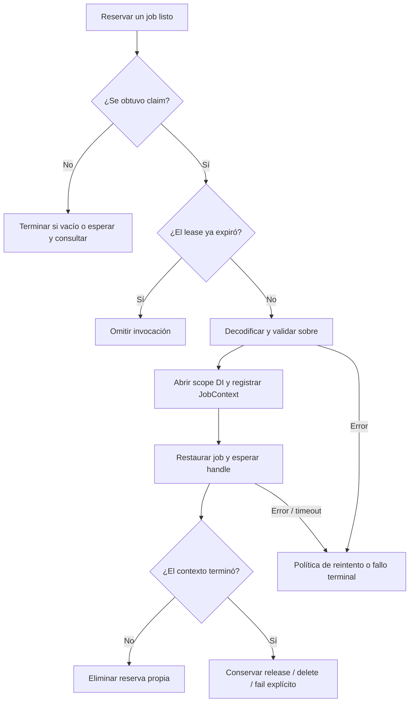

Un worker consume jobs ya persistidos en una conexión durable de colas. Reserva un job durante un lease limitado, restaura su declaración, resuelve las dependencias de `handle()` dentro de un scope aislado y confirma, libera o registra el intento como fallido.

Utiliza las mismas clases de jobs y configuración compatible en productores y workers. La conexión `sync` ejecuta durante el despacho y no puede seleccionarse con `Queue.worker()` ni `queue:work`. Consulta [modos de ejecución](/es/queues/execution-modes) y [configuración](/es/queues/configuration) para elegir una conexión.

Para las reglas de reintento automático, `JobContext` y la inspección de fallos, continúa con [reintentos y jobs fallidos](/es/queues/failures-and-retries).

<a id="command-work"></a>

## Ejecutar queue:work

Desde la raíz del proyecto, elige cualquiera de las formas del CLI:

```bash
orionis queue:work database --queue high,default --concurrency 4
```

```bash
python -B reactor queue:work database --queue high,default --concurrency 4
```

Para una ejecución limitada:

```bash
orionis queue:work database --queue reports --stop-when-empty --max-jobs 100
python -B reactor queue:work database --queue reports --stop-when-empty --max-jobs 100
```

La sintaxis completa es:

```text
queue:work [connection]
    [--queue QUEUE]
    [--concurrency CONCURRENCY]
    [--max-jobs MAX_JOBS]
    [--stop-when-empty]
```

| Argumento u opción | Tipo | Predeterminado del CLI | Selección efectiva |
| --- | --- | --- | --- |
| `connection` | Posicional `str` opcional | `None` | Utiliza `queue.default` si se omite. El valor distribuido es `sync`: selecciona una conexión durable o cambia la configuración. |
| `--queue` | `str` | `None` | Si se omite, utiliza la cola configurada de la conexión. En otro caso, los nombres separados por comas definen su prioridad. |
| `--concurrency` | `int` | `None` | Utiliza `queue.worker.concurrency`, cuyo valor distribuido es `1`. Debe ser un entero positivo. |
| `--max-jobs` | `int` | `None` | Sin límite de reservas hasta otra condición de parada. Un valor explícito debe ser positivo. |
| `--stop-when-empty` | Flag | `False` | Termina cada consumidor cuando su reserva no encuentra trabajo listo. |
| `-h` / `--help` | Flag | — | Muestra la ayuda del comando. |

`--queue "high, default"` se divide por comas y se recortan los espacios de cada parte. Las partes vacías no se descartan: `--queue high,,default` produce una configuración de colas inválida. Los nombres contienen entre 1 y 128 letras, dígitos, `.`, `_` o `-` y comienzan por letra o dígito.

Las colas se consultan en el orden declarado. Un flujo continuo en `high` puede posponer `default`; la prioridad no garantiza reparto equitativo ni orden de finalización entre consumidores concurrentes.

### Código de salida y condiciones de parada

Al terminar normalmente, el comando imprime `Worker stopped after N attempt(s).` y devuelve código `0`. Ese conteo incluye reservas procesadas que se liberaron o fallaron; no cuenta únicamente jobs distintos completados correctamente. Por ello pueden coexistir fallos de negocio gestionados y una salida exitosa del comando.

Los `QueueError` capturados se muestran como errores y devuelven `1`. Las demás excepciones de infraestructura no se convierten mediante ese bloque `QueueError` del comando.

`--stop-when-empty` significa «no hay trabajo listo ahora». Pueden quedar jobs retrasados o reservados por otros workers. Sirve para un drenado o ejecución programada; no afirma que el backend esté vacío.

El comando no incluye opciones `--tries`, `--timeout`, `--backoff`, `--sleep` ni `--retry-after`. Configura esos valores mediante [configuración de colas](/es/queues/configuration) o las declaraciones admitidas del job, según corresponda.

## Crear un worker desde la aplicación

Los servicios asíncronos pueden utilizar el mismo runtime mediante la fachada:

```python
from orionis.support.facades import Queue


class ReportsQueueService:

    async def drain(self) -> int:
        manager = await Queue.resolve()
        worker = await manager.worker(
            "database",
            queues=("reports",),
            concurrency=2,
        )
        return await worker.run(stop_when_empty=True, max_jobs=100)
```

La aplicación debe estar inicializada. `manager.worker` crea un `Worker` independiente; no inicia el consumo. El driver y el serializer siguen administrados por la aplicación existente. Consulta [manager e inyección](/es/queues/manager-and-injection) para inyectar por constructor o método.

<a id="worker-construction"></a>

## Construcción de Worker

```text
Worker(
    app: IApplication,
    driver: IQueueDriver,
    serializer: IJobSerializer,
    options: WorkerOptions,
    failed: IFailedJobRepository | FailedResolver | None = None,
) -> None

FailedResolver = Callable[[], Awaitable[IFailedJobRepository]]
```

Los cuatro primeros argumentos son obligatorios. `app` proporciona scopes e invoca el job; `driver` controla reservas y transiciones; `serializer` restaura sobres y clases registradas; `options` contiene los ajustes de polling y lease.

`failed` puede ser un repositorio, un resolver asíncrono sin argumentos o `None`. Se resuelve al producirse un fallo terminal y el worker conserva el repositorio obtenido. Con `None` no puede registrar un fallo terminal: registra en logs el problema de finalización y conserva el trabajo sin confirmar cuando no puede terminarlo de forma segura.

El constructor conserva dependencias e inicia contadores; no abre conexiones con el backend. Normalmente se obtiene este objeto configurado con `await manager.worker(...)` en lugar de montar una segunda aplicación.

<a id="worker-options"></a>

### WorkerOptions

Este dataclass inmutable y con slots se exporta desde `orionis.queues.worker`:

```text
WorkerOptions(
    connection: str,
    queues: tuple[str, ...] = ("default",),
    concurrency: int = 1,
    retry_after: float = 90.0,
    sleep: float = 1.0,
) -> None
```

| Campo | Significado y validación |
| --- | --- |
| `connection` | Nombre lógico obligatorio de conexión de colas. Sigue las reglas de nombres anteriores. |
| `queues` | Tupla no vacía de nombres en orden de prioridad. Se rechaza una lista o tupla vacía. |
| `concurrency` | `int` positivo; rechaza booleanos. Cantidad de tareas consumidoras creadas por `run`. |
| `retry_after` | Segundos finitos positivos del lease de una reserva. Es distinto del backoff y del timeout de ejecución. |
| `sleep` | Segundos finitos no negativos entre consultas sin trabajo. El evento de parada puede interrumpir esta espera. |

Una configuración inválida genera `QueueConfigurationError`. Las duraciones admiten enteros o flotantes, pero no booleanos, infinito, NaN ni valores negativos.

Estos predeterminados pertenecen al constructor de bajo nivel. `QueueManager.worker` proporciona el `retry_after` configurado de la conexión y los valores de configuración del worker. Cambiar `WorkerOptions` no reescribe timeout, intentos, backoff o deadline ya guardados en un sobre.

<a id="worker-run"></a>

## run: consumir reservas

```text
async run(
    *,
    stop_when_empty: bool = False,
    max_jobs: int | None = None,
) -> int
```

Ambos argumentos son opcionales y exclusivamente por nombre. `run` crea hasta `concurrency` tareas consumidoras y comparte un presupuesto de reservas entre ellas. `max_jobs=None` no limita jobs; un entero positivo limita reservas iniciadas, no handlers exitosos ni identificadores únicos de despacho.

Una reserva `None` no consume presupuesto. Cada reserva cuyo `execute` retorna incrementa el conteo procesado, incluidos fallos gestionados, liberaciones explícitas y claims expirados omitidos sin invocar `handle`. Una cancelación o error de consumidor sin gestionar se propaga en lugar de devolver el conteo.

Iniciar `run` mientras ese mismo worker sigue ejecutándose, o pasar `max_jobs` no positivo, no entero o booleano, genera `QueueConfigurationError`. Tras una ejecución terminada puede iniciarse otra: los contadores se reinician y se limpia el evento de parada anterior.

Un error de infraestructura durante la reserva termina ese consumidor. `run` solicita detenerse y drena los demás consumidores antes de propagarlo; esto difiere de las excepciones ordinarias de jobs gestionadas por `execute`.

<a id="worker-stop"></a>

## stop: solicitar una parada gradual

```text
stop() -> None
```

Es un método síncrono. Activa el evento de parada y retorna inmediatamente; no espera a los jobs activos. Espera la tarea que ejecuta `run` para saber cuándo terminó el drenado.

La parada evita nuevas iteraciones de polling. Una solicitud de reserva ya en curso todavía puede devolver trabajo y ejecutarlo; se permite terminar el trabajo activo. Despierta al consumidor que espera entre consultas. Llamar `stop` antes de un nuevo `run` no desactiva permanentemente el worker, porque `run` limpia el evento.

Un componente de ejecución puede exponer la solicitud de parada por separado del consumo asíncrono:

```python
from orionis.queues.contracts.worker import IWorker
from orionis.support.facades import Queue


class WorkerRuntime:

    def __init__(self) -> None:
        self.worker: IWorker | None = None

    async def run(self) -> int:
        manager = await Queue.resolve()
        self.worker = await manager.worker(
            "database",
            queues=("reports",),
            concurrency=2,
        )
        return await self.worker.run()

    def stop(self) -> None:
        if self.worker is not None:
            self.worker.stop()
```

Llama `stop()` cuando `run()` ya haya comenzado y espera esa tarea desde el ciclo de vida de tu aplicación. La parada no revierte operaciones de negocio ya completadas.

### Señales del CLI

El comando instala manejadores temporales de SIGINT y SIGTERM en el hilo principal, solicita `worker.stop()` y restaura los manejadores anteriores al salir.

`WorkerSignals` utiliza los manejadores del loop activo cuando están disponibles. Si `add_signal_handler` genera `NotImplementedError`, como en el loop habitual de Windows, utiliza `signal.signal` como alternativa. Fuera del hilo principal no instala manejadores. Una señal atendida así solicita el drenado; no cancela por fuerza el job actual.

Este worker no incorpora un supervisor de procesos ni un heartbeat de lease. La política de reinicio corresponde al despliegue.

<a id="worker-execute"></a>

## execute: procesar una reserva existente

```text
async execute(
    reserved: ReservedJob,
    *,
    raise_errors: bool = False,
) -> None
```

`reserved` debe ser un claim real adquirido del driver correspondiente y conservar payload, intentos, token y expiración. Esta API no encola ni reserva un job por ti.

Con `raise_errors=False`, los errores ordinarios se registran y se procesan mediante la política de reintentos/fallos. Normalmente no detienen el consumo. Una transición perdida o repositorio de fallos no disponible también se registra y, cuando es posible, deja el lease sin confirmar para recuperarlo.

Con `raise_errors=True` se omite el reintento automático: el worker intenta registrar un fallo terminal y propaga el error original. El driver `sync` utiliza este modo. No lo actives solo para inspeccionar los logs de un worker durable.

```python
from orionis.queues.entities.reserved_job import ReservedJob
from orionis.support.facades import Queue


class ReservedReportsService:

    async def execute_claim(self, reserved: ReservedJob) -> None:
        manager = await Queue.resolve()
        worker = await manager.worker(
            "database",
            queues=(reserved.queue,),
        )
        await worker.execute(reserved, raise_errors=False)
```

Quien llama debe proporcionar una reserva que pertenezca a la conexión de colas `database` seleccionada en este ejemplo. No inventes tokens ni invoques `execute` dos veces concurrentemente sobre el mismo claim.

### Validación del lease y ejecución con scope

Antes de invocar el job, el worker:

1. Omite una reserva que ya expiró.
2. Decodifica el sobre y comprueba ID, cola, conexión y un conteo de intentos positivo que comienza en uno.
3. Exige un timeout finito del job estrictamente menor que `retry_after` del worker.
4. Rechaza intentos superiores a `max_tries` y un `retry_until` vencido.
5. Crea un scope DI aislado, registra `JobContext`, restaura el job y llama `handle` mediante el contenedor.

Un scope nuevo separa las dependencias con alcance scoped entre jobs. También se cierra ante errores y timeouts. Los servicios anotados se proporcionan a `handle` mediante las reglas de inyección de métodos; el estado operativo se obtiene desde `JobContext`.



Consulta [JobContext y decisiones de reintento](/es/queues/failures-and-retries#job-context) para las transiciones explícitas.

### El timeout no es el lease

El límite de ejecución es:

```text
min(envelope.timeout, remaining_reservation_seconds * 0.95)
```

El lease restante se recalcula después de validar el sobre. El timeout rodea la entrada al scope, restauración del job, resolución de dependencias, `handle` y salida del scope. La decodificación/validación del sobre ocurre antes de ese bloque; la confirmación final o persistencia de fallos ocurre después.

`asyncio.timeout` es cooperativo. Puede interrumpir operaciones esperadas, pero no termina por fuerza código Python/SDK bloqueante que no cede el control. Un timeout se transforma en `TimeoutError` y sigue la política de reintentos. No revierte una escritura de base de datos ni una solicitud externa ya completada por el handler.

Deja margen entre el timeout y `retry_after` para limpieza y confirmación. Ninguna API del worker renueva el lease. Los drivers nativos rechazan tokens obsoletos, pero el lease no garantiza que una operación externa se haya ejecutado una sola vez.

<a id="reserved-job"></a>

## ReservedJob: el claim adquirido

`ReservedJob` es un `msgspec.Struct` inmutable con argumentos exclusivamente por nombre:

```text
ReservedJob(
    *,
    id: str,
    payload: bytes,
    queue: str,
    attempts: int,
    token: str,
    reserved_until: float,
)
```

Todos los campos son obligatorios:

| Campo | Significado |
| --- | --- |
| `id` | Identificador original de despacho/job. |
| `payload` | Bytes del sobre, incluidos el job serializado y su política de reintentos persistida. |
| `queue` | Canal lógico del que se adquirió el claim. |
| `attempts` | Reservas acumuladas, incluida esta; comienza en `1`. Una recuperación tras caída puede consumir un intento sin completar `handle`. |
| `token` | Token opaco de propiedad/fencing de esta reserva. |
| `reserved_until` | Segundos epoch absolutos en los que expira la reserva. |

Trátalo como estado operativo producido por el driver. Conservar el objeto Python no extiende la propiedad; el backend debe seguir aceptando el token vigente y lease no expirado al eliminar o liberar.

## Cancelación y propiedad de recursos

Cancelar la tarea exterior `run` solicita una parada y drena sus consumidores protegidos antes de propagar `CancelledError`. Eso no cancela un handler activo como mecanismo ordinario de parada gradual.

Cancelar directamente `execute` es distinto: si el contexto no terminó, el worker intenta `driver.release(reserved)` inmediato y propaga la cancelación original. Si la liberación genera un error, lo registra y conserva la cancelación. Un claim expirado/perdido puede quedar pendiente de recuperación del backend.

Un proceso terminado por fuerza no puede completar esa limpieza. Reintentar una reserva recuperada puede repetir efectos de negocio; diseña la operación para tolerarlo.

`run` y `stop` no cierran drivers, repositorios ni servicios compartidos de base de datos. Detén y espera los runtimes activos antes de que el cierre de la aplicación libere recursos de colas mediante el [ciclo de vida del manager](/es/queues/manager-and-injection).

<a id="command-clear"></a>

## queue:clear: eliminar una cola lógica

```bash
orionis queue:clear database --queue reports
python -B reactor queue:clear database --queue reports
```

```text
queue:clear [connection] [--queue QUEUE]
```

| Argumento u opción | Predeterminado | Comportamiento |
| --- | --- | --- |
| `connection` | `None` | Utiliza `queue.default` si se omite. |
| `--queue` | `"default"` | Limpia exactamente esta cola. Este valor literal del CLI **no** hereda el nombre configurado de la conexión. |
| `-h` / `--help` | — | Muestra la ayuda. |

El comando elimina jobs listos, retrasados **y reservados** de la cola seleccionada. No elimina registros de jobs fallidos ni detiene handlers que ya se ejecutan. Estos todavía pueden realizar efectos de negocio, pero pierden la posibilidad de confirmar la reserva borrada.

No hay confirmación interactiva ni opción `--force`. Una operación exitosa imprime `Cleared N job(s).` y devuelve `0`; un `QueueError` capturado devuelve `1`. Utiliza [queue:forget](/es/queues/failures-and-retries#command-forget) cuando la intención sea eliminar un registro de fallo.
