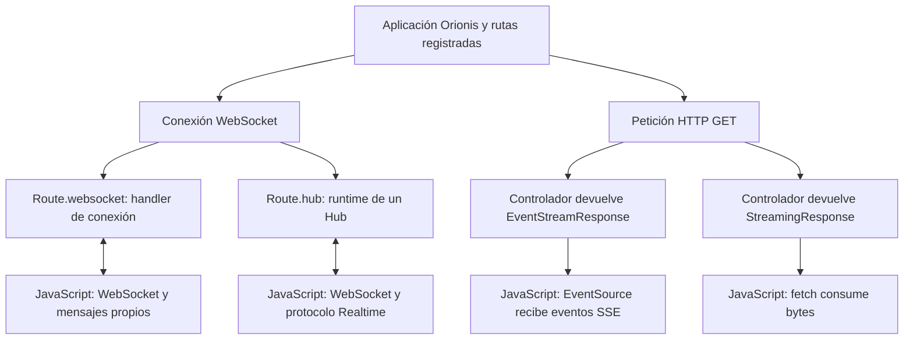

Una aplicación puede mantener una conexión abierta para recibir mensajes de un chat, actualizar un panel o mostrar el avance de una operación. Orionis ofrece tres formas de construir estos flujos. Comparten el servidor y el sistema de rutas, pero cada una define un intercambio diferente.

Esta sección parte de un proyecto creado mediante la [guía de instalación](/es/getting-started/installation). Los ejemplos indican qué archivos crear, cómo registrar sus rutas, qué ejecutar en Python y cómo conectarse desde el navegador.

## Elegir el flujo adecuado

| Variante | Qué intercambias | Cuándo utilizarla |
| --- | --- | --- |
| **Realtime** | Invocaciones de métodos tipados, resultados, eventos y secuencias sobre WebSocket. | Chats con salas, notificaciones a grupos y operaciones que necesitan una respuesta correlacionada. |
| **WebSocket** | Mensajes de texto o binarios cuyo significado define tu aplicación. | Un protocolo propio o una conexión bidireccional sin el contrato de hubs. |
| **SSE** | Eventos de texto enviados por el servidor dentro de una respuesta HTTP abierta. | Progreso de trabajos, feeds y paneles donde el navegador principalmente recibe actualizaciones. |

**Realtime utiliza WebSocket como transporte.** Un `Hub` añade nombres de métodos, validación de argumentos, IDs de invocación y selección de destinatarios. Un WebSocket sencillo no interpreta automáticamente esos mensajes.

**SSE utiliza HTTP.** El navegador abre una petición GET con `EventSource` y recibe eventos. Para enviar una orden al servidor puedes utilizar otra petición HTTP; el canal SSE no se convierte por ello en bidireccional.

### Streaming HTTP y streams Realtime

La palabra *stream* aparece en varios contextos:

- `StreamingResponse` entrega fragmentos de bytes en una respuesta HTTP, por ejemplo un CSV.
- `EventStreamResponse` entrega eventos en el formato SSE, con campos como `event`, `data` e `id`.
- Un método Realtime que devuelve una secuencia asíncrona produce mensajes `stream_item` y `stream_complete` dentro del protocolo del Hub.

El cliente debe interpretar el formato de su canal. `EventSource` no consume un stream Realtime, y un objeto `WebSocket` no interpreta SSE.

## De la ruta al navegador

El diagrama muestra las variantes admitidas, no una negociación automática entre ellas. Seleccionas el flujo al registrar la ruta y al construir el cliente.

| Registro | Archivo habitual | Cliente del ejemplo |
| --- | --- | --- |
| `Route.websocket(...)` | `routes/websocket.py` | `new WebSocket(...)`. |
| `Route.hub(...)` | `routes/websocket.py` | [`RealtimeClient` desde npm](/es/realtime/javascript-client). |
| `Route.get(...)` con una respuesta SSE | `routes/api.py` o `routes/web.py` | `new EventSource(...)`. |

Los archivos deben estar registrados en `app.withRouting(...)`. Su nombre no añade un prefijo a la URL ni sustituye el protocolo del registro. El [capítulo de rutas y ciclo de vida](/es/realtime/routing-and-lifecycle) incluye un ejemplo completo.

## Qué ocurre durante una conexión

En **WebSocket**, el kernel reserva un cupo, crea un scope de conexión y comprueba el handshake antes de ejecutar sus middlewares de socket. El handler acepta la conexión y permanece activo mientras intercambia mensajes. Al terminar se cierran la conexión, sus recursos y el scope.

En **Realtime**, ese mismo transporte entra en `HubRuntime`. El runtime registra la conexión, ejecuta `onConnect()` y, si puede continuar, acepta y envía `ready`. Cada invocación remota recibe un scope y una instancia de Hub nuevos. Al desconectar se cancelan las operaciones pendientes, se retiran la conexión y sus grupos y se ejecuta `onDisconnect()`.

En **SSE**, se procesa una petición HTTP habitual con sus middlewares y su perfil WEB o API. El controlador devuelve una respuesta cuyo productor se consume durante la entrega. El scope HTTP permanece disponible hasta finalizar la respuesta y su limpieza. Una desconexión cancela la producción SSE y cierra sus recursos.

Las guías específicas desarrollan estos ciclos con sus diagramas, errores y ejemplos. El kernel no aplica el mismo pipeline a las tres variantes.

## Peticiones, permisos y estado

Las conexiones WebSocket y los hubs **no restauran automáticamente la sesión HTTP ni ejecutan la autenticación de token de las rutas API**. Tampoco reciben los middlewares registrados mediante `app.withMiddleware(...)`. Utilizan los controles compartidos del handshake y los `WebSocketMiddleware` de su ruta.

Una cookie presente en el handshake o un origen permitido no equivale a una identidad autenticada. Establece la identidad y autoriza las operaciones que lo necesiten. La [guía WebSocket](/es/realtime/websocket) explica esa frontera.

SSE conserva el flujo HTTP correspondiente al archivo WEB o API. Los [middlewares HTTP](/es/http/middleware) y la autenticación de ese recorrido siguen siendo relevantes, aunque el cuerpo de la respuesta dure más que una petición ordinaria.

Los grupos Realtime seleccionan conexiones; no almacenan usuarios, mensajes ni permisos. El manager predeterminado y sus membresías pertenecen al worker actual. El [chat de ejemplo](/es/realtime/chat) usa un solo worker para que sus dos pestañas compartan el registro; la [guía de despliegue](/es/realtime/groups-and-deployment) explica las consecuencias de utilizar varios procesos.

## Recorrido de las guías

1. [Rutas y ciclo de vida](/es/realtime/routing-and-lifecycle): prepara los archivos, registra los endpoints y distingue parámetros de ruta, mensajes y argumentos RPC.
2. [Hubs y métodos remotos](/es/realtime/hubs-and-methods): declara operaciones, validación, dependencias y hooks.
3. [Cliente JavaScript](/es/realtime/javascript-client): instala el paquete npm, intégralo y configura reconexión, plazos y límites.
4. [Chat con salas](/es/realtime/chat): construye el servidor y una página JavaScript, abre dos pestañas y comprueba la difusión.
5. [Protocolo y streams](/es/realtime/protocol-and-streaming): correlaciona invocaciones, procesa eventos, consume streams y gestiona errores.
6. [Grupos y despliegue](/es/realtime/groups-and-deployment): selecciona destinatarios, publica desde otros componentes y configura límites.
7. [WebSocket](/es/realtime/websocket): implementa un handler de conexión y un cliente sin el contrato Realtime.
8. [Streaming y SSE](/es/realtime/streaming-and-sse): entrega progreso y otros eventos, consume el flujo y gestiona desconexiones.

Los ejemplos de navegador utilizan APIs nativas de JavaScript. Ejecútalos desde una página HTTP de tu aplicación, con el origen y puerto de su servidor. Las conexiones seguras utilizan `wss:` para WebSocket y `https:` para SSE.
