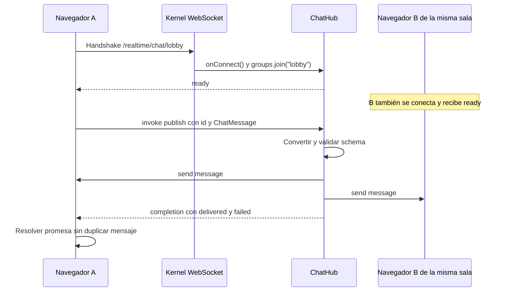

Este ejemplo conecta varias pestañas a una sala pública, valida mensajes y los difunde a sus participantes. Utiliza `Hub`, schemas de Orionis y el [cliente JavaScript](/es/realtime/javascript-client) publicado en npm como `@orionis-framework/realtime-client`, que administra el transporte WebSocket.

Es una demostración **anónima**: el nombre lo proporciona el usuario y cualquier persona que conozca la URL puede entrar. Una aplicación privada debe resolver la identidad y autorizar la sala antes de incorporarla al grupo. Aquí no se guarda historial ni se promete entrega a usuarios desconectados.

## 1. Crear el hub

Desde la raíz del proyecto, genera el hub con una de estas alternativas:

```bash
python -B reactor make:realtime-hub chat
```

```bash
orionis make:realtime-hub chat
```

Esto crea `ChatHub` en `app/realtime/hubs/chat_hub.py`, inicialmente con un método remoto `echo`. Sustituye el contenido de ese archivo por el siguiente código para añadir el schema, la sala y la difusión del chat. Si el archivo ya existe, edítalo directamente: el generador no lo sobrescribe.

```python
from orionis.realtime import Hub, remote
from orionis.realtime.errors import RPCError
from orionis.schemas import Schema
from orionis.schemas.constraints import MaxLength, MinLength
from orionis.schemas.fields import Field


class ChatMessage(Schema, forbid_unknown_fields=True):

    author: Field[str, MinLength(1), MaxLength(40)]
    text: Field[str, MinLength(1), MaxLength(500)]


class ChatHub(Hub):

    __slots__ = ()

    async def onConnect(self) -> None:
        room = self.context.socket.routeParams()["room"]
        await self.groups.join(room)

    @remote
    async def publish(self, message: ChatMessage) -> dict[str, int]:
        author = message.author.strip()
        text = message.text.strip()
        if not author or not text:
            raise RPCError("empty_message", "Author and text cannot be blank")

        room = self.context.socket.routeParams()["room"]
        delivery = await self.clients.group(room).send(
            "message",
            {
                "room": room,
                "author": author,
                "text": text,
                "sender": self.context.connection_id,
            },
        )
        return {"delivered": delivery.sent, "failed": delivery.failed}
```

La sala proviene de la URL del handshake, no del mensaje enviado por el cliente. `onConnect()` incorpora la conexión al grupo antes de anunciar `ready`. `publish()` valida el schema, rechaza texto compuesto únicamente por espacios y difunde el evento `message` a los miembros de esa sala, incluido el emisor.

El valor devuelto es una **confirmación de entregas al transporte**. No confirma que cada navegador haya mostrado el mensaje. El mensaje visible llega por el evento `send`, por lo que el cliente no lo añade otra vez al recibir `completion`.

## 2. Registrar el socket y la página

Registra esta ruta en `routes/websocket.py`. Si antes registraste la plantilla en `/realtime/echo`, sustituye ese registro por el siguiente: esta versión del hub necesita el parámetro `room` de la URL.

```python
from app.realtime.hubs.chat_hub import ChatHub
from orionis.support.facades import Route

Route.hub("/realtime/chat/{room:slug}", ChatHub).name("realtime.chat")
```

`slug` admite letras ASCII minúsculas, dígitos y guiones. Por ejemplo, `lobby` o `python-help`. Una sala que no coincida con el convertidor no resuelve la ruta.

En `routes/web.py` añade la página HTML:

```python
from orionis.support.facades import Route

Route.view("/chat", "chat").name("chat")
```

Comprueba que la llamada existente a `app.withRouting(...)` incluya `web="routes/web.py"` y `websocket="routes/websocket.py"` antes de `app.create()`. Conserva las demás rutas. [Rutas y ciclo de vida](/es/realtime/routing-and-lifecycle) detalla esta configuración.

## 3. Crear el cliente del navegador

Instala el cliente desde la raíz del proyecto:

```bash
npm install @orionis-framework/realtime-client
```

Después sigue [Servir el módulo desde Orionis](/es/realtime/javascript-client#servir-el-módulo-desde-orionis) para copiar `node_modules/@orionis-framework/realtime-client/orionis-realtime.js` y servirlo en `/assets/orionis-realtime.js`. El HTML de este ejemplo carga esa URL porque utiliza módulos nativos del navegador sin bundler; el nombre del paquete npm se importa directamente cuando el frontend utiliza un bundler.

Guarda este documento completo en `resources/views/chat.html`, el directorio predeterminado de vistas:

```html
<!doctype html>
<html lang="es">
<head>
    <meta charset="utf-8">
    <meta name="viewport" content="width=device-width, initial-scale=1">
    <title>Orionis Realtime Chat</title>
</head>
<body>
    <h1>Chat: <span id="room"></span></h1>
    <p id="status" role="status">Conectando...</p>
    <form id="chat-form">
        <label>
            Nombre
            <input id="author" maxlength="40" value="Ada" required>
        </label>
        <label>
            Mensaje
            <input id="text" maxlength="500" required>
        </label>
        <button id="send" disabled>Enviar</button>
    </form>
    <p id="delivery" aria-live="polite"></p>
    <ul id="messages" aria-live="polite"></ul>

    <script type="module">
        import { RealtimeClient } from "/assets/orionis-realtime.js";

        const room = new URLSearchParams(location.search).get("room") || "lobby";
        const status = document.querySelector("#status");
        const button = document.querySelector("#send");
        const text = document.querySelector("#text");
        const author = document.querySelector("#author");
        const delivery = document.querySelector("#delivery");
        const messages = document.querySelector("#messages");
        document.querySelector("#room").textContent = room;

        const url = new URL("/realtime/chat/" + encodeURIComponent(room), location.href);
        url.protocol = location.protocol === "https:" ? "wss:" : "ws:";
        const client = new RealtimeClient(url);
        let sending = false;
        const errorText = {
            validation_error: "Nombre o mensaje inválido.",
            empty_message: "Escribe un nombre y un mensaje.",
            busy: "Hay demasiadas operaciones; intenta nuevamente.",
            timeout: "El servidor no completó la operación a tiempo.",
        };

        function updateButton() {
            button.disabled = sending || client.state !== "connected";
        }

        client.onState(({ state }) => {
            status.textContent = state === "connected"
                ? "Conectado a " + room
                : "Estado: " + state;
            updateButton();
        });
        client.onError(() => {
            status.textContent = "Conexión no disponible. Se aplicará la política de reconexión.";
        });
        client.on("message", ([item]) => {
            if (!item || typeof item.author !== "string" || typeof item.text !== "string") return;
            const row = document.createElement("li");
            row.textContent = item.author + ": " + item.text;
            messages.append(row);
            while (messages.children.length > 200) messages.firstElementChild.remove();
        });

        async function connect() {
            try {
                await client.connect();
            } catch {
                status.textContent = "Conexión no disponible. Se aplicará la política de reconexión.";
            }
        }

        document.querySelector("#chat-form").addEventListener("submit", async (event) => {
            event.preventDefault();
            if (sending || client.state !== "connected") return;
            sending = true;
            updateButton();
            const sentText = text.value;
            try {
                const result = await client.invoke("publish", [{
                    author: author.value.trim(),
                    text: sentText.trim(),
                }], { timeoutMs: 8000, serverTimeout: 5 });
                delivery.textContent = "Entregas: " + result.delivered
                    + "; fallos: " + result.failed + ".";
                if (text.value === sentText) text.value = "";
                text.focus();
            } catch (error) {
                delivery.textContent = errorText[error.code] || "No se pudo confirmar la entrega. El mensaje no se reenviará automáticamente.";
            } finally {
                sending = false;
                updateButton();
            }
        });

        window.addEventListener("pagehide", () => { void client.stop(); });
        window.addEventListener("pageshow", (event) => {
            if (event.persisted) void connect();
        });
        await connect();
    </script>
</body>
</html>
```

El cliente espera `ready` antes de habilitar el envío y se reconecta según su política. El plazo local es de ocho segundos y la operación del servidor solicita cinco. Un timeout o una desconexión no prueban que una operación no haya ocurrido: no se reenvían mensajes automáticamente y se conserva el texto cuando no hay confirmación. La lista visible conserva los últimos 200 mensajes para acotar el DOM. `pagehide` detiene el cliente y `pageshow` lo conecta de nuevo si la página vuelve desde la caché del navegador.

`textContent` muestra los mensajes como texto y evita interpretar contenido de usuarios como HTML. La conexión usa el mismo host y puerto que la página y selecciona `wss:` cuando se sirve por HTTPS.

## 4. Ejecutar con un solo worker

Para que todas las pestañas compartan el registro de conexiones de esta demostración, ejecuta desde la raíz del proyecto:

```bash
uv run python -B -m granian --interface asgi --host 127.0.0.1 --port 8000 --workers 1 bootstrap.app:app
```

Si ya activaste el entorno virtual, puedes ejecutar el mismo comando sin `uv run`. Granian es el servidor instalado con Orionis; `bootstrap.app:app` apunta a la aplicación configurada en `bootstrap/app.py`.

El comando habitual `orionis serve` también admite Realtime, pero actualmente selecciona un worker en Windows y una cantidad basada en CPU en Unix. Su interfaz no expone `--workers`. Por eso este ejemplo utiliza Granian directamente para fijar un único proceso. Consulta [Grupos y despliegue](/es/realtime/groups-and-deployment) antes de utilizar varios workers.

Abre dos pestañas de [http://127.0.0.1:8000/chat?room=lobby](http://127.0.0.1:8000/chat?room=lobby), asigna nombres distintos y envía mensajes. Ambas reciben los eventos de `lobby`. Una tercera pestaña en [http://127.0.0.1:8000/chat?room=python-help](http://127.0.0.1:8000/chat?room=python-help) solo recibe los de `python-help`.

Mantén el mismo host en las pestañas. El servidor comprueba el origen del handshake y la configuración predeterminada permite el mismo origen.

## Flujo de un mensaje



Las conexiones de otra sala no son destinatarias. El grupo se selecciona por clase de hub y nombre: si reutilizas `ChatHub` en otra ruta, la misma sala pertenece al mismo namespace. Un prefijo de URL por sí solo no aísla organizaciones o usuarios.

## Comprobar y ampliar el ejemplo

- Un mensaje válido aparece una vez en cada pestaña de la sala.
- Vacíos, tipos inválidos o longitudes fuera del schema producen `validation_error`; cadenas de espacios producen `empty_message`.
- Al cerrar una pestaña, Orionis cancela sus llamadas pendientes y retira sus grupos.
- Al recargar se crea otra conexión, se ejecuta `onConnect()` y vuelve a unirse a la sala. No hay recuperación de mensajes anteriores.
- Si solo el emisor recibe mensajes entre distintas pestañas, comprueba que el servidor use un worker y que todas compartan sala y host.

Para añadir historial, guarda mensajes en un servicio de dominio y consulta ese historial explícitamente. Para salas privadas, verifica permisos en la admisión y las operaciones. Para difusión desde otro proceso necesitas una estrategia distribuida; configurar Redis en otro módulo no transforma automáticamente este registro local en un backplane.
