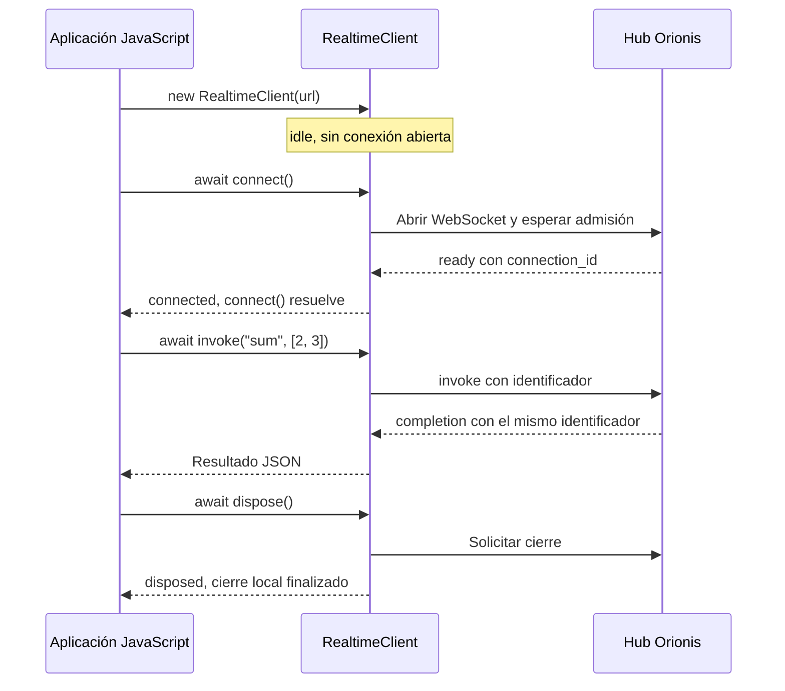

El paquete [`@orionis-framework/realtime-client` en npm](https://www.npmjs.com/package/@orionis-framework/realtime-client) proporciona `RealtimeClient` para conectar con las rutas `Route.hub(...)` de Orionis. Implementa el protocolo Realtime JSON en un módulo ESM sin dependencias de ejecución, con declaraciones de TypeScript y licencia MIT. Consulta su [repositorio oficial](https://github.com/orionis-framework/realtime-client) para el código, los tipos y las guías del cliente.

Este cliente corresponde a **hubs Realtime**. Para `Route.websocket(...)` y SSE, utiliza las APIs descritas en [WebSocket](/es/realtime/websocket) y [Server-Sent Events](/es/realtime/streaming-and-sse). Una ruta `protocol="msgpack"` requiere otro codec; este paquete procesa únicamente texto JSON.

## Instalar desde npm

Desde el proyecto de tu frontend, o desde la raíz de Orionis si vas a servir JavaScript directamente, instala el paquete:

```bash
npm install @orionis-framework/realtime-client
```

En una aplicación con bundler, importa las exportaciones nombradas desde la raíz del paquete:

```javascript
import { RealtimeClient, RemoteError } from "@orionis-framework/realtime-client";
```

El paquete utiliza ESM e incluye sus tipos; no requiere instalar un paquete adicional de declaraciones. No dispone de una exportación predeterminada ni una entrada CommonJS para `require()`. Importarlo no abre conexiones: estas comienzan al ejecutar `connect()`.

Utiliza un navegador moderno con módulos ESM, `WebSocket`, `AbortController`, `TextEncoder` e iteradores asíncronos. Para ejecutarlo en Node.js, utiliza un entorno que cumpla el campo `engines` del paquete y proporcione esas APIs. En el navegador, el nombre npm necesita la resolución del frontend; un HTML sin bundler debe importar una URL de archivo servido, como se muestra a continuación.

### Servir el módulo desde Orionis

Después de instalar el paquete desde la raíz de Orionis, copia `node_modules/@orionis-framework/realtime-client/orionis-realtime.js` a `storage/app/public/js/orionis-realtime.js`. Esta es la ubicación predeterminada del disco `public`; si cambiaste su raíz en `config/filesystems.py`, ajusta el destino. El módulo del paquete se puede servir directamente, sin compilarlo.

Este comando crea el directorio y copia el archivo utilizando Node.js; funciona desde PowerShell y desde una terminal Unix:

```bash
node --input-type=module -e "import { mkdir, copyFile } from 'node:fs/promises'; await mkdir('storage/app/public/js', { recursive: true }); await copyFile('node_modules/@orionis-framework/realtime-client/orionis-realtime.js', 'storage/app/public/js/orionis-realtime.js');"
```

Configurar el disco no publica automáticamente sus archivos. Este archivo servido es una copia del paquete instalado: vuelve a copiarlo cuando actualices la dependencia.

Este registro en `routes/web.py` sirve exclusivamente el archivo del cliente:

```python
from orionis.http import StreamingResponse, response
from orionis.support.facades import Route, Storage


async def realtime_client_module() -> StreamingResponse:
    module = Storage.disk("public").file("js/orionis-realtime.js")
    await module.size()
    return response.stream(
        module.readStream(),
        media_type="text/javascript",
        headers={
            "Cache-Control": "no-cache",
            "X-Content-Type-Options": "nosniff",
        },
    )


Route.get("/assets/orionis-realtime.js", realtime_client_module)
```

Desde un `<script type="module">` de la vista, utiliza la URL servida:

```javascript
import { RealtimeClient } from "/assets/orionis-realtime.js";
```

También puedes servir el archivo mediante tu servidor estático habitual. La ruta anterior solo expone el módulo y no acepta nombres de archivo proporcionados por el usuario. No utilices `node_modules` como URL pública ni importes el subpath npm `@orionis-framework/realtime-client/orionis-realtime.js`: la entrada exportada por el paquete es su raíz.

Los siguientes ejemplos usan imports npm para un frontend con bundler. Si trabajas directamente en una vista HTML, sustituye el origen del import por `/assets/orionis-realtime.js`, igual que en el [chat completo](/es/realtime/chat).

## Primer cliente completo

Este ejemplo utiliza el `MathHub` y la ruta `/realtime/math` del capítulo [Hubs y métodos remotos](/es/realtime/hubs-and-methods#personalizar-un-hub-aliases-y-valores-predeterminados). Su método remoto `sum` recibe `first` y `second` y devuelve la suma.

<!-- realtime-example: connect -->

```javascript
import { RealtimeClient } from "@orionis-framework/realtime-client";

const client = new RealtimeClient("/realtime/math");

try {
    await client.connect();
    console.log("Connection:", client.connectionId);
    const total = await client.invoke("sum", [2, 3]);
    console.log("Total:", total); // 5
} catch (error) {
    console.error("Realtime:", error.code, error.message);
} finally {
    await client.dispose();
}
```

El recorrido es el siguiente:

1. `new RealtimeClient(...)` prepara la instancia. No abre una conexión.
2. `connect()` resuelve la URL, abre WebSocket y espera un mensaje Realtime `ready` válido.
3. `invoke()` envía la llamada y devuelve una promesa con su resultado JSON. El cliente genera y correlaciona los identificadores.
4. `dispose()` cierra definitivamente esta instancia y libera sus registros.

El ejemplo termina después de una llamada. En una pantalla interactiva conserva el cliente mientras se utilice y dispón de él al desmontarla. El [chat con salas](/es/realtime/chat) muestra ese uso continuo.



## Construir la conexión

La firma es `new RealtimeClient(url, options?)`. El primer argumento admite una cadena, un objeto `URL` o una función que produzca cualquiera de esos valores. El segundo configura el transporte, sus plazos y sus límites.

### URL relativa o absoluta

En un navegador puedes utilizar una ruta del mismo origen:

```javascript
const client = new RealtimeClient("/realtime/chat/lobby");
```

Las URL relativas se resuelven con `location.href`; `http:` y `https:` se convierten a `ws:` y `wss:`. Si el frontend y Orionis tienen distintos orígenes, indica el servidor de Orionis explícitamente:

```javascript
const client = new RealtimeClient(
    new URL("wss://api.example.com/realtime/chat/lobby"),
);
```

Sustituye ese dominio por el de tu aplicación y configura el origen permitido en el servidor. El cliente rechaza URL con usuario/contraseña incorporados o fragmentos `#...`. En Node.js utiliza una URL absoluta, porque no existe la ubicación de una página.

### Calcular la URL en cada intento

Una fábrica permite construir la URL de nuevo al conectar o reconectar. Este ejemplo selecciona una sala mediante una variable de la aplicación:

```javascript
let selectedRoom = "lobby";

const client = new RealtimeClient(({ attempt, signal }) => {
    signal.throwIfAborted();
    console.log("Transport attempt:", attempt);
    return new URL(
        "/realtime/chat/" + encodeURIComponent(selectedRoom),
        location.href,
    );
});

await client.connect();

// Para cambiar de sala, inicia una nueva conexión con la URL actualizada.
await client.stop();
selectedRoom = "python-help";
await client.connect();

// Cuando termine la pantalla:
await client.dispose();
```

La función también puede ser `async` y devolver una promesa. Si realiza trabajo cancelable, debe respetar `signal`. `attempt` vale `0` en la conexión inicial y `1` en el primer reintento; cuenta fallos consecutivos y se reinicia después de conectar satisfactoriamente.

La URL se conserva durante una conexión: cambiar `selectedRoom` no mueve una conexión ya abierta. Para el chat documentado, el servidor incorpora la nueva conexión al grupo indicado por la URL desde `onConnect()`.

El plazo `connectTimeoutMs` incluye la ejecución de la fábrica. El cliente admite hasta 32 fábricas todavía sin resolver; una función que ignore la cancelación no puede detenerse por la fuerza.

### Esperar la disponibilidad

Llama `await client.connect()` antes de `invoke()` o `stream()`. Un WebSocket abierto todavía puede estar esperando la admisión del hub.

Las llamadas concurrentes a `connect()` comparten el proceso pendiente. Si ya está conectado, la llamada resuelve sin abrir otro transporte. Si hay reintentos habilitados, la promesa original sigue pendiente durante ellos: `connectTimeoutMs` limita **cada intento**, no el tiempo total de todas las tentativas.

## Estados y observadores

`client.state` permite consultar el estado actual. `client.connectionId` contiene la identidad asignada por el servidor únicamente en `connected`; en los demás estados devuelve `null`.

| Estado | Significado para la aplicación |
|---|---|
| `idle` | No hay una conexión activa. Puedes llamar `connect()`. |
| `connecting` | Está resolviendo la URL, abriendo el transporte o esperando `ready`. |
| `connected` | Se pueden iniciar invocaciones y streams. |
| `reconnecting` | Perdió el transporte o falló un intento y está intentando recuperarlo. |
| `stopping` | Está terminando el cierre solicitado. |
| `disposed` | La instancia terminó definitivamente; crea otra si necesitas una nueva conexión. |

Registra los observadores antes de conectar:

```javascript
function updateState({ state, previous, attempt }) {
    console.log(previous, "->", state, "attempt:", attempt);
}

console.log("Initial state:", client.state);
const removeState = client.onState(updateState);
const removeError = client.onError((error) => {
    console.error("Transport or callback:", error.code);
});

// Al retirar los observadores:
removeState();
removeError();
```

`onState()` informa cambios, sin emitir automáticamente una copia del estado inicial. Varios intentos mientras continúa en `reconnecting` no producen un evento por intento. Al recibir `ready`, el contador se reinicia y el evento `connected` lleva `attempt: 0`; para detectar una recuperación utiliza `previous === "reconnecting"`.

Mantén los observadores breves. Si devuelven una promesa, se omiten notificaciones mientras esa misma función siga pendiente; no constituyen un historial. Un fallo de `onState` se comunica a `onError` y un fallo del propio observador de errores se contiene.

## Invocar métodos remotos

La firma es `client.invoke(target, args?, options?)` y devuelve `Promise<JsonValue>`.

- `target` es el nombre expuesto por `@remote`. En `MathHub` se utiliza `"sum"`, aunque el método Python se llame `add`.
- `args` es un array de argumentos posicionales. Si se omite, equivale a `[]`.
- `options.kwargs` es un objeto con argumentos por nombre. Utiliza los nombres de los parámetros Python.
- Los servicios inyectados por Orionis no se incluyen en `args` ni en `kwargs`.

Con una conexión al `MathHub` anterior:

```javascript
await client.invoke("sum", [3]); // 5: second conserva su valor predeterminado.
await client.invoke("sum", [2], { kwargs: { second: 3 } }); // 5.
await client.invoke("sum", [], {
    kwargs: { first: 2, second: 3 },
}); // 5.
```

### Parámetros que solo se envían por nombre

El `SearchHub` del capítulo [Hubs](/es/realtime/hubs-and-methods#argumentos-y-valores-permitidos) expone `search(term, *, limit=10)` en `/realtime/search`. `limit` debe ir en `kwargs`:

<!-- realtime-example: kwargs -->

```javascript
import { RealtimeClient } from "@orionis-framework/realtime-client";

const client = new RealtimeClient("/realtime/search");

try {
    await client.connect();
    const result = await client.invoke("search", ["Orionis"], {
        kwargs: { limit: 5 },
    });
    console.log("Search:", result); // { term: "Orionis", limit: 5 }
} finally {
    await client.dispose();
}
```

No repitas un parámetro en `args` y `kwargs` ni envíes nombres que el método no acepte. Los argumentos posicionales y por nombre tienen un máximo de 64 entradas cada uno. Un nombre remoto debe ser público, no vacío, de hasta 128 puntos de código Unicode y no comenzar con `_`.

El servidor valida las anotaciones y los schemas antes de ejecutar el método. `invalid_arguments` indica problemas de vinculación y `validation_error` indica datos que no satisfacen los tipos o reglas.

### Datos que puedes enviar y recibir

El contrato es JSON: `null`, booleanos, cadenas, números finitos, arrays densos y objetos simples. El cliente copia los argumentos al iniciar la operación; modificarlos posteriormente no cambia la trama preparada.

Convierte explícitamente los valores que no pertenecen a JSON:

```javascript
const data = {
    created_at: new Date().toISOString(),
    external_id: 9007199254740993n.toString(),
    optional_value: null,
};
```

Este objeto solo se puede enviar a un método cuyo contrato acepte esos campos. No lo pases al `publish` del chat, que espera exclusivamente su estructura de mensaje.

Se rechazan `undefined`, `Date`, `BigInt`, números no finitos, ciclos, getters, arrays dispersos y objetos de clases. Los números usan la precisión de `Number`; representa como cadenas los identificadores enteros que excedan el rango seguro.

## Plazos y cancelación de una llamada

Estas opciones se aplican tanto a `invoke()` como a `stream()`:

| Opción | Unidad y comportamiento |
|---|---|
| `kwargs` | Argumentos por nombre; objeto JSON, vacío si se omite. |
| `timeoutMs` | Plazo total **local**, en milisegundos, incluida la cola de envío. Usa `invocationTimeoutMs` por defecto; `0` lo desactiva. |
| `serverTimeout` | Plazo solicitado **al servidor**, en segundos; positivo y puede ser fraccionario. Si se omite, conserva la política del servidor. |
| `signal` | `AbortSignal` de la operación. No cancela las demás llamadas ni cierra el cliente. |

Por ejemplo, sobre una conexión al `MathHub`:

```javascript
const result = await client.invoke("sum", [2, 3], {
    timeoutMs: 5000,
    serverTimeout: 4,
});
```

Son dos plazos independientes. `serverTimeout` debe respetar `REALTIME_INVOCATION_TIMEOUT` de Orionis; cambiarlo no modifica el timer local. Desactivar `timeoutMs` tampoco desactiva los controles del servidor.

### Cancelar con AbortController

```javascript
const controller = new AbortController();
const pending = client.invoke("sum", [2, 3], {
    signal: controller.signal,
    timeoutMs: 5000,
});

controller.abort("The screen was closed");

try {
    await pending;
} catch (error) {
    console.log(error.code); // aborted
    console.log(error.cause); // Motivo local de cancelación.
}
```

Si la señal ya estaba abortada, no se inicia trabajo. Si se cancela antes de enviar la llamada, se retira de la cola; si ya se envió y sigue disponible la conexión, se solicita su cancelación en el servidor.

Un plazo agotado o una cancelación **no revierten efectos ya realizados**. Tampoco prueban que la operación no haya ocurrido. La aplicación debe reconciliar el resultado de operaciones con efectos persistentes.

## Escuchar eventos enviados por el servidor

`client.on(target, handler)` recibe los eventos `send` del hub. El callback recibe un **array de argumentos**, incluso cuando el evento lleva un solo objeto.

Con el [chat documentado](/es/realtime/chat), `publish` es el método invocado y `message` es el evento difundido:

<!-- realtime-example: events -->

```javascript
import { RealtimeClient } from "@orionis-framework/realtime-client";

const client = new RealtimeClient("/realtime/chat/lobby");
const removeMessage = client.on("message", ([message]) => {
    console.log("Message:", message.author, message.text);
});

try {
    await client.connect();
    const delivery = await client.invoke("publish", [{
        author: "Ada",
        text: "Hello Orionis",
    }]);
    console.log("Delivery:", delivery);
} finally {
    removeMessage();
    await client.dispose();
}
```

Registra el listener antes de conectar o de invocar acciones que puedan publicar eventos. Un evento no es el resultado de la última invocación y no se correlaciona por el orden de llegada. En el chat, el texto se muestra al recibir `message`; el resultado de `publish` informa entregas al transporte, sin añadir otra copia del texto.

Puedes registrar varias funciones diferentes para un evento. Registrar exactamente la misma función otra vez no la duplica: el segundo registro devuelve una desuscripción vacía. Conserva la función devuelta por el registro original.

La desuscripción es idempotente y detiene entregas futuras. No cancela un callback que ya empezó. Los eventos solo reciben `args`; el contexto con `signal` corresponde a `handle()`.

## Responder a llamadas del servidor

`client.handle(target, handler)` registra una función que el hub puede invocar en ese navegador. No expone otro método Python ni registra una ruta HTTP.

El [`ConfirmationHub`](/es/realtime/protocol-and-streaming#invocar-un-método-del-navegador) expone `ask` y solicita `confirmAction` al cliente:

<!-- realtime-example: callback -->

```javascript
import { RealtimeClient } from "@orionis-framework/realtime-client";

const client = new RealtimeClient("/realtime/confirmation");
const removeConfirmation = client.handle(
    "confirmAction",
    async ([{ question }], { signal, connectionId }) => {
        console.log("Confirmation on:", connectionId);
        if (signal.aborted) return false;
        return window.confirm(question);
    },
);

try {
    await client.connect();
    console.log("Confirmed:", await client.invoke("ask"));
} finally {
    removeConfirmation();
    await client.dispose();
}
```

El handler recibe `(args, context)`:

| Valor | Uso |
|---|---|
| `args` | Array de datos enviados por el servidor. |
| `context.connectionId` | Identidad de la conexión en la que empezó el callback. |
| `context.signal` | Señal para cancelar trabajo cuando vence `callbackTimeoutMs` o termina esa conexión. |

Devuelve un valor JSON o una promesa que lo produzca; `undefined` se envía como `null`. El cliente prepara la respuesta y correlaciona el resultado. Una excepción o un resultado no serializable produce una respuesta de error saneada para el servidor y un aviso local.

La función del ejemplo devuelve una promesa por ser `async`, pero `window.confirm` sigue siendo un diálogo síncrono bloqueante. Para una interacción prolongada utiliza la interfaz asíncrona de tu aplicación y respeta `signal`; el cliente no puede interrumpir JavaScript bloqueante.

El plazo del callback local y el de `self.clients.caller.invoke(...)` en el servidor son independientes. La expiración del plazo remoto no se transmite automáticamente como un aborto del handler del navegador. Configura ambos de acuerdo con la interacción.

Solo se admite un handler por nombre. Intentar registrar otro sin retirar el anterior lanza `TypeError`. La función de desuscripción impide llamadas futuras; una llamada ya iniciada continúa con su propia señal y plazo. Lanzar `RemoteError` desde un handler tampoco permite escoger arbitrariamente el código enviado al servidor: se aplica la política de errores del cliente.

## Consumir streams

Utiliza `client.stream(target, args?, options?)` cuando el método del hub produce una secuencia asíncrona. El [`FeedHub`](/es/realtime/protocol-and-streaming#streams-progreso-de-una-operación) de la guía de protocolo publica `updates(count)` en `/realtime/feed`.

<!-- realtime-example: stream -->

```javascript
import { RealtimeClient } from "@orionis-framework/realtime-client";

const client = new RealtimeClient("/realtime/feed");

try {
    await client.connect();
    const updates = client.stream("updates", [3], { timeoutMs: 10000 });
    for await (const value of updates) {
        console.log("Update:", value); // 0, 1, 2.
    }
    console.log("Stream finished");
} finally {
    await client.dispose();
}
```

`stream()` inicia la invocación **al crearlo**, antes del primer `next()`. Consume el iterador o cancélalo; no lo crees para guardarlo indefinidamente sin leer.

`timeoutMs` limita la vida total del stream, no el intervalo entre elementos. Para un stream deliberadamente prolongado puedes utilizar `timeoutMs: 0` y conservar una señal o referencia para cancelarlo.

### Terminar antes con break

Salir de `for await` con `break` llama a `return()`: libera los elementos pendientes y solicita cancelar el trabajo restante.

<!-- realtime-example: cancel-stream -->

```javascript
import { RealtimeClient } from "@orionis-framework/realtime-client";

const client = new RealtimeClient("/realtime/feed");

try {
    await client.connect();
    for await (const value of client.stream("updates", [100])) {
        console.log("Update:", value);
        if (value === 2) break;
    }
} finally {
    await client.dispose();
}
```

### Cancelación explícita y lectura manual

Sobre un cliente conectado a `FeedHub`:

```javascript
const controller = new AbortController();
const updates = client.stream("updates", [100], {
    signal: controller.signal,
    timeoutMs: 0,
});

try {
    const first = await updates.next();
    if (!first.done) console.log(first.value);
    controller.abort("The user stopped the feed");
    await updates.next(); // Rechaza con AbortError.
} catch (error) {
    console.log(error.code);
} finally {
    await updates.return();
}
```

También puedes llamar `updates.cancel(reason)` sin un `AbortController`. Rechaza las lecturas con `AbortError` y conserva el motivo en `cause` local, sin transmitirlo. `return()` finaliza limpiamente y libera buffers incluso si ya hubo una terminación. `throw(error)` cancela y devuelve una promesa rechazada con ese error; captura también ese rechazo si lo utilizas.

Solo se admite **un `next()` pendiente por iterador**. No hagas `Promise.all([updates.next(), updates.next()])`: la lectura adicional rechaza con código `concurrent_next`.

Al finalizar correctamente, los elementos ya recibidos permanecen disponibles hasta consumirlos o ejecutar `return()`. Una terminación con error descarta el buffer y rechaza las lecturas. Si el servidor rechaza el inicio de la operación con `completion.error`, el iterador también informa ese error.

Cada stream tiene un límite de elementos y bytes esperando al consumidor. Si lo supera, recibe `LimitError` y se solicita cancelar el productor. El protocolo no implementa créditos de consumo: estos límites acotan la cola de la aplicación, sin garantizar que el navegador no haya recibido datos previamente.

## Manejar errores de operaciones y del cliente

Usa `try/catch` en cada invocación o consumo de stream. `onError()` permite observar problemas de transporte, protocolo y callbacks; no captura por ti las promesas rechazadas ni emite necesariamente cada error individual de negocio.

Este ejemplo distingue un rechazo remoto de un error de uso local:

<!-- realtime-example: errors -->

```javascript
import {
    RealtimeClient,
    RemoteError,
} from "@orionis-framework/realtime-client";

const client = new RealtimeClient("/realtime/math");

try {
    await client.connect();

    try {
        await client.invoke("missingMethod");
    } catch (error) {
        if (!(error instanceof RemoteError)) throw error;
        console.log("Remote:", error.code); // method_not_found
    }

    try {
        await client.invoke("sum", "invalid");
    } catch (error) {
        if (!(error instanceof TypeError)) throw error;
        console.log("Local:", error.name); // TypeError
    }
} finally {
    await client.dispose();
}
```

`invoke()` es asíncrono: incluso sus errores de preparación rechazan una promesa. `stream()` puede lanzar al construir el iterador; incluye también esa creación dentro del `try`.

### Clases de error

| Clase exportada | Cuándo tratarla |
|---|---|
| `RemoteError` | El servidor terminó la operación con un error. Conserva su código remoto. |
| `ConnectionError` | No hay disponibilidad, falló el transporte o se detuvo/dispuso la instancia. |
| `TimeoutError` | Expiró un plazo local de operación, envío o callback. |
| `AbortError` | La operación se canceló localmente. |
| `LimitError` | Se agotó un presupuesto de operaciones, buffers, registros o trabajo. |
| `ProtocolError` | Se recibió un mensaje incompatible o se utilizó un resultado escalar como stream, o viceversa. |
| `RealtimeError` | Clase base y fallos del cliente como `callback_error` o `concurrent_next`. |
| `TypeError` nativo | Argumentos u opciones de configuración incorrectos. |

Las clases del paquete se importan desde `@orionis-framework/realtime-client`. Utiliza `instanceof` para distinguirlas: un `RemoteError` con `code === "timeout"` representa un plazo del servidor y no es un `TimeoutError` local.

Los errores propios del cliente incluyen `not_connected`, `connect_failed`, `connect_timeout`, `connection_lost`, `heartbeat_timeout`, `send_failed`, `send_timeout`, `stopped`, `disposed`, `aborted` y `limit_exceeded`. Un `connect_failed` puede conservar en `cause` el error de la fábrica o de la URL.

Entre los códigos remotos están `method_not_found`, `invalid_arguments`, `validation_error`, `busy`, `unauthorized`, `forbidden`, `timeout`, `cancelled`, `client_error` y `internal_error`, además de los definidos por tu aplicación. El servidor sanea sus mensajes: muestra explicaciones de interfaz según el código, sin depender de un texto de diagnóstico. [Protocolo y streams](/es/realtime/protocol-and-streaming#errores-y-plazos) explica esos rechazos.

## Configurar la reconexión

La política se configura al construir el cliente:

```javascript
const client = new RealtimeClient("/realtime/chat/lobby", {
    reconnect: {
        enabled: true,
        maxAttempts: 5,
        initialDelayMs: 1000,
        maxDelayMs: 15000,
        factor: 2,
        jitter: 0.2,
    },
});
```

`initialDelayMs` establece la primera espera; `factor` aumenta las siguientes hasta `maxDelayMs`. `jitter` aplica variación aleatoria para que varias conexiones no vuelvan al mismo tiempo. `maxAttempts` limita los reintentos de fallos consecutivos, no todas las reconexiones durante la vida del cliente; la cuenta se reinicia al recibir un nuevo `ready`.

Con `reconnect: { enabled: false }`, una pérdida deja la instancia en `idle` y puedes decidir cuándo llamar otra vez `connect()`. `stop()` y `dispose()` siempre cancelan la recuperación automática.

Se reintentan los cierres `1001`, `1006`, `1011`, `1012`, `1013` y `1014`, además de fallos de conexión, envío y heartbeat. Un cierre normal `1000`, un rechazo de política o un fallo de protocolo detienen la reconexión automática. RSGI puede comunicar cierres como `1000`; el cliente solo puede decidir con la información entregada por el transporte.

### Recuperar el estado de la aplicación

Las suscripciones JavaScript permanecen registradas, pero las llamadas y streams pendientes se rechazan al perder la conexión. **El cliente no reenvía operaciones**, recupera mensajes perdidos ni repite automáticamente el contenido de un stream.

Utiliza el cambio de estado para iniciar la reconciliación que necesite tu aplicación. Sobre un cliente conectado a `MathHub`:

```javascript
const removeState = client.onState(({ state, previous }) => {
    if (state === "connected" && previous === "reconnecting") {
        void refreshAfterReconnect();
    }
});

async function refreshAfterReconnect() {
    try {
        const total = await client.invoke("sum", [2, 3]);
        console.log("Refreshed:", total);
    } catch (error) {
        console.error("Refresh failed:", error.code);
    }
}
```

En una aplicación real, sustituye esa consulta por una operación de lectura de tu dominio. Conserva un mecanismo de idempotencia y reconciliación en el servidor antes de repetir escrituras cuyo resultado se haya perdido.

Una conexión recuperada recibe otra `connectionId`. Sus grupos pertenecían a la conexión anterior: en el chat, `onConnect()` vuelve a unirla a la sala de su URL. Otros grupos dinámicos requieren el procedimiento de tu aplicación; el cliente no incorpora un método genérico `join()`.

## Detener, reiniciar y disponer

`stop()` detiene el transporte, cancela reintentos y rechaza las operaciones pendientes. Conserva eventos, métodos y observadores registrados para permitir un reinicio:

<!-- realtime-example: stop-restart -->

```javascript
import { RealtimeClient } from "@orionis-framework/realtime-client";

const client = new RealtimeClient("/realtime/math");

try {
    await client.connect();
    const previousId = client.connectionId;
    console.log("Before stop:", await client.invoke("sum", [2, 3]));

    await client.stop();
    console.log("Stopped:", client.state); // idle

    await client.connect();
    console.log("New connection:", client.connectionId !== previousId);
    console.log("After restart:", await client.invoke("sum", [2, 3]));
} finally {
    await client.dispose();
}
```

`dispose()` es definitivo: limpia registros y termina en `disposed`. Después no puedes conectar, invocar ni registrar nuevos handlers en esa instancia. Crea otra para un nuevo ciclo de vida.

Ambas operaciones tienen una espera local acotada por `closeTimeoutMs`. La API WebSocket del navegador no permite forzar la terminación física inmediata de TCP, ni JavaScript permite detener por la fuerza una función bloqueante.

### Integración con una pantalla

Utiliza una instancia mientras su pantalla o componente la necesite:

- Inicializa la interfaz con `client.state` y escucha `onState`; habilita envíos solo cuando esté `connected`.
- Captura también el rechazo de cada operación: un estado consultado previamente no garantiza que la conexión continúe disponible.
- Conserva y ejecuta las funciones de desuscripción cuando retires un consumidor. Eliminar un listener no dispone del cliente compartido.
- Utiliza `AbortController` para el trabajo de esa pantalla y aborta sus llamadas al retirarla.
- Si la pantalla es propietaria de la instancia, termina con `await client.dispose()`. Si otra pantalla comparte el cliente, libera solo tus suscripciones y operaciones.
- En una página que se conserva en la caché del navegador, puedes detener con `pagehide` y reconectar en `pageshow`. El [chat completo](/es/realtime/chat) implementa ese recorrido sin duplicar registros.

## Usar TypeScript

El paquete incluye sus declaraciones. `invoke()` devuelve `Promise<JsonValue>` y un stream entrega `JsonValue`. La API no dispone de `invoke<T>()` ni de un cliente genérico: comprueba la forma de los resultados antes de utilizarlos.

```typescript
import {
    RealtimeClient,
    type JsonValue,
} from "@orionis-framework/realtime-client";

function requireNumber(value: JsonValue): number {
    if (typeof value !== "number" || !Number.isFinite(value)) {
        throw new TypeError("Expected a finite number");
    }
    return value;
}

const client = new RealtimeClient("/realtime/math");

try {
    await client.connect();
    const result: JsonValue = await client.invoke("sum", [2, 3]);
    const total = requireNumber(result);
    console.log(total.toFixed(2)); // "5.00"
} finally {
    await client.dispose();
}
```

Para un objeto, comprueba que sea distinto de `null`, que no sea un array y que sus campos tengan los tipos esperados. Una aserción como `as MyResult` no valida datos. Los tipos ayudan al frontend; no sustituyen los schemas ni la autorización del servidor.

## Usar el cliente desde Node.js

Utiliza un entorno que cumpla `engines` del paquete y disponga de WebSocket nativo. Guarda el siguiente módulo como `client.mjs`, instala el mismo paquete y ejecútalo con `node client.mjs`. La ruta corresponde al `MathHub` ya registrado.

<!-- realtime-example: node -->

```javascript
import { RealtimeClient } from "@orionis-framework/realtime-client";

const endpoint = process.env.ORIONIS_REALTIME_URL
    || "ws://127.0.0.1:8000/realtime/math";
const client = new RealtimeClient(endpoint);

try {
    await client.connect();
    console.log("Total:", await client.invoke("sum", [2, 3]));
} catch (error) {
    console.error("Realtime:", error.code, error.message);
    process.exitCode = 1;
} finally {
    await client.dispose();
}
```

El ejemplo permite proporcionar otra dirección mediante `ORIONIS_REALTIME_URL`, una variable elegida por esta aplicación, no una configuración automática del paquete. No utiliza `location`, `window` ni otras APIs de una página.

## Referencia de configuración

Las opciones se fijan en el constructor. Los valores predeterminados siguientes corresponden a la implementación; cambiar opciones de una instancia no es una API soportada.

### Conexión y plazos

| Opción | Predeterminado | Uso |
|---|---|---|
| `connectTimeoutMs` | `10000` | Resolver la URL, abrir y completar el handshake de cada intento. |
| `closeTimeoutMs` | `1000` | Espera local del cierre. |
| `invocationTimeoutMs` | `30000` | Plazo local predeterminado de llamadas y streams; `0` lo desactiva. |
| `callbackTimeoutMs` | `30000` | Plazo de callbacks de eventos y métodos del cliente. |
| `heartbeatIntervalMs` | `30000` | Intervalo de `ping` de aplicación; `0` desactiva heartbeat. |
| `heartbeatTimeoutMs` | `10000` | Espera de `pong` después de enviar el ping. |
| `sendTimeoutMs` | `10000` | Espera máxima de una escritura bloqueada en la cola. |

Los plazos son milisegundos enteros finitos, hasta `2147483647`. Solo las opciones indicadas admiten `0` para desactivar su comportamiento. Un heartbeat comprueba capacidad de respuesta; las pestañas suspendidas pueden retrasar timers y la recuperación requiere un nuevo handshake.

### Capacidad, datos y buffers

| Opción | Predeterminado | Qué limita |
|---|---|---|
| `maxPendingInvocations` | `128` | Llamadas y streams activos en conjunto. |
| `maxConcurrentHandlers` | `32` | Callbacks de eventos y métodos del cliente, incluso entre conexiones. |
| `maxMessageBytes` | `1048576` | Bytes UTF-8 máximos por mensaje, de entrada y salida. |
| `maxQueuedBytes` | `2097152` | Bytes en la cola local de envío. |
| `maxBufferedAmount` | `262144` | Umbral para pausar nuevas escrituras al WebSocket. Admite `0`. |
| `maxStreamBufferItems` | `64` | Elementos pendientes de consumo por stream. |
| `maxStreamBufferBytes` | `1048576` | Bytes pendientes de consumo por stream. |
| `maxJsonDepth` | `64` | Profundidad de la estructura JSON. |
| `maxJsonNodes` | `100000` | Nodos recorridos al validar la estructura JSON. |

Los límites son enteros finitos. `maxBufferedAmount` es un umbral de admisión: una trama admitida puede elevar el buffer por encima de él hasta su propio tamaño máximo. La cola limita además su número de entradas.

Una operación que supera su capacidad puede fallar con `LimitError`. Cuando el buffer de escritura no drena dentro de `sendTimeoutMs`, falla el transporte; las operaciones pendientes se rechazan y se aplica la política de reconexión.

Eventos y callbacks RPC comparten `maxConcurrentHandlers`. Un callback que ignore la cancelación conserva su plaza hasta terminar realmente. Si no queda capacidad, los eventos excedentes se descartan con un aviso en `onError` y las invocaciones del servidor reciben `busy`.

Hay un máximo de 1024 registros entre eventos, métodos y observadores, además de un máximo de 1024 observadores asíncronos sin finalizar. Desuscribir un observador libera su registro, pero su trabajo pendiente conserva su plaza hasta terminar.

### Transporte y política de reintentos

| Opción | Predeterminado | Uso |
|---|---|---|
| `protocols` | `[]` | Subprotocolos WebSocket que el endpoint debe negociar. |
| `webSocketFactory` | WebSocket nativo | Función síncrona `(url, protocols) => socket`. |
| `reconnect.enabled` | `true` | Recuperación automática del transporte. |
| `reconnect.maxAttempts` | `10` | Reintentos por fallos consecutivos. |
| `reconnect.initialDelayMs` | `500` | Espera inicial. |
| `reconnect.maxDelayMs` | `30000` | Espera máxima. |
| `reconnect.factor` | `2` | Factor exponencial, como mínimo `1`. |
| `reconnect.jitter` | `0.2` | Variación aleatoria entre `0` y `1`. |

`maxAttempts` e `initialDelayMs` admiten `0`; los demás valores deben respetar los rangos del constructor y `maxDelayMs` no puede ser menor que `initialDelayMs`. Las opciones desconocidas o de tipo incorrecto provocan `TypeError`.

Si necesitas adaptar el transporte, devuelve un objeto compatible con `WebSocketLike` de las declaraciones del paquete:

```javascript
const client = new RealtimeClient("/realtime/math", {
    webSocketFactory: (url, protocols) => new WebSocket(url, protocols),
});
```

Este ejemplo reproduce la fábrica predeterminada. Una fábrica asíncrona corresponde a la **URL**, no a `webSocketFactory`. El transporte debe proporcionar estado, `bufferedAmount`, listeners y operaciones `send`/`close`.

`protocols` no selecciona JSON/MessagePack ni añade autenticación. Este paquete procesa JSON y el WebSocket del navegador no permite añadir encabezados HTTP arbitrarios. Usa `wss:` desde HTTPS y establece autenticación, origen permitido y autorización en el servidor.

## Resolver problemas habituales

| Síntoma | Qué revisar |
|---|---|
| El navegador no resuelve el nombre npm. | Usa el bundler del frontend o el módulo servido con `<script type="module">`. |
| `not_connected` al invocar. | Espera `connect()` y gestiona pérdidas posteriores; no hay cola offline. |
| `method_not_found`. | Comprueba la URL del hub, `@remote` y el alias público del método. |
| `invalid_arguments` o `validation_error`. | Revisa `args`/`kwargs`, nombres, tipos y schema del método. |
| Un evento parece no tener `author` o `text`. | El callback recibe `[message]`, no directamente `message`. |
| Un stream deja de producir por capacidad. | Consume sin acumular lecturas; revisa sus límites y cancela cuando ya no lo necesites. |
| El diálogo o callback sigue activo tras un timeout remoto. | Respeta su `signal` y configura el plazo local; el timeout del servidor no se propaga como cancelación de UI. |
| La conexión se restablece sin mensajes anteriores. | Recupera el estado desde tu aplicación; el cliente no implementa historial ni replay. |
| `ProtocolError` al conectar. | Verifica que la ruta sea `Route.hub` JSON y que el proxy preserve WebSocket. |

El [chat completo](/es/realtime/chat) combina eventos, confirmación de envíos y estado de interfaz. [Protocolo y streams](/es/realtime/protocol-and-streaming) detalla los mensajes, mientras [grupos y despliegue](/es/realtime/groups-and-deployment) explica el alcance por worker y los límites del servidor.
