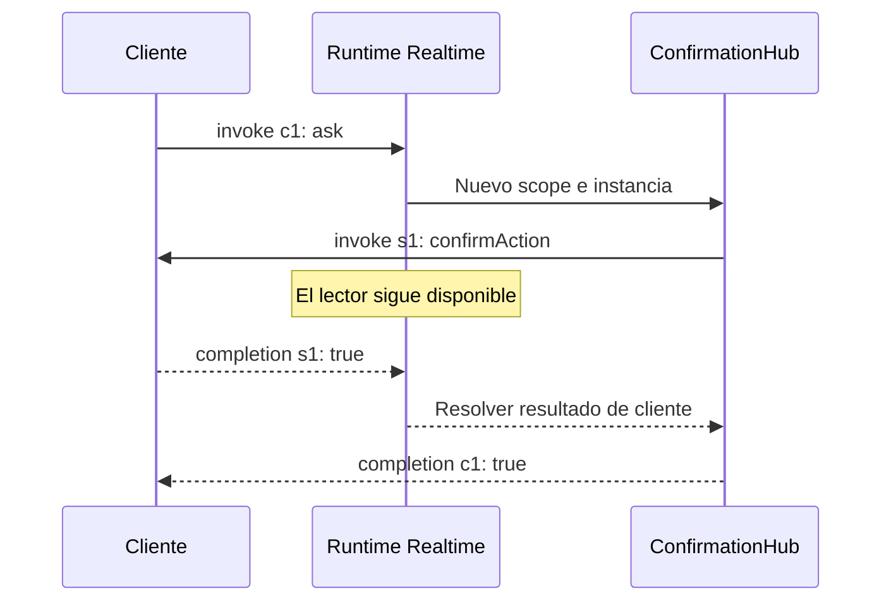

Realtime utiliza el **protocolo Orionis Realtime v1** sobre WebSocket. Abrir el socket no basta: el cliente debe esperar `ready`, usar identificadores para correlacionar operaciones y distinguir eventos, resultados y streams.

El [cliente JavaScript](/es/realtime/javascript-client), publicado en npm como `@orionis-framework/realtime-client`, implementa estos mensajes y administra sus límites, plazos y reconexiones. Esta página explica el protocolo y muestra ejemplos completos de streams y resultados bidireccionales.

## Mensajes del protocolo

En JSON cada envelope es un objeto enviado como texto. La alternativa `protocol="msgpack"` usa los mismos campos, codificados en MessagePack binario; el navegador necesitaría un codec MessagePack compatible. `JSON.parse` no sirve para esa ruta.

| Mensaje | Dirección y propósito |
|---|---|
| `ready` | Servidor → cliente: `version: 1` y `connection_id`. Habilita invocaciones. |
| `invoke` | Cliente → servidor: `id`, `target`, `args`, `kwargs` y `timeout` opcional. Servidor → un cliente: solicita un resultado con `id`, `target` y `args`. |
| `completion` | Resultado escalar o error con el mismo `id`. También responde a una invocación del servidor. |
| `send` | Servidor → cliente: evento `target` y lista `args`, sin resultado esperado. |
| `stream_item` | Servidor → cliente: `id` e `item` de una invocación que produce una secuencia. |
| `stream_complete` | Servidor → cliente: termina un stream, con `id` y `error` si falló. |
| `cancel` | Cliente → servidor: solicita cancelar la invocación activa identificada por `id`. |
| `ping` / `pong` | Mensajes de aplicación sin `id`; un `ping` de cliente recibe `pong`. |

Una llamada escalar completa:

```json
{"type":"invoke","id":"call-1","target":"sum","args":[2,3],"kwargs":{},"timeout":10}
```

```json
{"type":"completion","id":"call-1","result":5}
```

Un error en lugar del resultado:

```json
{"type":"completion","id":"call-1","error":{"code":"validation_error","message":"Invocation failed"}}
```

`args` y `kwargs` son opcionales en un `invoke` y predeterminan listas/diccionarios vacíos. `timeout` omitido o `null` utiliza la política del runtime. Una `completion` enviada por el cliente debe contener **exactamente uno** de `result` o `error`; `result: null` es válido.

Los envelopes de entrada rechazan campos desconocidos. Los IDs deben tener entre 1 y 128 caracteres ASCII imprimibles sin espacios. Hay un máximo de 64 argumentos posicionales y 64 argumentos por nombre. Un ID no puede reutilizarse mientras su llamada siga activa; usa uno nuevo por operación.

## Invocar desde el paquete npm

Instala el paquete en tu frontend:

```bash
npm install @orionis-framework/realtime-client
```

Los ejemplos JavaScript de esta página son módulos de navegador procesados por un bundler que resuelve el import de npm. Si utilizas HTML con `<script type="module">` sin bundler, sigue [Servir el módulo desde Orionis](/es/realtime/javascript-client#servir-el-módulo-desde-orionis) y sustituye únicamente el origen del import por `"/assets/orionis-realtime.js"`.

Conecta al `MathHub` del capítulo [Hubs](/es/realtime/hubs-and-methods):

```javascript
import { RealtimeClient } from "@orionis-framework/realtime-client";

const url = new URL("/realtime/math", location.href);
url.protocol = location.protocol === "https:" ? "wss:" : "ws:";
const client = new RealtimeClient(url);

try {
    await client.connect();
    console.log(await client.invoke("sum", [2, 3])); // 5
} catch (error) {
    console.error(error.code, error.message);
} finally {
    await client.dispose();
}
```

`args` contiene únicamente datos de la llamada, sin servicios inyectados. Para argumentos por nombre utiliza `kwargs`, por ejemplo `client.invoke("search", ["Orionis"], { kwargs: { limit: 5 } })` sobre el `SearchHub` del capítulo anterior. Los eventos se registran con `client.on("message", ([message]) => { ... })`: el callback recibe la lista de argumentos.

## Streams: progreso de una operación

Un método que devuelve un iterable asíncrono produce `stream_item` y termina con `stream_complete`, en lugar de devolver una lista completa en `completion`. Guarda `app/realtime/feed_hub.py`:

```python
import asyncio
from collections.abc import AsyncIterator
from orionis.realtime import Hub, remote
from orionis.realtime.errors import RPCError


class FeedHub(Hub):

    __slots__ = ()

    @remote
    async def updates(self, count: int) -> AsyncIterator[int]:
        if not 1 <= count <= 100:
            raise RPCError("invalid_count", "Count must be between 1 and 100")
        for value in range(count):
            await asyncio.sleep(0.5)
            yield value
```

Registra la ruta en `routes/websocket.py`:

```python
from app.realtime.feed_hub import FeedHub
from orionis.support.facades import Route

Route.hub("/realtime/feed", FeedHub)
```

Con el paquete instalado en el frontend, este cliente recibe tres elementos:

```javascript
import { RealtimeClient } from "@orionis-framework/realtime-client";

const url = new URL("/realtime/feed", location.href);
url.protocol = location.protocol === "https:" ? "wss:" : "ws:";
const client = new RealtimeClient(url);

try {
    await client.connect();
    for await (const item of client.stream("updates", [3], { timeoutMs: 10000 })) {
        console.log("Progress:", item);
    }
    console.log("Stream finished");
} catch (error) {
    console.error(error.code, error.message);
} finally {
    await client.dispose();
}
```

El servidor entrega `0`, `1` y `2`, cada uno con el ID de la llamada, y luego `stream_complete`. `timeoutMs` limita la vida total del iterador en el cliente. El servidor no asigna un plazo predeterminado a los streams; para solicitar uno utiliza `serverTimeout` en segundos, dentro del límite `REALTIME_INVOCATION_TIMEOUT`.

La producción espera la escritura de cada elemento antes de avanzar. Si el generador abre recursos, ciérralos en `finally`: Orionis solicita `aclose()` cuando existe y libera el scope antes de enviar la terminación. Cancelación, validación y errores de negocio terminan un stream declarado con `stream_complete.error`.

### Cancelar una secuencia

Con `FeedHub`, un `AbortSignal` cancela la operación después de 1,2 segundos:

```javascript
import { RealtimeClient } from "@orionis-framework/realtime-client";

const url = new URL("/realtime/feed", location.href);
url.protocol = location.protocol === "https:" ? "wss:" : "ws:";
const client = new RealtimeClient(url);
const controller = new AbortController();
let cancellationTimer;

try {
    await client.connect();
    cancellationTimer = setTimeout(() => controller.abort(), 1200);
    const stream = client.stream("updates", [100], {
        signal: controller.signal,
        timeoutMs: 0,
    });
    for await (const item of stream) console.log(item);
} catch (error) {
    console.log(error.code); // aborted for a local AbortSignal cancellation
} finally {
    clearTimeout(cancellationTimer);
    await client.dispose();
}
```

El cliente rechaza localmente con `aborted` al cancelar. También puedes usar `stream.cancel()` o salir de `for await` con `break`, que llama a `return()`. Si el servidor rechaza la admisión del stream antes de ejecutarlo, puede responder con `completion.error`; el cliente también reconoce ese caso.

`cancel` solo actúa sobre una operación todavía activa de esa conexión. Un ID desconocido se ignora; cancelar no revierte efectos ya realizados. La cancelación cooperativa intenta enviar una terminación con código `cancelled` si la conexión sigue abierta.

## Invocar un método del navegador

Para solicitar una decisión del cliente, guarda `app/realtime/confirmation_hub.py`:

```python
from orionis.realtime import Hub, remote


class ConfirmationHub(Hub):

    __slots__ = ()

    @remote
    async def ask(self) -> object:
        return await self.clients.caller.invoke(
            "confirmAction",
            {"question": "Do you want to continue?"},
            timeout=5.0,
        )
```

Registra `Route.hub("/realtime/confirmation", ConfirmationHub)`. En el navegador:

```javascript
import { RealtimeClient } from "@orionis-framework/realtime-client";

const url = new URL("/realtime/confirmation", location.href);
url.protocol = location.protocol === "https:" ? "wss:" : "ws:";
const client = new RealtimeClient(url);
client.handle("confirmAction", ([{ question }], { signal }) => {
    if (signal.aborted) return false;
    return window.confirm(question);
});

try {
    await client.connect();
    console.log("Confirmed:", await client.invoke("ask"));
} catch (error) {
    console.error(error.code, error.message);
} finally {
    await client.dispose();
}
```

El handler recibe los argumentos como una lista y un contexto con `signal` y `connectionId`. El cliente limita su concurrencia y plazo. La cancelación es cooperativa: un diálogo síncrono bloqueante no puede ser interrumpido por el timer; para interacciones largas utiliza una interfaz asíncrona que respete `signal`.

El método `ask` permanece esperando mientras el lector del servidor sigue recibiendo mensajes. El navegador responde al `invoke` del servidor con una `completion` correlacionada y el resultado llega después a la llamada original.



Solo `self.clients.caller` y `self.clients.client(id)` permiten `invoke`. El timeout incluye envío y espera de resultado; predetermina `REALTIME_CLIENT_RESULT_TIMEOUT`. El límite de resultados pendientes se aplica por conexión.

Un error devuelto por el navegador se convierte en `ClientInvocationError` con código `client_error` y mensaje saneado, sin propagar texto arbitrario del cliente a diagnósticos. Como hereda de `RPCError`, si no lo gestionas en el método del hub, la llamada original termina con `client_error` y el mensaje público `"Invocation failed"`. Las completions desconocidas, tardías o duplicadas se ignoran.

## Errores y plazos

| Código | Situación |
|---|---|
| `method_not_found` | `target` no corresponde a un método `@remote`. |
| `invalid_arguments` | Argumentos ausentes, repetidos, desconocidos o plazo superior al permitido. |
| `validation_error` | Tipos, restricciones o reglas del schema inválidos. |
| `busy` | Se alcanzó la capacidad de invocaciones concurrentes de la conexión. |
| `unauthorized` | El método lanzó `AuthenticationException`. |
| `forbidden` | El método lanzó `AuthorizationException`. |
| `timeout` | La ejecución excedió su plazo. |
| `cancelled` | Se canceló la invocación activa. |
| `client_error` | Un método del navegador respondió con error y el hub no lo gestionó. |
| `internal_error` | Excepción inesperada o resultado que no pudo serializarse. |
| Código de `RPCError` | Rechazo deliberado definido por la aplicación. |

Los códigos distintos de `internal_error` reciben el mensaje `"Invocation failed"`; `internal_error` recibe `"Internal server error"`. Incluso el mensaje personalizado de `RPCError` se sustituye. Traduce los códigos a explicaciones de interfaz propias.

Las llamadas ordinarias usan `REALTIME_INVOCATION_TIMEOUT` si no se solicita otro plazo. Un `timeout` explícito debe ser finito, positivo y no superar ese valor. El plazo gobierna la operación; la entrega terminal ocurre tras la limpieza y no constituye un límite total de latencia de red.

No se generan páginas HTML ni respuestas HTTP 422 dentro del protocolo. Un fallo de invocación puede terminar una llamada manteniendo la conexión; un envelope mal formado es un fallo de la conexión.

## Cierre, heartbeat y codecs

| Condición | Cierre solicitado por Realtime |
|---|---|
| Envelope inválido o ID activo repetido | `1002`: error de protocolo. |
| Texto en ruta MessagePack o bytes en ruta JSON | `1003`: tipo de mensaje incompatible. |
| Tamaño entrante superior al límite | `1009`: mensaje demasiado grande. |
| Fallo no recuperable de conexión | `1011` cuando el transporte permite detalles. |

Los detalles de cierre dependen del adaptador: RSGI no expone todas las capacidades de ASGI y puede utilizar `1000`. Consulta [WebSocket](/es/realtime/websocket).

Puedes enviar `{"type":"ping"}` y procesar `{"type":"pong"}`. Son mensajes de aplicación; no crean una tarea automática de heartbeat ni garantizan persistencia. El cliente JavaScript administra ese timer y su plazo de respuesta; el runtime no inicia por sí mismo un heartbeat periódico. Los pings del transporte WebSocket son un mecanismo distinto.

Al reconectar debes esperar otro `ready`, reconstruir la selección de salas y reconciliar el estado de negocio. Usa [grupos y despliegue](/es/realtime/groups-and-deployment) para configurar límites y entender el alcance por worker.
