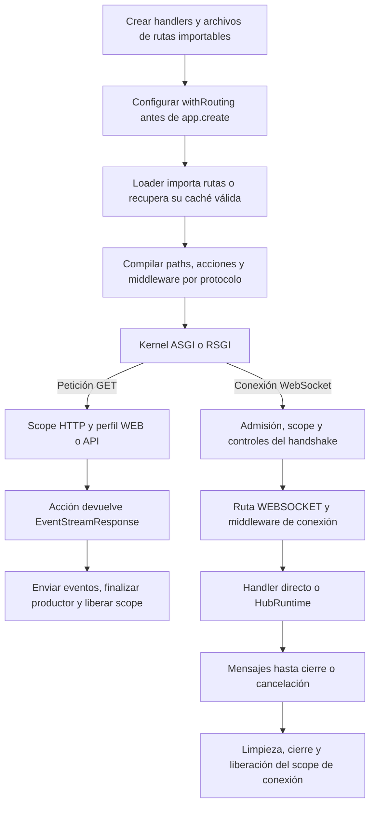

Una URL identifica un endpoint, pero el registro determina el intercambio. `Route.websocket()` recibe una conexión de mensajes, `Route.hub()` la entrega al runtime Realtime y `Route.get()` puede devolver una respuesta SSE.

Este capítulo crea tres endpoints pequeños para comprobar el registro completo. Después puedes continuar con el [chat con salas](/es/realtime/chat), el [handler WebSocket](/es/realtime/websocket) o el [progreso mediante SSE](/es/realtime/streaming-and-sse).

## Generar sockets y hubs con el CLI

Desde la raíz del proyecto, ejecuta el generador del componente que necesites:

```bash
python -B reactor make:realtime-socket chat
python -B reactor make:realtime-hub chat
```

Sus equivalentes mediante el comando directo son:

```bash
orionis make:realtime-socket chat
orionis make:realtime-hub chat
```

Son alternativas para crear cada componente; no necesitas ejecutar ambas formas del mismo comando.

| Generador | Resultado predeterminado para `chat` |
| --- | --- |
| `make:realtime-socket` | Clase `ChatSocket` en `app/realtime/sockets/chat_socket.py`. |
| `make:realtime-hub` | Clase `ChatHub` en `app/realtime/hubs/chat_hub.py`. |

Ambos reciben un único argumento obligatorio, `name`, sin valor predeterminado. `-h` o `--help` muestra la ayuda. No hay opciones propias para forzar la sobrescritura o cambiar el directorio desde el comando: el destino utiliza las rutas configuradas `app_realtime_sockets` y `app_realtime_hubs`.

El socket generado es una clase invocable cuyo `__call__()` acepta la conexión, recibe texto y lo devuelve. El hub hereda de `Hub` y contiene un método `@remote echo(message: str) -> str`. Elegir el nombre `chat` no añade salas, historial ni difusión; el [chat completo](/es/realtime/chat) desarrolla esa lógica sobre el hub generado.

### Nombres y archivos existentes

| Nombre | Comportamiento |
| --- | --- |
| `chat` | Añade el sufijo `Socket` o `Hub` a la clase y `_socket` o `_hub` al archivo. |
| `chat_socket.py` o `chat_hub.py` | Reconoce el sufijo correspondiente y no lo duplica; el archivo generado mantiene la extensión `.py`. |
| `rooms/chat` | Crea un subdirectorio `rooms` dentro del destino del generador. También admite separadores de Windows. |
| `ChatSocket` o `ChatHub` | Conserva esos nombres de clase, pero genera `chatsocket.py` o `chathub.py`: no separa CamelCase en palabras. |

Los segmentos admiten letras ASCII, dígitos y guiones bajos, comenzando por una letra. Los directorios se convierten a minúsculas; los guiones bajos separan las palabras del nombre de clase. No se admiten rutas absolutas, segmentos vacíos, `.` ni `..`.

El generador crea los directorios necesarios. Si el archivo de destino ya existe, muestra un error y conserva su contenido. No registra rutas, modifica `bootstrap/app.py` ni inicia el servidor: después debes añadir `Route.websocket(...)` o `Route.hub(...)` y registrar el archivo correspondiente.

Las guías de [WebSocket](/es/realtime/websocket#generar-un-socket-con-el-cli) y [hubs](/es/realtime/hubs-and-methods#generar-un-hub-con-el-cli) muestran las plantillas y su registro.

## Preparar los archivos

Desde la raíz de tu proyecto, crea los archivos de aplicación indicados y conserva los que ya existan:

```text
app/
├── http/controllers/live_demo_controller.py
└── realtime/
    └── status_hub.py
routes/
├── api.py
├── web.py
└── websocket.py
bootstrap/app.py
```

Los handlers deben pertenecer a módulos importables: el router conserva sus referencias para compilarlas y recuperarlas desde caché. Evita lambdas o funciones locales como acciones registradas.

### Controlador para WebSocket y SSE

Guarda `app/http/controllers/live_demo_controller.py`:

```python
import asyncio
import json
from collections.abc import AsyncIterator

from orionis.http import (
    EventStreamResponse,
    ServerSentEvent,
    WebSocket,
    WebSocketDisconnected,
    response,
)
from orionis.http.base import BaseController


class LiveDemoController(BaseController):
    async def socket(self, socket: WebSocket, channel: str) -> None:
        await socket.accept()
        try:
            while True:
                message = await socket.receiveText()
                await socket.sendText(f"{channel}: {message}")
        except WebSocketDisconnected:
            return
        finally:
            await socket.close()

    async def progress(self, job_id: int) -> EventStreamResponse:
        async def events() -> AsyncIterator[ServerSentEvent]:
            for step in range(1, 4):
                await asyncio.sleep(1)
                yield ServerSentEvent(
                    data=json.dumps({"job_id": job_id, "step": step}),
                    event="progress",
                    id=str(step),
                )

            yield ServerSentEvent(data="{}", event="done")

        return response.eventStream(events())
```

`socket()` conserva la conexión hasta terminar su lectura y devuelve `None`. `progress()` devuelve una respuesta cuyo generador se consume durante la entrega; las pausas no bloquean el event loop. El progreso es una simulación por petición, no una cola de trabajos ni un registro persistente.

### Hub de consulta

Guarda `app/realtime/status_hub.py`:

```python
from orionis.realtime import Hub, remote


class StatusHub(Hub):
    @remote
    async def where(self) -> dict[str, str]:
        channel = self.context.socket.routeParams()["channel"]
        return {
            "channel": channel,
            "connection_id": self.context.connection_id,
        }
```

El cliente puede invocar `where` cuando reciba `ready`. `channel` procede de la URL de la conexión; no es un argumento que deba repetirse en el mensaje RPC.

## Registrar las rutas

Importa siempre la fachada desde `orionis.support.facades`. En `routes/websocket.py`, añade:

```python
from app.http.controllers.live_demo_controller import LiveDemoController
from app.realtime.status_hub import StatusHub
from orionis.support.facades import Route

Route.group(
    prefix="/live",
    routes=[
        Route.websocket(
            "/socket/{channel:slug}",
            [LiveDemoController, "socket"],
        ).name("live.socket"),
        Route.hub(
            "/hubs/{channel:slug}",
            StatusHub,
        ).name("live.hub"),
    ],
)
```

El grupo aplica el prefijo a ambos registros. Las URLs son `/live/socket/lobby` y `/live/hubs/lobby`; el nombre del archivo no añade `/websocket`.

En `routes/api.py`, añade:

```python
from app.http.controllers.live_demo_controller import LiveDemoController
from orionis.support.facades import Route

Route.get(
    "/live/jobs/{job_id:int}/events",
    [LiveDemoController, "progress"],
).name("live.progress")
```

La URL SSE es `/live/jobs/12/events`. El archivo API tampoco incorpora automáticamente `/api`. Añade un prefijo mediante `Route.group(prefix="/api", ...)` si deseas incluirlo.

`routes/web.py` puede seguir conteniendo las páginas de tu aplicación. Si necesitas crearlo, comienza con `from orionis.support.facades import Route` y añade sus registros. La página HTML del [chat](/es/realtime/chat) muestra un uso completo.

## Configurar la carga en bootstrap/app.py

Modifica la llamada **existente** a `app.withRouting(...)`, antes de `app.create()`. Este fragmento muestra los tres archivos del recorrido:

```python
app.withRouting(
    api="routes/api.py",
    web="routes/web.py",
    websocket="routes/websocket.py",
    # Keep existing console, ai and health entries here.
)
```

Conserva los demás argumentos de tu bootstrap, incluidos `console`, `ai` y `health` cuando estén configurados. Una segunda llamada a `withRouting()` reemplaza la configuración de archivos: no añade entradas a la llamada anterior.

Los archivos registrados deben existir. Para declarar rutas, importa `Route` desde `orionis.support.facades`. Crear una clase o un archivo sin registrar su archivo de rutas no publica el endpoint.

`websocket` también admite una lista. Para separar conexiones y hubs, prepara:

```python
websocket_files = [
    "routes/websocket.py",
    "routes/realtime.py",
]
```

Usa `websocket=websocket_files` dentro de la misma llamada. Crea ambos archivos antes del arranque y evita registrar la misma ruta dos veces.

### Flujo asociado al registro

| Registro | Pipeline |
| --- | --- |
| HTTP en `routes/web.py` | Perfil WEB: sesión, CSRF y contexto de autenticación de sesión, además del pipeline HTTP y middleware de aplicación/ruta. |
| HTTP en `routes/api.py` | Perfil API sin sesión WEB; resuelve el contexto de autenticación de token y ejecuta el pipeline HTTP. |
| `Route.websocket` o `Route.hub` | Controles compartidos del handshake, admisión/origen y middleware WebSocket explícito. |

Los perfiles nativos no exigen por sí solos una identidad para cada endpoint. Aplica las restricciones de acceso de tu aplicación.

Un archivo es una unidad de carga. El protocolo proviene del registro: una ruta WebSocket sigue siendo WebSocket aunque se declare en un archivo WEB registrado. El archivo `websocket` dedicado mantiene clara su organización.

## Parámetros: URL, mensaje e invocación

Los tres flujos admiten los mismos convertidores de path:

| Convertidor | Ejemplo | Valor resuelto |
| --- | --- | --- |
| `str`, implícito | `/live/{channel}` o `/live/{channel:str}` | Un segmento no vacío sin `/`; entrega `str`. |
| `slug` | `/live/{channel:slug}` | Letras minúsculas ASCII, dígitos y guiones; entrega `str`. |
| `int` | `/jobs/{job_id:int}` | Dígitos sin signo; entrega `int`. |
| `uuid` | `/rooms/{room_id:uuid}` | UUID hexadecimal con guiones; entrega `uuid.UUID`. |

Un path incompatible no llega al handler de esa ruta. Los nombres de parámetros de una acción HTTP o WebSocket deben coincidir con los del registro: el kernel pasa `job_id` o `channel` al invocarla mediante el contenedor.

| Dato | Acceso |
| --- | --- |
| Path de WebSocket | Parámetro nombrado de la acción o `socket.routeParams()`. |
| Path de un Hub | `self.context.socket.routeParams()`; no se agrega a cada firma remota. |
| Path de SSE | Parámetro nombrado del controlador HTTP; también está disponible en su `Request`. |
| Mensaje WebSocket | Lectura explícita con `receiveText()`, `receiveBytes()` o `receiveJson()`. |
| Argumentos Realtime | Campos `args` y `kwargs` de `invoke`, validados contra el método remoto. |

Inyectar `WebSocket` en una acción y validar un mensaje son operaciones distintas. No declares un schema esperando que el kernel lo rellene automáticamente con el siguiente mensaje del socket; la [guía WebSocket](/es/realtime/websocket) muestra la validación explícita.

Los grupos admiten prefijos y grupos internos. Utiliza clases `WebSocketMiddleware` en conexiones y hubs, y `BaseMiddleware` en HTTP/SSE. El compilador rechaza un middleware de protocolo incompatible. Los ejemplos completos de [socket](/es/realtime/websocket) y [rutas HTTP](/es/http/routing) desarrollan esta composición.

## De los archivos a la ejecución



Los rechazos pueden terminar el recorrido antes de la acción. En WebSocket se resuelven durante el handshake o cerrando la conexión; no generan la página HTML de excepciones del HTTP ordinario.

Un `Hub` también tiene scopes de invocación. No guardes estado de usuario en atributos del Hub esperando reutilizar la instancia; consulta su [ciclo de vida](/es/realtime/hubs-and-methods). Una respuesta SSE mantiene el scope HTTP durante su entrega y limpieza, no solo durante el método del controlador.

## Iniciar y comprobar

Desde la raíz del proyecto puedes utilizar cualquiera de estas alternativas:

```bash
orionis serve
```

```bash
uv run python -B reactor serve
```

El CLI selecciona RSGI por defecto; `--interface asgi` selecciona ASGI. Usa la URL mostrada en consola; los ejemplos siguientes suponen `http://localhost:8000`.

Revisa los registros con cualquiera de estas formas:

```bash
orionis route:list
```

```bash
python -B reactor route:list
```

La tabla debe incluir `WEBSOCKET /live/socket/{channel:slug}`, `WEBSOCKET /live/hubs/{channel:slug}` y `GET /live/jobs/{job_id:int}/events`. `WEBSOCKET` es una clave interna de despacho, no un verbo que debas enviar con `fetch`.

### Comprobar SSE

Desde una terminal:

```bash
curl -N "http://localhost:8000/live/jobs/12/events"
```

Recibirás tres eventos `progress` con `job_id` igual a `12` y `step` de `1` a `3`, seguidos de `done`. El flujo termina después. El [cliente EventSource](/es/realtime/streaming-and-sse) cierra su suscripción al recibir ese evento.

### Comprobar WebSocket

Desde la consola de una página de la misma aplicación:

```javascript
const scheme = location.protocol === "https:" ? "wss:" : "ws:";
const socket = new WebSocket(
    scheme + "//" + location.host + "/live/socket/lobby"
);

socket.addEventListener("open", () => socket.send("Hello"));
socket.addEventListener("message", (event) => {
    console.log(event.data); // lobby: Hello
    socket.close();
});
socket.addEventListener("error", () => {
    console.error("The WebSocket connection failed.");
});
```

### Comprobar el Hub

En la misma consola, con una conexión distinta:

```javascript
const hubScheme = location.protocol === "https:" ? "wss:" : "ws:";
const hubSocket = new WebSocket(
    hubScheme + "//" + location.host + "/live/hubs/lobby"
);

hubSocket.addEventListener("message", (event) => {
    const message = JSON.parse(event.data);

    if (message.type === "ready") {
        hubSocket.send(JSON.stringify({
            type: "invoke",
            id: "where-1",
            target: "where",
            args: [],
            kwargs: {},
        }));
    } else if (message.type === "completion" && message.id === "where-1") {
        console.log(message.result ?? message.error);
        hubSocket.close();
    }
});
hubSocket.addEventListener("error", () => {
    console.error("The Realtime connection failed.");
});
```

El resultado contiene `channel: "lobby"` y el ID de conexión generado. El método utiliza el path y no recibe `channel` en `args`. El [cliente completo](/es/realtime/protocol-and-streaming) añade gestión de operaciones pendientes y desconexión.

## Reinicio y diagnóstico

Si modificas rutas o configuración, aplica el cambio al proceso activo. Con un bootstrap compilado, ten en cuenta su invalidación configurada; si procede, limpia cachés con `orionis optimize:clear` o `python -B reactor optimize:clear` y reinicia el servidor.

Si un endpoint no aparece, comprueba su archivo en `withRouting`, su importación de la fachada y `route:list`. Si un WebSocket se rechaza, revisa además origen, capacidad y middleware de socket. Una ruta GET con el mismo path no reemplaza el registro de conexión.

Para comprobar el chat en dos pestañas, sigue su [comando de un solo worker](/es/realtime/chat). El CLI `serve` utiliza un worker en Windows y varios según CPU en Unix; el manager Realtime predeterminado no comparte conexiones entre esos procesos.
