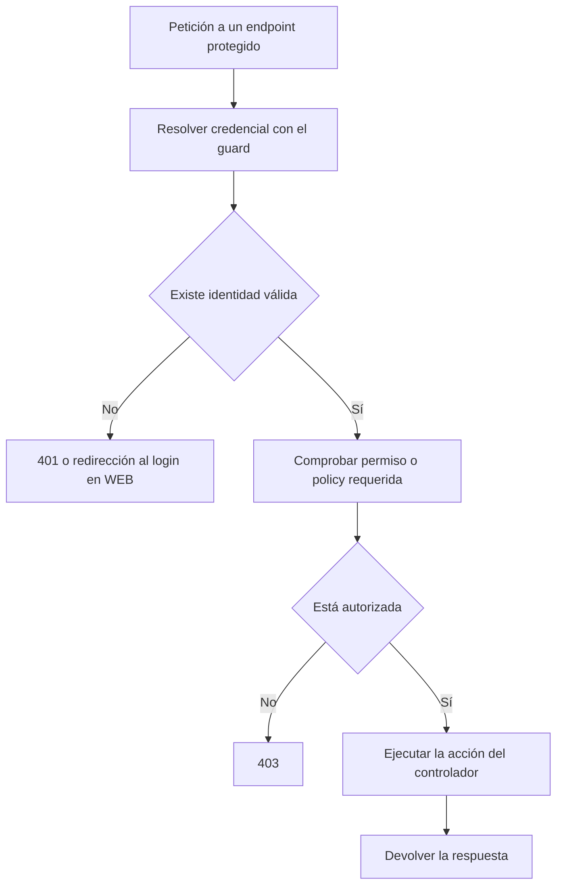

Orionis separa la **autenticación**, que identifica al usuario de una petición, de la **autorización**, que decide si puede realizar una operación. Un usuario puede haber iniciado sesión y aun así no tener permiso para publicar, administrar cuentas o modificar un recurso ajeno.

La fachada `Auth` y los contratos del contenedor permiten acceder a ambos mecanismos desde controladores y servicios. La identidad pertenece al contexto de la petición; los servicios compartidos consultan ese contexto cuando se utilizan.

## Qué forma de autenticación elegir

| Necesidad | Mecanismo nativo | Primera guía |
| --- | --- | --- |
| Iniciar sesión desde un navegador y enviar formularios | Guard `session`, sesión HTTP y CSRF. | [Autenticación con sesiones](/es/security/authentication/identity-and-session) |
| Llamar a una API desde una aplicación o integración | Guard `token` y credencial personal enviada como Bearer. | [Autenticación con tokens](/es/security/authentication/personal-access-tokens) |
| Recuperar una cuenta o confirmar su correo | Broker de contraseñas y rutas de registro/verificación. | [Recuperación y verificación](/es/security/authentication/account-recovery) |

«Recordarme» amplía el flujo de login de sesión mediante una credencial persistente opcional. Las abilities de un token limitan su alcance; los roles, permisos y policies determinan la autorización de su propietario.

## Preparar una aplicación

1. Configura el modelo y los campos de `config/auth.py` en [Configuración y guards](/es/security/authentication/configuration-and-guards).
2. Prepara la base de datos y ejecuta las [migraciones del proyecto](/es/database/migrations-and-seeders). Las guías de sesión, tokens y roles indican qué tablas utiliza cada mecanismo.
3. Elige rutas WEB para login de navegador y rutas API para credenciales Bearer.
4. Añade [middleware de acceso](/es/security/authentication/middleware) a las rutas privadas.
5. Asigna [roles y permisos](/es/security/authentication/authorization), o registra [policies](/es/security/authentication/policies) para decisiones sobre recursos.

El modelo habitual es `app.models.user.User`, con los concerns `Authenticatable` y `Authorizable`. La guía de sesiones muestra su definición completa, cómo crear una cuenta y cómo guardar su contraseña mediante la fachada `Hash`.

## Consultar la identidad actual

Importa la fachada desde `orionis.support.facades`. `Auth.check()`, `guest()`, `user()`, `identifier()` y `context()` son operaciones síncronas.

Crea `app/http/controllers/auth_status_controller.py`:

```python
from orionis.http import JSONResponse, response
from orionis.support.facades import Auth


class AuthStatusController:
    async def show(self) -> JSONResponse:
        return response.json({
            "authenticated": Auth.check(),
            "guest": Auth.guest(),
            "identifier": Auth.identifier(),
            "guard": Auth.context().guard,
        })
```

En `routes/api.py`, registrado en la configuración de rutas de la aplicación:

```python
from app.http.controllers.auth_status_controller import AuthStatusController
from orionis.support.facades import Route

Route.get("/authentication/status", [AuthStatusController, "show"])
```

Como invitado, `GET /authentication/status` devuelve:

```json
{
  "authenticated": false,
  "guest": true,
  "identifier": null,
  "guard": "token"
}
```

Esta ruta permite invitados para mostrar el estado. En API, un token válido permite resolver al propietario; una cookie de sesión pertenece al flujo WEB. Para exigir token antes de ejecutar la acción, añade `AuthenticateTokenMiddleware` como se muestra en la [guía de middleware](/es/security/authentication/middleware).

`Auth.user()` devuelve el modelo autenticado o `None`. Expón únicamente los datos que la respuesta necesita. Para declarar la dependencia explícitamente, inyecta `IAuthManager` desde `orionis.auth.contracts.manager`; la guía de sesiones incluye ejemplos por constructor y por método.

Las operaciones que realizan trabajo asíncrono sí se esperan, por ejemplo `await Auth.attempt(credentials)`, `await Auth.logout()`, `await Auth.can("reports.read")` y `await Auth.authorizeResource("update", resource)`. Cada guía identifica la firma correspondiente.

## Autenticación y autorización en una ruta protegida



Un **rol** agrupa permisos, por ejemplo `editor`. Un **permiso** expresa una capacidad como `reports.read`. Una **policy** evalúa una habilidad sobre una clase o un registro concreto, por ejemplo si el usuario es propietario de un documento.

La autenticación no concede permisos automáticamente. Una capacidad declarada en un token tampoco crea privilegios: cuando la credencial tiene abilities limitadas, el acceso debe cumplir tanto los permisos del usuario como los límites de esa credencial.

## Recorrido de la documentación

- [Configuración y guards](/es/security/authentication/configuration-and-guards): las opciones de `config/auth.py` y cómo se selecciona el mecanismo.
- [Autenticación con sesiones](/es/security/authentication/identity-and-session): modelo, creación de cuentas, formularios, login, logout y «recordarme».
- [Autenticación con tokens](/es/security/authentication/personal-access-tokens): emitir, utilizar, consultar y revocar credenciales personales.
- [Middleware de acceso](/es/security/authentication/middleware): resolver identidad, exigir autenticación y restringir rutas o grupos.
- [Roles y permisos](/es/security/authentication/authorization): crear, asignar, comprobar, actualizar y revocar acceso.
- [Policies de recursos](/es/security/authentication/policies): registrar reglas y autorizar operaciones sobre objetos concretos.
- [Recuperación y verificación](/es/security/authentication/account-recovery): restablecimiento de contraseña y correo de verificación.

Las [sesiones HTTP](/es/http/sessions), el [hashing de contraseñas](/es/security/hashing) y el [cifrado](/es/security/encryption) tienen categorías propias en el menú. La documentación de [respuestas](/es/http/responses) y [excepciones HTTP](/es/http/exceptions) explica la presentación de resultados y errores de estos flujos.
