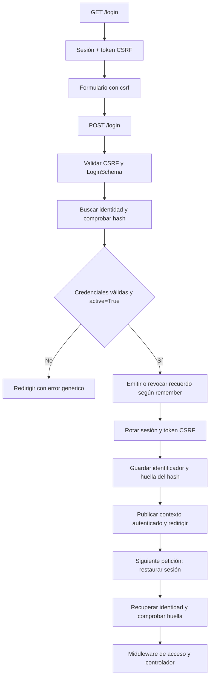

La autenticación con sesiones está orientada a aplicaciones web en las que el navegador conserva una cookie de sesión. El guard `session` recupera la identidad del almacenamiento del servidor y la publica durante la petición; la cookie de sesión no contiene el modelo del usuario ni su contraseña.

Esta guía utiliza la configuración predeterminada de `config/auth.py`. Consulta [configuración y guards](/es/security/authentication/configuration-and-guards) si cambias el modelo, el campo de acceso o los destinos de redirección.

## Preparar la identidad y la contraseña

El modelo configurado en `auth.identity.model` debe implementar `IAuthenticatable`. En un modelo ORM se consigue con el mixin `Authenticatable`, que obtiene la clave primaria desde los metadatos del modelo y el hash desde `AUTH_PASSWORD`, cuyo valor predeterminado es `"password"`.

La aplicación de referencia ya organiza la tabla en `database/schemas/users_v1.py` y el modelo en `app/models/user.py`:

```python
from typing import ClassVar

from database.schemas.users_v1 import USERS_V1
from orionis.auth import Authenticatable, Authorizable, MustVerifyEmail
from orionis.orm import Model
from orionis.orm.schema.table import TableDefinition


class User(Model, Authenticatable, Authorizable, MustVerifyEmail):
    table_definition: TableDefinition = USERS_V1

    casts: ClassVar[dict[str, str]] = {
        "active": "bool",
        "email_verified_at": "datetime",
    }
    hidden: ClassVar[list[str]] = ["password", "remember_token"]
    fillable: ClassVar[list[str]] = ["name", "email", "password", "active"]
```

Adapta el modelo existente; no necesitas crear un segundo usuario. La tabla y su migración deben existir en la conexión de base de datos configurada. Los campos relevantes para este flujo son:

| Campo | Uso |
| --- | --- |
| Clave primaria, normalmente `id` | Identificador persistido en la sesión. Se admiten claves enteras, UUID y de texto. |
| `email` | Campo de búsqueda predeterminado; se cambia con `auth.identity.username`. |
| `password` | Hash de la contraseña. El nombre se puede cambiar mediante `User.AUTH_PASSWORD`. La clave enviada a `attempt()` sigue siendo `"password"`. |
| `active` | `attempt()` y la restauración del acceso persistente exigen el booleano `True`. El cast del ejemplo es relevante si el driver entrega valores numéricos. |
| `remember_token` | Columna nullable utilizada al activar el inicio persistente; el esquema de referencia reserva 100 caracteres. |

`Authorizable` añade las operaciones de roles, permisos y tokens; `MustVerifyEmail` añade el comportamiento de verificación de correo. Ninguno sustituye a `Authenticatable`. Consulta [autorización](/es/security/authentication/authorization) y [registro y recuperación](/es/security/authentication/account-recovery).

El proveedor de identidad busca únicamente por el campo de usuario configurado y comprueba la contraseña mediante el servicio de hashing. Añadir `{"active": True}` u otros filtros a las credenciales no añade condiciones a la consulta.

Al crear una cuenta, guarda el resultado de `await Hash.make(...)`. Por ejemplo, en `app/services/account_creator.py`:

```python
from app.models.user import User
from orionis.support.facades import Hash


class AccountCreator:
    async def create(self, name: str, email: str, password: str) -> User:
        return await User.create({
            "name": name,
            "email": email,
            "password": await Hash.make(password),
            "active": True,
        })
```

Este servicio presupone datos ya validados y no implementa el registro ni la verificación de correo completos. El modelo no hashea automáticamente la contraseña al asignarla. Consulta [almacenamiento de contraseñas](/es/security/hashing/password-storage) para configurar el algoritmo y su coste.

## Crear un formulario y un controlador de acceso

El siguiente ejemplo implementa sus propias rutas. Si tu `routes/web.py` ya llama a `Route.auth()`, utiliza la [alternativa integrada](#utilizar-las-rutas-integradas) o sustituye esas definiciones antes de copiarlo, para no duplicar `/login` y `/logout`.

### Validar las credenciales

Crea `app/http/schemas/auth/login.py`:

```python
from orionis.schemas import Schema
from orionis.schemas.constraints import Email, MinLength
from orionis.schemas.fields import Field, Nullable


class LoginSchema(Schema):
    email: Field[str, Email()]
    password: Field[str, MinLength(8)]
    remember: Nullable[str] = None
```

El kernel valida el payload e inyecta `LoginSchema` en la acción. Un checkbox HTML marcado envía `"on"`; uno sin marcar no envía el campo. Por eso el ejemplo compara explícitamente el valor y no convierte cualquier cadena a `bool`. Consulta [validación](/es/validation).

### Procesar login, área privada y logout

Crea `app/http/controllers/auth/session_controller.py`:

```python
from app.http.schemas.auth.login import LoginSchema
from orionis.http import HttpResponse, response
from orionis.http.base import BaseController
from orionis.support.facades import Auth, View


class SessionController(BaseController):
    async def loginForm(self) -> HttpResponse:
        return await View.make("auth.login")

    async def login(self, payload: LoginSchema) -> HttpResponse:
        authenticated = await Auth.attempt(
            {"email": payload.email, "password": payload.password},
            remember=payload.remember == "on",
        )
        if not authenticated:
            return (
                response.redirect("/login", 303)
                .withInput({"email": payload.email})
                .withErrors({"email": "These credentials do not match our records."})
            )
        return response.redirect("/home", 303)

    async def home(self) -> HttpResponse:
        return await View.make("auth.home", user=Auth.user())

    async def logout(self) -> HttpResponse:
        await Auth.logout()
        return response.redirect("/login", 303)
```

`Auth.attempt()` devuelve `bool`, no el usuario. Cuando devuelve `True`, `Auth.user()` y `Auth.identifier()` ya reflejan la identidad en esa misma petición. El error del ejemplo es idéntico para usuario inexistente, contraseña incorrecta o cuenta inactiva. Solo se conserva el email para volver a rellenar el formulario.

### Registrar las rutas web

En `routes/web.py`:

```python
from app.http.controllers.auth.session_controller import SessionController
from orionis.auth.middleware import AuthenticateSessionMiddleware, GuestMiddleware
from orionis.support.facades import Route


Route.group(middleware=GuestMiddleware, routes=[
    Route.get("/login", [SessionController, "loginForm"]).name("login"),
    Route.post("/login", [SessionController, "login"]),
])

Route.group(middleware=AuthenticateSessionMiddleware, routes=[
    Route.get("/home", [SessionController, "home"]).name("home"),
    Route.post("/logout", [SessionController, "logout"]).name("logout"),
])
```

El pipeline web ya inicia la sesión, comprueba CSRF y resuelve la identidad. `GuestMiddleware` reserva el formulario para invitados. `AuthenticateSessionMiddleware` exige autenticación antes de ejecutar las acciones privadas; resolver una identidad por sí solo permite invitados. El logout es una operación POST protegida con CSRF.

### Crear las vistas

Guarda el formulario en `resources/views/auth/login.html`:

```jinja
<!doctype html>
<html lang="en">
<head>
    <meta charset="utf-8">
    <title>Sign in</title>
</head>
<body>
    <h1>Sign in</h1>
    
        <p role="alert">{{ errors.first("email") }}</p>
    
    <form method="post" action="/login">
        
        <label>
            Email
            <input type="email" name="email" value="{{ old('email', '') }}"
                   autocomplete="username" required>
        </label>
        <label>
            Password
            <input type="password" name="password" minlength="8"
                   autocomplete="current-password" required>
        </label>
        <label>
            <input type="checkbox" name="remember">
            Remember me
        </label>
        <button type="submit">Sign in</button>
    </form>
</body>
</html>
```

Y el área privada en `resources/views/auth/home.html`:

```jinja
<!doctype html>
<html lang="en">
<head>
    <meta charset="utf-8">
    <title>Account</title>
</head>
<body>
    <h1>Hello, {{ user.name }}</h1>
    <p>Account identifier: {{ auth().identifier() }}</p>
    <form method="post" action="/logout">
        
        <button type="submit">Sign out</button>
    </form>
</body>
</html>
```

Abre `/login`, introduce una cuenta persistida con contraseña hasheada y confirma el formulario. Tras el éxito, la redirección GET a `/home` utiliza la nueva cookie de sesión y renderiza un nuevo token CSRF. Si envías peticiones JavaScript a estas rutas, conserva las cookies y presenta ese token en `X-CSRF-Token` o en un campo `_csrf`; el token anterior al login deja de ser válido.

Los helpers `auth()`, `old()` y `errors` y la etiqueta `` están incluidos en el motor de vistas. Consulta [globals de vistas](/es/services/views/globals) para sus variantes.

## Qué realiza el guard de sesión

`SessionGuard` implementa `ISessionGuard` y utiliza la sesión adjunta a `request.state.session`. No crea un almacenamiento de autenticación independiente.



En el login se rota el identificador de sesión, se guarda la clave del usuario y una huella del hash de su contraseña, y se genera un nuevo token CSRF. En la siguiente petición el guard vuelve a consultar la identidad y compara esa huella; si el usuario ya no existe o cambió su hash, elimina los datos de autenticación e intenta restaurar un recuerdo válido, si existe.

El estado `active` se comprueba al validar credenciales y al restaurar un recuerdo. La resolución de una sesión ya autenticada comprueba la identidad y la huella; no añade otra comprobación de `active`. Si tu aplicación requiere bloquear de inmediato sesiones existentes por un estado de negocio, aplica también esa condición mediante un [middleware de acceso](/es/security/authentication/middleware).

## Inicio persistente: remember me

`remember=True` permite recuperar la autenticación cuando la sesión ya no contiene un identificador. Es una credencial distinta de la cookie normal de sesión y solo se emite tras verificar la contraseña con `attempt()`.

La configuración está en `auth.remember` dentro de `config/auth.py`:

| Opción | Valor predeterminado | Efecto |
| --- | --- | --- |
| `cookie` | `"orionis_remember"` | Nombre de la cookie persistente; debe diferir de la cookie de sesión. |
| `lifetime` | `43200` minutos | Plazo del recuerdo, equivalente a 30 días. |
| `secure` | `True` | Exige HTTPS para emitir y restaurar el recuerdo. |

Con la configuración predeterminada puedes probar un login normal sobre HTTP local **sin marcar** “Remember me”. Si marcas la opción, debes usar HTTPS. Para probar exclusivamente en un entorno local HTTP puedes establecer `AUTH_REMEMBER_SECURE=bool:false` en su archivo de entorno; consulta [configuración](/es/security/authentication/configuration-and-guards). No confundas esta opción con `SESSION_SECURE`, que configura la otra cookie.

El comportamiento real es:

1. Después de comprobar credenciales y `active`, el componente de inicio persistente genera un secreto aleatorio y almacena su digest en `remember_token`, vinculado al usuario, al vencimiento y al hash de la contraseña.
2. El navegador recibe una cookie host-only, `HttpOnly`, `SameSite=Lax`, con path `/` y `Max-Age` según el tiempo configurado.
3. Sin identidad de sesión, el guard valida la cookie y el digest, rota el secreto y crea una nueva sesión autenticada. La rotación conserva el vencimiento original: navegar no prolonga indefinidamente los 30 días.
4. Un nuevo login con `remember=True` sustituye el recuerdo anterior del usuario. Solo hay un digest por identidad; no es un registro independiente por dispositivo.
5. Un login correcto con `remember=False` revoca el recuerdo almacenado y expira su cookie. `logout()` también revoca el recuerdo y elimina la cookie.
6. Cambiar el hash de contraseña invalida el recuerdo anterior, porque el digest está ligado a ese hash.

El proveedor debe poder actualizar `remember_token`; una columna ausente o un fallo de persistencia impide emitir el recuerdo y produce `AuthException`. No leas ni construyas la cookie manualmente.

## Leer la identidad y utilizar inyección de dependencias

La fachada se importa siempre desde `orionis.support.facades`. Estas lecturas son síncronas:

| Llamada | Resultado |
| --- | --- |
| `Auth.user()` | `IAuthenticatable` de la petición o `None`. |
| `Auth.identifier()` | Clave primaria de la identidad o `None`. |
| `Auth.check()` | `True` si la petición está autenticada. |
| `Auth.guest()` | `True` si es una petición invitada. |
| `Auth.context()` | Contexto de autenticación actual. |

El nombre de la API es `identifier()`; no existe un alias `Auth.id()`. La identidad puede leerse desde cualquier componente ejecutado en el scope de la petición. No conserves el usuario de una petición en una variable global o en un servicio compartido.

La alternativa a la fachada es inyectar `IAuthManager`. También puedes recibir `IAuthenticationContext` para consultar la identidad resuelta de esa petición. Por ejemplo, crea `app/http/controllers/session_status_controller.py`:

```python
from orionis.auth.contracts import IAuthenticationContext, IAuthManager
from orionis.http import JSONResponse, response
from orionis.http.base import BaseController


class SessionStatusController(BaseController):
    def __init__(self, auth: IAuthManager) -> None:
        self.auth = auth

    async def show(self, context: IAuthenticationContext) -> JSONResponse:
        return response.json({
            "authenticated": self.auth.check(),
            "identifier": self.auth.identifier(),
            "guard": context.guard,
        })
```

Registra la acción en `routes/web.py`:

```python
from app.http.controllers.session_status_controller import SessionStatusController
from orionis.auth.middleware import AuthenticateSessionMiddleware
from orionis.support.facades import Route


Route.get("/account/session", [SessionStatusController, "show"]).middleware(
    AuthenticateSessionMiddleware,
)
```

El constructor recibe el manager y la acción recibe el contexto mediante sus anotaciones. Ambos consultan la misma petición; no hay que construirlos ni pasar `Request` manualmente. Las operaciones `await auth.attempt(...)`, `await auth.login(identity)` y `await auth.logout()` tienen el mismo contrato que sus equivalentes en `Auth`.

## Login de una identidad previamente verificada y logout

`await Auth.login(identity)` inicia una sesión para una identidad ya persistida que tu aplicación verificó por otro flujo confiable. **No comprueba contraseña ni `active` y no emite un recuerdo**; no lo uses con un identificador recibido del cliente sin verificarlo.

A diferencia del método síncrono de bajo nivel `SessionGuard.login(request, identity)`, el método público del manager es asíncrono: coordina la operación y publica inmediatamente el nuevo contexto.

`await Auth.logout()` revoca el recuerdo, elimina identificador y huella, invalida la sesión y convierte el contexto actual en invitado. El middleware web aplica la eliminación de las cookies a la respuesta. Para este flujo no basta con borrar una variable, eliminar la cookie en JavaScript o redirigir a `/login`.

`attempt()`, `login()` y `logout()` del manager siempre operan con el guard de sesión, incluso si `auth.default` es `"token"`. Necesitan una petición HTTP activa; el login además necesita la sesión del pipeline web. Para clientes API utiliza [tokens de acceso](/es/security/authentication/personal-access-tokens).

## Utilizar las rutas integradas

Si prefieres las pantallas y los controladores incluidos, registra una sola vez en `routes/web.py`:

```python
from orionis.support.facades import Route


Route.auth()
```

Este helper añade login/logout, registro, verificación de correo y recuperación de contraseña. No protege automáticamente tus otras páginas: aplica `AuthenticateSessionMiddleware` donde corresponda.

Puedes personalizar el controlador de acceso mediante `Route.auth(login_controller=LoginController)`; debe proporcionar las acciones `index`, `login` y `logout` que utiliza el helper. El ejemplo manual de esta página usa `loginForm` y por eso no se pasa directamente como sustituto.

Consulta el [catálogo de rutas y pantallas integradas](/es/security/authentication/account-recovery) y los [middlewares de autenticación](/es/security/authentication/middleware).
