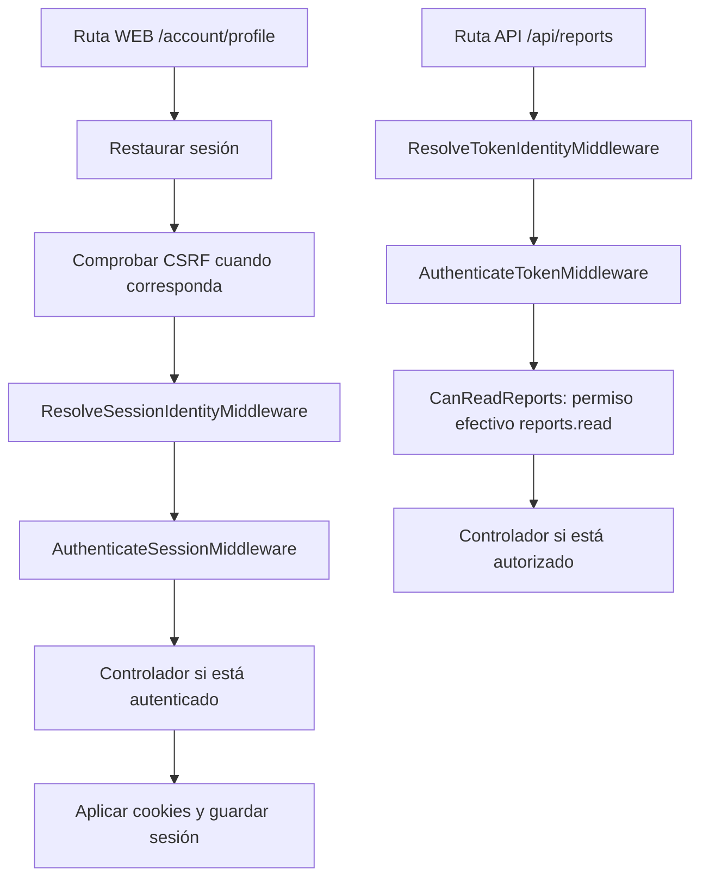

Los middleware de autenticación resuelven o exigen una identidad. Los de autorización comprueban si esa identidad puede realizar una operación. Se aplican antes del controlador y pueden terminar la petición con una redirección o una respuesta de error.

Importa las clases desde `orionis.auth.middleware` y registra clases, no instancias parametrizadas. La guía general de [middleware HTTP](/es/http/middleware-and-security) explica su creación, registro global y encadenamiento; esta página se concentra en los componentes de autenticación.

## Resolver identidad y exigir autenticación

En las rutas WEB normales, el kernel ejecuta `StartSessionMiddleware`, `CSRFTokenMiddleware` y `ResolveSessionIdentityMiddleware`. En API utiliza `ResolveTokenIdentityMiddleware`. Resolver identidad permite continuar a un invitado: una ruta no se vuelve privada por estar en `routes/web.py` o `routes/api.py`.

| Middleware | Qué hace |
| --- | --- |
| `ResolveIdentityMiddleware` | Usa el guard ya seleccionado o el predeterminado y continúa con identidad o invitado. |
| `ResolveSessionIdentityMiddleware` | Resuelve sesión y credencial «recordarme»; permite invitados. El kernel lo añade a WEB. |
| `ResolveTokenIdentityMiddleware` | Resuelve el token Bearer; permite invitados. El kernel lo añade a API. |
| `AuthenticateMiddleware` | Exige identidad reutilizando el guard del contexto o el predeterminado. |
| `AuthenticateSessionMiddleware` | Exige identidad del guard `session`. |
| `AuthenticateTokenMiddleware` | Exige identidad del guard `token`. |
| `GuestMiddleware` | Deja continuar a invitados de sesión y restringe las páginas de login/registro a ellos. |

No necesitas repetir los resolvers que el kernel ya aporta. Utiliza los middleware `Authenticate*` en las rutas privadas y `GuestMiddleware` en páginas que solo deben recibir invitados.

El contexto de identidad pertenece a la petición. Repetir la resolución con el mismo guard reutiliza ese resultado; una petición ya autenticada no puede sustituirlo por otro guard. Define cada endpoint en el contexto WEB o API adecuado y elige el middleware correspondiente.

## Proteger una ruta de navegador

Crea `app/http/controllers/access_examples_controller.py`. Sus acciones se reutilizarán en los siguientes ejemplos:

```python
from orionis.http import JSONResponse, Response, response
from orionis.support.facades import Auth


class AccessExamplesController:
    async def profile(self) -> JSONResponse:
        return response.json({"user_id": Auth.identifier()})

    async def reports(self) -> JSONResponse:
        return response.json({"reports": ["Monthly report"]})

    async def guest_offer(self) -> Response:
        return response.text("Create an account or sign in.")
```

En `routes/web.py`:

```python
from app.http.controllers.access_examples_controller import AccessExamplesController
from orionis.auth.middleware import AuthenticateSessionMiddleware, GuestMiddleware
from orionis.support.facades import Route

Route.get(
    "/account/profile",
    [AccessExamplesController, "profile"],
).middleware(AuthenticateSessionMiddleware)

Route.get(
    "/guest-offer",
    [AccessExamplesController, "guest_offer"],
).middleware(GuestMiddleware)
```

Con sesión autenticada, `GET /account/profile` devuelve el identificador de esa petición. Un invitado que navega normalmente recibe `302` hacia `auth.session.redirect_to`, configurado como `/login` en el archivo del proyecto. Un cliente que pide JSON o envía una petición AJAX recibe `401`. Si `redirect_to` es `None`, el navegador también recibe `401`.

`GuestMiddleware` permite consultar `/guest-offer` como invitado. Para un usuario autenticado de navegador redirige a `auth.session.home`; para JSON/AJAX produce `403`. Una subclase puede establecer `redirect_to` para utilizar un destino propio.

Los middleware `Authenticate*` aplican `Cache-Control: no-store, private` a las respuestas que devuelven. Su atributo de clase `cache_control` permite cambiar ese encabezado, o usar `None` para omitir su aplicación.

## Exigir un token y un permiso en un grupo

Crea `app/http/middleware/can_read_reports.py`:

```python
from typing import ClassVar

from orionis.auth.middleware import RequirePermissionMiddleware


class CanReadReports(RequirePermissionMiddleware):
    permissions: ClassVar[tuple[str, ...]] = ("reports.read",)
    requires_all: ClassVar[bool] = True
```

Registra el grupo en `routes/api.py`:

```python
from app.http.controllers.access_examples_controller import AccessExamplesController
from app.http.middleware.can_read_reports import CanReadReports
from orionis.auth.middleware import AuthenticateTokenMiddleware
from orionis.support.facades import Route

Route.group(
    prefix="/api",
    middleware=[AuthenticateTokenMiddleware, CanReadReports],
    routes=[
        Route.get("/reports", [AccessExamplesController, "reports"]),
    ],
)
```

El orden expresa dos requisitos: `AuthenticateTokenMiddleware` exige una credencial válida y `CanReadReports` exige `reports.read`. Solo entonces se ejecuta `AccessExamplesController.reports`. La identidad debe tener ese permiso y un token limitado debe incluirlo entre sus abilities.

Un invitado recibe `401`. Una identidad válida sin el permiso efectivo recibe `403`. Declarar `reports.read` en un token no concede ese permiso a su propietario. La [guía de roles y permisos](/es/security/authentication/authorization) muestra cómo crearlo, asignarlo y revocarlo.

El mismo middleware puede asociarse a una ruta individual mediante `.middleware(AuthenticateTokenMiddleware, CanReadReports)`. Los grupos evitan repetir la lista en cada endpoint. Consulta [rutas](/es/http/routing) para grupos y herencia de middleware.

## Permisos, roles y policies

| Middleware | Configuración de una subclase |
| --- | --- |
| `RequirePermissionMiddleware` | `permissions`: tupla no vacía; `requires_all=True` exige todos y `False` admite cualquiera. |
| `RequireRoleMiddleware` | `roles`: tupla no vacía; `requires_all=False` admite cualquiera y `True` exige todos. |
| `RequirePolicyMiddleware` | `ability`: nombre de habilidad; `resource`: clase del recurso registrado en una policy. |

Estas clases comprueban el contexto actual; no reemplazan el guard. Declara sus requisitos en clases importables, como `CanReadReports`. No se usan aliases como `"auth:token"` ni objetos construidos con parámetros en el archivo de rutas.

Para restringir una zona WEB al rol editorial, crea `app/http/middleware/editors_only.py`:

```python
from typing import ClassVar

from orionis.auth.middleware import RequireRoleMiddleware


class EditorsOnly(RequireRoleMiddleware):
    roles: ClassVar[tuple[str, ...]] = ("editor",)
    requires_all: ClassVar[bool] = False
```

Adjunta `EditorsOnly` después de `AuthenticateSessionMiddleware` a la ruta o grupo que lo necesite. Crear esta clase no asigna el rol: esa operación se realiza con `PermissionRegistrar`, descrito en [roles y permisos](/es/security/authentication/authorization).

Para tokens con abilities limitadas, exige una capacidad concreta mediante permisos o policies: `RequireRoleMiddleware` rechaza esas credenciales incluso si el usuario pertenece al rol. Una membresía no debe ampliar el alcance de una credencial limitada.

`RequirePolicyMiddleware` evalúa una habilidad sobre la **clase** de recurso, apropiada para `create` o `viewAny`. Cuando debes comprobar un registro concreto, cárgalo en el controlador y utiliza `await Auth.authorizeResource(...)`. La [guía de policies](/es/security/authentication/policies) incluye registro, ejemplos de ambos casos e inyección de dependencias.

## Orden de los ejemplos protegidos



Las comprobaciones pueden detener el flujo antes del controlador. Para los errores HTTP, consulta [excepciones HTTP](/es/http/exceptions). Para respuestas, cabeceras y sesiones, utiliza sus guías correspondientes; la autenticación añade los requisitos de acceso a ese flujo.
